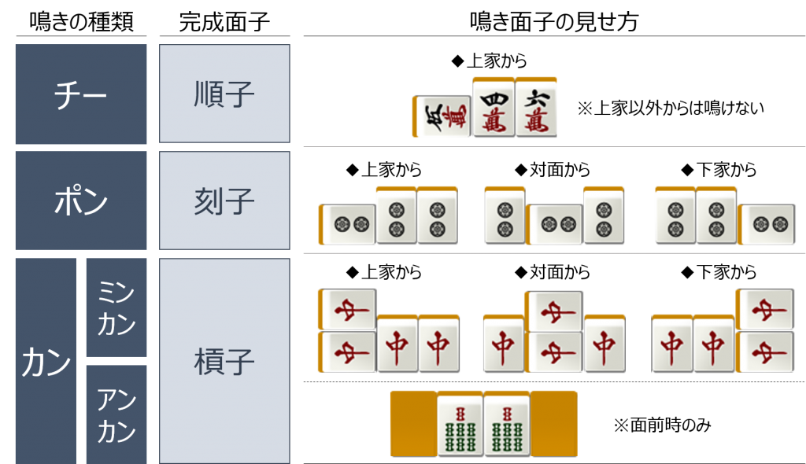
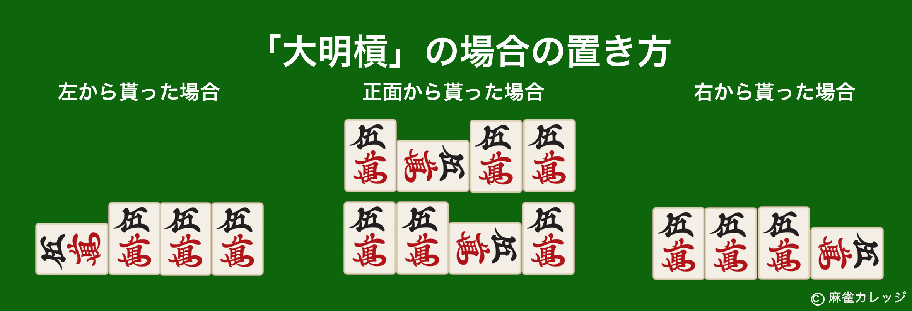
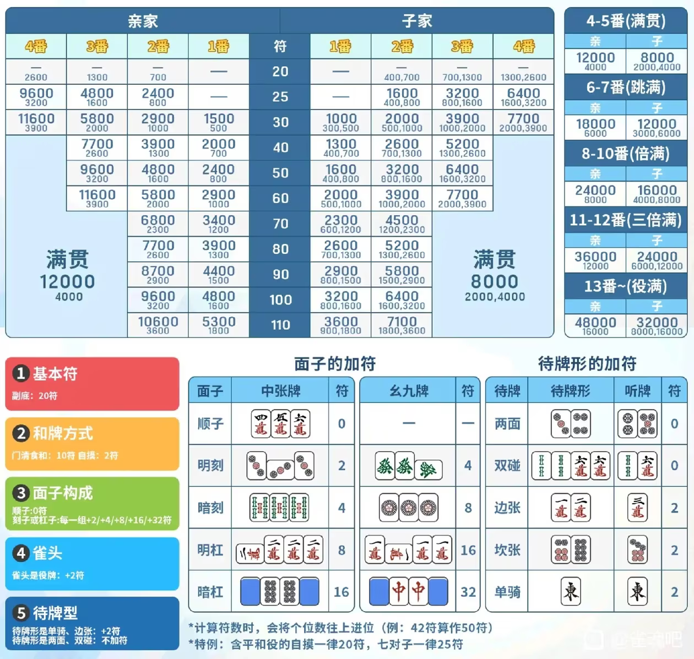

# 雀魂

## 规则

### 麻将入门

#### 麻将牌介绍

麻将共有1-9万（日语为マンズ/简写为m），1-9饼（日语为ピンズ/简写为p），1-9索（日语为ソウズ/简写为s），东南西北白发中（简写为1-7z），每一种各4张，共136张牌。为方便表示，下文统一使用上述简写。例如，2万、5万、6万、两张8饼、东、南、中，记作256m88p127z。

#### 摸打顺序

麻将由4名玩家分别坐在桌子的四个方向上进行。桌上会有东、南、西、北四个方位的标记，来标记你的自风。坐在“东”位的玩家是庄家。庄家起手14张并先打出一张牌，其余玩家起手各13张。之后逆时针轮流摸一张、打一张。

#### 基本牌形与和牌条件

3张同花色且数字连续的牌叫顺子，例如123m、456p。字牌（1-7z）不能组成顺子，数牌也不能跨越9和1，例如891、912都不算顺子。3张完全相同的牌叫刻子，2张完全相同的牌叫对子。顺子和刻子统称面子。

通常的和牌形由4个面子和1个对子组成，这个对子称为“雀头”。如果用AAA表示刻子、XYZ表示顺子、NN表示雀头，就可以写成：x组AAA＋(4−x)组XYZ＋NN。凑齐四面子一雀头，就有了基本的和牌形！

如果你的手牌组成了完整的和牌形，并且至少有一个役，你就可以和牌，这局结束。当你的和牌满足某些特定条件时，就会获得对应的“役”。不同的役有不同的番数，一手牌也可以同时满足多个役，番数会累加；大概来说番数越高，得分越高。如果你的牌虽然组成了完整的和牌型，但一个役都没有，就叫“无役”，这种情况下不能和牌。

只差最后一张牌就能和牌的状态称为“听牌”。和牌之前一定会听牌。例如你有11145m456s234p22z，此时摸到3m可以组成345m，摸到6m可以组成456m，因此称为听36m。

#### 荣和、自摸与振听

如果别人打出了你和牌所需要的最后一张牌，你可以“荣和”。打出这张牌的人称为“放铳者”，也可以说是他给你“放铳”了，通常由放铳者独自支付你这次和牌的点数。如果有人进行加杠，而加上的那张牌正好能让你和牌，你可以用这张牌荣和，称为“抢杠”。通常只能抢加杠；部分规则，如雀魂平台允许国士无双（役满之一）抢暗杠。

如果一张牌同时让多人和牌，通常都算和。部分规则采用“头跳”，多人同时荣和时，只有从放铳者起按逆时针方向最先遇到的和牌家可以和牌，其他人的和牌不成立。这名玩家称为“头跳家”。也有规则规定一炮三响直接流局，即不结算，直接结束本局。天凤平台有一炮三响流局。雀魂没有有一炮三响流局。

如果你自己摸到了和牌所需要的最后一张牌，则称为“自摸”，由另外三家共同承担。日本麻将的自摸不像四川麻将那样，不是三家各收一份荣和点数，不等价于三家同时向你放铳。因此，自摸的总收益并不是荣和的三倍；被自摸时也比自己放铳损失更少。

如果你处于“振听”状态中，你不能荣和别人打出的任何牌，只能自摸和牌。

#### 吃、碰、杠

如果对局中上家打出的牌能和你的手牌组成顺子，例如你有12m，上家打3m；或者你有24m，上家打3m，你可以“吃”，拿走这张牌组成顺子，然后打出一张牌。其他玩家打出的牌不能吃。

如果你手里已经有两张相同的牌，而任意一家打出了第三张相同的牌，你可以“碰”，拿走这张牌组成刻子，然后打出一张牌。碰的优先级高于吃，因此同一张牌如果有人要碰，其他人不能吃。

4张完全相同的牌可以形成“杠子”，在和牌结构中算作一个面子。如果你手里有3张相同的牌，别人打出第4张，你可以“大明杠”；如果4张牌全部来自自己手中，可以“暗杠”；如果之前已经碰了一组刻子，后来又自己摸到第4张，可以“加杠”。杠之后要补摸一张牌，然后再打出一张牌。

大明杠和加杠统称明杠，吃、碰、明杠统称鸣牌，又称副露。不可以鸣海底牌，即最后一张能摸到的牌。

吃、碰、杠后，需要把形成的面子公开摆在手牌旁边，并通过横放牌的位置表示拿的是谁打出的牌。副露后，组成面子的那些牌就固定在桌上，不能再拆开打出了。

  
  

吃牌时还要注意“食替”规则。例如你有123m，上家打1m。虽然你可以用23m吃进1m，但吃完后不能立刻打出自己原来那张1m，这叫“现物食替”。“现物”就是别人打过的牌。又例如你有234m，上家打1m，你用23m吃成123m后，很多规则也不允许你立刻打出4m，这类情况称为“筋食替”。“筋”就是数字相差3的同花色牌。这真是一个烦人的规则！

如果之后的例子中有副露，因为我太懒了，就用了“手牌/副露”这个自己擅自规定的简写。比如234789m23p455s碰了东，就写成234789m23p455s/111z。至于暗杠还是明杠、碰的是谁的牌、具体吃了哪张，我就先不管了，需要的时候再用文字明确说吧。

#### 庄家轮换

进入下一局时，如果没有连庄，下一位玩家会成为庄家。大家通常不会交换座位，而是改变东南西北的身份标记。对固定坐在一个位置的玩家来说，自风（即你所在的位置的标记）会按照东→北→西→南→东的顺序变化，也可以理解为桌上的“东家标记”逆时针移动一位。

#### 入门建议

“振听”和“役”是日本麻将相比其他麻将规则最显著、也最容易让初学者头疼的规则，之后会专门进行讲解。不过，如果你以前完全不会打麻将，最先需要熟悉的并不是这两个规则，而是麻将最基本的结构：四面子一雀头，以及吃、碰、杠这些操作。

个人认为，如果只是想先熟悉麻将的基本逻辑，四川麻将会比日本麻将更容易入门，因为它的和牌限制更少。在附录中会介绍[四川麻将的规则](#四川麻将的规则)，先帮助大家建立对麻将的直觉，再回过头学习日本麻将会轻松很多。

### 役

在立直麻将中，仅仅凑齐“四面子一雀头”的基本和牌形是不够的，你还必须至少满足一个“役”的条件才能和牌。也就是说，立直麻将不允许单纯“推倒就和”；如果牌型中没有任何役，就会被判定为“无役”，无法和牌。附录中的[役种表](#役种表)列出了各类役及其详细说明。不过役种数量不少，刚开始接触时很难一下子全部记住。下面先介绍一些常见，也比较好记的役种。

#### 常见役种

- 立直：这是立直麻将最具代表性的役，也是[出现频率最高的役](https://amae-koromo.sapk.ch/statistics/fan-stats)，成立后计1番。立直要求玩家保持门前清，也就是此前没有鸣牌过。
  - 在门前清状态下达到听牌后，可以在打出一张牌时将其横置，作为立直宣言牌。如果立直宣言牌被其他玩家吃、碰或杠走（统称“鸣走”），立直仍然成立。此时，应将自己下一次打出的牌横置；如果这张牌也被鸣走，则继续横置下一张舍牌（“舍牌”即自己打出的牌），直到有一张横置牌留在自己的牌河（“牌河”即面前摆放舍牌的区域）中。如果没有其他玩家荣和这张牌，则立直成立，需要支付1000点立直棒放在桌面中央。
  - 不足1000点无法立直。这1000点会由之后和牌的玩家获得；如果本局流局，则立直棒会保留到之后的牌局作为场供，直到有人和牌为止；若多家和牌，场供及场上的立直棒由头跳家获得。
  - 立直成立后，原则上只能摸切，也就是摸到什么牌就打出什么牌。
  - 立直后不可以鸣牌，不过仍然可以进行暗杠。暗杠有以下要求：
    - 只能用新摸到的牌暗杠。如2345688m789999p，摸到6p不能暗杠。
    - 不能改变自己的待牌。如123456m6667999p，本来听578p。摸到6p之后，如果暗杠，就只听78p了，所以不可以暗杠。
  - 前面提到的门前清是立直麻将中非常重要的概念。许多役只有在门前清状态下才能成立；另一些役即使鸣牌后仍然成立，但会少一番，这种役叫做食下役。
  - 剩余牌大于等于4张时才能立直。
- 役牌：这是立直麻将中非常常见的役，不要求门前清。只要你拥有一组由役牌组成的刻子或杠子，成立后计1番。
  - 役牌包括三元牌白、发、中，以及符合条件的风牌。役牌包括场风牌，即当前场次对应的风牌。例如现在是南2局，那么拥有一组南刻子即可成立役牌。还包括自风牌，即自己座位对应的风牌。例如你当前坐北家，那么北就是你的自风，拥有一组北刻子即可成立役牌。
  - 不是役牌的风牌叫客风牌。
  - 如果同一张风牌同时是场风和自风，则两个役会同时计算，共计2番。例如在东场中，东家的东刻子算2番。同时是场风和自风的风牌叫连风。
  - 部分规则采用“无后付”：如果在听牌时手牌本身还没有确定的役，例如手中有一个役牌对子和另一个普通对子，形成双碰听牌，那么即使最后和到役牌、使役牌刻子成立，也仍然不能和牌，因为这个役是在和牌时才产生的。雀魂有后付，这种情况下如果和到役牌，就会成立“役牌”这一役，可以正常和牌。
- 断幺九：这是比较容易达成的役，通常不要求门前清，成立后计1番。牌型中不能包含任何1万、9万、1筒、9筒、1条、9条，这些牌统称为老头牌；同时也不能包含东、南、西、北、白、发、中这些字牌。老头牌和字牌合称为幺九牌。少数规则要求断幺九必须保持门前清，这种规则称为无食断。
- 门前清自摸和：成立后计1番。保持门前清并自摸即可成立。这个役的价值之一，是让你在没有其他役、又不想立直时，仍有自摸和牌的可能。没错，后面会讲到，有些时候即使没有其他役，你也未必想立直。
- 七对子：成立后计2番，并且必然是门前清。需要由七组不同的对子组成；在立直麻将中，四张相同的牌不能当作两组对子，因此不承认“龙七对”。如果手牌很差，几乎很难凑成正常的“四面子一雀头”，但对子比较多，就可以考虑转做七对子。
- 对对和：面子全部由刻子或杠子组成，不需要门前清，成立后计2番。碰碰碰，爽！不过这个役通常不太推荐去做，之后会讲原因。
- 混一色：只使用一种数牌花色和字牌。门前清时3番，副露后2番。
- 清一色：只使用一种数牌花色，不含字牌。门前清时6番，副露后5番。混一色和清一色都是食下役。
- 国士无双：13种幺九牌各一张，再加上其中任意一种凑成一对。属于役满，分数非常高，但牌型十分特殊。

简单来说，新手不要看到吃、碰、杠按钮亮了就直接点，先想一想，这样副露之后，我还有役吗？不然很容易把自己做成无役，最后不能和牌只能干瞪眼。

一些不被主流规则普遍承认的役，被称为古役，可以理解成“村规役”。

#### 包牌

大三元（白、发、中各有一组刻子或杠子，是役满）和大四喜（东、南、西、北各有一组刻子或杠子，是两倍役满）存在包牌规则。如果对方已经副露了两组三元牌，你又打出第三种三元牌让他碰或大明杠；或者对方已经副露了三组风牌，你又打出第四种风牌让他碰或大明杠，那么你就会成为包牌者。自摸役满时，包牌者需要承担这个役满的全部责任；如果是其他玩家放铳，则包牌者承担这个役满的一半。例如有人和出大四喜+字一色，是三倍役满。若由其他玩家放铳，包牌者需要支付其中大四喜部分的一半：和牌家是亲家为96000÷2＝48000点，和牌家是子家为64000÷2＝32000点。如果是自摸，包牌者则要承担大四喜的全部分数，再加上自己本来需要支付的字一色自摸份额。因此，亲家自摸时需要支付96000+16000＝112000点；子家自摸时，如果自己是子家则支付64000+8000＝72000点，如果自己是亲家则支付64000+16000＝80000点。

所以，看到别人已经副露了两组三元牌或三组风牌时，最后那一种牌千万不要乱打！除非你有比较充分的理由判断他碰不了，例如这张牌已经有两张出现在牌局中（简称为现2），那么他手里就不可能还有两张来碰。巡目特别早，比如前三巡时，风险也相对较低，因为他不太可能起手就同时拿着所有对应的对子。如果打出去正好被他碰了，那就当是成全他了。遇到这种场面，立直也要非常谨慎，因为立直以后摸到什么就得打什么，万一摸到那张致命的三元牌或风牌，会被迫成为包牌者。就算没有包出役满，这种牌也已经非常危险。例如对方已经有两组三元牌时，第三种三元牌就可能直接放铳小三元。小三元本身2番，再加上两个役牌，共4番；如果再叠加很容易与小三元复合的混一色、对对和之类的役，轻松就能达到6番跳满，已经非常严重了！

### 振听

立直麻将最有特点的规则之一就是振听，它是很多新人的噩梦。你可以把振听理解成一种“诅咒”：一旦振听，你就不能荣和，只能自摸。虽然很烦，但振听也能防止你给别人点炮。

#### 振听的类型与解除条件

振听分三种情况：

- 舍张振听：你的听牌里包含自己曾经打过的牌。比如你听3、6万，如果之前打过3万，那么不仅3万不能荣和，6万也不能荣和。没立直的话，可以通过改变听牌解除振听；立直后听牌不能改变，只能认栽，等待自摸和牌。
- 立直振听：立直后，如果放过别人打出的和牌，或者摸到能和的牌却没有自摸，就会进入振听，而且无法解除。
- 同巡振听：也叫临时振听。没立直时，如果别人打出了你听的牌，但你没有荣和，就会暂时振听。直到自己下一次出牌解除。如果别人打出的牌满足自己的和牌型，但是因为无役不能荣和，仍然会进入振听状态。

#### 避免振听的技巧

新手出牌时，可以稍微想一下，这张牌以后会不会变成自己的和牌。例如，135打掉5后，剩下的13又摸到4，不要急着打1留下34，否则以后听25时，会因为打过5而振听。再比如，之前打过9，后来又摸到8，也要谨慎保留；如果最终留下78，听69，就会因为打过9而振听。

不过，振听并不一定代表你技术不好。振听很难完全避免，魂天一样会振听。

### 王牌和宝牌

#### 牌山、王牌与岭上牌

牌山就是麻将开局洗牌后，把牌两张上下叠成一层，再一层层排成墙状的那一整排牌。游戏过程中，大家就是从牌山里依次摸牌。在日麻中，有14张牌不会被摸到。在实体麻将中，这14张牌位于牌山末端的7幢，每幢由上下两张牌组成，统称为“王牌”。

王牌的前两幢是4张岭上牌。开杠后，补摸不是从平时摸牌的位置摸排，而是从王牌中的岭上牌里摸1张。但摸走1张岭上牌后，王牌就会少1张。为了让王牌始终保持14张，正常牌山中的最后一张牌，海底牌，就会被划进王牌里，不能再正常摸到。无论开几次杠，最后始终都会留下14张王牌不能摸到。

#### 宝牌、里宝牌与赤宝牌

王牌中，第3到第7幢的上层牌是宝牌指示牌，用来决定这局的宝牌（日语是Dora）。和牌时每有1张宝牌，就额外加1番，所以大家会更倾向于把宝牌留在手里。正因为如此，宝牌更不容易被打出，而宝牌以及它周围的牌也更容易放铳，打宝牌放铳时也尤其心痛。不过要注意，宝牌不是役。如果手牌没有任何役，还是不能和牌。

开局会先翻开第3幢的宝牌指示牌。例如指示牌是2p，那么3p就是宝牌。数字牌按1-2-…-9-1循环；三元牌按白-发-中-白循环；风牌按东-南-西-北-东循环。

每开杠一次会多翻开一张宝牌指示牌。在雀魂中，每次暗杠都会立即翻开一张新的宝牌指示牌；大明杠和加杠则需要先补摸岭上牌并打出一张牌，确认没有放铳后才会翻开。因此，明杠后如果立即放铳，新增的杠宝牌不会计入点数。如果被抢杠，算作杠牌不成立，不会增加新的宝牌指示牌。

若同一张牌同时被多个宝牌指示牌指中，番数会重复计算。

如果立直后和牌，还可以查看宝牌指示牌下方对应的“里宝牌”指示牌。里宝牌的判定方式与普通宝牌相同，杠宝牌指示牌下方的牌也会作为里宝牌指示牌。里宝牌相当于额外增加了一倍未知的宝牌指示牌，这是立直的一大福利。

5m、5p、5s中各有1张红色的牌，叫“赤宝牌”，记作0m、0p、0s，每张同样加1番。

宝牌指示牌最多只能有5张，所以一局游戏最多只能开杠4次。如果同一名玩家开了4次杠，其他玩家便不能开杠；如果4次杠由多名玩家共同完成，且最后一个杠之后的出牌没有放铳，会触发“四杠散了”流局。

### 点数计算

- 和牌时，每满足一个番种条件，就会获得相应的番数。
- 普通役种仅累计至役满为止，记作累计役满，日语为数え役満；若和牌中包含役满役种，则普通役种不再计入，多个役满役种之间可叠加计算。例如，大四喜+四暗刻是三倍役满，获得役满点数的三倍。
- 牌型、听牌方式等因素还会决定符数。注意对于雀头是连风（同时是场风和自风）的情况，部分规则如天凤和雀魂记作4符，而M.LEAGUE等规则记作2符。
- 亲家（庄家）的得点为子家的1.5倍。

最终得点由番数、符数以及庄闲身份共同决定：
- 基本点 = 符\*2^(番+2)
- 闲家荣和：基本点\*4
- 庄家荣和：基本点\*6
- 闲家自摸：庄家付\*2，闲家各付\*1
- 庄家自摸：三家各付\*2

每笔支付向上取整到100点。

对于同一种和牌形，如果有相互矛盾的分数计算方式，优先采用点数高的计算方式。

基本点上限：
- 满贯：5番（或4番40符及以上），2000点
- 跳满：6-7番，3000点
- 倍满：8-10番，4000点
- 三倍满：11-12番，6000点
- 役满：13番及以上（累计役满），8000点

可根据下表查出对应的和牌得点。

表格中的小字表示自摸时各家需要支付的点数。子家自摸时，小字会以逗号分隔。较大的数字表示亲家需要支付的点数，较小的数字表示其他子家各自需要支付的点数。亲家自摸时，三名子家支付的点数相同。

子家自摸时另外两名子家各支付总得点的1/4，亲家支付1/2。亲家自摸时三名子家各支付相当于子家自摸时总得点的1/2，总和为子家得点的1.5倍。

这个表确实非常复杂，甚至职业玩家在算符时都有可能出错。幸运的是，有了电脑之后，算分已经不再困难。一个比较简便的估算方法是：

| 番数     | 等级  | 点数      |
| ------ | --- | ------- |
| 1番     | —   | 1,000点  |
| 2番     | —   | 2,000点  |
| 3番     | —   | 4,000点  |
| 4–5番   | 满贯  | 8,000点  |
| 6–7番   | 跳满  | 12,000点 |
| 8–10番  | 倍满  | 16,000点 |
| 11–12番 | 三倍满 | 24,000点 |
| 13番及以上 | 役满  | 32,000点 |

亲家的得分是以上的 1.5 倍。

### 流局

流局指的是没有任何人和牌，但这一局仍然结束的情况。

#### 荒牌流局与不听罚符

如果牌山已经摸完，仍然没有人和牌，就称为荒牌流局，这也是最常见的流局。荒牌流局时，未听牌的玩家需要向听牌的玩家支付点数。好消息是，判定听牌时可以处于振听状态，也不需要有役；即使是空听，也仍然算听牌。所谓空听，就是所有和牌张都已经出现，不可能被摸到了。不过，不能通过虚听来获得听牌判定。虚听就是，你手里已经有某种牌的四张，而和牌却要求不存在的第五张相同的牌，这种情况不算听牌。比如，你已经副露四次，其中有一组中刻子，手里还剩一张中，需要不存在的第五张中才能和牌，因此不算听牌。

荒牌流局时，听牌与未听牌玩家之间转移的点数总额固定为3000点：
- 1人听牌、3人未听牌：3名未听牌玩家各支付1000点给听牌玩家。
- 2人听牌、2人未听牌：2名未听牌玩家各支付1500点。
- 3人听牌、1人未听牌：未听牌玩家需向其余听牌玩家每人支付1000点，共支付3000点。
- 4人全部听牌，或全部未听牌：不发生点数支付。

未听牌的玩家只需要支付“不听罚符”。和四川麻将的“查大叫”相比，这里的损失就温和多了。

另外还有一个彩蛋役：如果荒牌流局时，一名玩家从头到尾打出的牌全部都是幺九牌，而且这些牌一次都没有被别人鸣过，就可以达成流局满贯，等价于自摸8000点。

#### 途中流局

除了荒牌流局之外，还有一些特殊情况会让牌局立即结束，这类情况称为途中流局:

- 九种九牌：在自己的第一次摸牌后，如果手牌中含有至少9种不同的幺九牌（注意不只是9张），并且此前没有任何玩家鸣牌，可以选择宣布流局，也可以不流局。
- 四风连打：在没有任何人吃、碰、杠的情况下，第一巡中四名玩家打出的第一张牌全部是同一种风牌时，立即流局。
- 四杠散了：同一局中，如果由两名或以上玩家累计进行了四次杠，且最后一次杠没有岭上开花、之后的出牌也没有放铳，会触发流局。如果第四次杠被抢杠，按照和牌处理。 
- 四家立直：四名玩家全部宣布立直，并且最后一名玩家的立直宣言牌没有造成放铳时，牌局流局。

### 局间规则和PT计算

#### 巡目

一局麻将可以按照巡目，也就是你已经打出了几张牌，大致分成三个阶段：1-6巡称为序盘，7-12巡称为中盘，13巡以后称为末盘。雀魂的牌河正好也是6张一行，因此看牌河时非常方便。第一行是序盘，第二行是中盘，第三行以后是末盘。

#### 连庄、本场与场次

一整场麻将的第一局叫做东一局，场风为东。如果庄家和牌，或者荒牌流局时庄家处于听牌状态，又或者发生九种九牌等途中流局，庄家都会继续连庄。此时局数不变，本场数加一，例如依次进入东一局一本场、东一局二本场，其他局也是同理。

每增加1本场，荣和时由放铳者多付300点；自摸时其他三家各多付100点。若多人同时荣和，仅头跳家获得本场加点。本场加点与亲家、子家无关。

反之，如果只有子家和牌且庄家未和牌，或者荒牌流局时庄家未听牌，庄家就会下庄，庄位会按照东、南、西、北的顺序轮到下一家，牌局会依次进入东二局、东三局、东四局。子家和牌时，本场数清零；荒牌流局时，无论庄家是否连庄，本场数都会加一。东一局至东四局合称为东场。

东场结束后进入南场，此时需要把场风标示调整为“南”。之后的牌局依次称为南一局、南二局、南三局、南四局。

#### 对局形式与结束条件

常见的对局形式主要有：
- 东风战：只打东场，也就是东一局到东四局。雀魂线上对局采用5+20秒的思考时间：每次操作有5秒，另有20秒共用的备用时间；备用时间耗尽后，每次就只剩5秒；一场对局约20分钟。
- 半庄战：打东场和南场。一场对局约40分钟。

每位玩家开局时都有25000点，也就是所谓的“原点”。

在雀魂中，如果东风战的东四局，或者半庄战的南四局结束后，没有任何一名玩家达到30000点，对局不会立刻结束，而是继续进入下一场。东风战会进入南场，半庄战则会进入西场，这种情况分别称为南入和西入。南入或西入之后，只要某一局结束时有玩家达到或超30000点，对局就会结束；但此时若存在庄家连庄且当前庄家不是一位的情况时，连庄优先；庄家为一位，超过30000点且满足要求可以连庄时，不再连庄，结束游戏；如果始终无人达到30000点，则最多进行到南四局或西四局。此时由第一位获得全部场供。

有击飞规则。有玩家点数为负数时立即结束游戏，有玩家为0点时继续游戏。

#### 顺位、马点与PT结算

游戏结束后，会根据玩家的最终位次和得分计算PT，用于段位升降、比赛评分等。

四麻中，各位次的马点分别为1位+15、2位+5、三位-5、4位-15。游戏结束时，若玩家点数相同，则按东一局的座位顺序决定名次，东家优先，其次为南家、西家、北家。

然后计算精算点数=(最终得分-25000)÷1000+马点。

在雀魂中，最终获得的PT计算公式为roundup(精算点数)+ 段位分。roundup表示向上取整。段位分由对局房间等级、最终顺位和玩家段位决定，属于雀魂内的特有规则，此处不作介绍。

## 上卷

### 序言

了解完规则之后，我们便要正式开始学习麻将的技术了。短期来看，运气确实是决定胜负的主要因素；但把时间拉长，技术水平一定会反映在数据上。

有人看到一手牌会说：“这一手再摸几张万子，就能做成混一色了。”这和“这一手之后只要再摸3张发、3张中、3张白，就是大三元了”本质上又有多大区别？初学者尤其要避免只盯着最理想的情况做牌。麻将并不会按照你脑海里预设的剧本发牌。日本麻将里有一种说法叫“絵合わせ麻雀”（拼图麻将）就是只按照心中的最好剧本来打麻将。初学阶段，最需要避免的正是这种打法。

本部分的框架参考了《魔女博客——初心の入门书》，也结合了其他博主的讲解，具体参考资料见附录。

#### 阅读前的准备与建议

建议至少先熟悉麻将最基本的和牌结构，以及吃、碰、杠等基本操作。完全没有麻将基础的读者，可以先打几局四川血战到底麻将来建立直觉。虽然四川麻将与日本麻将在战术上有很大差异，但基本的牌型结构和吃碰杠规则是相通的。具体规则可参见[四川麻将的规则](#四川麻将的规则)。

也建议先随便打几局日本麻将，争取做到：
- 理解什么是振听、什么是役，不会在对局中经常无役振听。
- 熟悉[上文所述](#役)的常见役种。

虽然不要求读者完全记住前面介绍的所有规则和役种，但上卷将不再重复解释这些内容。如果阅读时遇到不熟悉的规则或役种，请自行查阅[规则](#规则)或附录[役种表](#役种表)。

阅读时建议做笔记。遇到不理解的地方，不要死记硬背，先自己推演一下为什么作者会这样说。如果因为作者编排不够妥当，不小心提前提到了尚未讲解的概念，可以先记下来，暂时放下，阅读完再回头看。如果发现了作者忘记解释的术语，可以去上网搜索或着询问AI。

认真阅读优秀的教材，胜过自己瞎打一辈子。如果能够熟练掌握这一章的战术，实际上已经算是中级玩家了。这些技术并不是认真看完就能立刻掌握的，需要通过大量实战不断积累熟练度。

### 牌效率 - 孤张

#### 孤张与牌效率

所谓牌效率，就是让自己和牌更快、打点更高的技巧。

打麻将时，每打掉一张牌，其实都意味着放弃了这张牌未来可能的发展。我们打牌时要保留潜力大的牌，舍弃潜力小的牌。

一开始，比如我们摸到了1255m257p378s1366z。这时候手牌还比较凌乱，我们应该先打什么呢？可以先把手牌拆开来看。12m摸到3m就能组成面子，55m是对子；2p是一张孤张，57p摸到6p就能组成面子；3s是一张孤张，78s摸到6s、9s都能组成面子；1z、3z都是孤张，66z则是对子，之后还能碰成役牌刻子。你会发现，2p、3s、1z、3z现在都比较孤立，还需要摸到更多合适的牌才能派上用场，所以它们的价值比其他牌低，应该优先打出。

#### 孤张的舍牌顺序

对于孤张，推荐按照这个顺序打出：
1. 客风牌：只能形成对子和刻子，发展潜力最低，最优先打出。
2. 1、9数牌：除了形成对子和刻子，还可能未来变成12、13。12只有摸到3才能形成面子，13只有摸到2才能形成面子。9的情况和1一样，只是方向相反。之后遇到这种对称的情况，我们都只讲其中一边。
3. 役牌：和客风一样，只能形成对子和刻子。但是役牌一旦碰成刻子，就会有役，之后可以更自由地吃碰，而不用担心无役。所以虽然它的发展潜力不如1、9数牌，但还是更值得保留。
4. 28数牌：以2为例，可以变成12、23、24。12只有摸到3才能形成面子，24只有摸到3才能形成面子，而23摸到1或者4都能形成面子，所以2比1有更多的发展方向。8同理。
5. 连风牌：凑成刻子能有2番。参考[ネマタ的战术文章](https://mj-news.net/column/method/2016022735904)。
6. 3-7数牌：以3为例，可以变成13、23、34、35。13只有摸到2才能形成面子，35只有摸到4才能形成面子，而23摸到1或者4，34摸到2或者5都能形成面子，因此3-7的发展潜力最大。

对于客风来说，出牌顺序影响不是很大。不过真要细究，可以考虑两种策略：
- 首先是比较常见的推荐顺序。自己想尽快做牌时，先打下家的自风，再打对家的自风，最后打上家的自风。原因在于，三家如果要碰自己的自风，你最希望的是上家来碰。因为你打出一张牌后，上家一碰完，你就会多一次摸牌的机会，对自己推进手牌最有利。所以，如果上家的自风最后打出，在你打出它之前，上家已经比另外两家多经历了一些摸牌机会，比其他家更有可能把自己的自风摸成对子，从而碰牌。
- 如果有特别想压制的玩家，可以考虑优先打他的自风。比如你现在排名第三，但和第四名的点差很小，你希望他不要通过和牌反超你，你最需要防范的自然就是第四名。你优先打出他的自风，对方在此之前经历的摸牌次数就会比别家少，也就更不容易已经把自风摸成对子，他就更难碰自风，更难做牌。

#### 孤张价值的修正因素

以下因素会影响孤张牌的出牌顺序：
- 14中的1，价值低于单独的1。如果手里有14，如果先打掉1，之后即使摸到2或者3，仍然可以和4组合成24或34，所以除了损失1本身形成对子、刻子的可能性以外，没有其他损失。但如果是一个完全孤立的1，就会直接失去变成12或13的可能性。
- 15中的1，价值高于单独的1。因为15可以形成135的结构。当然，15价值低于2。
- 场上已经出现过一张的役牌，价值会降低很多。役牌一旦已经在场上出现过，无论是在牌河中被打出，还是作为宝牌指示牌出现，剩余枚数都会减少，之后再做成刻子的难度也会明显提高，因此保留价值会随之下降。相应地，因为出现过两张的役牌不可能碰到，所以几乎没有价值了。
- 三元牌之间，优先打发。因为发相比白和中，多了一个绿一色役满的可能性，所以发对别人的潜在价值略高。为了减少被利用的可能，优先打发。
- 役牌之间，先打场风牌再打三元牌后打自风。三元牌对所有人都有役，因此更容易被碰，早点打可以减少之后被碰的概率。如果自风和场风不一致，场风牌不仅对所有人都有役，对于场风和自风同样的玩家来说是连风牌，碰了就有2番，应该比三元牌更优先打出。自风只对自己有役，对其他玩家没有役牌价值，因此可以晚一点打。
- 客风是宝牌时，价值远远高于役牌。因为只要有一张宝牌就能获得一番，而役牌需要三张才能有一番。注意宝牌不是役。

#### 孤张价值的模拟比较

把宝牌、已现枚数等修正因素考虑进去后，这个排序到底会发生多大变化呢？

虽然这么详细的排名，对麻将胜负本身并没有多大影响，但作者自己也很好奇，所以就拿 [Mahjong Nanikiru Simulator](https://pystyle.info/apps/mahjong-nanikiru-simulator/) 跑了不少局面，比较打出不同孤张时的打点预期。需要注意的是，这是一个单人麻将模拟器，并不会考虑鸣牌。因此，役牌可以通过碰牌直接形成役种这一优势无法被正确反映，模拟结果会系统性低估役牌孤张的实际价值。

大致得到了以下结论：
- Dora有压倒性的优势。[客风dora的价值甚至明显高于5](https://pystyle.info/apps/mahjong-nanikiru-simulator/?v=1&mode=yonma&hand=2567789m13445p5s4z&dora=3z&counts=4244232333432244444444244444433444111&turn=3&round=27&seat=27)。甚至客风dora已现1 枚时，[价值仍然和3-7的中张孤张差不多](https://pystyle.info/apps/mahjong-nanikiru-simulator/?v=1&mode=yonma&hand=2567789m13445p5s4z&dora=3z&counts=4244232333432244444444244444432444111&turn=3&round=27&seat=27)，[并且明显高于28](https://pystyle.info/apps/mahjong-nanikiru-simulator/?v=1&mode=yonma&hand=2567789m13445p2s4z&dora=3z&counts=4244232333432244444344344444432444111&turn=3&round=27&seat=27)。
- Dora已现2枚后，优势会明显下降。客风dora已现2枚时，[它的价值已经和生张（场上没有出现的）19差不多](https://pystyle.info/apps/mahjong-nanikiru-simulator/?v=1&mode=yonma&hand=2567789m13445p1s4z&dora=3z&counts=4244232333432244443444344444431444111&turn=3&round=27&seat=27)。
- [连风牌已现1枚，价值和役牌几乎一致。](https://pystyle.info/apps/mahjong-nanikiru-simulator/?v=1&mode=yonma&hand=3345678m179p3s145z&dora=1z&counts=4423233343444343434434344442443344111&turn=3&round=27&seat=27)
- 已现1枚的役牌与生张19，价值难以通过模拟比较。根据雀魂内置的AI复盘工具MAKA的建议，一般应先打生张19。

笔者没有精确进行两两对比。首先，不能用Codex自动操控浏览器跑。一个原因是它非常非常非常消耗usage，消耗量是用Codex Workspace正常编程的很多倍。笔者前后Reset了三次才勉强跑完，而且用的还是Plus套餐，每月20美元的！另一个更重要的问题是，Codex很难做到严格控制变量。首先，模拟时要保证“搭子（如13这样的两张牌，摸到2就能形成面子） + 面子 + 对子”的数量少于4。因为和牌只需要4组面子，如果已经有4组以上，我们基本上就不太需要这些孤张再去形成新的面子了，直接使用手里已有的搭子即可，这样就很难比较出不同孤张本身的成搭能力。同时，手牌里也不能有太多对子，或者过多幺九牌。否则七对子和国士无双这两个比较特殊、并不遵循普通牌效率逻辑的役种就会混进来，干扰最终结果。但另一方面，牌又不能做得太差。具体来说，4向听（之后马上会介绍什么是向听，这里就简单理解成很不好的牌即可）以上的手牌，模拟器无法计算期待得点。如果全部靠自己手动跑，两两比较的工作量实在太大。

另一个麻烦是，模拟结果偶尔还会出现一些很难解释的反常现象。比如某些局面里，手牌同时有14，宝牌分别设为1和北时，宝牌北的保留价值居然会低于4；但如果单独比较，宝牌客风的价值又明显高于5。这样的结果很难判断究竟是我输入时出了问题，还是手牌里存在某些没有注意到的结构差异，抑或模拟器本身的计算方式导致了这种现象。每遇到一次都要重新检查条件、排查变量，实在太麻烦了。

### 牌效率 - 搭子

#### 搭子的类型与保留优先级

处理完价值较低的孤张以后，我们就可以开始观察手牌中还没有组成面子的两张牌组合。其中，两张相同的牌叫对子；而像12、35、78这样，距离组成顺子只差一张的两张数牌，就叫做搭子。搭子有三种：

1. 边张：12和89。12只有摸到3才能形成顺子，89只有摸到7才能形成顺子。
2. 坎张：例如35，需要摸到中间的4才能形成顺子。
3. 两面：例如78，摸到6或者9都能形成顺子。

边张和坎张都只有一种牌能够直接形成顺子，因此称为愚形搭子；两面摸到两种牌都能形成面子，因此称为好形搭子。

边张的价值最低，其次是坎张，两面的价值最高。不同坎张之间也有区别，因为它们未来变成两面的能力不同。可以按照下面的顺序理解：

1. 边张12/89。以12为例，只能通过摸到3形成顺子，而且本身没有改良成两面的空间。
2. 坎张13/79。以13为例，本身需要摸到2才能形成顺子；但如果摸到4，就可以改良成34两面。
3. 坎张24/68。以24为例，摸到5后可以改良成45两面。
4. 其他中张坎张35/46/57。可以从两个方向改良成两面，因此比靠近边缘的坎张更有价值。
5. 两面。两面摸到两种牌都能形成面子，不要优先拆掉。

所以可以不同搭子的保留优先级是边张 < 13/79坎张 ≈ 24/68坎张 < 其他中张坎张 << 两面。

#### 拆搭子的出牌顺序与振听

如果已经决定拆掉一个搭子，先打外侧还是先打内侧，有时也会产生区别。

对于两面搭子来说，差别不大。例如想要拆34m。
- 先打3m，留下4m。之后如果摸到2m，就会形成24m坎张；但因为3m已经被自己打过，之后如果再听3m，就会产生振听。
- 先打4m，留下3m。之后如果摸到5m，就会形成35m坎张；同样，因为4m已经被自己打过，之后如果再听4m，也会产生振听。

对于坎张，更倾向于从外侧拆，保留更靠中间的牌，可以留下更多改良空间。例如13m决定拆掉时，先打1m留下3m：
- 如果之后摸到2m，会形成23m，也就是14m两面。不过因为自己已经打过1m，这会成为振听两面。
- 如果之后摸到4m，会形成34m，也就是正常的25m两面，不会振听。

对于边张，先打内侧还是外侧，要根据自己的手牌情况判断。例如决定拆12m时，如果先打1m、留下2m，之后却摸到3m，就会形成23m，也就是摸到14m能形成面子的的两面。不过，因为自己已经打过1m，这时会处于振听状态。如果自己的牌比较差，没有什么其他好形搭子，那么这个振听两面比较可能比其他愚形搭子更快形成顺子。这种情况下，可以先打1m，保留摸到3m后重新形成两面的可能。反过来，如果自己的牌其他搭子质量也不错，那么这个振听两面就没有那么值得保留。尤其是如果它一直留到最后，反而可能让最终听牌陷入振听。这种情况下，可以先打2m，更彻底地放弃12m这个搭子。

总的来说优先打外侧牌是一个很好用的经验法则。

这种拆掉搭子以后，却又摸到本来想要的牌，结果形成振听搭子的情况，日语里称为裏目（うらめ），意思是“适得其反”，中文里也俗称“烫到了”。

上面的搭子优先级默认相关牌都还没有出现时的理论效率。实际对局中，还要看这些牌究竟剩多少张。例如：12223455m1229p12s，乍看之下，9p似乎是最明显的孤张，好像应该优先打掉；但这里其实可以把万子部分理解成1 + 222 + 345 + 5。由于2m自己手里已经有三张，剩余的2m只有一张，因此1m以后和2m组成12搭子的机会已经很少，价值低于9p。

### 牌效率 - 向听数、有效牌、进张重复、听牌型

为了方便之后的讲解，这里会介绍一系列术语。

#### 向听数与进张

向听数可以理解为：对于14张手牌，至少还需要摸多少次牌，才能进入听牌状态。向听数越小，就说明手牌距离听牌越近。例如1向听表示再前进一步就能听牌。[Mahjong Efficiency Trainer](https://euophrys.itch.io/mahjong-efficiency-trainer) 提供了专门的向听数计算训练，可以用来熟悉不同手牌的向听判断。手牌向听数很高，比如说5向听时不必追求精确计算；但对于3向听、2向听和1向听，最好能够比较快地判断出来。大致掌握自己当前的向听数，对于估计自己的局势非常重要。手牌的最差情况是七对子6向听。

#### 进张

另一个术语是进张，日语是“受け入れ”。所谓进张，就是能够让手牌向听数下降的牌。例如一手牌当前是2向听，那么摸到某些牌以后能够变成1向听，这些牌就属于这手牌的进张。比如手里有23m，在完成这个顺子能够使整手牌向听数下降的情况下，1m和4m就是进张。[Tenhou](https://tenhou.net/2/) 支持使用麻将牌简写输入牌型：万子用m、筒子用p、索子用s、字牌用z，赤宝牌用0表示。输入手牌后，可以计算当前手牌向听数，以及切出每一张牌时对应的进张。你会发现，牌越烂，向听数越大，进张就越多。

有一个很重要的概念叫做进张重复，日语里叫二度受け。当两个搭子的进张有重复时，这两个搭子的价值都会下降。比如你有3467m23s，现在需要拆掉一个搭子。应该拆34m或67m，而不是拆23s。假设拆掉34m，剩下的进张有58m、14s；如果拆掉 23s，则只剩下258m。因为5m同时是34m和67m的进张，所以拆掉它们其中一个的进张损失只有一种牌，不像拆掉单独的两面搭子一样损失两种牌。

再看几个例子：
- 6889p12s，应该打9p，而不是1s。因为89p的进张和68p重复。
- 2368m24888p，应该打8m，而不是2p。这里的68m的价值略低于24p。因为68m的后续改良存在潜在的进张重复。如果摸到5m，68m改良成56m，此时4m就会同时成为56m和23m的进张。

#### 改良与有效牌

有时候，摸到一张牌后向听数不会下降，但进张会增加，这种变化叫作“改良”。例如，手里有13时摸到4，牌形变成34，虽然向听数不变，但进张变多了。进张和改良合称有效牌。

#### 基本听牌型

听牌的基本类型主要分为以下几种：

1. 两面：3面子+雀头+两面搭子，听两种8张。是好形。
2. 双碰：3面子+2对子，由于两种牌手里都已经各有两张，听两种4张。是愚形。
3. 坎张：3面子+雀头+坎张搭子，听一种4张。是愚形。
4. 边张：3面子+雀头+边张搭子，听一种4张，而且没有坎张的改良。是愚形。
5. 单骑：4面子+1单张，听一种3张。是愚形。

单骑虽然听牌张数少，但很容易换听。你可以很轻松地改听更容易和到的牌，例如场上已经出现一张的字牌。也可以借助已有面子形成更好的复合听牌。比如手里有234面子，单牌可以组成1234，听14，共6张。组成2234，听25，共6张。如果有333面子，组成3334，听245，共11张！所以单骑听牌的改良很多。

实际牌形会出现比这些复杂得多的复合听牌，但说到底，都可以通过拆解，理解成两面、坎张、边张、双碰和单骑这几种基本结构的组合。

### 牌效率 - 对子、七对子、对对和

#### 对子的价值

和牌需要面子和对子，不过对子的价值比面子低很多。首先，对子虽然能发展成刻子，但自己已经拿着其中两张，剩下的进张只有2张，甚至少于边张的4张。如果不能碰，很难组成面子。其次，和牌只需要一个雀头，而手里有14张牌，摸到与其中某张相同的牌，就有机会形成对子，因此对子并不难获得。

所以，不要轻易为了保留雀头而拆掉面子。例如1223，即使22是手里唯一的对子，也应该打2，保留123，而不是打1来保住对子。不过，临近听牌时，为了获得好形听牌，可以考虑拆暗刻。例如234m45789p345888s，此时打8s把88s作为雀头，听36p两面，比打4p或5p单骑听牌更好。也不要过早确定雀头。例如12446，不要急着把44当作雀头而打掉6，应把这个形状看作1+24+46，打掉1，这样不损失任何进张。

#### 对子的数量与进张

只有一个对子时，摸到它的第三张只是改良，不是进张。因为对子变成刻子后，手牌就失去了雀头，还得另找一个。例如23567m236p24699s，99s是唯一的雀头，摸到9s并不能减少向听数，因此不算进张。不过，这张牌是很好的改良。摸到9s、打掉6p后，手牌变成23567m23p246999s，进张就会增加很多。此时999s已经成为面子，接下来需要的是雀头；而对子很容易形成，摸到与手中任何一张未组成面子的牌相同的牌，都可以产生雀头。

有两个对子时，它们合计提供4枚进张。例如23789m1166p5678s，摸到1p或6p都能让其中一个对子变成刻子，同时留下另一个作为雀头。因此，有两个对子时，拆掉其中一个，会失去4枚双碰进张。

第三个对子只额外增加2枚进张。例如33789m1166p567s1z，对子提供的进张是3m，1p6p，共6枚。一般两个对子就够了，更多对子会挤占你的手牌空间。如果有三个对子，可以考虑牺牲2枚进张，拆掉其中一对，保留更有价值的其他牌。总的来说，一个对子不提供进张，两个对子合计提供4枚进张；有三个对子时，可以考虑拆掉一对，损失2枚进张来保留其他更有价值的牌。

#### 复合形中的对子

拆对子时，经常会遇到两面对子，如566；坎张对子，如688；以及边张对子，如112或122。这时应该拆哪一个对子呢？ 例如你有两个面子和566m33p466s，如果要在6m和6s之间选择，应该打6m，拆掉两面对子中的对子，保留56m两面搭子。原因在于，566m和466s都既能作为搭子，也能提供雀头。它们作为对子的价值相同，作为搭子的价值却不同。拆掉其中的对子，不会影响顺子进张，但会影响摸成刻子后留下的形状。打6m后，如果摸到6s或3p，就会形成56m33p4666s或56m333p466s。此时打掉4s，都能留下56m两面听牌。反过来，打6s后，如果摸到6m或3p，就会形成5666m33p46s或566m333p46s。此时打掉5m，留下的却是46s坎张听牌。

拆掉复合形中的对子，就是放弃它变成刻子的机会，保留它变成顺子的功能。因此，应该拆更好的形状中的对子，把更好的形状固定成搭子，让更不好的形状承担对子的角色。毕竟，好形对子和坏形对子摸成刻子的概率相同，我们更希望在其中一个对子变成刻子时，留下的是好形搭子。

如果好形对子余1枚、坏形对子余2枚，拆好形对子自然更有利。但如果坏形对子余1枚、好形对子余2枚，就存在一些取舍，但实验证明拆好形对子更有利。例如123566m33789p466s，即使6s只剩1枚，[Mahjong Nanikiru Simulator](https://pystyle.info/apps/mahjong-nanikiru-simulator/)的结果仍然显示：先打6m、保留56m两面搭子的期待得点明显更高。这个例子说明，保留好形的价值，足以弥补少一枚进张的损失。

遇到224466这种连续坎张对子形，该怎么拆？例如224466m789p23789s，该切4m。根据牌理计算，拆中间的对子，进张数最多。为什么不切2m呢？因为即使切2m后摸进5m，看起来搭子得到了改善，实际上却没有进向听。这样一来，手牌就没有雀头了。不过，如果手牌本身已经有四个对子，情况就不同了。例如224466m789p33789s，这时，无论拆掉哪个对子，进张数都是一样的，但切3s后续还有做成一杯口的可能性。

#### 手牌有很多对子时的处理方法

有四个对子时，手牌会变得棘手，因为手牌被进张很少的对子占据了很多。这时可以考虑以下补救办法：

- 通过断幺九或染手（做混一色或清一色）等役，放弃门前清，利用鸣牌推进手牌。例如4m23488s33567799p，很多人会先打4m，但这里应该打9p，考虑走断幺九路线，为之后碰牌创造条件。这手牌对子多，进张很少；打掉一张9p，除了损失再摸到9p形成刻子的机会，并不会损失其他进张。之后摸到合适的牌，再打掉剩下的9p，就能往断幺九推进，通过吃碰缓解进张少的问题。
- 保留七对子的可能。例如4499m12789s33p33z，手里只有789s一组顺子，其他部分进张很少，对子之间也缺乏联系，可以考虑转做七对子。不过，即使有了做七对子的想法，也不要随便挑一张单张打掉，而应尽量保留一般形的可能，选择对一般形损失最小的牌。例如67889m566p3599s33z，打9m就是最经济的选择。因为七对子的进张非常少。当手牌有五个对子时，是七对子一向听，只有3种、共9枚进张，听牌不怎么容易，和好形一向听比进张少多了。1289m456p234s3345z这种两个搭子全是愚形的一般形一向听，也有8枚进张，和七对子差不多。拿着这么一手烂一向听，你也会头疼吧！七对子就是和这样的烂牌一样难听牌。而换成2378m456p234s3345z这样的两面一向听，进张就有16枚了。四个对子更是才到七对子二向听。因此，不妨给自己多留一些机会，万一之后一般形变好了，还能及时转回去。七对子和一般形（即普通的4面子1雀头和牌）向听数相同时，只要一般形能够形成好形，应该优先做一般形。

一般形和七对子在有四个对子时的抉择是一个好问题。如果四个对子的手牌形状实在太差，那就不用再兼顾一般形了。如122m2446p11455s35z，七对子2向听，一般形3向听，而且只有⼀个两⾯搭⼦。这种情况下就老老实实切6p一心做七对子吧。

手里有五个对子时是七对子一向听。
- 一般形也还说得过去时，不必完全放弃一般形，因为七对子从一向听不好推进到听牌。例如7799m1156778p05s3z，虽然只有一枚宝牌和一个两面搭子，也值得切西，兼顾七对子与一般形。
- 一般形明显更有优势时，可以放心放弃七对子。例如 34405588m667p334s，dora8m，直接放弃七对子切6p/3s。稍差一些的例子是119m33777p229s355z，有役牌中，对对和路线可达三番，也明显比七对子更容易听牌，因此可以切孤立牌，保留对对和的可能。如果没有役牌，就应该一心做七对子切7p。七对子和对对和都是两番，但七对子听牌后还可以立直。

#### 对对和

对对和和七对子都是2番。对对和相对于七对子的优点是可以碰牌，听牌比七对子快。新手，尤其是打过四川麻将的人，容易看到对子多就一路碰下去，做成对对和。在四川麻将中，碰牌后还有加杠得分的机会；但在日麻中，不能照搬这种思路。对局水平越高，对对和占整体和牌的比例通常越低。不要因为对对和不要求门前清，就觉得“碰碰碰就完事了”。

如果手里只是四个普通的中张对子，不要轻易副露，去做对对和nomi。のみ（nomi）在日语中表示“仅有”。在日麻中，用来表示手牌只有所提到的役，没有其他役或宝牌加番。常见用法有“立直nomi”，“对对和nomi”，“混一色nomi”等。例如，你有3355m46699p3578s，宝牌是5p。此时对家打出6p，不建议碰，原因有三点：
- 剩下的对子不好碰。例如55m，别人不会轻易打出中张5，更不用说红5。
- 碰牌容易导致对对和nomi，只有2番。这手牌没有其他确定的役，碰了6p以后，普通的顺子手很可能无役，只能继续追求对对和。碰牌在这里会导致失去一些有价值的进张。如果保持门前清，之后摸到0p，便能与46p组成406p顺子，其中红5同时计算赤宝牌和普通宝牌；碰掉66p后，这条路线就消失了。
- 副露会降低手牌的防守能力。有时别人已经立直，自己的手牌却很难和牌，就值得拆掉已经组成的面子，打出安全牌，避免放铳。但副露的面子固定在桌上，不能再拆开打出。副露越多，手中能用于防守的牌就越少。

有三个对子时，一般应该拆掉一个对子，向一般形推进，不要急着做对对和。只有当牌形很差、一般形难以和牌时，才应该考虑保留三个对子，而且要转做七对子而不是对对和。例如79m2379p22468899s，不要拆第三个对子了，出9m/9p。这么差的手牌，往往是别人先立直。做七对子可以保持门前清，比碰牌做对对和保留更多手牌，在他人立直时有更多安全牌可选。

五个对子时，可以考虑七对子和对对和。但是如果只是普通的5个中张数牌，更建议做七对子。
- 如果手中没有刻子，五个对子做对对和还是3向听，而做七对子已经是1向听。
- 七对子听牌后容易换听。摸到更适合等待的单张，就可以换掉原来的待牌。例如，客风字牌比较容易被别人打出，可以考虑听它。
- 七对子和对对和本身都是2番，但七对子保持门前清，可以叠加立直、门前清自摸、一发和里宝牌。例如，立直、七对子、自摸，再中两张里宝牌，就是6番跳满。

那么，什么时候推荐做对对和？当手中的刻子和对子合计已有四到五组时，以下因素会让对对和更值得考虑。个人感觉只满足一项可能还不太够？大概至少要满足两项，才值得考虑碰牌做对对和而不是门清做七对子。
- 已有一些暗刻，不需要都靠碰牌完成所有面子。
- 有宝牌对子或暗刻，只是带赤宝牌的对子或者暗刻也算。做成后至少有3番，值得为此承担副露导致的防守力低下。
- 能够复合其他役。如役牌、混一色，不仅能提高打点，还能保留转做一般形的可能，不必一条路碰到底。
- 对子容易碰到。例如幺九牌，28数牌等别人较容易打出的牌，比普通中张对子更容易碰到。因为这些牌成为待牌的概率更低，别人会觉得这些牌更安全，打起来更放心，这就正合你的计划。如果你手里的5个对子都特别好碰，你甚至可以不做七对子而去做对对和，因为七对子不好听牌。
  - 44m5577p1366s377z不应该碰中，继续做七对子。
  - 11m2288p13s22377z应该碰中。
  - 11m2288p1399s223z不该碰南，尽管这些对子都很好碰。一路碰下去，一旦有人立直，手中能用于防守的牌就很少了，只能继续进攻。但这手牌做成也只有对对和2番，拿着这么一手小牌，实在是没有和立直对攻的底气。

### 牌效率 - 复合形

除了对子和搭子之外，数牌之间还可以形成更复杂的组合结构。下面介绍一些容易理解的复合形。参考了up主[星野Poteto](https://space.bilibili.com/303003611)的系列视频。

#### 经典好形

- 五连形：如23456，经典的三面听，听147。
- 四连形：如4567。
  - 既可以看作面子加单张，也可以看作两个两面的组合。3568都是进张，并且能留下两面搭子，还可能发展成34567、45678这样的进张258或369的三面听形状，价值很高。
  - 如果听牌时没有对子，四连形可以转化出雀头。例如有三个面子和4567时，听47形成雀头。比如说你有23m1111234p278s77z，宝牌为7z。这手牌不要暗杠1p，因为几乎没人能忍住不碰宝牌7z；一旦碰出，手牌就会失去雀头，最后可能四个面子齐了，就需要一个雀头和牌，也就是单骑听牌，只听3张。保留111+1234的结构，摸4就能产生雀头，避免单骑。此外，这手牌还有发展成混全带幺九的可能。
  - 1234只有创造雀头的价值，因此如果手牌不缺雀头，价值和123面子+4孤张差不多。
  - 对于1234这个形状来说，打1和打4的牌效率损失其实差不多，尽管1比4更不容易放铳。因为打掉1以后，4也就被锁定在234这个面子里了。
- 中膨形：如4556。不要把它看成456+5的孤张；这是45+56，3467都是进张，都能留下两面搭子，还有发展成一杯口的可能，价值很高。不过，1223这样的边张中膨形价值要低得多，基本可以视为123+2。

#### 坎张复合形

- 两坎：如468。虽然大家不太喜欢坎张，但是其进张数和一个两面相同，而且只占三张手牌，价值不算太差。
- DNA形：如134556。
  - 既可以拆成1+345+56来看，也可以拆成135+456来看。这个牌形的有效进张包括247，因此1并不是多余牌。DNA形也被称为两面坎张型。
  - 类似的隐藏两坎还有AABCCE形，如445668，可以拆成456+468。8并不多余。
- 长两坎：如134568，1和8都不多余，摸到2或7都能组成两个面子，可以理解为“一个面子+两坎”。更气人的是，如果先打1，之后摸到2，就会留下23456，听147三面。如果因为打过1而振听，那可真是气死人了！打8后摸到7也一样。可以记成3456四连形，两端各隔一张添一张牌。
- 长坎张对子：如134566，作用类似133这样的坎张对子。133进13，134566进26。可以记成3456四连形，一端隔一张加1，另一端再加一张6。
- 连坎：
  - 四连坎如2468，就是著名的“非洲大连坎”。摸到5后，组成456，会留下28两张浮牌，形状不太好。奇数的四连坎如1357，至少还能摸8打1，改良成3578。偶数四连坎2468则没有改良。
  - 五连坎，如13579，拆掉一张就会变成较差的四连坎。与四连坎不同，它进张后仍能留下不错的形状。摸到2后，变成123+579，留下两坎；摸到4打掉1后，变345+79，留下坎张。

#### 顺子强化复合形

顺子强化的孤张和坎张。顺子越靠近边缘，强化作用越小。如果顺子已经撞墙，也就是最大数牌为9或者最小数牌为1，则无法提供这类强化。
- 跳一形，如1345：
  - 1345中的345能够强化旁边的1。1345摸1形成对子，摸2形成两面，摸3或6形成坎张。相比之下，孤张2摸1形成边张，摸2形成对子，摸3形成两面，摸4形成坎张。因此，1345中的1已经有接近孤张2的价值。而且，摸6形成的13456是强化坎张，比普通13更好，下文会进一步解释。综合来看，这里的1比孤张2略强。此外，1345还可以吃2，形成123+45，留下两面搭子。
  - 2456，其中的2强于孤张2。2456摸1形成边张，摸2形成对子，摸3形成23456三面听，摸4形成坎张，摸7形成强化坎张。不过，它仍不如孤张3。孤张3摸15形成坎张，摸24形成两面，摸3形成对子。虽然2456摸3能形成三面听，但它只有这一种摸牌能直接变成好形；孤张3却有两个方向的好形变化。
  - 3567的情况类似2456，其中的3强于孤张3。
  - 4678则不如3567。因为摸9后形成的46789中，789已经撞墙，不能像其他顺子那样强化坎张。
  - 5789和1235中的5，没有被强化，价值与孤张5几乎一致。
- 强化坎张：
  - 13456：456强化了13。摸1234时，13和13456的结果相同。但普通13摸5只会形成135两坎，而13456摸5会形成DNA形134556。摸8形成134568长两坎，进27。摸6形成134566长坎张对子，进26。摸7后打掉1，则留下34567，听258三面。
  - 13345：345强化了13。摸1245时，13和13345的结果相同。但摸3形成133345后，形成暗刻复合形，多了摸6组成333+456的机会。摸6形成133+456。相比之下，57789中的789已经撞墙，对57没有强化。
  - 13567：567强化了13。摸1235时，13和13567的结果相同。但摸4后打掉1，可以留下34567三面听，摸8则形成135+678两坎。相比之下，35789中的789已经撞墙，对35没有强化。
  - 相比普通13，这三种形状的强化如下。A->B表示原有变化A升级为B，“无->”表示新增的有效变化：
    - 13456：两坎->DNA形；无->长两坎；无->长坎张对子；无->三面听。
    - 13345：坎张对子->暗刻复合形；无->坎张对子。
    - 13567：两面->三面听；无->两坎。
    从这些改良来看，13456的强化明显优于另外两种；13345和13567价值大致相近。

#### 创造雀头的复合形

手中对子较少，没有对子或者只有一个对子时，这些形状比较有价值；有两个或更多的对子时，这些形状价值会大大减少。注意，役牌对子在不缺对子的时候基本会碰成刻子，所以不需要把它固定当作雀头。
- 亚两面：如4456。
  - 已有三个面子时，留下4456就能听47，两面听牌形成雀头。
  - 摸4则变成44456。可以看成44+456，也可以看成444+56。BCDDD的形状被称为“烟囱形”。手里有烟囱形和一个对子，如33345m88s，听36m8s。顺子撞墙形成的12333没有两面变化。
  - 如果不缺对子，这些变化的价值就会降低，其他变化与孤张4相近。
  - 还可以用46吃5，留下45两面来改良。
  - 1233、7789这样的撞墙亚两面，没有同样的优势。
  - 缺雀头时，1123通常比1234更好，因为前者有两面听作出平和的可能；摸1时，也可以按单骑解释，符数更高。
- 螺丝形：暗刻+单张，如4445、4446、1112。
  - 已有三个面子时，4445听356；4446听56；1112听23。因此，缺雀头时，这些形状很有价值。
  - 如果不缺对子，不需要形成雀头的变化，螺丝形就没有什么额外的价值，除了变成大肚刻34445。而且，4445中5的孤张价值低于普通孤张5，因为自己已经拿了三张4。例如3334m446p2367999s，切4m或6p都有16枚进张，但3334m要摸到最后一张3m，才有机会发展出额外面子；而446p发展出新面子的潜力更大；因此，更倾向于切4m。即使446p之后摸5打4，失去唯一的对子，也可以摸到与搭子中某张相同的牌，补上雀头，或在听牌时拆暗刻作雀头。
- 大肚刻：如34445。
  - 可以看成345+44，由于手中已有三张4，很难再摸到最后一张4。
  - 也可以看成3445中膨形+4，是好形。例如摸2形成234+445后，摸36/14都能组成第二个面子。

#### 进张重复的复合形

进张重复的复合形，价值较低。如果非常缺搭子，可以暂时保留；否则应尽早解决进张重复。
- 1334：保留1，摸2后可以拆成123+34，留下两面搭子。
- 13468/13568：13468打1，会失去摸2或5后留下两坎的变化；13568打8，会失去摸4或7后留下两坎的变化。

其他形状不再逐一介绍，因为作者只想保留那些不经提醒就很难自己发现的形状。内容太多，反而容易模糊重点，讲了一堆，最后什么也没记住。当然，这一章已经讲了不少。遇到未介绍的形状，可以举一反三；如果一时想不明白，就先记下来，之后再慢慢分析。认真阅读这些内容后，应该可以做到在纸面上分析进张；但要在雀魂的5秒决策时间内判断清楚，还需要慢慢积累熟练度。

### 牌效率 - 五组理论、一向听集中理论

#### 五组理论与搭子取舍

普通和牌需要四个面子和一个雀头，因此可以把手牌大致分成五组，方便观察哪些部分已经够用，哪些还需要发展。例如34889m577p23678s3z，可以分成34m/889m/577p/23s/678s五组，3z则是多余的孤张。

- 搭子不足时，保留形成新搭子的机会。
  - 例如1278m3458p367s356z，只有12m/78m/345p/67s四组，属于搭子不足。这时应该保留8p、3s等有发展潜力的孤张，希望它们形成新的搭子。
  - 不过，有些手牌看起来只有四组，实际并不缺搭子。例如133m378p1225667s4z，可以分成133m/78p/122s/5667s四组，但5667s是中膨形，也可以看成56s/67s两组，能够承担两个面子的任务。
- 搭子足够，但有愚形时，要保留改良。
  - 例如126m33567p34799s3z，虽然搭子够用，但其中有12m这样的坏形。6m不应急着打掉，因为它容易形成好形搭子，之后可以替换12m。
  - 再如123m3489p5678s233z，搭子已经齐了，但89p是边张。因此，5678s四连形仍值得保留，希望通过它的变化替换坏形。
- 搭子足够，而且都是好形时，不必继续追求新的搭子。
  - 例如123m349p56678s33z，摸到7m。虽然孤张7m的牌效率高于9p，但手牌已经有足够的好形搭子，两张孤张都不需要。7m未来比9p更容易放铳，因此可以先打7m，留下相对安全的9p。
  - 但这不代表所有改良都没用了。如果摸到4p，能让34p变成344p，增加进张，就仍有保留价值。例如45789m237p77788s1z，1z是连风牌。手牌已有五组，不需要7p或1z再形成普通搭子；但如果1z发展成刻子，就能增加2番。因此，可以打7p，保留1z。
  - 幺九牌的双碰和牌率很高，可以视为好形。比如55578m11367p4s377z，不需要4s改良。
  - 23688m45789p488s3z则比较微妙，两组对子都是28数牌。这种手牌处在保留改良与留安全牌的分界附近。序盘可以切西，保留4s的变化；中盘以后则可以切4s，留下西作为安全牌。
- 搭子过多，拆掉最弱的一组。例如1256m56789p446s44z，可以拆掉12m这个边张。

#### 一向听集中理论

- 如果几组搭子的强弱接近，就要考虑“一向听集中理论”，日语为一シャンテンピーク理論。有时，当前进张最多的打法，并不是牌效率最高的打法！暂时牺牲一些当前的进张，换取一向听时更多的进张，反而能更快听牌。因为向听数越少，整体进张通常越少，同样多出的几枚进张，在一向听时占比更大，作用也比在两向听时更明显。
  - 例如45999m677p3478s44z，有六组。
    - 打7p，当前进张最多，有32枚进张，留下45999m67p3478s44z。
    - 但也可以拆78s，保留677p这个复合形，有28枚进张，留下45999m677p348s44z。
  - 假设之后摸到3m，完成345m，进入一向听：
    - 第一条路线是345999m67p3478s44z，仍有六组，必须再拆一组两面。例如打8s后，留下345999m67p347s44z，一向听有16枚进张。
    - 第二条路线是345999m677p348s44z，只需打掉剩余的8s，留下345999m677p34s44z，一向听有20枚进张。除了两面的进张，还保留了7p4z合计4枚双碰进张。

手牌有六组，其中有一个对子和一个两面对子复合形，其余未完成的搭子都是两面时，可以提前拆掉一组普通两面，保留两面对子，把额外的4枚进张留到更难推进的一向听阶段。向听数越少，整体进张通常越少，这4枚的作用也就越明显。例如44678m23378p2367s，可以拆23s。

不过，如果整体形状不好，例如46999m677p2479s44z，就更适合打7p，暂时保留各组搭子，等待后续改良。

一向听集中理论还有其他应用。比如说要小心进向听时好形先完成，剩下的进张全落在愚形上。例如手里有两个面子、3446688和一张不太会放铳的安全牌4z，不要说因为4是第三个对子，而且之后放铳概率比较大，就把4打了留下4z。这样除了会失去摸4形成刻子的两枚进张，还会降低摸5后的听牌质量。保留34466时，摸5打6，可以拆成456+34+88，听25两面。提前打4后，摸5、打安全牌，则只能留下345+66+88，双碰听68。因此，34466中的第二张4并不多余。

#### 进张与改良的取舍

向听数越大，进张也就越多，向听数也越容易推进。因此，在向听数很大时，可以考虑暂时退向，拆掉愚形搭子，保留改良，比如说红5等宝牌。临近听牌时，进张越来越少，就不要轻易为了改良退向听。向听数越小，进张越重要。向听数越大，改良越重要。

听牌后的待牌即使比一向听的进张少，也不能直接据此认为听牌更慢。门前一向听要靠自己摸牌推进，而听牌后可以自摸，也可以荣和。立直还能够给对手施加压力，降低他们的和牌率，让自己有更多机会摸牌。

### 牌效率 - 鸣牌

#### 鸣牌的收益与代价

新手在鸣牌时最大的问题，是看到按钮亮了就点。

鸣牌的主要好处是加快和牌。吃上家，相当于两倍速进张，碰三家，相当于四倍速进张。但鸣牌也有不少代价：
- 损失打点。许多门前清限定的役不再成立，部分役会减番，还要小心变成无役。
- 削弱防守能力。如果别人已经立直，自己的手牌却很难和牌，有时候值得拆掉已经组成的面子，打出比较安全的牌避免放铳。但副露的面子固定在桌上，不能再拆开打出。因此，副露越多，手中能用于防守的牌就越少。
- 暴露手牌意图。例如断幺九、对对和、混一色、清一色、混全带幺九，都比较容易从副露中看出线索，让对手更警惕你需要的牌，从而减少你荣和的机会。

#### 不宜鸣牌的情况

以下情况不建议鸣牌：
- 没有意义的鸣牌。例如手里已有123，上家打1，你又用23吃成123，牌形没有改善，还浪费了一次摸牌机会。
- 鸣牌后打点大幅下降。例如3367m556677s334p，上家打5p，不要急着吃，会失去立直、平和和一杯口。不过，如果已经到了南四局，只需和出2000点就能逆转，那么速度比打点更重要，可以鸣牌。
- 鸣牌后留下大量坏形。鸣牌虽然减少了向听数，但因为手中有大量坏形，和牌依然很困难。
  - 手牌本来就很差。例如2489246p479s266z，不建议碰发。碰了以后手牌仍然很慢，却失去了两张可以用于防守的发。再如24m99p1359s123556z，不建议吃3m或碰白。这手牌有8种幺九牌，一般形很难和牌，应该考虑国士和七对子的特殊和牌形，拆掉24m，先打危险牌，保留更多安全牌。
  - 鸣掉好形，留下坏形。一个经典笑话就是序盘吃掉两面，最后听边张。好形本来就更容易形成面子，鸣牌应该优先解决坏形。例如78m12p23377s2377z，只应吃3p或碰中。
  - 鸣牌破坏了原有好形。例如同花色的2334668899，不要碰3，否则会破坏2334中膨形。由于3万只剩一枚，剩下的2万几乎成了字牌，4万也近似边张。再如1234556779，不要碰7。两张7原本可以分别参与567顺子和79坎张，碰掉后会同时损失这两条路线。由于7只剩一张，4556好形的进张也会减少，9的价值也大幅下降，接近字牌。

#### 开杠的取舍

开杠的好处有：
- 多摸一张牌，可能会岭上开花。
- 增加符数。由于杠子有8-32符的加成，和牌的时候点数会增加。
- 翻开新的宝牌指示牌，要是新的宝牌正好是杠的牌那可就太棒了！
- 特别不想让下家吃牌，可以暗杠。

以下情况不建议开杠：
- 门前清时大明杠。会破坏门前清，失去相关役种。
- 自己手牌较差。新增宝牌更可能帮助其他玩家。不过如果自己大幅落后，不怕放铳降低顺位，也可以杠。
- 已经有人立直。开杠会额外增加对方中里宝牌的机会。
- 自己大幅领先，或手牌已经满贯确定。额外宝牌和符数的收益有限，不值得为此增加对手的打点。
- 开杠会让自己牌形变差。如12233446666789s不该暗杠6s，应该打6s。暗杠6s会损失5s听牌，还会损失一气通贯。
- 会严重暴露自己的意图。如23499m55666z/777z，不该杠发，不然大家会非常担心自己包牌大三元，就不会打白了。

#### 鸣牌改良与巡目

鸣牌除了完成面子，也可以改良牌形。
- 亚两面4456，可以用46吃5，留下45两面；
- 5566可以通过吃牌减少进张重复。
- 4568用68吃7留下45两面。
- 56678p，dora8p，应该用68p吃7p留下567p，而不是56p吃7p。之后摸到红5，可以替换普通5；摸到8p，则可以打5p，保留带宝牌的678p。

巡目越晚，越倾向于鸣牌。序盘还有时间靠摸牌改良，末盘则应更积极地鸣牌，争取尽快听牌。对手可能听牌时，也可以鸣牌抢和。临近流局，甚至可以副露成无役听牌，争取罚符。

### 牌效率 - 染手

做混一色（门前3番，副露2番）或清一色（门前6番，副露5番）称为染手（日语为染め手）。新手常见的错误，是过度贪染手，损失了门前和其他花色的好搭子。而且，序盘只打另外两种花色，只吃碰目标花色，很容易暴露染手意图，让对手更容易防守。

#### 不宜染手的情况

- 花色没有明显偏向。例如13566m1456p5s234z，万子和筒子的数量接近，不应为了染手先打5s。
- 保持门清也有足够的打点。副露混一色只有2番，不是很大的牌。
  - 34m1355667788p56s，可以先打1p，不要只盯着清一色。即使不染手，也有机会做成立直断幺九平和一杯口，简称“立断平一杯口”，合计4番，打点已经不错。如果强行做清一色，拆掉万子和索子的两面后，第四个面子又要从哪里来？
  - 334678m4p67s12666z，已经有了役牌暗刻和其他颜色的两面，立直+发的打点和混一色一样，立直能威慑对手，还有一发自摸里宝等可能的额外加番。
  - 1256677999p3s477z，宝牌是3s，也不要随手打掉3s。可以先打北，保留宝牌的发展。摸3s就有两张宝牌，摸2s或4s则能形成两面，继续走门前路线。考虑立直等加番后，打点未必比副露混一色低。
  - 3m230578p46s34557z，宝牌是5p。手里已有两张5p，其中一张还是红5，合计3番宝牌，不需要再强行染手来增加打点。
- 染手会大幅降低和率。
  - 22445m45p78s13577z，染手会损失2个两面搭子。碰中做1000点速攻牌和率会提升很多。
  - 23347999m345s377z，其他花色已经有了完整的面子。

#### 适合考虑染手的情况

- 难以门前听牌，可以用副露混一色加快速度。同时混一色可以，提前处理掉容易放铳的其他花色的中张，多保留不容易放铳的字牌，让自己更加安全。
  - 例如49m24s125788s1447z，牌形很差，可以考虑混一色。不过，如果手牌迟迟没有改善，不要勉强碰字牌。遇到这样的烂牌，要多保留一些安全牌。因为别人很可能在你听牌前先立直，到时可以用来防止放铳。
  - 例如112468899m12p48s7z，索子都是孤张，万子又有较多对子，门前推进比较困难，可以考虑混一色或清一色，争取通过副露获得和牌机会。
  - 例如3m235578p46s24557z，门前推进不容易。白对子如果迟迟不碰，还可能被别人打完，因此可以考虑混一色。有役牌对子时，值得多考虑染手路线。
  - 例如4m124677p269s5577z，有两个役牌对子，一般不会门前推进，可以考虑混一色。
  - 相比之下，235578p67s145557z的形状已经不错，即使有白刻子，也不必因此染手。
- 即使立直，也很可能只是愚形立直nomi。
  - 例如2m125567s124p1567z，直接切字牌、走门前路线，很可能只得到愚形立直nomi。可以考虑混一色；即使做不成，留下的字牌也能方便之后防止放铳。
  - 例如12m23467999p4s157z，门前路线可能最终听3m，只有立直一役，可以考虑混一色。
- 有机会大幅提升打点，从1000-2000点小牌做成8000点满贯。
  - 45889m45p78s15577z，两个役牌对子+两面搭子可以轻松做出1000-2000点的小牌。尽管之前说过会损失2个两面搭子，但是做出混一色就是4番8000点，打点能翻4倍！

### 防守 - 弃和的意义、现物、留安

#### 弃和的意义与时机

在日本麻将中，为了避免给已经听牌的对手放铳，放弃自己的和牌机会很有意义，你甚至值得拆掉已经成形的面子来防守。为什么值得这样做？因为对手自摸时，点数由其他玩家分担，每个人的损失相对有限；放铳时，却要由放铳者一人承担全部点数，损失更大。这与四川麻将自摸时每家各付一份点数的规则不同。

哪怕最后没能听牌，惩罚也不算重，无非就是支付1000-3000点的未听罚符，总比冒着放铳的风险，赔上一笔不知道有多大的点数要好得多。万一一不小心点个16000点，那可真是令人绝望。

什么时候该从做牌转为弃和，属于攻守判断。这项技巧非常重要。新手先掌握几条简化原则：
- 有人立直时，如果你已经听牌，或是一向听且手牌很好，可以考虑继续进攻。听牌或一向听时究竟该进攻还是弃和，是下一阶段学习的重点。
- 有人立直时，如果手牌还在两向听或更远，一般应全力弃和。例外是自己大幅落后，冒着放铳的风险也要追分。

仅凭牌河，很难准确判断对手的待牌。因此，日麻防守的核心并不是猜出对手的具体待牌，而是尽可能找出相对安全、放铳概率更低的牌。由于振听规则限制了玩家的荣和，我们可以反过来利用这一机制来阻碍对手和牌。事实上，很多日麻中的防守技巧，都是建立在振听规则之上的。

#### 现物与留安

先介绍几种最简单的防守技巧。
- 现物：
  - 现物包括听牌家打过的牌。由于舍牌振听，对手无法荣和自己打出过的牌。找现物时除了看牌河，也要看其他玩家的副露。通过横置牌的位置，可以判断这张牌是否由立直家打出；如果是，它同样是立直家的现物。这类现物只保证对相应玩家安全。
  - 现物也包括对手立直后，其他玩家打出且他没有荣和的牌，因为有立直振听。如果一张牌在多家立直后通过，它就同时是所有立直家的现物。
- 跟打：在某位对手最近一次摸牌或鸣牌之后，其他玩家打出且他没有荣和的牌，在他下一次摸牌或鸣牌前，对他是安全的，因为同巡振听限制了他的荣和。
- 第四张字牌：第四张字牌不可能放铳给普通手牌，只能放铳国士无双。国士一般会有早巡打中张、快听牌时开始打幺九牌这样的线索，很容易看出。如果另有一种幺九牌已经四张全部公开，则可以排除国士，第四张字牌也就绝对安全。
- 第三张字牌：第三张字牌除国士外，只可能放铳给单骑。此时，对手手中有一张，场上已经出现两张，能和的牌只剩最后一张，称为“地狱单骑”。如果最后一张在王牌中，就无法和牌；而单骑又容易换听，因此大部分玩家不会选择地狱单骑。
- 留安：巡目还不晚时，如果两张牌对你都完全没有用，先打更危险的牌，留下相对安全的牌比如字牌，等到对手听牌时，就有安全牌可用。例如234m3356p111478s2z，在4s和2z之间，可以先打4s，因为它将来更容易成为危险牌。不过，不要随便为了留安全牌大幅损失牌效率。留安是在几张都不需要的牌之间，选择留下更安全的一张。搭子不足时，一般应优先补齐五组，而不是留字。手牌较好时，应更重视进张，不应该留字；手牌很差时，则更应重视储备安全牌。

### 防守 - 筋、壁

#### 筋

[大体的数据](https://note.com/nifty_yak8361/n/nf8ac13941da3)显示，所有的立直中约六成是两面听牌。因为对手会更倾向于保留好形，还有就是有时候会等待坎张和双碰听牌变化成两面的好形听牌后再立直。为了不铳两面听牌的理论就叫做“筋”。

对于数牌，和一张牌同花色，数字相差3的牌，称为那张牌的“筋”，比如说4的筋是1和7。常见口诀是147、258、369。没有现物时，可以考虑打筋牌，防止放铳两面听。为什么呢？比如说立直的人打过4s，那么他就不可能拿着23s听14s，或者拿着56s听47s，否则就会振听，不能荣和。因此，1s、7s不会放铳这两种两面听，也就相对更安全。

平和要求两面听，所以即使筋牌放铳，对方也不会有平和这一役。

但是，筋无法防御双碰、单骑、坎张和边张，可别把筋牌当成绝对安全的牌！很多人甚至会故意利用你对筋的信任，诱导你打出他们的和牌张，这称为“骗筋”，日语是“引っ掛け”。
- 比如做七对子或者单骑听牌这种很好换听的牌时，可以故意听筋牌。
- 还有经典的两坎骗筋。例如11468m234p123789s，打8m听5m，或者打4m听7m，都是立直nomi。听5m虽然有机会拿到红5，但别人不会轻易打出这种危险牌；打4m立直听7m，7m却会被当作筋牌，更容易有人打出来。这手牌选择骗筋听7m，期望收益更高。如果之后自摸了红5，你就认命红温吧。
- 两坎骗筋已经臭名昭著，很多人会特别提防立直宣言牌的筋。那么，要不要先打掉这张牌，等一巡再立直，让这个筋看起来更可信？网上也有人讨论过，一般还是建议直接立直。为了让别人更容易上当而等一巡，不仅会延迟一巡立直的威慑，多给对手一巡自由推进的机会，还可能错过这一巡的荣和，少掉立直、一发和里宝牌的收益。

判断筋时，不只看立直家自己打过的牌。立直后，其他人打出而立直家没有荣和的牌，也可以作为参考。因为立直后放过和牌就会进入无法解除的立直振听，所以这些牌同样是立直家的现物。例如立直后有人打出4s，没有被荣和，那么1s、7s也就成了对这家的筋牌。

哪些筋牌更加安全，哪些筋牌更加危险？
- 筋19：只可能因为单骑或双碰放铳，最为安全。
- 筋28：除了单骑和双碰，还可能因为坎张放铳。
- 筋37：除了单骑、双碰和坎张，还可能因为边张放铳。
- 456比较特殊，要看两边的筋是否都已经打出。
  - 比如对方打过1，虽然可以排除23听14，但仍然可能拿着56听47，所以4还不能排除两面听。这种只排除一侧两面听的牌，称为“半筋”，安全性最低。
  - 如果对方同时打过1和7，那么4的两种两面听就都被排除了，只可能因为单骑、双碰或坎张放铳，安全性和筋28接近。这种情况称为“两筋”。5需要对方打过2和8，6则需要打过3和9。
所以，可以记成：筋19 > 筋28 ≈ 两筋456 > 筋37 > 半筋456。

然后是关于立直筋的统计数据。不感兴趣的话，可以跳过。数据表明立直筋确实比普通筋更危险，所以安全性要稍微往后排一点。一份对2019年天凤凤凰桌牌谱的[统计](https://blog.kobalab.net/entry/2021/11/19/201332)比较了筋牌成为立直家待牌的概率：

| 牌的类型 | 统计对象 | 单骑 | 双碰 | 坎张 | 边张 | 两面 | 合计 |
|---|---|---:|---:|---:|---:|---:|---:|
| 筋28 | 普通筋 | 0.62% | 1.20% | 1.68% | — | — | 3.50% |
| 筋28 | 立直筋 | 0.36% | 0.83% | 2.45% | — | — | 3.64% |
| 筋37 | 普通筋 | 0.60% | 0.94% | 1.69% | 1.39% | — | 4.62% |
| 筋37 | 立直筋 | 0.31% | 0.71% | 3.30% | 1.08% | — | 5.40% |

这组数据里，立直筋放铳坎张的概率确实明显更高，约为普通筋的1.5–2倍。不过，令人意外的是，其他听牌类型的概率反而下降了。一来一去，总体放铳率就差不多了。

那为什么还说立直筋更危险呢？你能打出这些筋牌，说明自己手里有它。立直家单骑时，需要拿着一张；双碰时，需要拿着两张，那么加上自己手里有一张这个条件，立直家是单骑和双碰听筋牌的条件概率就比表里更低了。普通筋原本靠着更多的单骑、双碰，把危险度拉了上来。如果两边的单骑、双碰分别按相同比例打折，重新算下来，普通筋的危险度就会降得更多，两者的差距也就拉开了。

#### 壁

如果某种牌已经现4，也就是四张都在你的视野里（包括手牌和宝牌指示牌），别人手里不可能再有，这种牌就称为“壁”。壁为什么能帮助防守呢？可以先想想幺九牌为什么比较安全。1只能组成123，9只能组成789，都只能从一个方向形成顺子。另一个方向呢？零万？十万？没有这种牌吧。壁的作用也类似，别人手里没有这张牌，就无法组成经过它的顺子。

如果一张牌的两个方向都被堵住了，无论是两边都有壁，还是一边已经到了19的边界，另一边又有壁，那么别人就不能用它组成顺子。这种牌称为No Chance牌，简称NC牌。例如，你能看到四张3，那么别人就不可能有13或34来听2，因为他们手里已经没有3了。2的另一侧又是数牌的边界，因此不能通过顺子放铳，只可能放铳单骑或双碰，安全性就和字牌类似。这里，3是壁，2就是No Chance牌，简称NC。如果此时场上还已经出现了三张2，那么剩下的最后一张2也不可能放铳单骑或双碰，就完全安全了。

筋只针对打出对应牌的那一家，壁则可以用来判断所有人的手牌。因为四张牌都已经看到了，谁手里都不可能再有这张牌。

不过，壁只能排除顺子，不能排除对子和刻子。比如8m是壁，9m就是No Chance牌，别人不可能用78m听9m。但如果已经到了第9巡，9m却一张都没出现，就要小心是不是有人拿着9m对子，等你打出去双碰和牌。不能看到NC就觉得绝对安全！

如果某种牌已经看到了三张，只剩最后一张不知道在哪里，就叫做薄壁。比如3已经出现了三张，3就是薄壁，2就是One Chance牌，简称OC。别人如果想用34听2，就必须拿着最后那张3，可能性相对较低。不过，薄壁并不像壁那样可靠。随着牌局进行，牌山越来越少，最后那张牌可能已经在别人手里，所以OC越晚越不安全。OC在序盘的时候是可信的，但是在终盘就不靠谱了。

如果同一侧有两个薄壁，安全性还会提高。比如7和8都已经出现了三张，别人要用78听9，就必须同时拿着最后一张7和最后一张8。这叫Double One Chance，简称2OC，比OC安全很多。

#### 补充说明

如果对手经常碰，而且打出了很多中张，就要考虑对对和的可能。对对和不靠顺子和牌，筋和壁排除顺子的作用也就帮不上忙了。此时，场上没出现过的生张，尤其是役牌，都不安全。

筋和壁还可以一起用。比如对手打过9，那么6只是半筋：可以排除78听6，但还不能排除45听6。如果此时4又是壁牌，45这条路线也被排除了，6就不会放铳给两面听牌，只需要小心单骑、双碰和坎张，安全性就接近筋28。

还有一个有趣的线索：如果一个人同时有红5和普通5，基本上都会先打普通5。因此，如果他切了红5，可以推测他手里应该没有其他5。面对24、68这样的坎张，正常做牌时摸到5会改良成45、56两面，不过会有极少数老阴比会故意打红5，引诱你打出3或7，这太坏了！

### 防守 - 安全性排名

#### 安全性排名

总结一下不同牌的安全性。首先是完全弃和时应该优先打的牌。简单来说，现物和跟打绝对安全；现3、现2的筋老头牌 (19数牌)、字牌和NC牌不会放铳顺子，安全性非常高。现1或生张的筋老头牌、NC牌也比较安全，但是现1字牌没那么安全，生张字牌甚至不怎么安全，不在这个范围内。为什么现1字牌没那么安全？因为如果大家都不需要它，应该会打出来很多。为什么只打出了一张？可能别人手里有对子可以碰，也可能是已经有暗刻。

- 现物=跟打>现3的字牌/筋19/NC>现2的字牌/筋19/NC>现1筋19/NC>生张筋19/NC>现1字牌

然后是自己一向听、为了兜牌，也就是在保持向和牌前进的情况下防守，可以容忍的牌。可以打，但是放铳了也别意外：

- 2OC>筋28=两筋456>筋37>生张字牌

中晚巡生张字牌不太安全。为什么早巡一直没有人打出？可能别人手里有对子可以碰，也可能已经有暗刻。

最后是自己未听牌时尽量别打的牌：

- 无筋19>半筋456=无筋28>无筋37>无筋456

One Chance牌的安全性介于有筋和无筋之间，而且巡目越晚，OC牌越不安全。根据[一份比较不同牌在有筋和无筋时，成为待牌概率的统计](https://blog.kobalab.net/entry/2021/01/22/204805)，无筋456是待牌的概率是11.56%，比其他牌危险多了！

具体数据如下：

| 牌的类型 | 单骑 | 双碰 | 坎张 | 边张 | 两面 | 合计 |
|---|---:|---:|---:|---:|---:|---:|
| 字牌（总体） | 0.56% | 1.20% | | | | 1.76% |
| 字牌：生张 | 0.98% | 3.31% | | | | 4.29% |
| 字牌：已见1枚 | 0.91% | 1.20% | | | | 2.11% |
| 字牌：已见2枚 | 0.21% | 0.06% | | | | 0.28% |
| 字牌：已见3枚 | 0.01% | | | | | 0.01% |
| 19（总体） | 0.47% | 1.01% | | | 4.61% | 6.09% |
| 19：无筋 | 0.43% | 0.96% | | | 5.25% | 6.65% |
| 19：有筋 | 0.69% | 1.33% | | | | 2.02% |
| 28（总体） | 0.48% | 0.89% | 1.18% | | 4.66% | 7.20% |
| 28：无筋 | 0.46% | 0.85% | 1.11% | | 5.30% | 7.72% |
| 28：有筋 | 0.62% | 1.20% | 1.68% | | | 3.50% |
| 37（总体） | 0.38% | 0.66% | 1.18% | 0.97% | 4.74% | 7.94% |
| 37：无筋 | 0.34% | 0.62% | 1.11% | 0.91% | 5.44% | 8.42% |
| 37：有筋 | 0.60% | 0.94% | 1.69% | 1.39% | | 4.62% |
| 456（总体） | 0.44% | 0.67% | 0.83% | | 7.62% | 9.56% |
| 456：无筋 | 0.45% | 0.59% | 0.81% | | 9.71% | 11.56% |
| 456：半筋 | 0.40% | 0.76% | 0.81% | | 5.13% | 7.10% |
| 456：两筋 | 0.51% | 1.03% | 1.26% | | | 2.81% |

可以看到，筋确实能明显降低危险度，无筋456也真不是一般的危险！

根据《「統計学」のマージャン戦術》英译本 [Statistical Mahjong Strategy](https://files.catbox.moe/ofyysq.pdf) 第80页的统计，字牌巡目越晚放铳率越高：

| 字牌类别 | 第5巡 | 第9巡 | 第15巡 | 第18巡 |
|---|---:|---:|---:|---:|
| 生张役牌 | 2.9% | 4.6% | 9.9% | 13.9% |
| 已见1枚役牌 | 1.2% | 1.9% | 5.2% | 8.5% |
| 已见2枚役牌 | 0.2% | 0.3% | 0.8% | 1.7% |
| 生张客风 | 2.8% | 4.0% | 8.4% | 11.8% |
| 已见1枚客风 | 1.2% | 1.8% | 5.3% | 9.4% |
| 已见2枚客风 | 0.2% | 0.2% | 0.8% | 1.6% |

因为字牌留到这么晚还没打，大概是手里有对子或刻子啊！

#### 宝牌的影响

宝牌会大大增加危险度。宝牌能增加打点，所以大家会多保留宝牌，更倾向于听宝牌，和宝牌相邻的数牌。宝牌放铳也会造成明显更大的损失。所以弃和时尽量不要打宝牌！除非是在有筋、现1的19宝牌和无筋456之间选择这样的情况。

根据《「統計学」のマージャン戦術》英译本 [Statistical Mahjong Strategy](https://files.catbox.moe/ofyysq.pdf) 第97页的系列统计，宝牌放铳明显更痛：

| 类别 | 子家非宝牌荣和 | 子家宝牌荣和 | 庄家非宝牌荣和 | 庄家宝牌荣和 |
|---|---:|---:|---:|---:|
| 总体 | 5600 | 8000 | 8000 | 11700 |
| 无筋456 | 5800 | 7800 | 8300 | 11600 |
| 无筋37 | 5600 | 7500 | 7800 | 10800 |
| 无筋28 | 5400 | 7500 | 7600 | 11200 |
| 无筋19 | 5300 | 7700 | 7600 | 11500 |
| 半筋456 | 6000 | 8100 | 8500 | 11600 |
| 筋37 | 5600 | 7500 | 7800 | 10300 |
| 筋28 | 5600 | 8100 | 7900 | 11100 |
| 筋19 | 5800 | 9200 | 8200 | 13600 |
| 双筋456 | 6200 | 8800 | 8700 | 12000 |
| 役牌 | 6700 | 9600 | 9800 | 14500 |
| 客风 | 5600 | 9200 | 7900 | 13300 |

宝牌明显放铳率更高：

| 数牌类别 | 总体 | 宝牌 | 指示牌 | 两者皆非 |
|---|---:|---:|---:|---:|
| 无筋5 | 12.8% | 14.9% | 13.8% | 12.7% |
| 无筋46 | 13.1% | 15.0% | 14.4% | 13.0% |
| 无筋37 | 9.5% | 12.1% | 11.2% | 9.3% |
| 无筋28 | 8.6% | 10.3% | 9.5% | 8.5% |
| 无筋19 | 7.4% | 8.9% | 6.9% | 7.3% |
| 半筋5 | 7.4% | 9.7% | 8.1% | 7.3% |
| 半筋46 A | 7.2% | 8.9% | 8.0% | 7.1% |
| 半筋46 B | 7.9% | 10.4% | 8.9% | 7.8% |
| 筋37 | 5.5% | 8.0% | 6.4% | 5.3% |
| 筋28 | 3.9% | 5.5% | 3.9% | 3.8% |
| 筋19 | 1.8% | 3.5% | 0.5% | 1.7% |
| 双筋5 | 2.2% | 4.1% | 1.6% | 2.1% |
| 双筋46 | 2.3% | 4.1% | 1.9% | 2.2% |

| 字牌类别 | 总体 | 宝牌 | 指示牌 | 两者皆非 |
|---|---:|---:|---:|---:|
| 生张役牌 | 4.6% | 5.2% | — | 4.5% |
| 已见1枚役牌 | 1.9% | 2.9% | 2.1% | 1.8% |
| 已见2枚役牌 | 0.3% | 1.1% | 0.2% | 0.2% |
| 生张客风 | 4.0% | 5.1% | — | 3.8% |
| 已见1枚客风 | 1.8% | 3.0% | 1.5% | 1.7% |
| 已见2枚客风 | 0.2% | 0.8% | 0.2% | 0.2% |

#### 弃和出牌顺序

确定对手听牌后，先从最安全的牌开始出。筋牌没有那么安全，如果现在不急着出筋，之后可能会有更多安全的现物。当你有很多现物时，优先出数牌。因为如果第二家也立直了，这些数牌可能就不安全了。

如果你手中安全牌很多，也不要随便选一张打，要优先出对你和牌损失最小的牌，在保持安全的情况下保留听牌的可能性。

#### 弃和练习

可以用[这个网站](https://euophrys.itch.io/mahjong-efficiency-trainer)做弃和练习。手牌有14枚时很容易找到现物，建议把设置改成只有11枚手牌，加大难度，让自己多练习找筋。找筋时，先看现物中的456，再找对应两边的筋，这样比较好找。反过来，两筋456需要同时有两张对应的现物，不太好找。

同理，自己立直时，如果其他条件相同，也应尽量少打456，以免给对手提供更多筋牌。例如4599m1234456p234s，应打1p立直，而不是4p。两种打法都听36m，但打4p会让17p成为筋牌。对手有了更多相对安全的选择，就更少需要冒险打出你的和牌张，荣和的机会也会随之减少。

### 防守 - 没有安全牌怎么办

首先可以考虑序盘外侧理论。比如说，如果一个人早巡打过8m，9m对他来说大概相对安全。为什么呢？因为他手里大概没有78m两面，也不太可能有9m对子，可能8m周围啥也没有。这个假设的前提是，他打出这张牌时，手牌还比较凌乱。什么时候算早巡？要看他打出这张牌以后，距离听牌还差多少巡。如果再过2-3巡就听牌了，这个假设就不成立。此外，对方也可能在做七对子，或者之后恰好进张了，这时候外侧牌就没那么安全了。

如果实在没有安全牌，可以先出牌效率相对不好的牌，如19数牌。

也可以先拆暗刻或者对子，如果没放铳，你剩下的同样的牌就成了现物。这样撑过几巡，之后可能就有新的安全牌了。

如果所有牌看上去都很危险，那么就头铁进攻，尽快和牌吧。如果自己和牌了，就不用担心放铳了。这算是一种变相的防守吧。

根据《「統計学」のマージャン戦術》英译本 [Statistical Mahjong Strategy](https://files.catbox.moe/ofyysq.pdf) 第84页图中的统计，早巡舍牌外侧的37、28和19，明显比不属于早巡外侧的同类无筋牌更安全。

### 防守 - 应对不立直听牌的防守基础

如果对手副露，就不会立直了。更有腹黑的人，门前清听牌也不立直，这就叫默听。这两种情况令人防不胜防。那么，对手不立直时，如何判断他是不是听牌了？下一阶段会详细介绍判断方法，其中一个重要的线索是区分手切（打出原本的手牌）和摸切（打出刚摸到的牌）。雀魂会显示这些信息，但只有出牌时能看到，之后不会保留。新手暂时不用掌握这些，我们先看不需要记忆的线索。

#### 通过副露次数判断听牌

首先可以看副露次数。副露次数与向听数之间的关系，可以参考[这篇统计](https://blog.kobalab.net/entry/20180203/1517667551)。如果以平均向听数低于0.75为标准，1副露在第9巡、2副露在第5巡、3副露在第2巡，就已经达到这个水平。因此，3副露、中巡2副露、晚巡1副露，基本就可以当作听牌了。

#### 接近听牌的行为提示

出现以下情况时，对手大概已经一向听或者听牌了：
- 其他人确定听牌或立直后，仍然继续副露，或者打出无筋456这样的危险牌。大概率自己也听牌了，当然，也可能手里完全没有安全牌，或者就是在低段位不会防守，铳率15%以上的野猪。
- 反复毫不犹豫地摸切。
- 有明显的染手倾向时（前期不出自己需要的花色和字牌，只鸣这个花色或者字牌），开始打出所染花色的牌。
- 打出中张宝牌。
- 碰出两种三元牌后，打出第三种生张三元牌。一般会留着它做小三元大三元。

#### 补充提示

- 自己看到的宝牌越多，对手持有宝牌的几率就越低。
- 对手染手时，所染花色和字牌更不安全。
  
根据《「統計学」のマージャン戦術》英译本 [Statistical Mahjong Strategy](https://files.catbox.moe/ofyysq.pdf) 第45-46页的统计，不同条件下的平均打点如下：

| 类别 | 子家荣和均点 | 子家自摸均点 | 子家自摸占比 | 庄家荣和均点 | 庄家自摸均点 | 庄家自摸占比 |
|---|---:|---:|---:|---:|---:|---:|
| 全部和牌 | 4300 | 5800 | 39% | 6400 | 8600 | 43% |
| 立直一发 | 7600 | 9400 | 49% | 10900 | 13700 | 53% |
| 立直非一发 | 5300 | 7000 | 49% | 7500 | 10000 | 54% |
| 副露混一色 | 6600 | 7200 | 37% | 9600 | 10400 | 41% |
| 副露对对和 | 7300 | 8900 | 35% | 10500 | 12900 | 38% |
| 副露断幺九 | 3200 | 3700 | 34% | 4700 | 5300 | 36% |
| 副露役牌（排除混一色） | 2800 | 3400 | 32% | 4500 | 5300 | 36% |

根据[这篇关于不同牌成为待牌频率的统计](https://blog.kobalab.net/entry/20180120/1516417938)，我们可以更直观地感受不同牌的危险程度：

| 数牌 | 1 | 2 | 3 | 4 | 5 | 6 | 7 | 8 | 9 |
|---|---:|---:|---:|---:|---:|---:|---:|---:|---:|
| 立直待牌率 | 4.3% | 5.6% | 6.7% | 8.3% | 8.5% | 8.4% | 6.7% | 5.7% | 4.4% |
| 默听待牌率 | 3.4% | 5.7% | 6.9% | 8.2% | 9.1% | 8.3% | 6.8% | 5.8% | 3.4% |

| 字牌 | 东 | 南 | 西 | 北 | 白 | 发 | 中 |
|---|---:|---:|---:|---:|---:|---:|---:|
| 立直待牌率 | 1.1% | 1.0% | 1.0% | 1.0% | 1.2% | 1.1% | 1.1% |
| 默听待牌率 | 1.3% | 1.3% | 1.0% | 1.0% | 1.6% | 1.6% | 1.6% |

### 防守 - 兜牌

兜牌是完全弃和和完全进攻之间的一个战略，也就是在保持听牌，或者至少一向听的情况下，选择更安全的牌打出。

- 比如说你有577m233456p678s66z，假如我们不想拆面子，我们可以打发，去做门清断幺。
- 比如从两面听退成单骑，虽然听牌变差了，但还有截和立直家的可能。
- 比如，你已经听牌，别人立直后却摸到一张生张红5，你恐怕不敢打吧！这时可以退回一向听，然后祈祷自己之后能摸到2346，这样就能重新听牌了。到了尾巡，也可以通过副露做成无役听牌，至少还能吃到罚符。

面对可能已经听牌的副露家，不必像面对立直那样果断地完全弃和。如果对方看起来打点不高，就没必要怂到拆掉面子来防守，优先考虑兜牌。更极端一点，例如对方副露了234p、345s，dora4z，大概率就只是1000点的断幺九，甚至可以完全不防他。

弃和很容易被看出来，拆刻子、跟打都很明显，对手就会不再害怕你。而且弃和局的期望收益是小于0的。因为一旦多家立直，就很难找到安全牌了。即使不放铳，也可能被自摸，流局时还会支付罚符。所以别太怂哦！

### 立直判断基础

门前清听牌后，可以选择立直，也可以不立直。不立直且门清有役听牌被称为默听。下文将默听简称为dama，来自日语「黙聴」（ダマテン）。

立直的收益：
- 增加打点。立直本身是1番，还能带来一发和里宝牌的机会。立直和牌时，根据[这份统计](https://note.com/mahjong_math/n/n3dd3441b09c4?after_purchase=true&scrollpos=paywall)，有18.55%的概率带一发；从136张牌中随机抽取14张作为手牌，再从剩余122张中随机抽取一张作为里宝牌指示牌，则手牌中里宝牌枚数的期望为$\frac{4}{135}\times14\approx0.415$枚。算上立直本身的1番，立直和牌平均能带来约1.6番！
- 增加自摸率。对手在立直的威慑下，会减少进攻，截和率下降，你就有了更多摸牌的机会。
- 引诱对手打出安全牌。对手会倾向于打筋、客风、NC牌或其他立直家的现物等相对安全的牌。如果你恰好听这些牌，就有更多机会荣和。

立直的代价：
- 无法改良。立直后只能摸切或暗杠，不能再调整听牌。
- 荣和机会减少。对手会更少打出危险牌。
- 支付1000点供托。这1000点可能会被别人获得。
- 无法防守，可能被迫打出危险牌放铳。

先制两面听牌时，也就是尚无对手明显听牌或立直时，一般应立即立直。立直带来的打点提升，可以弥补和牌率下降的损失。也不必过于担心放铳，你放铳需要对手在你立直的威慑下听牌，之后你还得摸到他的铳牌。巡目越早，立直的优势通常越大。

#### 适合默听的情况

- 对手有危险的副露，如碰两组役牌、碰连风牌、染手或碰宝牌时，放铳损失可能很大，除非自己手牌很好，否则不值得对攻。
- 和率非常低，如愚形待牌3-7，只剩1枚时，一般不宜立直。不过，如果大幅落后，不怕放铳，哪怕是听坎宝牌而且没有改良这样和率很低的听牌，也可以立直。既然别人本来就不太会打出宝牌，不妨靠更高的立直自摸打点追分。
- 巡目不晚、改良较多时。
  - 3-7单骑时，可以等待改良，借助已有面子形成亚两面（如2234听25）、四连形（如1234听14）或螺丝形（如2223听124）等复合听牌；也能换听现1字牌、其他立直家的现物等更容易和到的牌。
  - 坎张听牌时，46m摸3或7能改良两面，改良枚数是和牌张5m的两倍；13m只有摸4能改良，改良枚数与和牌张相同，等待改良的价值较低。
- 不急于追求打点。自己明显领先，或因雀魂段位分对四位的惩罚较重而需要避四时，可以更重视防守。
- 手牌是4/6/8番或役满。4番超过30符，或5番，都是满贯；6-7番都是跳满；8-10番都是倍满。立直增加一番不会明显提升点数。至于为什么11-12番都是三倍满，却没有说11番推荐默听嘛...你难道不想靠立直，期待通过里宝或者一发，搏一个累计役满吗？我们人类又不像AI，哪怕会损失一些期望收益，也还是想做役满啊。因为和到役满就是超级开心啊！
  - 满贯或跳满的好形听牌，如果巡目较早（大家都还没出过什么牌，很难推断你和什么，就容易放铳），或是三面听，和牌机会较多，也可以立直，争取一发和里宝牌，将打点提升到跳满或倍满。
  - 对于必须自摸才能成立的役满，如振听的国士无双十三面，应该立直。立直能增加自摸的机会。

### 场况判断基础

目前有多少点，现在是第几局、第几巡，你是亲家还是子家，都会影响判断。同样一手牌，换一个场况，正确的打法可能就不同了。更具体的场况判断之后再讲，这里先介绍一些基本思路。

#### 点数

顺位对段位pt的影响很大，尤其是在雀魂高段位，顺位分比最终持有的点数更重要。例如，雀魂雀豪1在玉之间四人南的段位分+顺位马点是1位+125、2位+60、3位-5、4位-180。相比之下，最终持有点数按(最终点数-原点)÷1000折算，多赢或少输几千点，也只影响几个pt，远不如顺位变化的影响大。处于4位时，再怎么放铳，也不会掉到第5位，所以放铳造成的顺位损失不大。1位则相反，再和一次牌也不会提升顺位，可放一次铳让自己掉到2位，损失就大了。

领先时，应该更重视保持优势。
- 与其追求大牌，不如尽快和牌，让牌局向结束推进。这就是所谓的“局消化”。剩下的局数越少，别人逆转你的机会也越少。
- 更谨慎地对攻和立直。对攻就是在明知别人可能已经听牌，或者已经立直的情况下，仍然打出危险牌，继续推进自己的手牌。有人觉得，领先的人怎么总是对攻更强？因为人家明明可以稳着打，却还敢跟你对攻，那就是因为他们手里真的有好牌啊！
- 谨慎开杠。开杠会增加宝牌指示牌，可能提高别人的打点，给对手创造逆转的机会。

落后时，则要更积极地争取逆转。
- 如果距离上一位还有较大的点差，比如8000点，就要更重视做大牌，不能只顾着和得快。
- 更积极地对攻和立直。
- 更愿意通过开杠增加打点。

除了当前顺位，和上下位之间的点差也很重要。例如，你距离上一位还有10000点，却只领先下一位1000点，那么相比勉强追赶上一位，更应该小心被下一位反超。反过来，如果只差1000点就能上升一位，而身后的人离你很远，就更值得积极争取和牌。

剩下的局数越少，相同点差所代表的优劣势就越明显。在前几局，例如四人南的东1局、东2局，即使领先，也不要过早转向保守；即使落后，也不必急着在一局之内追回全部差距。随着牌局接近结束，追分的机会越来越少，保持领先或争取逆转，才会越来越明显地影响你的打法。

#### 巡目

巡目会影响做牌和攻守的选择。
- 序盘（1-6巡）一般还不用担心别人已经听牌，可以放心打危险的牌，除非有人三副露或者立直了。我们还有很多摸牌的机会，可以多考虑改良，让牌尽可能大一点，尽可能是好形，不必一味按照牌效率追求最快听牌。越早，越有余裕考虑这些未来的潜在变化；随着巡目推进，就要逐渐把重心转向和牌速度。
- 末盘（13巡以后）有人听牌的概率很高，所以要谨慎打危险的牌。如果牌不好，就老老实实弃和吧。哪怕牌不错，我们摸牌的次数也不多了，也就不要再惦记改良了，赶紧听牌要紧。如果吃碰就能听牌，也可以考虑放弃门前清。毕竟剩下的摸牌机会不多了，继续坚持门清，可能连听牌都做不到。即使没有役，也可以争取形式听牌，避免支付未听罚符，如果自己是庄家还可以连庄。

如果到了第6巡仍是三向听，或第12巡仍是两向听，那么这手牌已经明显落后于对手的做牌速度，和牌机会已经不大，不宜继续全力做牌了。在还没有人立直时，可以跟打同巡其他玩家刚打过的危险牌，同时扣住安全度较高的牌，例如字牌，为之后可能出现的立直准备安全牌。不过，不要为了提前处理危险牌保留安全牌，就盲目地在有人立直之前急着只打危险牌。我们应该等别人打出并安全通过后再跟打危险牌。因为到了中盘，可能已经有人听牌了，比如碰过役牌的玩家就可能在中盘听牌了。你还在想着为之后的立直准备安全牌，结果先给已经听牌的人放铳了。

这一段的具体数据参考的是[各巡目向听数分布的统计](https://blog.kobalab.net/entry/20180118/1516202840)：

| 巡目 | 听牌 | 一向听 | 两向听 | 三向听 | 四向听 | 五向听 | 六向听 | 平均向听数 |
|---|---:|---:|---:|---:|---:|---:|---:|---:|
| 0 | 0.0% | 0.6% | 9.4% | 36.2% | 39.9% | 13.1% | 0.8% | 3.58 |
| 1 | 0.1% | 2.3% | 19.4% | 43.7% | 28.5% | 5.8% | 0.2% | 3.17 |
| 2 | 0.3% | 6.0% | 30.6% | 43.1% | 17.6% | 2.3% | 0.0% | 2.79 |
| 3 | 1.0% | 11.9% | 39.6% | 36.7% | 9.9% | 0.9% | 0.0% | 2.45 |
| 4 | 2.5% | 19.5% | 44.0% | 28.2% | 5.4% | 0.4% | 0.0% | 2.16 |
| 5 | 5.0% | 27.2% | 43.9% | 20.6% | 3.1% | 0.2% | 0.0% | 1.90 |
| 6 | 8.6% | 33.8% | 40.6% | 14.9% | 2.0% | 0.2% | 0.0% | 1.68 |
| 7 | 13.1% | 38.3% | 35.8% | 11.1% | 1.5% | 0.1% | 0.0% | 1.50 |
| 8 | 18.1% | 40.7% | 31.0% | 8.8% | 1.3% | 0.1% | 0.0% | 1.35 |
| 9 | 23.1% | 41.1% | 26.8% | 7.6% | 1.2% | 0.1% | 0.0% | 1.23 |
| 10 | 27.8% | 40.1% | 23.6% | 7.1% | 1.2% | 0.1% | 0.0% | 1.14 |
| 11 | 32.0% | 38.2% | 21.5% | 6.9% | 1.3% | 0.1% | 0.0% | 1.08 |
| 12 | 35.5% | 35.9% | 20.1% | 7.0% | 1.3% | 0.1% | 0.0% | 1.03 |
| 13 | 38.4% | 33.5% | 19.3% | 7.3% | 1.4% | 0.1% | 0.0% | 1.00 |
| 14 | 40.6% | 31.2% | 19.0% | 7.7% | 1.4% | 0.1% | 0.0% | 0.98 |
| 15 | 42.4% | 28.9% | 18.9% | 8.1% | 1.5% | 0.1% | 0.0% | 0.98 |
| 16 | 43.8% | 26.7% | 19.1% | 8.6% | 1.6% | 0.1% | 0.0% | 0.98 |
| 17 | 45.0% | 24.0% | 19.9% | 9.3% | 1.6% | 0.1% | 0.0% | 0.99 |
| 18 | 48.3% | 21.1% | 20.6% | 8.6% | 1.3% | 0.1% | 0.0% | 0.94 |

#### 亲子

亲家就是庄家，其他三家是子家。亲家和子家有三个区别：
- 同样的和牌，亲家的得点是子家的1.5倍。
- 子家自摸时，亲家支付的点数是其他子家的2倍。
- 亲家连庄可以继续当庄家。

因为亲家和牌的收益更高，所以庄家是争取高打点、拉开分差或逆转顺位的好机会。同样一手满贯，子家和牌是8000点，亲家是12000点，打中了就是决胜一击！反过来，子家面对亲家的听牌，也得掂量一下自己能不能挨得起这一击，这就是“庄家的威严”！

另一方面，亲家被别人自摸时，需要支付的点数也更多。要是子家自摸了一手大牌，庄家可就惨了，这就是俗称的“炸庄”。对手保持门前清时，自摸会增加“门前清自摸和”这一番。对于低打点手牌，多一番一般是点数翻倍。由于被自摸时亲家要支付总点数的一半，自己被自摸的损失，和自己直接放铳的损失竟然差不多！因此，亲家可以比子家更积极地对攻、立直。因为哪怕亲家什么都不做消极弃和，别人自摸时，受伤的也还是庄家自己。

不过，如果对手已经立直，自己却还是两向听，哪怕是庄家也仍然应该弃和。

### 结语

#### 牌效率练习

上卷的大头是讲牌效率。牌效率是麻将取胜最基础，也是最重要的知识，需要通过一些练习才能掌握。比在段位场一局一局地打更高效的练习方法是刷题。[这个网页](https://euophrys.itch.io/mahjong-efficiency-trainer)就是一个非常好的习题生成器。不过，它不会考虑七对子和一般形之间的抉择，完全禁止退向听，也不考虑听牌后是否容易和牌，只是机械地考察你能不能看出当前进张最多的舍牌。但作为初学者，做一做还是很有帮助的。可以做一些错题本，再找一段时间集中重做错题。

估算局势时，需要计算自己手牌的向听数。个人的计算方法是：如果你有14张牌，看看至少需要换几次牌才能和牌，再把这个数字减1即可。在换牌的过程中，你会逐渐意识到哪些牌更应该打出。而且，你还可以想一想，换成什么牌能够减少向听数，这也有助于判断哪种打法的进张更多。

在牌局中，每次遇到难以拆分的组合形，都可以先记下来，之后再慢慢想一想，比较不同拆法的进张，再把结论记下来。这样，你拆分复合形的能力就会慢慢提升。

#### 打牌习惯

不要等摸牌了才开始思考，别人在打牌的时候就可以先想，这样可以节省时间。不过，每次摸牌之后，还是一定要好好看一眼再出牌，别太着急。比如说你本来有23478m，然后摸到0m，你可千万别一看：“0m和78m进张重复，扔了！”你应该看到它还能形成2340m！

如果累了就别硬打麻将，因为你一累就会停止思考，这样打下去不会对你的水平有任何提升。不动脑子打麻将，和玩消消乐这样的无脑小游戏没有区别。

运气不好的时候，除了骂骂发牌姬，也要记住，恶调的时候恰恰是最考验基本功的时候。

#### 复盘

每次牌局结束后，你都可以用[这个网站](https://mjai.ekyu.moe/zh-cn.html)把自己的牌局输入Mortal（麻将AI），或者用雀魂内置的AI MAKA，看看自己的决策和技术更好的AI有哪些差别。不要在游戏途中使用AI插件，比如雀魂大助手。哪怕不是自动操作，只是让AI提建议，也属于开挂，小心封号。

也可以去看王座之间的牌谱，看看自己的思路和魂天们有什么差距。牌谱可以上[雀魂牌谱屋](https://amae-koromo.sapk.ch/)查询。自己打一个半庄就要40分钟，看牌谱时却可以直接快进到困难的决策，看看他们是怎么处理的。这可比自己不停打要省时间多了。

#### 统计数据

个人认为，放铳率无论如何都要控制在15%以下。而且在对四位惩罚很大的雀魂/天凤高段位，放铳率达到13%以上，就可以认为有些偏高了。如果采用更严格的标准，那么12.5%以上就值得注意。因为根据[雀魂牌谱屋](https://amae-koromo.sapk.ch/)，雀圣1玩家的平均放铳率，恰好是12.5%。

提高牌效率，可以在增加和牌率的同时降低放铳率。如果你做牌的速度慢，你听牌的巡目晚，别人的手牌会推进得更多，即使选择立直，其他玩家也未必会轻易弃和，自己的放铳风险就会提高。

为了提升做牌速度，除了需要良好的牌效率，还需要注意副露率不能太低。副露率低于25%，就太低了。因为如果很少鸣牌，就难以快速听牌。顺便说一句，副露率在25%-45%之间都很正常。作为参考，根据[雀魂牌谱屋](https://amae-koromo.sapk.ch/statistics/data-by-rank)，圣3作为雀魂的高段位，平均副露率为32.30%。副露率太低了和牌速度会慢，太高了打点会低。

攻守判断更激进或更保守，则会让和率和铳率同时上升或下降。但是过度进攻，尤其是在自己和牌期望就不怎么大的时候，和率提升不会明显，铳率可是会高不少。

作为初学者，我们可以先盯住这个目标：一般来说，和牌率与放铳率之差要大于10个百分点，才算比较健康的数据，否则恐怕很难上分。和牌率和放铳率同时略高没问题，这属于个人选择。

以上统计数据的标准也有例外：第三代天凤位[独歩](https://x.com/doppo3010)在凤凰桌铳率13.01%，和率22.23%，但是平均顺位2.413，成绩相当好。他的进攻非常强势。这组数据来自Yoteru的一期视频，不过我忘记是哪一期了，懒得去找链接了。

#### 其他

也可以打打三麻，节奏更快，牌更大，紧张刺激，也很好玩！规则见附录[三人麻将](#三人麻将)部分。

也可以加一些麻将QQ群，就去b站的麻将博主粉丝群就很好，有问题直接发到群里，会有人一起探讨的。

## 附录

### 引用

数据来源：
- [副露次数与向听数之间的关系](https://blog.kobalab.net/entry/20180203/1517667551)。
- [巡目和向听数之间的关系](https://blog.kobalab.net/entry/20180118/1516202840)。
- [不同牌成为待牌的频率](https://blog.kobalab.net/entry/20180120/1516417938)。
- [立直筋和普通筋的比较](https://blog.kobalab.net/entry/2021/11/19/201332)。
- [不同牌/是不是筋的待牌率](https://blog.kobalab.net/entry/2021/01/22/204805)。
- [立直是好形听牌的概率](https://note.com/nifty_yak8361/n/nf8ac13941da3)。
- [雀魂赤羽之战规则](https://zh.moegirl.org.cn/雀魂麻将/特色规则)。
- [雀魂规则参考](https://zh.moegirl.org.cn/雀魂麻将)。
- [不同役和里宝牌数量的关系](https://note.com/mahjong_math/n/n3dd3441b09c4?after_purchase=true&scrollpos=paywall)，是收费文章。
- 《「統計学」のマージャン戦術》英译本 [Statistical Mahjong Strategy](https://files.catbox.moe/ofyysq.pdf)

自媒体：
- [星野Poteto](https://space.bilibili.com/303003611)，麻将教学UP主。讲解详细，非常推荐观看。是上卷的重要补充材料。
- [Yoteru](https://www.youtube.com/@yoteru)，麻将教学UP主。思路独到，非常推荐观看。他的系列作品是中卷的骨架。
- [Yoteru的博客之一](https://mj-news.com/tag/column-yoteru_ch/)。

网页工具：
- [天凤牌理分析](https://tenhou.net/2/)，用于计算向听数和不同舍牌的进张。
- [Mahjong Efficiency Trainer](https://euophrys.itch.io/mahjong-efficiency-trainer)，提供牌效率、弃和、点数计算和向听数训练。
- [Mahjong Nanikiru Simulator](https://pystyle.info/apps/mahjong-nanikiru-simulator/)，通过一人麻将模拟比较不同舍牌的期待得点、听牌率和和牌率。
- [雀魂牌谱屋](https://amae-koromo.sapk.ch/)，提供对局数据统计、金之间及以上房间的牌谱查询、雀士三及以上玩家的数据查询和排行榜等功能，是很实用的工具。

书籍：
- [《魔女博客---初心の入门书》](https://github.com/Jackey-Marine/Mahjong-B2D/blob/main/魔女blog（相对完整版）.pdf)。内容不是很全面，不过前面讲牌效率和防守的部分读起来非常轻松，对纯新手来说很容易上手。是上卷的骨架，非常推荐阅读。
- Yoteru[《只有上级者才知道的麻雀战术论》](https://www.bilibili.com/read/readlist/rl765906)，日文标题《上級者だけが知っている麻雀戦術論》，每读一章，都像看Yoteru的视频一样，感觉茅塞顿开。
- [79博客](https://github.com/Jackey-Marine/Mahjong-B2D/blob/main/Seventh9先生の麻雀教室%28改二%29.pdf)。是经典入门教材，牌例丰富。不过，个人读下来觉得，一些章节对理论的归纳不够充分，我常常看懂了具体牌例，却仍不清楚该如何举一反三。因此，对我而言，它更适合作为补充材料，而不是第一本入门教材。

### 役种表

1番：
- 立直：门清限定。宣言时支付1000点。立直后只能进行摸切，或在不改变听牌形的情况下进行暗杠。
- 断幺九：不含幺九牌，即手牌中没有1、9万／筒／索及字牌。
- 门前清自摸和。
- 役牌：[自风牌]：拥有对应的刻子或杠子。
- 役牌：[场风牌]：拥有对应的刻子或杠子。
- 役牌：[三元牌]：拥有对应的刻子或杠子。
- 平和：门清限定。和牌时由4组顺子组成，雀头不得为役牌，且必须以两面听牌和牌。
- 一杯口：门清限定。手牌中包含两组完全相同的顺子。
- 抢杠：他人加杠时，以该牌荣和。抢杠荣和时，该次加杠视为不成立，因此不会翻开新的宝牌指示牌，也不会触发四杠散了流局。国士无双可以抢暗杠。
- 岭上开花：通过岭上牌自摸和牌。
- 海底摸月：以牌山最后一张牌自摸和牌。
- 河底捞鱼：以牌山最后一张打出的牌荣和。
- 一发：立直后，在无人鸣牌的情况下，于下一巡结束前自摸或荣和。抢杠不会消除一发，因为抢杠算这个杠不成立。
- 宝牌：不是役，但可以增加番数。

2番：
- 两立直：第一巡、且在自己摸牌前无人鸣牌时立直。
- 三色同刻：万、筒、索三种花色中各有一组相同数字的刻子，如333m、333p、333s。属于相当罕见的役种，根据[雀魂牌谱屋](https://amae-koromo.sapk.ch/)，其出现频率与役满四暗刻相近。
- 三杠子：和牌时拥有3组杠子。
- 对对和：和牌型由4组刻子或杠子组成。
- 三暗刻：和牌时拥有3组暗刻或暗杠。荣和完成的刻子不算暗刻，大明杠不算暗刻，暗杠算暗刻。
- 小三元：三元牌中有两组刻子或杠子，剩余一种作为雀头。由于另外计2番役牌，实际至少为4番。
- 混老头：手牌仅由老头牌（1、9万／筒／索）和字牌组成。由于必定同时满足对对和或七对子，实际至少为4番。
- 七对子：由7组不同的对子组成。龙七对不算，且不与一杯口复合计算。简称七对。
- 混全带幺九：副露时减1番。每组顺子、刻子或杠子以及雀头都含有老头牌或字牌。简称混全。
- 一气通贯：副露时减1番。同一花色中同时拥有123、456、789三组顺子。简称一气。
- 三色同顺：副露时减1番。万、筒、索三种花色中各有一组相同数字组成的顺子，如234m、234p、234s。简称三色。

3番：
- 二杯口：门清限定。手牌中包含两组一杯口，如223344s、667788p。不与七对子复合计算。
- 纯全带幺九：副露时减1番。所有顺子、刻子或杠子以及雀头都含有老头牌，且不含字牌。简称纯全。
- 混一色：副露时减1番。手牌仅由一种花色的数牌和字牌组成。

6番：
- 清一色：副露时减1番。手牌仅由同一种花色的数牌组成，没有字牌。

满贯：
- 流局满贯：荒牌流局时，自己的所有舍牌均为幺九牌，且其中没有任何一张被其他玩家吃、碰或杠。

役满：
- 天和：庄家起手后，在第一次摸牌前直接和牌。
- 地和：闲家在第一巡、且此前无人鸣牌的情况下，第一次摸牌直接自摸和牌。
- 国士无双：集齐13种幺九牌，并使其中任意一种再出现1张组成对子。简称国士，又名十三幺。
- 大三元：中、发、白三种三元牌全部组成刻子或杠子。
- 四暗刻：门清限定。拥有4组暗刻或暗杠。双碰听牌时荣和完成的刻子不算暗刻，因此必须自摸；大明杠不算暗刻，暗杠算暗刻。
- 字一色：手牌全部由字牌组成。
- 九莲宝灯：门清限定。仅使用一种花色，组成1112345678999，再加同花色任意1张数牌。
- 绿一色：手牌仅由2、3、4、6、8索及发组成。
- 清老头：手牌全部由老头牌组成。
- 小四喜：四种风牌中有3种组成刻子或杠子，剩余1种作为雀头。
- 四杠子：和牌时拥有4组杠子。根据[雀魂牌谱屋](https://amae-koromo.sapk.ch/)，出现频率比天和还低。

双倍役满：
- 四暗刻单骑：四暗刻以单骑听牌和牌。
- 国士无双十三面：先集齐13种不同的幺九牌，听全部13种幺九牌。
- 纯正九莲宝灯：先组成1112345678999的牌型，并听同花色1至9中的任意一张。
- 大四喜：四种风牌全部组成刻子或杠子。

### 四川麻将的规则

四川麻将的规则与立直麻将有较大差异，但两者都遵循“四面子一雀头”的基本和牌结构。本文所介绍的规则以《雀魂》平台“赤羽之战”玩法为基准，并参考了[萌娘百科“雀魂麻将/特色规则”](https://zh.moegirl.org.cn/雀魂麻将/特色规则)页面的相关内容。

基本规则：
- 四川麻将不使用字牌，只使用108张数牌。
- 没有吃，只能碰或者杠。
- 没有王牌。开杠时，按照平常摸牌的顺序摸一张牌。
- 换三张：配牌时，玩家选择3张同一花色的牌，并按照本局规定的方向与其他玩家交换。交换方向可以是与对家交换、顺时针交换或逆时针交换。若某一花色的牌不足3张，则不能选择该花色进行交换。
- 定缺：换牌后，玩家需从万、饼、索中选择一种不要的花色。手中如果有该花色则无法和牌。请最先出定缺的花色。
- 没有类似立直的报听宣言。
- 没有振听。

分数计算：
- 役种和立直麻将完全不同，且没有门清限定和食下役。
- 按照1000\*2^(番数-1)的公式计算分数。不计算符数。
- 自摸和牌时，所有其他玩家分别付给和牌的玩家对应的点数再额外加1000点。
- 和牌时，若有人被击飞，则当场结束。

局间规则：
- 和牌时当场计分。和牌的玩家将自己的手牌扣下，不能再摸牌或打牌。
- 有人胡牌后退出对局，且不会被自摸，胡牌者的下家继续打，这就是所谓的“血战到底”规则。当牌山剩余0张牌时，若和牌人数小于3，则本局流局。一局进行到流局或最多3人和牌时结束。
- 一局中最开始和牌的玩家会成为下一局的庄家。
- 没有特殊流局。

杠相关的规则：
- 下雨：暗杠时，所有玩家当场向开杠的玩家各支付2000点。
- 刮风：大明杠时，被鸣的玩家当场向开杠的玩家支付2000点；用刚刚摸到的牌加杠时，所有玩家当场向开杠的玩家各支付1000点；使用手牌中已有的牌加杠时，无需支付点数（该规则为《雀魂》特有机制，并非萌娘百科记载有误，实际规则确实如此）。
- 若加杠时发生抢杠，则优先处理抢杠，而不会产生由加杠造成的点数变动。而如果那位被抢杠的玩家之后和牌时，则那个杠子会被视为刻子。
- 未听返杠：流局时，如果有开杠的玩家未能听牌，则需将开杠时获得的点数归还给原主。

流局相关的规则：
- 查大叫：听牌的玩家需算出自己若和牌会赢得多少点数。如果听多种牌，则需算出和哪种牌赢得的点数最多（即“高目”）。没听牌的玩家需支付高目所带来的分数给听牌的玩家。听牌者之间不互相赔付。若有多家听牌，要分别赔付。
- 查花猪：无论是否听牌，只要玩家手中仍持有最初宣布不要的花色，即判定为“花猪”。花猪玩家需分别向其余所有玩家支付至少8000点；若对方按查大叫可获得的高目点数高于8000点，则按该较高点数赔付。例如，流局时，玩家A听16000点，玩家B听4000点，玩家C未听牌，玩家D虽已听牌，但仍未绝一门，因此判定为花猪。结算时，C需向A支付16000点、向B支付4000点；D则需向A支付16000点，并分别向B、C支付8000点。

#### 四川麻将战术

四川麻将的战术思路与日本麻将有很大不同，很多在四川麻将中战术不适合日本麻将：

- 四川麻将通常更愿意保留对子。对子不仅可以碰，之后还有机会补杠，直接获得点数，还能增加一个根。在四川麻将对子的价值很高，在日本麻将里对子的价值没有那么高。日本麻将碰牌会破坏门前清，使玩家失去许多只能在门清状态下成立的役。

- 四川麻将中如果在早巡就已经形成好型听牌，常会选择过水，见和不和，继续等待自摸，因为自摸收益是点炮和的三倍还多1000all。日本麻将的自摸收益不会翻三倍，因此见逃并不常见。通常只有在存在明显的低目与高目差距时，例如追求自摸四暗刻，或者必须由特定玩家放铳才能扭转顺位时，才会主动放弃眼前的和牌机会。见逃还会触发振听的惩罚。

- 四川麻将中碰牌、杠牌也明显更加积极。除了能加快做牌之外，杠本身往往就能直接产生收益。相比之下，日本麻将的副露代价更高。吃、碰和大明杠都会失去门前清，而大量役种是门清限定或者食下役，副露还会降低自己的防御力，因此玩家通常会更加谨慎地决定是否副露。

- 定缺本身也会带来一些四川麻将特有的心理战。例如实际打算做万子清一色，但手中本来就没有筒子时，可以故意宣布不要条子，从而降低其他玩家对自己正在做万子清一色的警惕。

- 四川麻将鼓励竭尽全力尽快和牌，因为拖得越久，承担的风险越大。除了点炮之外，还存在刮风下雨、自摸、查大叫等难以通过防守规避的失分来源。被自摸的损失比自己点炮还多1000点。此外，流局时未听牌所受到的惩罚也比日本麻将更重。于是大家都会倾向于尽快和牌，以减少之后被自摸、被刮风下雨以及查大叫的风险。

- 日本麻将则会考虑进攻和防守的平衡，因为日本麻将自摸时通常由其他三家共同分担点数，因此单个玩家因他人自摸而承受的损失小于自己直接点炮；荒牌流局时，未听牌罚符的损失也远不如一次高打点放铳严重。因此，日本麻将没有那么强烈的“必须尽快结束这一局”的压力，玩家有办法通过防守来降低损失。同时，日本麻将禁止无役和牌，而许多高价值役又要求门前清，这也进一步抑制了随意吃碰，使整体做牌速度比四川麻将更慢。相应地，日本麻将出现荒牌流局的频率也更高。

因此，打了一段时间四川麻将之后再回到日本麻将时，尤其要注意这些战术差异。不要把“对子要多留”，“使劲碰”，“早巡好形听牌要拼自摸”，“能听牌就听牌”，之类的四川麻将思路直接照搬到日本麻将中。

#### [四川麻将役种表](https://zh.moegirl.org.cn/四川麻将#番种一览)：

1番：
- 底和：未满足任何2番及以上番种条件的普通和牌，可与其他1番条件复合计算。
- 根：手牌中每有四张完全相同的牌，计1根；这四张牌不一定需要组成杠。
- 杠上开花：用开杠后摸到的牌自摸。
- 杠上炮：他人开杠后打出的第一张牌被玩家荣和。和牌时，开杠者此前因该次杠牌所得的点数同时转移给和牌者。
- 抢杠：他人补杠时，以其用于补杠的牌荣和；被抢的补杠同时视为无效。
- 海底捞月：以牌山中的最后一张牌和牌。

2番：
- 对对和：由四组刻子或杠子与一对将牌组成的和牌。

3番：
- 带幺九：每组搭子及将牌中均含有幺九牌。
- 清一色：全部手牌只由一种花色组成。
- 金钩钓：累计碰牌或杠牌四次后，以最后一张手牌单钓和牌。不另计对对和。
- 七对：不采用“四组搭子加一对将牌”的通常和牌形式，而是由七个对子组成。若其中存在两对完全相同的对子，则称为“龙七对”，按“七对+1根”计算。

4番：
- 将对：仅使用2、5、8组成的对对和。
- 清对：同时满足清一色与对对和。

5番：
- 清幺九：同时满足清一色与带幺九。
- 清金钩钓：同时满足清一色与金钩钓。
- 清七对：同时满足清一色与七对。

6番：
- 天和：换牌结束后，庄家的初始配牌直接满足和牌条件。
- 地和：换牌结束后，闲家以自己摸到的第一张牌自摸和牌。

### 三人麻将

三个人也可以打麻将，而且非常好玩。三麻的基本规则和四麻大体一致，但有不少重要区别。

三麻没有北家，牌局只有东一到东三、南一到南三。由于不存在北家，也就没有“四风连打”和“四家立直”这两种流局。雀魂三麻默认以35000点为原点，一位结束必要点数为40000点。本场棒每根200点，流局时不听罚符总计2000点。马点为：一位+15、二位+0、三位-15。精算点数的计算方式为：（原始得分-35000）÷1000+马点。

三麻不能吃牌，只能碰和杠，因此副露役牌要更加谨慎。四麻中有时可以先碰役牌，再通过吃牌快速推进手牌；但三麻没有“吃”，碰役牌的收益没有那么大。

三麻不使用2m-8m，只保留1m和9m。因此三麻不存在“三色同顺”这一役种。宝牌指示牌的规则也略有不同：当指示牌为1m时，宝牌为9m；当指示牌为9m时，宝牌则回到1m。

雀魂三麻还采用“拔北”规则。手牌中出现北时，可以把北单独放到一旁，然后从岭上牌补摸一张，但拔北本身不会增加新的宝牌指示牌。每拔一张北增加1番，结算是计拔北宝牌。但拔北本身不是役，所以如果手牌没有其他役，不能仅凭拔北和牌。拔北后从岭上摸到的牌如果自摸，可以计“岭上开花”。如果北本身是宝牌，那么已经拔出的北每张计2番；未拔出的北如果仍留在手牌中，则只按普通宝牌计1番。拔出的北视为手牌的一部分，而不是舍牌，因此不会像普通舍牌那样造成振听。其他玩家也可以对别人的拔北进行荣和。不过抢北并不计“抢杠”这一役，所以想靠抢北和牌，手牌本身必须有其他役。如果北不拔出，而是留在手牌中组成面子，那么它只是普通的客风牌。

拔北在规则判定上近似于鸣牌，因此会破坏一发、地和、九种九牌、两立直的条件。另外，碰牌后不能立刻拔北。

由于有拔北规则，雀魂三麻的岭上牌共有8张。宝牌指示牌前方因此会有4幢而不是四麻的2幢。不过这些拔北用岭上牌并不是永远锁死在王牌区中，正常摸牌可以摸到。因此，雀魂三麻开局依然显示“余54张”。计算方式是：108张总牌-庄家14张-两名子家各13张-14张王牌＝54张。线下打牌时，也可以简单理解为牌山剩14张时荒牌流局。

雀魂三麻默认采用“自摸损”规则。三人麻将少了北家，因此自摸时，原本应该由北家支付的那部分点数会直接消失。结果就是庄家自摸时，实际获得的点数会比荣和少1/3；子家自摸时，则会少1/4。友人场也可以采用“丸取”规则，也叫“北家折半”或“无自摸损”。这种规则会把原本应由北家支付的点数平分给另外两家承担，从而使自摸和荣和的总得点保持一致。

三人麻将之所以好玩，很大程度上就在于它比四麻更加快速、刺激。

因为牌的总数减少了，对局节奏会明显加快。

因为少了2-8m，染手（即做混一色或清一色）更容易进行。玩家数量和牌种减少后，相同牌更容易集中，因此七对子、对对和等牌型的出现率也会上升。像大三元、国士无双、清老头这类高打点牌型，也比四麻更容易见到。还有拔北宝牌。综上所述，三麻的平均打点会比四麻更高，根据[雀魂牌谱屋](https://amae-koromo.sapk.ch/)，平均约为9000。

因此，三麻的攻守判断、副露判断、以及立直判断和四麻很不同。

