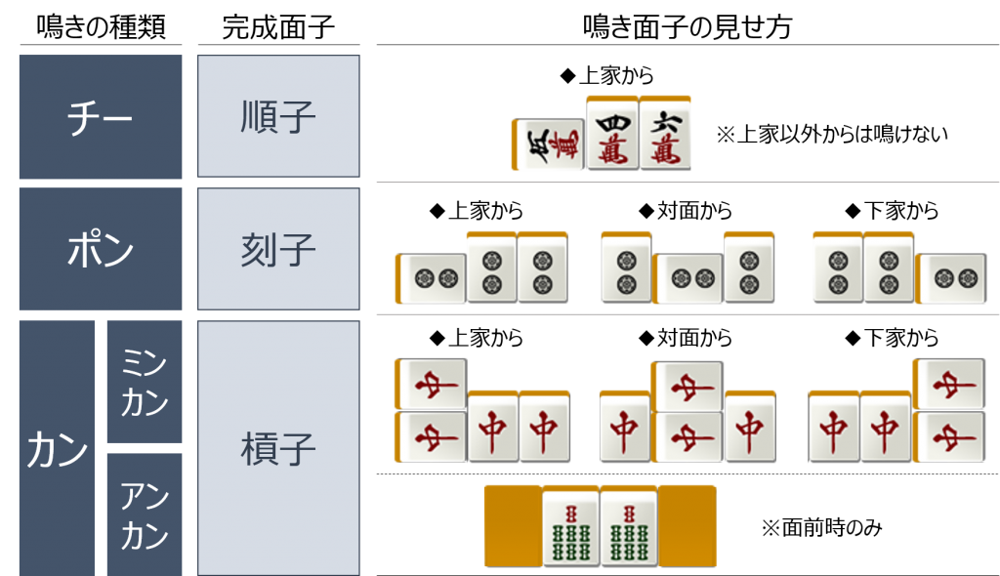
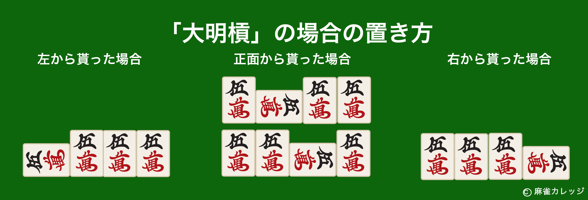
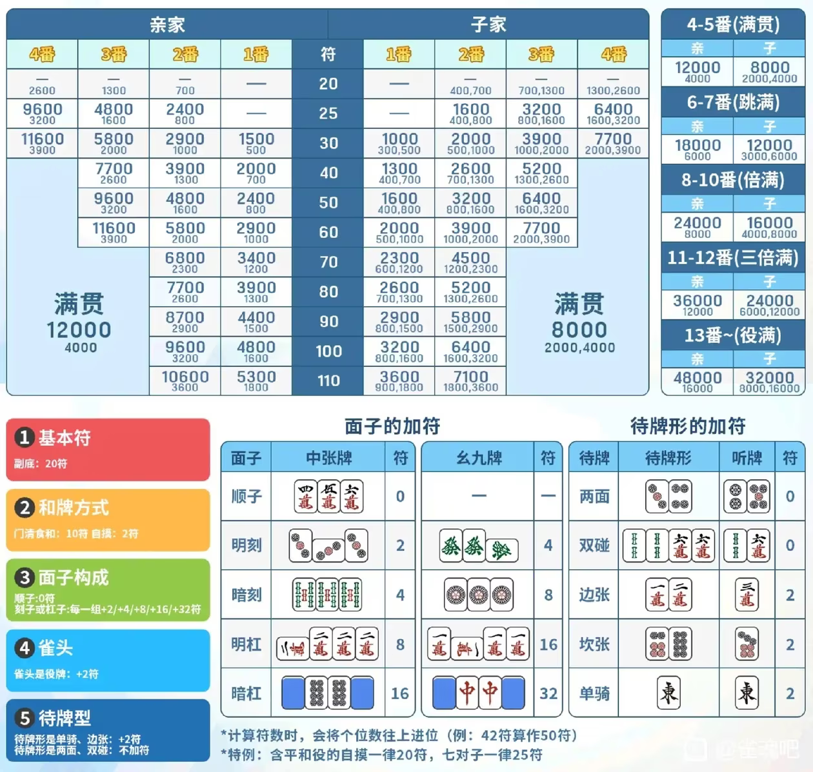
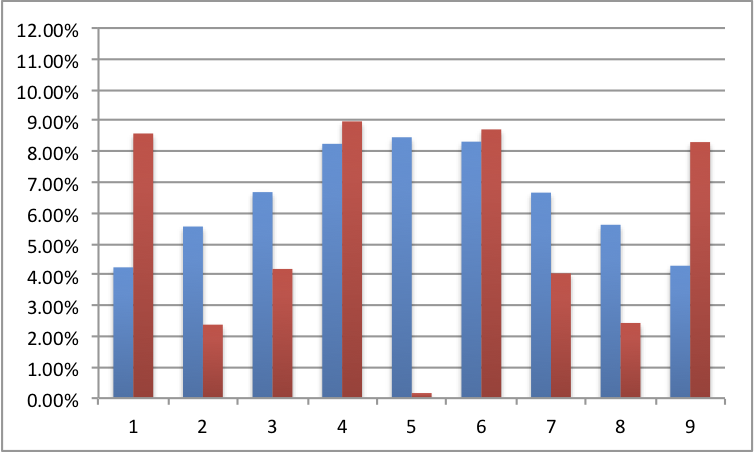
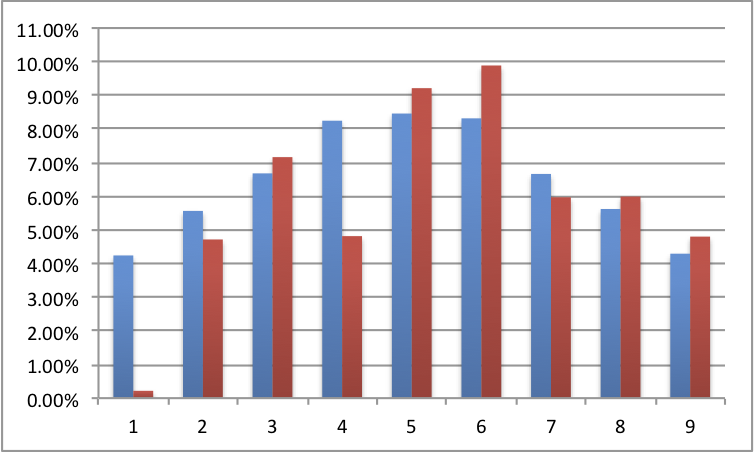
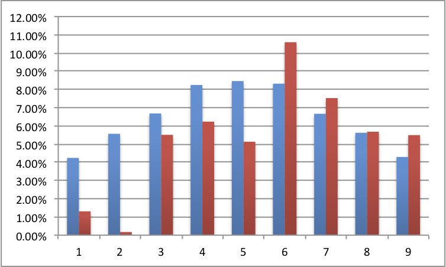
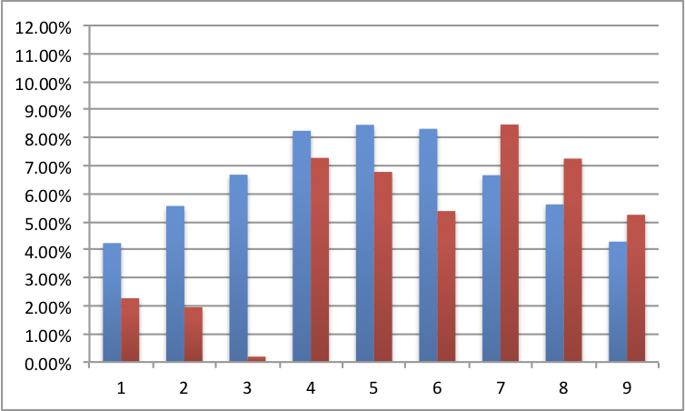
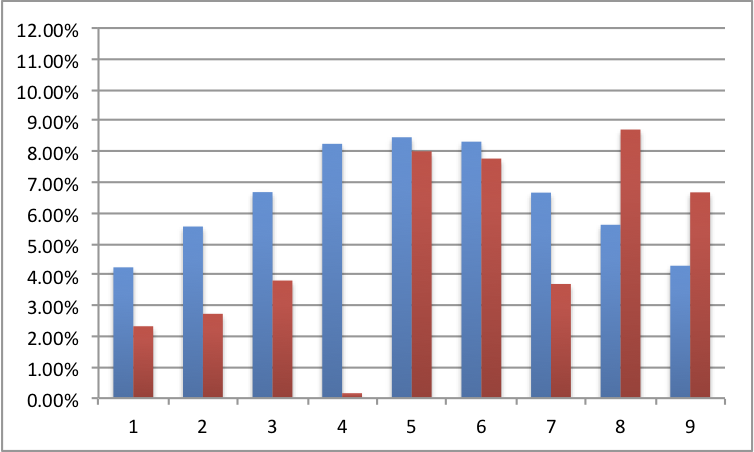

# 从初心到魂天，这一本就够了！

## 规则

### 麻将入门

#### 麻将牌介绍

麻将共有1-9万（日语为マンズ/简写为m），1-9饼（日语为ピンズ/简写为p），1-9索（日语为ソウズ/简写为s），东南西北白发中（简写为1-7z），每一种各4张，共136张牌。为方便表示，下文统一使用上述简写。例如，2万、5万、6万、两张8饼、东、南、中，记作256m88p127z。

#### 摸打顺序

麻将由4名玩家分别坐在桌子的四个方向上进行。桌上会有东、南、西、北四个方位的标记，来标记你的自风。坐在“东”位的玩家是庄家。庄家起手14张并先打出一张牌，其余玩家起手各13张。之后逆时针轮流摸一张、打一张。

#### 基本牌形与和牌条件

3张同花色且数字连续的牌叫顺子，例如123m、456p。字牌（1-7z）不能组成顺子，数牌也不能跨越9和1，例如891、912都不算顺子。3张完全相同的牌叫刻子，2张完全相同的牌叫对子。顺子和刻子统称面子。

通常的和牌形由4个面子和1个对子组成，这个对子称为“雀头”。如果用AAA表示刻子、XYZ表示顺子、NN表示雀头，就可以写成：x组AAA＋(4−x)组XYZ＋NN。凑齐四面子一雀头，就有了基本的和牌形！

如果你的手牌组成了完整的和牌形，并且至少有一个役，你就可以和牌，这局结束。当你的和牌满足某些特定条件时，就会获得对应的“役”。不同的役有不同的番数，一手牌也可以同时满足多个役，番数会累加；大概来说番数越高，得分越高。如果你的牌虽然组成了完整的和牌型，但一个役都没有，就叫“无役”，这种情况下不能和牌。

只差最后一张牌就能和牌的状态称为“听牌”。和牌之前一定会听牌。例如你有11145m456s234p22z，此时摸到3m可以组成345m，摸到6m可以组成456m，因此称为听36m。

#### 荣和、自摸与振听

如果别人打出了你和牌所需要的最后一张牌，你可以“荣和”。打出这张牌的人称为“放铳者”，也可以说是他给你“放铳”了，通常由放铳者独自支付你这次和牌的点数。如果有人进行加杠，而加上的那张牌正好能让你和牌，你可以用这张牌荣和，称为“抢杠”。通常只能抢加杠；部分规则，如雀魂平台允许国士无双（役满之一）抢暗杠。

如果一张牌同时让多人和牌，通常都算和。部分规则采用“头跳”，多人同时荣和时，只有从放铳者起按逆时针方向最先遇到的和牌家可以和牌，其他人的和牌不成立。这名玩家称为“头跳家”。也有规则规定一炮三响直接流局，即不结算，直接结束本局。天凤平台有一炮三响流局。雀魂没有有一炮三响流局。

如果你自己摸到了和牌所需要的最后一张牌，则称为“自摸”，由另外三家共同承担。日本麻将的自摸不像四川麻将那样，不是三家各收一份荣和点数，不等价于三家同时向你放铳。因此，自摸的总收益并不是荣和的三倍；被自摸时也比自己放铳损失更少。

如果你处于“振听”状态中，你不能荣和别人打出的任何牌，只能自摸和牌。

#### 吃、碰、杠

如果对局中上家打出的牌能和你的手牌组成顺子，例如你有12m，上家打3m；或者你有24m，上家打3m，你可以“吃”，拿走这张牌组成顺子，然后打出一张牌。其他玩家打出的牌不能吃。

如果你手里已经有两张相同的牌，而任意一家打出了第三张相同的牌，你可以“碰”，拿走这张牌组成刻子，然后打出一张牌。碰的优先级高于吃，因此同一张牌如果有人要碰，其他人不能吃。

4张完全相同的牌可以形成“杠子”，在和牌结构中算作一个面子。如果你手里有3张相同的牌，别人打出第4张，你可以“大明杠”；如果4张牌全部来自自己手中，可以“暗杠”；如果之前已经碰了一组刻子，后来又自己摸到第4张，可以“加杠”。杠之后要补摸一张牌，然后再打出一张牌。

大明杠和加杠统称明杠，吃、碰、明杠统称鸣牌，又称副露。不可以鸣海底牌，即最后一张能摸到的牌。

吃、碰、杠后，需要把形成的面子公开摆在手牌旁边，并通过横放牌的位置表示拿的是谁打出的牌。副露后，组成面子的那些牌就固定在桌上，不能再拆开打出了。

  
  

吃牌时还要注意“食替”规则。例如你有123m，上家打1m。虽然你可以用23m吃进1m，但吃完后不能立刻打出自己原来那张1m，这叫“现物食替”。“现物”就是别人打过的牌。又例如你有234m，上家打1m，你用23m吃成123m后，很多规则也不允许你立刻打出4m，这类情况称为“筋食替”。“筋”就是数字相差3的同花色牌。这真是一个烦人的规则！

如果之后的例子中有副露，因为我太懒了，就用了“手牌/副露”这个自己擅自规定的简写。比如234789m23p455s碰了东，就写成234789m23p455s/111z。至于暗杠还是明杠、碰的是谁的牌、具体吃了哪张，我就先不管了，需要的时候再用文字明确说吧。

#### 庄家轮换

进入下一局时，如果没有连庄，下一位玩家会成为庄家。大家通常不会交换座位，而是改变东南西北的身份标记。对固定坐在一个位置的玩家来说，自风（即你所在的位置的标记）会按照东→北→西→南→东的顺序变化，也可以理解为桌上的“东家标记”逆时针移动一位。

#### 入门建议

“振听”和“役”是日本麻将相比其他麻将规则最显著、也最容易让初学者头疼的规则，之后会专门进行讲解。不过，如果你以前完全不会打麻将，最先需要熟悉的并不是这两个规则，而是麻将最基本的结构：四面子一雀头，以及吃、碰、杠这些操作。

个人认为，如果只是想先熟悉麻将的基本逻辑，四川麻将会比日本麻将更容易入门，因为它的和牌限制更少。在附录中会介绍[四川麻将的规则](#四川麻将的规则)，先帮助大家建立对麻将的直觉，再回过头学习日本麻将会轻松很多。

### 役

在立直麻将中，仅仅凑齐“四面子一雀头”的基本和牌形是不够的，你还必须至少满足一个“役”的条件才能和牌。也就是说，立直麻将不允许单纯“推倒就和”；如果牌型中没有任何役，就会被判定为“无役”，无法和牌。附录中的[役种表](#役种表)列出了各类役及其详细说明。不过役种数量不少，刚开始接触时很难一下子全部记住。下面先介绍一些常见，也比较好记的役种。

#### 常见役种

- 立直：这是立直麻将最具代表性的役，也是[出现频率最高的役](https://amae-koromo.sapk.ch/statistics/fan-stats)，成立后计1番。立直要求玩家保持门前清，也就是此前没有鸣牌过。
  - 在门前清状态下达到听牌后，可以在打出一张牌时将其横置，作为立直宣言牌。如果立直宣言牌被其他玩家吃、碰或杠走（统称“鸣走”），立直仍然成立。此时，应将自己下一次打出的牌横置；如果这张牌也被鸣走，则继续横置下一张舍牌（“舍牌”即自己打出的牌），直到有一张横置牌留在自己的牌河（“牌河”即面前摆放舍牌的区域）中。如果没有其他玩家荣和这张牌，则立直成立，需要支付1000点立直棒放在桌面中央。
  - 不足1000点无法立直。这1000点会由之后和牌的玩家获得；如果本局流局，则立直棒会保留到之后的牌局作为场供，直到有人和牌为止；若多家和牌，场供及场上的立直棒由头跳家获得。
  - 立直成立后，原则上只能摸切，也就是摸到什么牌就打出什么牌。
  - 立直后不可以鸣牌，不过仍然可以进行暗杠。暗杠有以下要求：
    - 只能用新摸到的牌暗杠。如2345688m789999p，摸到6p不能暗杠。
    - 不能改变自己的待牌。如123456m6667999p，本来听578p。摸到6p之后，如果暗杠，就只听78p了，所以不可以暗杠。
  - 前面提到的门前清是立直麻将中非常重要的概念。许多役只有在门前清状态下才能成立；另一些役即使鸣牌后仍然成立，但会少一番，这种役叫做食下役。
  - 剩余牌大于等于4张时才能立直。
- 役牌：这是立直麻将中非常常见的役，不要求门前清。只要你拥有一组由役牌组成的刻子或杠子，成立后计1番。
  - 役牌包括三元牌白、发、中，以及符合条件的风牌。役牌包括场风牌，即当前场次对应的风牌。例如现在是南2局，那么拥有一组南刻子即可成立役牌。还包括自风牌，即自己座位对应的风牌。例如你当前坐北家，那么北就是你的自风，拥有一组北刻子即可成立役牌。
  - 不是役牌的风牌叫客风牌。
  - 如果同一张风牌同时是场风和自风，则两个役会同时计算，共计2番。例如在东场中，东家的东刻子算2番。同时是场风和自风的风牌叫连风。
  - 部分规则采用“无后付”：如果在听牌时手牌本身还没有确定的役，例如手中有一个役牌对子和另一个普通对子，形成双碰听牌，那么即使最后和到役牌、使役牌刻子成立，也仍然不能和牌，因为这个役是在和牌时才产生的。雀魂有后付，这种情况下如果和到役牌，就会成立“役牌”这一役，可以正常和牌。
- 断幺九：这是比较容易达成的役，通常不要求门前清，成立后计1番。牌型中不能包含任何1万、9万、1筒、9筒、1条、9条，这些牌统称为老头牌；同时也不能包含东、南、西、北、白、发、中这些字牌。老头牌和字牌合称为幺九牌。少数规则要求断幺九必须保持门前清，这种规则称为无食断。
- 门前清自摸和：成立后计1番。保持门前清并自摸即可成立。这个役的价值之一，是让你在没有其他役、又不想立直时，仍有自摸和牌的可能。没错，后面会讲到，有些时候即使没有其他役，你也未必想立直。
- 七对子：成立后计2番，并且必然是门前清。需要由七组不同的对子组成；在立直麻将中，四张相同的牌不能当作两组对子，因此不承认“龙七对”。如果手牌很差，几乎很难凑成正常的“四面子一雀头”，但对子比较多，就可以考虑转做七对子。
- 对对和：面子全部由刻子或杠子组成，不需要门前清，成立后计2番。碰碰碰，爽！不过这个役通常不太推荐去做，之后会讲原因。
- 混一色：只使用一种数牌花色和字牌。门前清时3番，副露后2番。
- 清一色：只使用一种数牌花色，不含字牌。门前清时6番，副露后5番。混一色和清一色都是食下役。
- 国士无双：13种幺九牌各一张，再加上其中任意一种凑成一对。属于役满，分数非常高，但牌型十分特殊。

简单来说，新手不要看到吃、碰、杠按钮亮了就直接点，先想一想，这样副露之后，我还有役吗？不然很容易把自己做成无役，最后不能和牌只能干瞪眼。

一些不被主流规则普遍承认的役，被称为古役，可以理解成“村规役”。

#### 包牌

大三元（白、发、中各有一组刻子或杠子，是役满）和大四喜（东、南、西、北各有一组刻子或杠子，是两倍役满）存在包牌规则。如果对方已经副露了两组三元牌，你又打出第三种三元牌让他碰或大明杠；或者对方已经副露了三组风牌，你又打出第四种风牌让他碰或大明杠，那么你就会成为包牌者。自摸役满时，包牌者需要承担这个役满的全部责任；如果是其他玩家放铳，则包牌者承担这个役满的一半。例如有人和出大四喜+字一色，是三倍役满。若由其他玩家放铳，包牌者需要支付其中大四喜部分的一半：和牌家是亲家为96000÷2＝48000点，和牌家是子家为64000÷2＝32000点。如果是自摸，包牌者则要承担大四喜的全部分数，再加上自己本来需要支付的字一色自摸份额。因此，亲家自摸时需要支付96000+16000＝112000点；子家自摸时，如果自己是子家则支付64000+8000＝72000点，如果自己是亲家则支付64000+16000＝80000点。

所以，看到别人已经副露了两组三元牌或三组风牌时，最后那一种牌千万不要乱打！除非你有比较充分的理由判断他碰不了，例如这张牌已经有两张出现在牌局中（简称为现2），那么他手里就不可能还有两张来碰。巡目特别早，比如前三巡时，风险也相对较低，因为他不太可能起手就同时拿着所有对应的对子。如果打出去正好被他碰了，那就当是成全他了。遇到这种场面，立直也要非常谨慎，因为立直以后摸到什么就得打什么，万一摸到那张致命的三元牌或风牌，会被迫成为包牌者。就算没有包出役满，这种牌也已经非常危险。例如对方已经有两组三元牌时，第三种三元牌就可能直接放铳小三元。小三元本身2番，再加上两个役牌，共4番；如果再叠加很容易与小三元复合的混一色、对对和之类的役，轻松就能达到6番跳满，已经非常严重了！

### 振听

立直麻将最有特点的规则之一就是振听，它是很多新人的噩梦。你可以把振听理解成一种“诅咒”：一旦振听，你就不能荣和，只能自摸。虽然很烦，但振听也能防止你给别人点炮。

#### 振听的类型与解除条件

振听分三种情况：
- 舍张振听：你的听牌里包含自己曾经打过的牌。比如你听3、6万，如果之前打过3万，那么不仅3万不能荣和，6万也不能荣和。没立直的话，可以通过改变听牌解除振听；立直后听牌不能改变，只能认栽，等待自摸和牌。如果你听的牌中有自己打过的牌，即使和这张牌没有役，也仍然算振听。
- 立直振听：立直后，如果放过别人打出的和牌，或者摸到能和的牌却没有自摸，就会进入振听，而且无法解除。
- 同巡振听：也叫临时振听。没立直时，如果别人打出了你听的牌，但你没有荣和，就会暂时振听，直到自己下一次摸牌时解除。如果别人打出的牌满足自己的和牌型，但是因为无役不能荣和，仍然会进入振听状态。

#### 避免振听的技巧

新手出牌时，可以稍微想一下，这张牌以后会不会变成自己的和牌。例如，357打掉7后，剩下的35又摸到6，不要无脑打3留下56，否则以后听47时，会因为打过7而振听。再比如，之前打过9，后来又摸到8，也要谨慎保留；如果最终留下78，听69，就会因为打过9而振听。

不过，振听并不一定代表你技术不好。振听很难完全避免，魂天一样会振听。

### 王牌和宝牌

#### 牌山、王牌与岭上牌

牌山就是麻将开局洗牌后，把牌两张上下叠成一层，再一层层排成墙状的那一整排牌。游戏过程中，大家就是从牌山里依次摸牌。在日麻中，有14张牌不会被摸到。在实体麻将中，这14张牌位于牌山末端的7幢，每幢由上下两张牌组成，统称为“王牌”。

王牌的前两幢是4张岭上牌。开杠后，补摸不是从平时摸牌的位置摸排，而是从王牌中的岭上牌里摸1张。但摸走1张岭上牌后，王牌就会少1张。为了让王牌始终保持14张，正常牌山中的最后一张牌，海底牌，就会被划进王牌里，不能再正常摸到。无论开几次杠，最后始终都会留下14张王牌不能摸到。

#### 宝牌、里宝牌与赤宝牌

王牌中，第3到第7幢的上层牌是宝牌指示牌，用来决定这局的宝牌（日语是Dora）。和牌时每有1张宝牌，就额外加1番，所以大家会更倾向于把宝牌留在手里。正因为如此，宝牌更不容易被打出，而宝牌以及它周围的牌也更容易放铳，打宝牌放铳时也尤其心痛。不过要注意，宝牌不是役。如果手牌没有任何役，还是不能和牌。

开局会先翻开第3幢的宝牌指示牌。例如指示牌是2p，那么3p就是宝牌。数字牌按1-2-…-9-1循环；三元牌按白-发-中-白循环；风牌按东-南-西-北-东循环。

每开杠一次会多翻开一张宝牌指示牌。在雀魂中，每次暗杠都会立即翻开一张新的宝牌指示牌；大明杠和加杠则需要先补摸岭上牌并打出一张牌，确认没有放铳后才会翻开。因此，明杠后如果立即放铳，新增的杠宝牌不会计入点数。如果被抢杠，算作杠牌不成立，不会增加新的宝牌指示牌。

若同一张牌同时被多个宝牌指示牌指中，番数会重复计算。

如果立直后和牌，还可以查看宝牌指示牌下方对应的“里宝牌”指示牌。里宝牌的判定方式与普通宝牌相同，杠宝牌指示牌下方的牌也会作为里宝牌指示牌。里宝牌相当于额外增加了一倍未知的宝牌指示牌，这是立直的一大福利。

5m、5p、5s中各有1张红色的牌，叫“赤宝牌”，记作0m、0p、0s，每张同样加1番。

宝牌指示牌最多只能有5张，所以一局游戏最多只能开杠4次。如果同一名玩家开了4次杠，其他玩家便不能开杠；如果4次杠由多名玩家共同完成，且最后一个杠之后的出牌没有放铳，会触发“四杠散了”流局。

### 点数计算

- 和牌时，每满足一个番种条件，就会获得相应的番数。
- 普通役种仅累计至役满为止，记作累计役满，日语为数え役満；若和牌中包含役满役种，则普通役种不再计入，多个役满役种之间可叠加计算。例如，大四喜+四暗刻是三倍役满，获得役满点数的三倍。
- 牌型、听牌方式等因素还会决定符数。这个比较复杂，新手不需要掌握。注意:
  - 对于雀头是连风（同时是场风和自风）的情况，部分规则如天凤和雀魂记作4符，而M.LEAGUE等规则记作2符。
  - 荣和形成的刻子不是暗刻。
  - 除七对子外，荣和时符数不足30符，按30符计算。
- 亲家（庄家）的得点为子家的1.5倍。

最终得点由番数、符数以及庄闲身份共同决定：
- 基本点 = 符\*2^(番+2)
- 闲家荣和：基本点\*4
- 庄家荣和：基本点\*6
- 闲家自摸：庄家付\*2，闲家各付\*1
- 庄家自摸：三家各付\*2

每笔支付向上取整到100点。

对于同一种和牌形，如果有相互矛盾的分数计算方式，优先采用点数高的计算方式。

基本点上限：
- 满贯：5番（或4番40符及以上），2000点
- 跳满：6-7番，3000点
- 倍满：8-10番，4000点
- 三倍满：11-12番，6000点
- 役满：13番及以上（累计役满），8000点

可根据下表查出对应的和牌得点。

表格中的小字表示自摸时各家需要支付的点数。子家自摸时，小字会以逗号分隔。较大的数字表示亲家需要支付的点数，较小的数字表示其他子家各自需要支付的点数。亲家自摸时，三名子家支付的点数相同。

子家自摸时另外两名子家各支付总得点的1/4，亲家支付1/2。亲家自摸时三名子家各支付相当于子家自摸时总得点的1/2，总和为子家得点的1.5倍。

这个表确实非常复杂，甚至职业玩家都有可能出错。幸运的是，有了电脑之后，算分已经不再困难。

新手不需要掌握精确算点，能大致估算点数即可：

| 番数     | 等级  | 点数      |
| ------ | --- | ------- |
| 1番     | —   | 1,000点  |
| 2番     | —   | 2,000点  |
| 3番     | —   | 4,000点  |
| 4–5番   | 满贯  | 8,000点  |
| 6–7番   | 跳满  | 12,000点 |
| 8–10番  | 倍满  | 16,000点 |
| 11–12番 | 三倍满 | 24,000点 |
| 13番及以上 | 役满  | 32,000点 |

亲家的得分是以上的 1.5 倍。

### 流局

流局指的是没有任何人和牌，但这一局仍然结束的情况。

#### 荒牌流局与不听罚符

如果牌山已经摸完，仍然没有人和牌，就称为荒牌流局，这也是最常见的流局。荒牌流局时，未听牌的玩家需要向听牌的玩家支付点数。好消息是，判定听牌时可以处于振听状态，也不需要有役；即使是空听，也仍然算听牌。所谓空听，就是所有和牌张都已经出现，不可能被摸到了。不过，不能通过虚听来获得听牌判定。虚听就是，你手里已经有某种牌的四张，而和牌却要求不存在的第五张相同的牌，这种情况不算听牌。比如，你已经副露四次，其中有一组中刻子，手里还剩一张中，需要不存在的第五张中才能和牌，因此不算听牌。

荒牌流局时，听牌与未听牌玩家之间转移的点数总额固定为3000点：
- 1人听牌、3人未听牌：3名未听牌玩家各支付1000点给听牌玩家。
- 2人听牌、2人未听牌：2名未听牌玩家各支付1500点。
- 3人听牌、1人未听牌：未听牌玩家需向其余听牌玩家每人支付1000点，共支付3000点。
- 4人全部听牌，或全部未听牌：不发生点数支付。

未听牌的玩家只需要支付“不听罚符”。和四川麻将的“查大叫”相比，这里的损失就温和多了。

另外还有一个彩蛋役：如果荒牌流局时，一名玩家从头到尾打出的牌全部都是幺九牌，而且这些牌一次都没有被别人鸣过，就可以达成流局满贯，等价于自摸8000点。

#### 途中流局

除了荒牌流局之外，还有一些特殊情况会让牌局立即结束，这类情况称为途中流局:

- 九种九牌：在自己的第一次摸牌后，如果手牌中含有至少9种不同的幺九牌（注意不只是9张），并且此前没有任何玩家鸣牌，可以选择宣布流局，也可以不流局。
- 四风连打：在没有任何人吃、碰、杠的情况下，第一巡中四名玩家打出的第一张牌全部是同一种风牌时，立即流局。
- 四杠散了：同一局中，如果由两名或以上玩家累计进行了四次杠，且最后一次杠没有岭上开花、之后的出牌也没有放铳，会触发流局。如果第四次杠被抢杠，按照和牌处理。 
- 四家立直：四名玩家全部宣布立直，并且最后一名玩家的立直宣言牌没有造成放铳时，牌局流局。

### 局间规则和PT计算

#### 巡目

一局麻将可以按照巡目，也就是你已经打出了几张牌，大致分成三个阶段：1-6巡称为序盘，7-12巡称为中盘，13巡以后称为末盘。雀魂的牌河正好也是6张一行，因此看牌河时非常方便。第一行是序盘，第二行是中盘，第三行以后是末盘。

#### 连庄、本场与场次

一整场麻将的第一局叫做东一局，场风为东。如果庄家和牌，或者荒牌流局时庄家处于听牌状态，又或者发生九种九牌等途中流局，庄家都会继续连庄。此时局数不变，本场数加一，例如依次进入东一局一本场、东一局二本场，其他局也是同理。

每增加1本场，荣和时由放铳者多付300点；自摸时其他三家各多付100点。若多人同时荣和，仅头跳家获得本场加点。本场加点与亲家、子家无关。

反之，如果只有子家和牌且庄家未和牌，或者荒牌流局时庄家未听牌，庄家就会下庄，庄位会按照东、南、西、北的顺序轮到下一家，牌局会依次进入东二局、东三局、东四局。子家和牌时，本场数清零；荒牌流局时，无论庄家是否连庄，本场数都会加一。东一局至东四局合称为东场。

东场结束后进入南场，此时需要把场风标示调整为“南”。之后的牌局依次称为南一局、南二局、南三局、南四局。

#### 对局形式与结束条件

常见的对局形式主要有：
- 东风战：只打东场，也就是东一局到东四局。雀魂线上对局采用5+20秒的思考时间：每次操作有5秒，另有20秒共用的备用时间；备用时间耗尽后，每次就只剩5秒；一场对局约20分钟。
- 半庄战：打东场和南场。一场对局约40分钟。

每位玩家开局时都有25000点，也就是所谓的“原点”。

在雀魂中，如果东风战的东四局，或者半庄战的南四局结束后，没有任何一名玩家达到30000点，对局不会立刻结束，而是继续进入下一场。东风战会进入南场，半庄战则会进入西场，这种情况分别称为南入和西入。南入或西入之后，只要某一局结束时有玩家达到或超30000点，对局就会结束；但此时若存在庄家连庄且当前庄家不是一位的情况时，连庄优先；庄家为一位，超过30000点且满足要求可以连庄时，不再连庄，结束游戏；如果始终无人达到30000点，则最多进行到南四局或西四局。此时由第一位获得全部场供。

有击飞规则。有玩家点数为负数时立即结束游戏，有玩家为0点时继续游戏。

#### 顺位、马点与PT结算

游戏结束后，会根据玩家的最终位次和得分计算PT，用于段位升降、比赛评分等。

四麻中，各位次的马点分别为1位+15、2位+5、三位-5、4位-15。游戏结束时，若玩家点数相同，则按东一局的座位顺序决定名次，东家优先，其次为南家、西家、北家。

然后计算精算点数=(最终得分-25000)÷1000+马点。

在雀魂中，最终获得的PT计算公式为roundup(精算点数) + 段位分。roundup表示向上取整。段位分由对局房间等级、最终顺位和玩家段位决定，属于雀魂内的特有规则，此处不作介绍。

## 上卷

### 序言

了解完规则之后，我们便要正式开始学习麻将的技术了。短期来看，运气确实是决定胜负的主要因素；但把时间拉长，技术水平一定会反映在数据上。

有人看到一手牌会说：“这一手再摸几张万子，就能做成混一色了。”这和“这一手之后只要再摸3张发、3张中、3张白，就是大三元了”本质上又有多大区别？初学者尤其要避免只盯着最理想的情况做牌。麻将并不会按照你脑海里预设的剧本发牌。日本麻将里有一种说法叫“絵合わせ麻雀”（拼图麻将）就是只按照心中的最好剧本来打麻将。初学阶段，最需要避免的正是这种打法。

本部分的框架参考了《魔女博客——初心の入门书》，也结合了其他博主的讲解，具体参考资料见附录。

#### 阅读前的准备与建议

建议至少先熟悉麻将最基本的和牌结构，以及吃、碰、杠等基本操作。完全没有麻将基础的读者，可以先打几局四川血战到底麻将来建立直觉。虽然四川麻将与日本麻将在战术上有很大差异，但基本的牌型结构和吃碰杠规则是相通的。具体规则可参见[四川麻将的规则](#四川麻将的规则)。

也建议先随便打几局日本麻将，争取做到：
- 理解什么是振听、什么是役，不会在对局中经常无役振听。
- 熟悉[上文所述](#役)的常见役种。

虽然不要求读者完全记住前面介绍的所有规则和役种，但上卷将不再重复解释这些内容。如果阅读时遇到不熟悉的规则或役种，请自行查阅[规则](#规则)或附录[役种表](#役种表)。

阅读时建议做笔记。遇到不理解的地方，不要死记硬背，先自己推演一下为什么作者会这样说。如果因为作者编排不够妥当，不小心提前提到了尚未讲解的概念，可以先记下来，暂时放下，阅读完再回头看。如果发现了作者忘记解释的术语，可以去上网搜索或着询问AI。

认真阅读优秀的教材，胜过自己瞎打一辈子。如果能够熟练掌握这一章的战术，实际上已经算是中级玩家了。这些技术并不是认真看完就能立刻掌握的，需要通过大量实战不断积累熟练度。

### 牌效率 - 孤张

#### 孤张与牌效率

所谓牌效率，就是让自己和牌更快、打点更高的技巧。

打麻将时，每打掉一张牌，其实都意味着放弃了这张牌未来可能的发展。我们打牌时要保留潜力大的牌，舍弃潜力小的牌。

一开始，比如我们摸到了1255m257p378s1366z。这时候手牌还比较凌乱，我们应该先打什么呢？可以先把手牌拆开来看。12m摸到3m就能组成面子，55m是对子；2p是一张孤张，57p摸到6p就能组成面子；3s是一张孤张，78s摸到6s、9s都能组成面子；1z、3z都是孤张，66z则是对子，之后还能碰成役牌刻子。你会发现，2p、3s、1z、3z现在都比较孤立，还需要摸到更多合适的牌才能派上用场，所以它们的价值比其他牌低，应该优先打出。

#### 孤张的舍牌顺序

对于孤张，推荐按照这个顺序打出：
1. 客风牌：只能形成对子和刻子，发展潜力最低，最优先打出。
2. 1、9数牌：除了形成对子和刻子，还可能未来变成12、13。12只有摸到3才能形成面子，13只有摸到2才能形成面子。9的情况和1一样，只是方向相反。之后遇到这种对称的情况，我们都只讲其中一边。
3. 役牌：和客风一样，只能形成对子和刻子。但是役牌一旦碰成刻子，就会有役，之后可以更自由地吃碰，而不用担心无役。所以虽然它的发展潜力不如1、9数牌，但还是更值得保留。
4. 28数牌：以2为例，可以变成12、23、24。12只有摸到3才能形成面子，24只有摸到3才能形成面子，而23摸到1或者4都能形成面子，所以2比1有更多的发展方向。8同理。
5. 连风牌：凑成刻子能有2番。参考[ネマタ的战术文章](https://mj-news.net/column/method/2016022735904)。
6. 3-7数牌：以3为例，可以变成13、23、34、35。13只有摸到2才能形成面子，35只有摸到4才能形成面子，而23摸到1或者4，34摸到2或者5都能形成面子，因此3-7的发展潜力最大。

对于客风来说，出牌顺序影响不是很大。不过真要细究，可以考虑两种策略：
- 首先是比较常见的推荐顺序。自己想尽快做牌时，先打下家的自风，再打对家的自风，最后打上家的自风。原因在于，三家如果要碰自己的自风，你最希望的是上家来碰。因为你打出一张牌后，上家一碰完，你就会多一次摸牌的机会，对自己推进手牌最有利。所以，如果上家的自风最后打出，在你打出它之前，上家已经比另外两家多经历了一些摸牌机会，比其他家更有可能把自己的自风摸成对子，从而碰牌。
- 如果有特别想压制的玩家，可以考虑优先打他的自风。比如你现在排名第三，但和第四名的点差很小，你希望他不要通过和牌反超你，你最需要防范的自然就是第四名。你优先打出他的自风，对方在此之前经历的摸牌次数就会比别家少，也就更不容易已经把自风摸成对子，他就更难碰自风，更难做牌。

#### 孤张价值的修正因素

以下因素会影响孤张牌的出牌顺序：
- 14中的1，价值低于单独的1。如果手里有14，如果先打掉1，之后即使摸到2或者3，仍然可以和4组合成24或34，所以除了损失1本身形成对子、刻子的可能性以外，没有其他损失。但如果是一个完全孤立的1，就会直接失去变成12或13的可能性。
- 15中的1，价值高于单独的1。因为15可以形成135的结构。当然，15价值低于2。
- 场上已经出现过一张的役牌，价值会降低很多。役牌一旦已经在场上出现过，无论是在牌河中被打出，还是作为宝牌指示牌出现，剩余枚数都会减少，之后再做成刻子的难度也会明显提高，因此保留价值会随之下降。相应地，因为出现过两张的役牌不可能碰到，所以几乎没有价值了。
- 三元牌之间，优先打发。因为发相比白和中，多了一个绿一色役满的可能性，所以发对别人的潜在价值略高。为了减少被利用的可能，优先打发。
- 役牌之间，先打场风牌再打三元牌后打自风。三元牌对所有人都有役，因此更容易被碰，早点打可以减少之后被碰的概率。如果自风和场风不一致，场风牌不仅对所有人都有役，对于场风和自风同样的玩家来说是连风牌，碰了就有2番，应该比三元牌更优先打出。自风只对自己有役，对其他玩家没有役牌价值，因此可以晚一点打。
- 客风是宝牌时，价值远远高于役牌。因为只要有一张宝牌就能获得一番，而役牌需要三张才能有一番。注意宝牌不是役。

#### 孤张价值的模拟比较

把宝牌、已现枚数等修正因素考虑进去后，这个排序到底会发生多大变化呢？

虽然这么详细的排名，对麻将胜负本身并没有多大影响，但作者自己也很好奇，所以就拿 [Mahjong Nanikiru Simulator](https://pystyle.info/apps/mahjong-nanikiru-simulator/) 跑了不少局面，比较打出不同孤张时的打点预期。需要注意的是，这是一个单人麻将模拟器，并不会考虑鸣牌。因此，役牌可以通过碰牌直接形成役种这一优势无法被正确反映，模拟结果会系统性低估役牌孤张的实际价值。

大致得到了以下结论：
- Dora有压倒性的优势。[客风dora的价值甚至明显高于5](https://pystyle.info/apps/mahjong-nanikiru-simulator/?v=1&mode=yonma&hand=2567789m13445p5s4z&dora=3z&counts=4244232333432244444444244444433444111&turn=3&round=27&seat=27)。甚至客风dora已现1 枚时，[价值仍然和3-7的中张孤张差不多](https://pystyle.info/apps/mahjong-nanikiru-simulator/?v=1&mode=yonma&hand=2567789m13445p5s4z&dora=3z&counts=4244232333432244444444244444432444111&turn=3&round=27&seat=27)，[并且明显高于28](https://pystyle.info/apps/mahjong-nanikiru-simulator/?v=1&mode=yonma&hand=2567789m13445p2s4z&dora=3z&counts=4244232333432244444344344444432444111&turn=3&round=27&seat=27)。
- Dora已现2枚后，优势会明显下降。客风dora已现2枚时，[它的价值已经和生张（场上没有出现的）19差不多](https://pystyle.info/apps/mahjong-nanikiru-simulator/?v=1&mode=yonma&hand=2567789m13445p1s4z&dora=3z&counts=4244232333432244443444344444431444111&turn=3&round=27&seat=27)。
- [连风牌已现1枚，价值和役牌几乎一致。](https://pystyle.info/apps/mahjong-nanikiru-simulator/?v=1&mode=yonma&hand=3345678m179p3s145z&dora=1z&counts=4423233343444343434434344442443344111&turn=3&round=27&seat=27)
- 已现1枚的役牌与生张19，价值难以通过模拟比较。根据雀魂内置的AI复盘工具MAKA的建议，一般应先打生张19。

笔者没有精确进行两两对比。首先，不能用Codex自动操控浏览器跑。一个原因是它非常非常非常消耗usage，消耗量是用Codex Workspace正常编程的很多倍。笔者前后Reset了三次才勉强跑完，而且用的还是Plus套餐，每月20美元的！另一个更重要的问题是，Codex很难做到严格控制变量。首先，模拟时要保证“搭子（如13这样的两张牌，摸到2就能形成面子） + 面子 + 对子”的数量少于4。因为和牌只需要4组面子，如果已经有4组以上，我们基本上就不太需要这些孤张再去形成新的面子了，直接使用手里已有的搭子即可，这样就很难比较出不同孤张本身的成搭能力。同时，手牌里也不能有太多对子，或者过多幺九牌。否则七对子和国士无双这两个比较特殊、并不遵循普通牌效率逻辑的役种就会混进来，干扰最终结果。但另一方面，牌又不能做得太差。具体来说，4向听（之后马上会介绍什么是向听，这里就简单理解成很不好的牌即可）以上的手牌，模拟器无法计算期待得点。如果全部靠自己手动跑，两两比较的工作量实在太大。

另一个麻烦是，模拟结果偶尔还会出现一些很难解释的反常现象。比如某些局面里，手牌同时有14，宝牌分别设为1和北时，宝牌北的保留价值居然会低于4；但如果单独比较，宝牌客风的价值又明显高于5。这样的结果很难判断究竟是我输入时出了问题，还是手牌里存在某些没有注意到的结构差异，抑或模拟器本身的计算方式导致了这种现象。每遇到一次都要重新检查条件、排查变量，实在太麻烦了。

### 牌效率 - 搭子

#### 搭子的类型与保留优先级

处理完价值较低的孤张以后，我们就可以开始观察手牌中还没有组成面子的两张牌组合。其中，两张相同的牌叫对子；而像12、35、78这样，距离组成顺子只差一张的两张数牌，就叫做搭子。搭子有三种：

1. 边张：12和89。12只有摸到3才能形成顺子，89只有摸到7才能形成顺子。
2. 坎张：例如35，需要摸到中间的4才能形成顺子。
3. 两面：例如78，摸到6或者9都能形成顺子。

边张和坎张都只有一种牌能够直接形成顺子，因此称为愚形搭子；两面摸到两种牌都能形成面子，因此称为好形搭子。

边张的价值最低，其次是坎张，两面的价值最高。不同坎张之间也有区别，因为它们未来变成两面的能力不同。可以按照下面的顺序理解：

1. 边张12/89。以12为例，只能通过摸到3形成顺子，而且本身没有改良成两面的空间。
2. 坎张13/79。以13为例，本身需要摸到2才能形成顺子；但如果摸到4，就可以改良成34两面。
3. 坎张24/68。以24为例，摸到5后可以改良成45两面。
4. 其他中张坎张35/46/57。可以从两个方向改良成两面，因此比靠近边缘的坎张更有价值。
5. 两面。两面摸到两种牌都能形成面子，不要优先拆掉。

所以可以不同搭子的保留优先级是边张 < 13/79坎张 ≈ 24/68坎张 < 其他中张坎张 << 两面。

#### 拆搭子的出牌顺序与振听

如果已经决定拆掉一个搭子，先打外侧还是先打内侧，有时也会产生区别。

对于两面搭子来说，差别不大。例如想要拆34m。
- 先打3m，留下4m。之后如果摸到2m，就会形成24m坎张；但因为3m已经被自己打过，之后如果再听3m，就会产生振听。
- 先打4m，留下3m。之后如果摸到5m，就会形成35m坎张；同样，因为4m已经被自己打过，之后如果再听4m，也会产生振听。

对于坎张，更倾向于从外侧拆，保留更靠中间的牌，可以留下更多改良空间。例如13m决定拆掉时，先打1m留下3m：
- 如果之后摸到2m，会形成23m，也就是14m两面。不过因为自己已经打过1m，这会成为振听两面。
- 如果之后摸到4m，会形成34m，也就是正常的25m两面，不会振听。

对于边张，先打内侧还是外侧，要根据自己的手牌情况判断。例如决定拆12m时，如果先打1m、留下2m，之后却摸到3m，就会形成23m，也就是摸到14m能形成面子的的两面。不过，因为自己已经打过1m，这时会处于振听状态。如果自己的牌比较差，没有什么其他好形搭子，那么这个振听两面比较可能比其他愚形搭子更快形成顺子。这种情况下，可以先打1m，保留摸到3m后重新形成两面的可能。反过来，如果自己的牌其他搭子质量也不错，那么这个振听两面就没有那么值得保留。尤其是如果它一直留到最后，反而可能让最终听牌陷入振听。这种情况下，可以先打2m，更彻底地放弃12m这个搭子。

总的来说优先打外侧牌是一个很好用的经验法则。

这种拆掉搭子以后，却又摸到本来想要的牌，结果形成振听搭子的情况，日语里称为裏目（うらめ），意思是“适得其反”，中文里也俗称“烫到了”。

上面的搭子优先级默认相关牌都还没有出现时的理论效率。实际对局中，还要看这些牌究竟剩多少张。例如：12223455m1229p12s，乍看之下，9p似乎是最明显的孤张，好像应该优先打掉；但这里其实可以把万子部分理解成1 + 222 + 345 + 5。由于2m自己手里已经有三张，剩余的2m只有一张，因此1m以后和2m组成12搭子的机会已经很少，价值低于9p。

### 牌效率 - 向听数、有效牌、进张重复、听牌型

为了方便之后的讲解，这里会介绍一系列术语。

#### 向听数与进张

向听数可以理解为：对于14张手牌，至少还需要摸多少次牌，才能进入听牌状态。向听数越小，就说明手牌距离听牌越近。例如1向听表示再前进一步就能听牌。[Mahjong Efficiency Trainer](https://euophrys.itch.io/mahjong-efficiency-trainer) 提供了专门的向听数计算训练，可以用来熟悉不同手牌的向听判断。手牌向听数很高，比如说5向听时不必追求精确计算；但对于3向听、2向听和1向听，最好能够比较快地判断出来。大致掌握自己当前的向听数，对于估计自己的局势非常重要。手牌的最差情况是七对子6向听。

#### 进张

另一个术语是进张，日语是“受け入れ”。所谓进张，就是能够让手牌向听数下降的牌。例如一手牌当前是2向听，那么摸到某些牌以后能够变成1向听，这些牌就属于这手牌的进张。比如手里有23m，在完成这个顺子能够使整手牌向听数下降的情况下，1m和4m就是进张。[Tenhou](https://tenhou.net/2/) 支持使用麻将牌简写输入牌型：万子用m、筒子用p、索子用s、字牌用z，赤宝牌用0表示。输入手牌后，可以计算当前手牌向听数，以及切出每一张牌时对应的进张。你会发现，牌越烂，向听数越大，进张就越多。

有一个很重要的概念叫做进张重复，日语里叫二度受け。当两个搭子的进张有重复时，这两个搭子的价值都会下降。比如你有3467m23s，现在需要拆掉一个搭子。应该拆34m或67m，而不是拆23s。假设拆掉34m，剩下的进张有58m、14s；如果拆掉 23s，则只剩下258m。因为5m同时是34m和67m的进张，所以拆掉它们其中一个的进张损失只有一种牌，不像拆掉单独的两面搭子一样损失两种牌。

再看几个例子：
- 6889p12s，应该打9p，而不是1s。因为89p的进张和68p重复。
- 2368m24888p，应该打8m，而不是2p。这里的68m的价值略低于24p。因为68m的后续改良存在潜在的进张重复。如果摸到5m，68m改良成56m，此时4m就会同时成为56m和23m的进张。

#### 改良与有效牌

有时候，摸到一张牌后向听数不会下降，但进张会增加，这种变化叫作“改良”。例如，手里有13时摸到4，牌形变成34，虽然向听数不变，但进张变多了。进张和改良合称有效牌。

#### 基本听牌型

听牌的基本类型主要分为以下几种：

1. 两面：3面子+雀头+两面搭子，听两种8张。是好形。
2. 双碰：3面子+2对子，由于两种牌手里都已经各有两张，听两种4张。是愚形。
3. 坎张：3面子+雀头+坎张搭子，听一种4张。是愚形。
4. 边张：3面子+雀头+边张搭子，听一种4张，而且没有坎张的改良。是愚形。
5. 单骑：4面子+1单张，听一种3张。是愚形。

单骑虽然听牌张数少，但很容易换听。你可以很轻松地改听更容易和到的牌，例如场上已经出现一张的字牌。也可以借助已有面子形成更好的复合听牌。比如手里有234面子，单牌可以组成1234，听14，共6张。组成2234，听25，共6张。如果有333面子，组成3334，听245，共11张！所以单骑听牌的改良很多。

实际牌形会出现比这些复杂得多的复合听牌，但说到底，都可以通过拆解，理解成两面、坎张、边张、双碰和单骑这几种基本结构的组合。

### 牌效率 - 对子、七对子、对对和

#### 对子的价值

和牌需要面子和对子，不过对子的价值比面子低很多。首先，对子虽然能发展成刻子，但自己已经拿着其中两张，剩下的进张只有2张，甚至少于边张的4张。如果不能碰，很难组成面子。其次，和牌只需要一个雀头，而手里有14张牌，摸到与其中某张相同的牌，就有机会形成对子，因此对子并不难获得。

所以，不要轻易为了保留雀头而拆掉面子。例如1223，即使22是手里唯一的对子，也应该打2，保留123，而不是打1来保住对子。不过，临近听牌时，为了获得好形听牌，可以考虑拆暗刻。例如234m45789p345888s，此时打8s把88s作为雀头，听36p两面，比打4p或5p单骑听牌更好。也不要过早确定雀头。例如12446，不要急着把44当作雀头而打掉6，应把这个形状看作1+24+46，打掉1，这样不损失任何进张。

#### 对子的数量与进张

只有一个对子时，摸到它的第三张只是改良，不是进张。因为对子变成刻子后，手牌就失去了雀头，还得另找一个。例如23567m236p24699s，99s是唯一的雀头，摸到9s并不能减少向听数，因此不算进张。不过，这张牌是很好的改良。摸到9s、打掉6p后，手牌变成23567m23p246999s，进张就会增加很多。此时999s已经成为面子，接下来需要的是雀头；而对子很容易形成，摸到与手中任何一张未组成面子的牌相同的牌，都可以产生雀头。

有两个对子时，它们合计提供4枚进张。例如23789m1166p5678s，摸到1p或6p都能让其中一个对子变成刻子，同时留下另一个作为雀头。因此，有两个对子时，拆掉其中一个，会失去4枚双碰进张。

第三个对子只额外增加2枚进张。例如33789m1166p567s1z，对子提供的进张是3m，1p6p，共6枚。一般两个对子就够了，更多对子会挤占你的手牌空间。如果有三个对子，可以考虑牺牲2枚进张，拆掉其中一对，保留更有价值的其他牌。总的来说，一个对子不提供进张，两个对子合计提供4枚进张；有三个对子时，可以考虑拆掉一对，损失2枚进张来保留其他更有价值的牌。

#### 复合形中的对子

拆对子时，经常会遇到两面对子，如566；坎张对子，如688；以及边张对子，如112或122。这时应该拆哪一个对子呢？ 例如你有两个面子和566m33p466s，如果要在6m和6s之间选择，应该打6m，拆掉两面对子中的对子，保留56m两面搭子。原因在于，566m和466s都既能作为搭子，也能提供雀头。它们作为对子的价值相同，作为搭子的价值却不同。拆掉其中的对子，不会影响顺子进张，但会影响摸成刻子后留下的形状。打6m后，如果摸到6s或3p，就会形成56m33p4666s或56m333p466s。此时打掉4s，都能留下56m两面听牌。反过来，打6s后，如果摸到6m或3p，就会形成5666m33p46s或566m333p46s。此时打掉5m，留下的却是46s坎张听牌。

拆掉复合形中的对子，就是放弃它变成刻子的机会，保留它变成顺子的功能。因此，应该拆更好的形状中的对子，把更好的形状固定成搭子，让更不好的形状承担对子的角色。毕竟，好形对子和坏形对子摸成刻子的概率相同，我们更希望在其中一个对子变成刻子时，留下的是好形搭子。

如果好形对子余1枚、坏形对子余2枚，拆好形对子自然更有利。但如果坏形对子余1枚、好形对子余2枚，就存在一些取舍，但实验证明拆好形对子更有利。例如123566m33789p466s，即使6s只剩1枚，[Mahjong Nanikiru Simulator](https://pystyle.info/apps/mahjong-nanikiru-simulator/)的结果仍然显示：先打6m、保留56m两面搭子的期待得点明显更高。这个例子说明，保留好形的价值，足以弥补少一枚进张的损失。

遇到224466这种连续坎张对子形，该怎么拆？例如224466m789p23789s，该切4m。根据牌理计算，拆中间的对子，进张数最多。为什么不切2m呢？因为即使切2m后摸进5m，看起来搭子得到了改善，实际上却没有进向听。这样一来，手牌就没有雀头了。不过，如果手牌本身已经有四个对子，情况就不同了。例如224466m789p33789s，这时，无论拆掉哪个对子，进张数都是一样的，但切3s后续还有做成一杯口的可能性。

#### 手牌有很多对子时的处理方法

有四个对子时，手牌会变得棘手，因为手牌被进张很少的对子占据了很多。这时可以考虑以下补救办法：

- 通过断幺九或染手（做混一色或清一色）等役，放弃门前清，利用鸣牌推进手牌。例如4m23488s33567799p，很多人会先打4m，但这里应该打9p，考虑走断幺九路线，为之后碰牌创造条件。这手牌对子多，进张很少；打掉一张9p，除了损失再摸到9p形成刻子的机会，并不会损失其他进张。之后摸到合适的牌，再打掉剩下的9p，就能往断幺九推进，通过吃碰缓解进张少的问题。
- 保留七对子的可能。例如4499m12789s33p33z，手里只有789s一组顺子，其他部分进张很少，对子之间也缺乏联系，可以考虑转做七对子。不过，即使有了做七对子的想法，也不要随便挑一张单张打掉，而应尽量保留一般形的可能，选择对一般形损失最小的牌。例如67889m566p3599s33z，打9m就是最经济的选择。因为七对子的进张非常少。当手牌有五个对子时，是七对子一向听，只有3种、共9枚进张，听牌不怎么容易，和好形一向听比进张少多了。1289m456p234s3345z这种两个搭子全是愚形的一般形一向听，也有8枚进张，和七对子差不多。拿着这么一手烂一向听，你也会头疼吧！七对子就是和这样的烂牌一样难听牌。而换成2378m456p234s3345z这样的两面一向听，进张就有16枚了。四个对子更是才到七对子二向听。因此，不妨给自己多留一些机会，万一之后一般形变好了，还能及时转回去。七对子和一般形（即普通的4面子1雀头和牌）向听数相同时，只要一般形能够形成好形，应该优先做一般形。

一般形和七对子在有四个对子时的抉择是一个好问题。如果四个对子的手牌形状实在太差，那就不用再兼顾一般形了。如122m2446p11455s35z，七对子2向听，一般形3向听，而且只有⼀个两⾯搭⼦。这种情况下就老老实实切6p一心做七对子吧。

手里有五个对子时是七对子一向听。
- 一般形也还说得过去时，不必完全放弃一般形，因为七对子从一向听不好推进到听牌。例如7799m1156778p05s3z，虽然只有一枚宝牌和一个两面搭子，也值得切西，兼顾七对子与一般形。
- 一般形明显更有优势时，可以放心放弃七对子。例如 34405588m667p334s，dora8m，直接放弃七对子切6p/3s。稍差一些的例子是119m33777p229s355z，有役牌中，对对和路线可达三番，也明显比七对子更容易听牌，因此可以切孤立牌，保留对对和的可能。如果没有役牌，就应该一心做七对子切7p。七对子和对对和都是两番，但七对子听牌后还可以立直。

#### 对对和

对对和和七对子都是2番。对对和相对于七对子的优点是可以碰牌，听牌比七对子快。新手，尤其是打过四川麻将的人，容易看到对子多就一路碰下去，做成对对和。在四川麻将中，碰牌后还有加杠得分的机会；但在日麻中，不能照搬这种思路。对局水平越高，对对和占整体和牌的比例通常越低。不要因为对对和不要求门前清，就觉得“碰碰碰就完事了”。

如果手里只是四个普通的中张对子，不要轻易副露，去做对对和nomi。のみ（nomi）在日语中表示“仅有”。在日麻中，用来表示手牌只有所提到的役，没有其他役或宝牌加番。常见用法有“立直nomi”，“对对和nomi”，“混一色nomi”等。例如，你有3355m46699p3578s，宝牌是5p。此时对家打出6p，不建议碰，原因有三点：
- 剩下的对子不好碰。例如55m，别人不会轻易打出中张5，更不用说红5。
- 碰牌容易导致对对和nomi，只有2番。这手牌没有其他确定的役，碰了6p以后，普通的顺子手很可能无役，只能继续追求对对和。碰牌在这里会导致失去一些有价值的进张。如果保持门前清，之后摸到0p，便能与46p组成406p顺子，其中红5同时计算赤宝牌和普通宝牌；碰掉66p后，这条路线就消失了。
- 副露会降低手牌的防守能力。有时别人已经立直，自己的手牌却很难和牌，就值得拆掉已经组成的面子，打出安全牌，避免放铳。但副露的面子固定在桌上，不能再拆开打出。副露越多，手中能用于防守的牌就越少。

有三个对子时，一般应该拆掉一个对子，向一般形推进，不要急着做对对和。只有当牌形很差、一般形难以和牌时，才应该考虑保留三个对子，而且要转做七对子而不是对对和。例如79m2379p22468899s，不要拆第三个对子了，出9m/9p。这么差的手牌，往往是别人先立直。做七对子可以保持门前清，比碰牌做对对和保留更多手牌，在他人立直时有更多安全牌可选。

五个对子时，可以考虑七对子和对对和。但是如果只是普通的5个中张数牌，更建议做七对子。
- 如果手中没有刻子，五个对子做对对和还是3向听，而做七对子已经是1向听。
- 七对子听牌后容易换听。摸到更适合等待的单张，就可以换掉原来的待牌。例如，客风字牌比较容易被别人打出，可以考虑听它。
- 七对子和对对和本身都是2番，但七对子保持门前清，可以叠加立直、门前清自摸、一发和里宝牌。例如，立直、七对子、自摸，再中两张里宝牌，就是6番跳满。

那么，什么时候推荐做对对和？当手中的刻子和对子合计已有四到五组时，以下因素会让对对和更值得考虑。个人感觉只满足一项应该还不太够吧？大概至少要满足两项，才值得考虑碰牌做对对和而不是门清做七对子。
- 已有一些暗刻，不需要都靠碰牌完成所有面子。
- 有宝牌对子或暗刻，只是带赤宝牌的对子或者暗刻也算。做成后至少有3番，值得为此承担副露导致的防守力低下。
- 能够复合其他役。如役牌、混一色，不仅能提高打点，还能保留转做一般形的可能，不必一条路碰到底。
- 对子容易碰到。例如幺九牌，28数牌等别人较容易打出的牌，比普通中张对子更容易碰到。因为这些牌成为待牌的概率更低，别人会觉得这些牌更安全，打起来更放心，这就正合你的计划。如果你手里的5个对子都特别好碰，你甚至可以不做七对子而去做对对和，因为七对子不好听牌。
  - 44m5577p1366s377z不应该碰中，继续做七对子。
  - 11m2288p13s22377z应该碰中。
  - 11m2288p1399s223z不该碰南，尽管这些对子都很好碰。一路碰下去，一旦有人立直，手中能用于防守的牌就很少了，只能继续进攻。但这手牌做成也只有对对和2番，拿着这么一手小牌，实在是没有和立直对攻的底气。

### 牌效率 - 复合形

除了对子和搭子之外，数牌之间还可以形成更复杂的组合结构。下面介绍一些容易理解的复合形。参考了up主[星野Poteto](https://space.bilibili.com/303003611)的系列视频。

#### 经典好形

- 五连形：如23456，经典的三面听，听147。
- 四连形：如4567。
  - 既可以看作面子加单张，也可以看作两个两面的组合。3568都是进张，并且能留下两面搭子，还可能发展成34567、45678这样的进张258或369的三面听形状，价值很高。
  - 如果听牌时没有对子，四连形可以转化出雀头。例如有三个面子和4567时，听47形成雀头。比如说你有23m1111234p278s77z，宝牌为7z。这手牌不要暗杠1p，因为几乎没人能忍住不碰宝牌7z；一旦碰出，手牌就会失去雀头，最后可能四个面子齐了，就需要一个雀头和牌，也就是单骑听牌，只听3张。保留111+1234的结构，摸4就能产生雀头，避免单骑。此外，这手牌还有发展成混全带幺九的可能。
  - 1234只有创造雀头的价值，因此如果手牌不缺雀头，价值和123面子+4孤张差不多。
  - 对于1234这个形状来说，打1和打4的牌效率损失其实差不多，尽管1比4更不容易放铳。因为打掉1以后，4也就被锁定在234这个面子里了。
- 中膨形：如4556。不要把它看成456+5的孤张；这是45+56，3467都是进张，都能留下两面搭子，还有发展成一杯口的可能，价值很高。不过，1223这样的边张中膨形价值要低得多，基本可以视为123+2。

#### 坎张复合形

- 两坎：如468。虽然大家不太喜欢坎张，但是其进张数和一个两面相同，而且只占三张手牌，价值不算太差。
- DNA形：如134556。
  - 既可以拆成1+345+56来看，也可以拆成135+456来看。这个牌形的有效进张包括247，因此1并不是多余牌。DNA形也被称为两面坎张型。
  - 类似的隐藏两坎还有AABCCE形，如445668，可以拆成456+468。8并不多余。
- 长两坎：如134568，1和8都不多余，摸到2或7都能组成两个面子，可以理解为“一个面子+两坎”。更气人的是，如果先打1，之后摸到2，就会留下23456，听147三面。如果因为打过1而振听，那可真是气死人了！打8后摸到7也一样。可以记成3456四连形，两端各隔一张添一张牌。
- 长坎张对子：如134566，作用类似133这样的坎张对子。133进13，134566进26。可以记成3456四连形，一端隔一张加1，另一端再加一张6。
- 连坎：
  - 四连坎如2468，就是著名的“非洲大连坎”。摸到5后，组成456，会留下28两张浮牌，形状不太好。奇数的四连坎如1357，至少还能摸8打1，改良成3578。偶数四连坎2468则没有改良。
  - 五连坎，如13579，拆掉一张就会变成较差的四连坎。与四连坎不同，它进张后仍能留下不错的形状。摸到2后，变成123+579，留下两坎；摸到4打掉1后，变345+79，留下坎张。

#### 顺子强化复合形

顺子强化的孤张和坎张。顺子越靠近边缘，强化作用越小。如果顺子已经撞墙，也就是最大数牌为9或者最小数牌为1，则无法提供这类强化。
- 跳一形，如1345：
  - 1345中的345能够强化旁边的1。1345摸1形成对子，摸2形成两面，摸3或6形成坎张。相比之下，孤张2摸1形成边张，摸2形成对子，摸3形成两面，摸4形成坎张。因此，1345中的1已经有接近孤张2的价值。而且，摸6形成的13456是强化坎张，比普通13更好，下文会进一步解释。综合来看，这里的1比孤张2略强。此外，1345还可以吃2，形成123+45，留下两面搭子。
  - 2456，其中的2强于孤张2。2456摸1形成边张，摸2形成对子，摸3形成23456三面听，摸4形成坎张，摸7形成强化坎张。不过，它仍不如孤张3。孤张3摸15形成坎张，摸24形成两面，摸3形成对子。虽然2456摸3能形成三面听，但它只有这一种摸牌能直接变成好形；孤张3却有两个方向的好形变化。
  - 3567的情况类似2456，其中的3强于孤张3。
  - 4678则不如3567。因为摸9后形成的46789中，789已经撞墙，不能像其他顺子那样强化坎张。
  - 5789和1235中的5，没有被强化，价值与孤张5几乎一致。
- 强化坎张：
  - 13456：456强化了13。摸1234时，13和13456的结果相同。但普通13摸5只会形成135两坎，而13456摸5会形成DNA形134556。摸8形成134568长两坎，进27。摸6形成134566长坎张对子，进26。摸7后打掉1，则留下34567，听258三面。
  - 13345：345强化了13。摸1245时，13和13345的结果相同。但摸3形成133345后，形成暗刻复合形，多了摸6组成333+456的机会。摸6形成133+456。相比之下，57789中的789已经撞墙，对57没有强化。
  - 13567：567强化了13。摸1235时，13和13567的结果相同。但摸4后打掉1，可以留下34567三面听，摸8则形成135+678两坎。相比之下，35789中的789已经撞墙，对35没有强化。
  - 相比普通13，这三种形状的强化如下。A->B表示原有变化A升级为B，“无->”表示新增的有效变化：
    - 13456：两坎->DNA形；无->长两坎；无->长坎张对子；无->三面听。
    - 13345：坎张对子->暗刻复合形；无->坎张对子。
    - 13567：两面->三面听；无->两坎。
    从这些改良来看，13456的强化明显优于另外两种；13345和13567价值大致相近。

#### 创造雀头的复合形

手中对子较少，没有对子或者只有一个对子时，这些形状比较有价值；有两个或更多的对子时，这些形状价值会大大减少。注意，役牌对子在不缺对子的时候基本会碰成刻子，所以不需要把它固定当作雀头。
- 亚两面：如4456。
  - 已有三个面子时，留下4456就能听47，两面听牌形成雀头。
  - 摸4则变成44456。可以看成44+456，也可以看成444+56。BCDDD的形状被称为“烟囱形”。手里有烟囱形和一个对子，如33345m88s，听36m8s。顺子撞墙形成的12333没有两面变化。
  - 如果不缺对子，这些变化的价值就会降低，其他变化与孤张4相近。
  - 还可以用46吃5，留下45两面来改良。
  - 1233、7789这样的撞墙亚两面，没有同样的优势。
  - 缺雀头时，1123通常比1234更好，因为前者有两面听作出平和的可能；摸1时，也可以按单骑解释，符数更高。
- 螺丝形：暗刻+单张，如4445、4446、1112。
  - 已有三个面子时，4445听356；4446听56；1112听23。因此，缺雀头时，这些形状很有价值。
  - 如果不缺对子，不需要形成雀头的变化，螺丝形就没有什么额外的价值，除了变成大肚刻34445。而且，4445中5的孤张价值低于普通孤张5，因为自己已经拿了三张4。例如3334m446p2367999s，切4m或6p都有16枚进张，但3334m要摸到最后一张3m，才有机会发展出额外面子；而446p发展出新面子的潜力更大；因此，更倾向于切4m。即使446p之后摸5打4，失去唯一的对子，也可以摸到与搭子中某张相同的牌，补上雀头，或在听牌时拆暗刻作雀头。
- 大肚刻：如34445。
  - 可以看成345+44，由于手中已有三张4，很难再摸到最后一张4。
  - 也可以看成3445中膨形+4，是好形。例如摸2形成234+445后，摸36/14都能组成第二个面子。

#### 进张重复的复合形

进张重复的复合形，价值较低。如果非常缺搭子，可以暂时保留；否则应尽早解决进张重复。
- 1334：保留1，摸2后可以拆成123+34，留下两面搭子。
- 13468/13568：13468打1，会失去摸2或5后留下两坎的变化；13568打8，会失去摸4或7后留下两坎的变化。

其他形状不再逐一介绍，因为作者只想保留那些不经提醒就很难自己发现的形状。内容太多，反而容易模糊重点，讲了一堆，最后什么也没记住。当然，这一章已经讲了不少。遇到未介绍的形状，可以举一反三；如果一时想不明白，就先记下来，之后再慢慢分析。认真阅读这些内容后，应该可以做到在纸面上分析进张；但要在雀魂的5秒决策时间内判断清楚，还需要慢慢积累熟练度。

这些形状不必一次全部记住。可以先从四连形（如2345）、五连形（如23456）、中膨形（如2334）、亚两面（如2234）和螺丝形（如2223）开始。

### 牌效率 - 五组理论、一向听集中理论

#### 五组理论与搭子取舍

普通和牌需要四个面子和一个雀头，因此可以把手牌大致分成五组，方便观察哪些部分已经够用，哪些还需要发展。例如34889m577p23678s3z，可以分成34m/889m/577p/23s/678s五组，3z则是多余的孤张。

- 搭子不足时，保留形成新搭子的机会。
  - 例如1278m3458p367s356z，只有12m/78m/345p/67s四组，属于搭子不足。这时应该保留8p、3s等有发展潜力的孤张，希望它们形成新的搭子。
  - 不过，有些手牌看起来只有四组，实际并不缺搭子。例如133m378p1225667s4z，可以分成133m/78p/122s/5667s四组，但5667s是中膨形，也可以看成56s/67s两组，能够承担两个面子的任务。
- 搭子足够，但有愚形时，要保留改良。
  - 例如126m33567p34799s3z，虽然搭子够用，但其中有12m这样的坏形。6m不应急着打掉，因为它容易形成好形搭子，之后可以替换12m。
  - 再如123m3489p5678s233z，搭子已经齐了，但89p是边张。因此，5678s四连形仍值得保留，希望通过它的变化替换坏形。
- 搭子足够，而且都是好形时，不必继续追求新的搭子。
  - 例如123m349p56678s33z，摸到7m。虽然孤张7m的牌效率高于9p，但手牌已经有足够的好形搭子，两张孤张都不需要。7m未来比9p更容易放铳，因此可以先打7m，留下相对安全的9p。
  - 但这不代表所有改良都没用了。如果摸到4p，能让34p变成344p，增加进张，就仍有保留价值。例如45789m237p77788s1z，1z是连风牌。手牌已有五组，不需要7p或1z再形成普通搭子；但如果1z发展成刻子，就能增加2番。因此，可以打7p，保留1z。
  - 幺九牌的双碰和牌率很高，可以视为好形。比如55578m11367p4s377z，不需要4s改良。
  - 23688m45789p488s3z则比较微妙，两组对子都是28数牌。这种手牌处在保留改良与留安全牌的分界附近。序盘可以切西，保留4s的变化；中盘以后则可以切4s，留下西作为安全牌。
- 搭子过多，拆掉最弱的一组。例如1256m56789p446s44z，可以拆掉12m这个边张。

#### 一向听集中理论

- 如果几组搭子的强弱接近，就要考虑“一向听集中理论”，日语为一シャンテンピーク理論。有时，当前进张最多的打法，并不是牌效率最高的打法！暂时牺牲一些当前的进张，换取一向听时更多的进张，反而能更快听牌。因为向听数越少，整体进张通常越少，同样多出的几枚进张，在一向听时占比更大，作用也比在两向听时更明显。
  - 例如45999m677p3478s44z，有六组。
    - 打7p，当前进张最多，有32枚进张，留下45999m67p3478s44z。
    - 但也可以拆78s，保留677p这个复合形，有28枚进张，留下45999m677p348s44z。
  - 假设之后摸到3m，完成345m，进入一向听：
    - 第一条路线是345999m67p3478s44z，仍有六组，必须再拆一组两面。例如打8s后，留下345999m67p347s44z，一向听有16枚进张。
    - 第二条路线是345999m677p348s44z，只需打掉剩余的8s，留下345999m677p34s44z，一向听有20枚进张。除了两面的进张，还保留了7p4z合计4枚双碰进张。

手牌有六组，其中有一个对子和一个两面对子复合形，其余未完成的搭子都是两面时，可以提前拆掉一组普通两面，保留两面对子，把额外的4枚进张留到更难推进的一向听阶段。向听数越少，整体进张通常越少，这4枚的作用也就越明显。例如44678m23378p2367s，可以拆67s。

不过，如果整体形状不好，例如46999m677p2479s44z，就更适合打7p，暂时保留各组搭子，等待后续改良。

一向听集中理论还有其他应用。比如说要小心进向听时好形先完成，剩下的进张全落在愚形上。例如手里有两个面子、3446688和一张不太会放铳的安全牌4z，不要说因为4是第三个对子，而且之后放铳概率比较大，就把4打了留下4z。这样除了会失去摸4形成刻子的两枚进张，还会降低摸5后的听牌质量。保留34466时，摸5打6，可以拆成456+34+88，听25两面。提前打4后，摸5、打安全牌，则只能留下345+66+88，双碰听68。因此，34466中的第二张4并不多余。

#### 进张与改良的取舍

向听数越大，进张也就越多，向听数也越容易推进。因此，在向听数很大时，可以考虑暂时退向，拆掉愚形搭子，保留改良，比如说红5等宝牌。临近听牌时，进张越来越少，就不要轻易为了改良退向听。向听数越小，进张越重要。向听数越大，改良越重要。

听牌后的待牌即使比一向听的进张少，也不能直接据此认为听牌更慢。门前一向听要靠自己摸牌推进，而听牌后可以自摸，也可以荣和。立直还能够给对手施加压力，降低他们的和牌率，让自己有更多机会摸牌。

### 牌效率 - 鸣牌

#### 鸣牌的收益与代价

新手在鸣牌时最大的问题，是看到按钮亮了就点。

鸣牌的主要好处是加快和牌。吃上家，相当于两倍速进张，碰三家，相当于四倍速进张。但鸣牌也有不少代价：
- 损失打点。许多门前清限定的役不再成立，部分役会减番，还要小心变成无役。
- 削弱防守能力。如果别人已经立直，自己的手牌却很难和牌，有时候值得拆掉已经组成的面子，打出比较安全的牌避免放铳。但副露的面子固定在桌上，不能再拆开打出。因此，副露越多，手中能用于防守的牌就越少。
- 暴露手牌意图。例如，你之前吃的都是不含幺九牌的顺子，对手会以为你在做断幺九，会放心打出19数牌。但一旦碰出役牌，对手就知道你不是断幺九，19数牌打起来就会更谨慎。

#### 不宜鸣牌的情况

以下情况不建议鸣牌：
- 没有意义的鸣牌。例如手里已有123，上家打1，你又用23吃成123，牌形没有改善，还浪费了一次摸牌机会。
- 鸣牌后打点大幅下降。例如3367m556677s334p，上家打5p，不要急着吃，会失去立直、平和和一杯口。不过，如果已经到了南四局，只需和出2000点就能逆转，那么速度比打点更重要，可以鸣牌。
- 鸣牌后留下大量坏形。鸣牌虽然减少了向听数，但因为手中有大量坏形，和牌依然很困难。
  - 手牌本来就很差。例如2489246p479s266z，不建议碰发。碰了以后手牌仍然很慢，却失去了两张可以用于防守的发。再如24m99p1359s123556z，不建议吃3m或碰白。这手牌有8种幺九牌，一般形很难和牌，应该考虑国士和七对子的特殊和牌形，拆掉24m，先打危险牌，保留更多安全牌。
  - 鸣掉好形，留下坏形。一个经典笑话就是序盘吃掉两面，最后听边张。好形本来就更容易形成面子，鸣牌应该优先解决坏形。例如78m12p23377s2377z，只应吃3p或碰中。
  - 鸣牌破坏了原有好形。例如同花色的2334668899，不要碰3，否则会破坏2334中膨形。由于3万只剩一枚，剩下的2万几乎成了字牌，4万也近似边张。再如1234556779，不要碰7。两张7原本可以分别参与567顺子和79坎张，碰掉后会同时损失这两条路线。由于7只剩一张，4556好形的进张也会减少，9的价值也大幅下降，接近字牌。

#### 开杠的取舍

开杠的好处有：
- 多摸一张牌，可能会岭上开花。
- 增加符数。由于杠子有8-32符的加成，和牌的时候点数会增加。
- 翻开新的宝牌指示牌，要是新的宝牌正好是杠的牌那可就太棒了！
- 特别不想让下家吃牌，可以暗杠。

以下情况不建议开杠：
- 门前清时大明杠。会破坏门前清，失去相关役种。
- 自己手牌较差。新增宝牌更可能帮助其他玩家。不过如果自己大幅落后，不怕放铳降低顺位，也可以杠。
- 已经有人立直。开杠会额外增加对方中里宝牌的机会。
- 自己大幅领先，或手牌已经满贯确定。额外宝牌和符数的收益有限，不值得为此增加对手的打点。
- 开杠会让自己牌形变差。如12233446666789s不该暗杠6s，应该打6s。暗杠6s会损失5s听牌，还会损失一气通贯。
- 会严重暴露自己的意图。如23499m55666z/777z，不该杠发，不然大家会非常担心自己包牌大三元，就不会打白了。

#### 鸣牌改良与巡目

鸣牌除了完成面子，也可以改良牌形。
- 亚两面4456，可以用46吃5，留下45两面；
- 5566可以通过吃牌减少进张重复。
- 4568用68吃7留下45两面。
- 56678p，dora8p，应该用68p吃7p留下567p，而不是56p吃7p。之后摸到红5，可以替换普通5；摸到8p，则可以打5p，保留带宝牌的678p。

巡目越晚，越倾向于鸣牌。序盘还有时间靠摸牌改良，末盘则应更积极地鸣牌，争取尽快听牌。对手可能听牌时，也可以鸣牌抢和。临近流局，甚至可以副露成无役听牌，争取罚符。形式听牌对胜负的影响，并不是无足轻重的。三人听牌时，你获得1000点，唯一没听牌的人损失3000点，你们之间就拉开了4000点差；只有你一人听牌时，你获得3000点，其他三家各损失1000点，相当于你对每个人都拉开了4000点差。这可就不是什么小数目了。

### 牌效率 - 染手

做混一色（门前3番，副露2番）或清一色（门前6番，副露5番）称为染手（日语为染め手）。新手常见的错误，是过度贪染手，损失了门前和其他花色的好搭子。而且，序盘只打另外两种花色，只吃碰目标花色，很容易暴露染手意图，让对手更容易防守。

#### 不宜染手的情况

- 花色没有明显偏向。例如13566m1456p5s234z，万子和筒子的数量接近，不应为了染手先打5s。
- 保持门清也有足够的打点。副露混一色只有2番，不是很大的牌。
  - 34m1355667788p56s，可以先打1p，不要只盯着清一色。即使不染手，也有机会做成立直断幺九平和一杯口，简称“立断平一杯口”，合计4番，打点已经不错。如果强行做清一色，拆掉万子和索子的两面后，第四个面子又要从哪里来？
  - 334678m4p67s12666z，已经有了役牌暗刻和其他颜色的两面，立直+发的打点和混一色一样，立直能威慑对手，还有一发自摸里宝等可能的额外加番。
  - 1256677999p3s477z，宝牌是3s，也不要随手打掉3s。可以先打北，保留宝牌的发展。摸3s就有两张宝牌，摸2s或4s则能形成两面，继续走门前路线。考虑立直等加番后，打点未必比副露混一色低。
  - 3m230578p46s34557z，宝牌是5p。手里已有两张5p，其中一张还是红5，合计3番宝牌，不需要再强行染手来增加打点。
- 染手会大幅降低和率。
  - 22445m45p78s13577z，染手会损失2个两面搭子。碰中做1000点速攻牌和率会提升很多。
  - 23347999m345s377z，其他花色已经有了完整的面子。

#### 适合考虑染手的情况

- 难以门前听牌，可以用副露混一色加快速度。同时混一色可以，提前处理掉容易放铳的其他花色的中张，多保留不容易放铳的字牌，让自己更加安全。
  - 例如49m24s125788s1447z，牌形很差，可以考虑混一色。不过，如果手牌迟迟没有改善，不要勉强碰字牌。遇到这样的烂牌，要多保留一些安全牌。因为别人很可能在你听牌前先立直，到时可以用来防止放铳。
  - 例如112468899m12p48s7z，索子都是孤张，万子又有较多对子，门前推进比较困难，可以考虑混一色或清一色，争取通过副露获得和牌机会。
  - 例如3m235578p46s24557z，门前推进不容易。白对子如果迟迟不碰，还可能被别人打完，因此可以考虑混一色。有役牌对子时，值得多考虑染手路线。
  - 例如4m124677p269s5577z，有两个役牌对子，一般不会门前推进，可以考虑混一色。
  - 相比之下，235578p67s145557z的形状已经不错，即使有白刻子，也不必因此染手。
- 即使立直，也很可能只是愚形立直nomi。
  - 例如2m125567s124p1567z，直接切字牌、走门前路线，很可能只得到愚形立直nomi。可以考虑混一色；即使做不成，留下的字牌也能方便之后防止放铳。
  - 例如12m23467999p4s157z，门前路线可能最终听3m，只有立直一役，可以考虑混一色。
- 有机会大幅提升打点，从1000-2000点小牌做成8000点满贯。
  - 2579m68p34s125577z，两个役牌对子+两面搭子可以轻松做出1000-2000点的小牌。尽管会损失2个搭子，但是做出混一色就是4番8000点，打点能翻4倍！

### 防守 - 弃和的意义、现物、留安

#### 弃和的意义与时机

在日本麻将中，为了避免给已经听牌的对手放铳，放弃自己的和牌机会很有意义，你甚至值得拆掉已经成形的面子来防守。为什么值得这样做？因为对手自摸时，点数由其他玩家分担，每个人的损失相对有限；放铳时，却要由放铳者一人承担全部点数，损失更大。这与四川麻将自摸时每家各付一份点数的规则不同。

哪怕最后没能听牌，惩罚也不算重，无非就是支付1000-3000点的未听罚符，总比冒着放铳的风险，赔上一笔不知道有多大的点数要好得多。万一一不小心点个16000点，那可真是令人绝望。

什么时候该从做牌转为弃和，属于攻守判断。这项技巧非常重要。新手先掌握几条简化原则：
- 有人立直时，如果你已经听牌，或是一向听且手牌很好，可以考虑继续进攻。听牌或一向听时究竟该进攻还是弃和，是下一阶段学习的重点。
- 有人立直时，如果手牌还在两向听或更远，基本上应该全力弃和！例外一是在顺位分远比终局持有点数重要的比赛中，自己又大幅落后，此时即使冒着放铳的风险，也要积极追分。二是打点非常高，比如手里有宝牌暗刻，而且巡目还非常非常早。你实在是舍不得弃和，毕竟之后还有很多摸牌机会，万一能推进到一向听呢？

仅凭牌河，很难准确判断对手的待牌。因此，日麻防守的核心并不是猜出对手的具体待牌，而是尽可能找出相对安全、放铳概率更低的牌。由于振听规则限制了玩家的荣和，我们可以反过来利用这一机制来阻碍对手和牌。事实上，很多日麻中的防守技巧，都是建立在振听规则之上的。

#### 现物与留安

先介绍几种最简单的防守技巧。
- 现物：
  - 现物包括听牌家打过的牌。由于舍牌振听，对手无法荣和自己打出过的牌。找现物时除了看牌河，也要看其他玩家的副露。通过横置牌的位置，可以判断这张牌是否由立直家打出；如果是，它同样是立直家的现物。这类现物只保证对相应玩家安全。
  - 现物也包括对手立直后，其他玩家打出且他没有荣和的牌，因为有立直振听。如果一张牌在多家立直后通过，它就同时是所有立直家的现物。
- 跟打：在某位对手最近一次摸牌或鸣牌之后，其他玩家打出且他没有荣和的牌，在他下一次摸牌或鸣牌前，对他是安全的，因为同巡振听限制了他的荣和。
- 第四张字牌：第四张字牌不可能放铳给普通手牌，只能放铳国士无双。国士一般会有早巡打中张、快听牌时开始打幺九牌这样的线索，很容易看出。如果另有一种幺九牌已经四张全部公开，则可以排除国士，第四张字牌也就绝对安全。
- 第三张字牌：第三张字牌除国士外，只可能放铳给单骑。此时，对手手中有一张，场上已经出现两张，能和的牌只剩最后一张，称为“地狱单骑”。如果最后一张在王牌中，就无法和牌；而单骑又容易换听，因此大部分玩家不会选择地狱单骑。
- 留安：巡目还不晚时，如果两张牌对你都完全没有用，先打更危险的牌，留下相对安全的牌比如字牌，等到对手听牌时，就有安全牌可用。例如234m3356p111478s2z，在4s和2z之间，可以先打4s，因为它将来更容易成为危险牌。不过，不要随便为了留安全牌大幅损失牌效率。留安是在几张都不需要的牌之间，选择留下更安全的一张。搭子不足时，一般应优先补齐五组，而不是留字。手牌较好时，应更重视进张，不应该留字；手牌很差时，则更应重视储备安全牌。

### 防守 - 筋、壁

#### 筋

[大体的数据](https://note.com/nifty_yak8361/n/nf8ac13941da3)显示，所有的立直中约六成是两面听牌。因为对手会更倾向于保留好形，还有就是有时候会等待坎张和双碰听牌变化成两面的好形听牌后再立直。为了不铳两面听牌的理论就叫做“筋”。

对于数牌，和一张牌同花色，数字相差3的牌，称为那张牌的“筋”，比如说4的筋是1和7。常见口诀是147、258、369。没有现物时，可以考虑打筋牌，防止放铳两面听。为什么呢？比如说立直的人打过4s，那么他就不可能拿着23s听14s，或者拿着56s听47s，否则就会振听，不能荣和。因此，1s、7s不会放铳这两种两面听，也就相对更安全。

平和要求两面听，所以即使筋牌放铳，对方也不会有平和这一役。

但是，筋无法防御双碰、单骑、坎张和边张，可别把筋牌当成绝对安全的牌！很多人甚至会故意利用你对筋的信任，诱导你打出他们的和牌张，这称为“骗筋”，日语是“引っ掛け”。
- 比如做七对子或者单骑听牌这种很好换听的牌时，可以故意听筋牌。
- 还有经典的两坎骗筋。例如11468m234p123789s，打8m听5m，或者打4m听7m，都是立直nomi。听5m虽然有机会拿到红5，但别人不会轻易打出这种危险牌；打4m立直听7m，7m却会被当作筋牌，更容易有人打出来。这手牌选择骗筋听7m，期望收益更高。如果之后自摸了红5，你就认命红温吧。
- 两坎骗筋已经臭名昭著，很多人会特别提防立直宣言牌的筋。那么，要不要先打掉这张牌，等一巡再立直，让这个筋看起来更可信？网上也有人讨论过，一般还是建议直接立直。为了让别人更容易上当而等一巡，不仅会延迟一巡立直的威慑，多给对手一巡自由推进的机会，还可能错过这一巡的荣和，少掉立直、一发和里宝牌的收益。

判断筋时，不只看立直家自己打过的牌。立直后，其他人打出而立直家没有荣和的牌，也可以作为参考。因为立直后放过和牌就会进入无法解除的立直振听，所以这些牌同样是立直家的现物。例如立直后有人打出4s，没有被荣和，那么1s、7s也就成了对这家的筋牌。

哪些筋牌更加安全，哪些筋牌更加危险？
- 筋19：只可能因为单骑或双碰放铳，最为安全。
- 筋28：除了单骑和双碰，还可能因为坎张放铳。
- 筋37：除了单骑、双碰和坎张，还可能因为边张放铳。
- 456比较特殊，要看两边的筋是否都已经打出。
  - 比如对方打过1，虽然可以排除23听14，但仍然可能拿着56听47，所以4还不能排除两面听。这种只排除一侧两面听的牌，称为“半筋”，安全性最低。
  - 如果对方同时打过1和7，那么4的两种两面听就都被排除了，只可能因为单骑、双碰或坎张放铳，安全性和筋28接近。这种情况称为“两筋”。5需要对方打过2和8，6则需要打过3和9。
所以，可以记成：筋19 > 筋28 ≈ 两筋456 > 筋37 > 半筋456。

然后是关于立直筋的统计数据。不感兴趣的话，可以跳过。数据表明立直筋确实比普通筋更危险，所以安全性要稍微往后排一点。一份对2019年天凤凤凰桌牌谱的[统计](https://blog.kobalab.net/entry/2021/11/19/201332)比较了筋牌成为立直家待牌的概率：

| 牌的类型 | 统计对象 | 单骑 | 双碰 | 坎张 | 边张 | 两面 | 合计 |
|---|---|---:|---:|---:|---:|---:|---:|
| 筋28 | 普通筋 | 0.62% | 1.20% | 1.68% | — | — | 3.50% |
| 筋28 | 立直筋 | 0.36% | 0.83% | 2.45% | — | — | 3.64% |
| 筋37 | 普通筋 | 0.60% | 0.94% | 1.69% | 1.39% | — | 4.62% |
| 筋37 | 立直筋 | 0.31% | 0.71% | 3.30% | 1.08% | — | 5.40% |

这组数据里，立直筋放铳坎张的概率确实明显更高，约为普通筋的1.5–2倍。不过，令人意外的是，其他听牌类型的概率反而下降了。一来一去，总体放铳率就差不多了。

那为什么还说立直筋更危险呢？你能打出这些筋牌，说明自己手里有它。立直家单骑时，需要拿着一张；双碰时，需要拿着两张，那么加上自己手里有一张这个条件，立直家是单骑和双碰听筋牌的条件概率就比表里更低了。普通筋原本靠着更多的单骑、双碰，把危险度拉了上来。如果两边的单骑、双碰分别按相同比例打折，重新算下来，普通筋的危险度就会降得更多，两者的差距也就拉开了。

#### 壁

如果某种牌已经现4，也就是四张都在你的视野里（包括手牌和宝牌指示牌），别人手里不可能再有，这种牌就称为“壁”。壁为什么能帮助防守呢？可以先想想幺九牌为什么比较安全。1只能组成123，9只能组成789，都只能从一个方向形成顺子。另一个方向呢？零万？十万？没有这种牌吧。壁的作用也类似，别人手里没有这张牌，就无法组成经过它的顺子。

如果一张牌的两个方向都被堵住了，无论是两边都有壁，还是一边已经到了19的边界，另一边又有壁，那么别人就不能用它组成顺子。这种牌称为No Chance牌，简称NC牌。例如，你能看到四张3，那么别人就不可能有13或34来听2，因为他们手里已经没有3了。2的另一侧又是数牌的边界，因此不能通过顺子放铳，只可能放铳单骑或双碰，安全性就和字牌类似。这里，3是壁，2就是No Chance牌，简称NC。如果此时场上还已经出现了三张2，那么剩下的最后一张2也不可能放铳单骑或双碰，就完全安全了。

筋只针对打出对应牌的那一家，壁则可以用来判断所有人的手牌。因为四张牌都已经看到了，谁手里都不可能再有这张牌。

不过，壁只能排除顺子，不能排除对子和刻子。比如8m是壁，9m就是No Chance牌，别人不可能用78m听9m。但如果已经到了第9巡，9m却一张都没出现，就要小心是不是有人拿着9m对子，等你打出去双碰和牌。不能看到NC就觉得绝对安全！

如果某种牌已经看到了三张，只剩最后一张不知道在哪里，就叫做薄壁。比如3已经出现了三张，3就是薄壁，2就是One Chance牌，简称OC。别人如果想用34听2，就必须拿着最后那张3，可能性相对较低。不过，薄壁并不像壁那样可靠。随着牌局进行，牌山越来越少，最后那张牌可能已经在别人手里，所以OC越晚越不安全。OC在序盘的时候是可信的，但是在终盘就不靠谱了。

如果同一侧有两个薄壁，安全性还会提高。比如7和8都已经出现了三张，别人要用78听9，就必须同时拿着最后一张7和最后一张8。这叫Double One Chance，简称2OC，比OC安全很多。

#### 补充说明

如果对手经常碰，而且打出了很多中张，就要考虑对对和的可能。对对和不靠顺子和牌，筋和壁排除顺子的作用也就帮不上忙了。此时，场上没出现过的生张，尤其是役牌，都不安全。

筋和壁还可以一起用。比如对手打过9，那么6只是半筋：可以排除78听6，但还不能排除45听6。如果此时4又是壁牌，45这条路线也被排除了，6就不会放铳给两面听牌，只需要小心单骑、双碰和坎张，安全性就接近筋28。

还有一个有趣的线索：如果一个人同时有红5和普通5，基本上都会先打普通5。因此，如果他切了红5，可以推测他手里应该没有其他5。面对24、68这样的坎张，正常做牌时摸到5会改良成45、56两面，不过会有极少数老阴比会故意打红5，引诱你打出3或7，这太坏了！

### 防守 - 安全性排名

#### 安全性排名

总结一下不同牌的安全性。首先是完全弃和时应该优先打的牌。简单来说，现物和跟打绝对安全；现3、现2的筋老头牌 (19数牌)、字牌和NC牌不会放铳顺子，安全性非常高。现1或生张的筋老头牌、NC牌也比较安全，但是现1字牌没那么安全，生张字牌甚至不怎么安全，不在这个范围内。为什么现1字牌没那么安全？因为如果大家都不需要它，应该会打出来很多。为什么只打出了一张？可能别人手里有对子可以碰，也可能是已经有暗刻。

- 现物=跟打>现3的字牌/筋19/NC>现2的字牌/筋19/NC>现1筋19/NC>生张筋19/NC>现1字牌

然后是自己一向听、为了兜牌，也就是在保持向和牌前进的情况下防守，可以容忍的牌。可以打，但是放铳了也别意外：

- 2OC>筋28=两筋456>筋37>生张字牌

筋37可以放铳所有愚形。中晚巡生张字牌不太安全。为什么早巡一直没有人打出？可能别人手里有对子可以碰，也可能已经有暗刻。

最后是自己未听牌时尽量别打的牌：

- 无筋19>半筋456=无筋28>无筋37>无筋456

其他条件相同时，对立直家而言，自风牌比其他役牌更危险。例如第三巡西家立直，只能在生张白和生张西之间选，白相对更安全。因为白对所有人都有役牌价值，可能被其他家留着；西对另外三家只是客风，如果起手只有一张，早就打掉了。因此，西家持有西的可能性比持有东更高。

One Chance牌的安全性介于有筋和无筋之间，而且巡目越晚，OC牌越不安全。根据[一份比较不同牌在有筋和无筋时，成为待牌概率的统计](https://blog.kobalab.net/entry/2021/01/22/204805)，无筋456是待牌的概率是11.56%，比其他牌危险多了！

场上能确认的安全牌越多，剩下的危险牌就越危险。道理很简单，就是排除法。因此，到了末盘，打危险牌时要更加谨慎。

一些具体数据如下：

| 牌的类型 | 单骑 | 双碰 | 坎张 | 边张 | 两面 | 合计 |
|---|---:|---:|---:|---:|---:|---:|
| 字牌（总体） | 0.56% | 1.20% | | | | 1.76% |
| 字牌：生张 | 0.98% | 3.31% | | | | 4.29% |
| 字牌：已见1枚 | 0.91% | 1.20% | | | | 2.11% |
| 字牌：已见2枚 | 0.21% | 0.06% | | | | 0.28% |
| 字牌：已见3枚 | 0.01% | | | | | 0.01% |
| 19（总体） | 0.47% | 1.01% | | | 4.61% | 6.09% |
| 19：无筋 | 0.43% | 0.96% | | | 5.25% | 6.65% |
| 19：有筋 | 0.69% | 1.33% | | | | 2.02% |
| 28（总体） | 0.48% | 0.89% | 1.18% | | 4.66% | 7.20% |
| 28：无筋 | 0.46% | 0.85% | 1.11% | | 5.30% | 7.72% |
| 28：有筋 | 0.62% | 1.20% | 1.68% | | | 3.50% |
| 37（总体） | 0.38% | 0.66% | 1.18% | 0.97% | 4.74% | 7.94% |
| 37：无筋 | 0.34% | 0.62% | 1.11% | 0.91% | 5.44% | 8.42% |
| 37：有筋 | 0.60% | 0.94% | 1.69% | 1.39% | | 4.62% |
| 456（总体） | 0.44% | 0.67% | 0.83% | | 7.62% | 9.56% |
| 456：无筋 | 0.45% | 0.59% | 0.81% | | 9.71% | 11.56% |
| 456：半筋 | 0.40% | 0.76% | 0.81% | | 5.13% | 7.10% |
| 456：两筋 | 0.51% | 1.03% | 1.26% | | | 2.81% |

可以看到，筋确实能明显降低危险度，无筋456也真不是一般的危险！

根据《「統計学」のマージャン戦術》英译本 [Statistical Mahjong Strategy](https://files.catbox.moe/ofyysq.pdf) 第80页的统计，字牌巡目越晚放铳率越高：

| 字牌类别 | 第5巡 | 第9巡 | 第15巡 | 第18巡 |
|---|---:|---:|---:|---:|
| 生张役牌 | 2.9% | 4.6% | 9.9% | 13.9% |
| 已见1枚役牌 | 1.2% | 1.9% | 5.2% | 8.5% |
| 已见2枚役牌 | 0.2% | 0.3% | 0.8% | 1.7% |
| 生张客风 | 2.8% | 4.0% | 8.4% | 11.8% |
| 已见1枚客风 | 1.2% | 1.8% | 5.3% | 9.4% |
| 已见2枚客风 | 0.2% | 0.2% | 0.8% | 1.6% |

因为字牌留到这么晚还没打，大概是手里有对子或刻子啊！

根据[这篇关于不同牌成为待牌频率的统计](https://blog.kobalab.net/entry/20180120/1516417938)，我们可以更直观地感受不同牌的危险程度：

| 数牌 | 1 | 2 | 3 | 4 | 5 | 6 | 7 | 8 | 9 |
|---|---:|---:|---:|---:|---:|---:|---:|---:|---:|
| 立直待牌率 | 4.3% | 5.6% | 6.7% | 8.3% | 8.5% | 8.4% | 6.7% | 5.7% | 4.4% |
| 默听待牌率 | 3.4% | 5.7% | 6.9% | 8.2% | 9.1% | 8.3% | 6.8% | 5.8% | 3.4% |

| 字牌 | 东 | 南 | 西 | 北 | 白 | 发 | 中 |
|---|---:|---:|---:|---:|---:|---:|---:|
| 立直待牌率 | 1.1% | 1.0% | 1.0% | 1.0% | 1.2% | 1.1% | 1.1% |
| 默听待牌率 | 1.3% | 1.3% | 1.0% | 1.0% | 1.6% | 1.6% | 1.6% |

#### 宝牌的影响

宝牌会大大增加危险度。宝牌能增加打点，所以大家会多保留宝牌，更倾向于听宝牌，和宝牌相邻的数牌。宝牌放铳也会造成明显更大的损失。所以弃和时尽量不要打宝牌！除非是在有筋、现1的19宝牌和无筋456之间选择这样的情况。

根据《「統計学」のマージャン戦術》英译本 [Statistical Mahjong Strategy](https://files.catbox.moe/ofyysq.pdf) 第97页的系列统计，宝牌放铳明显更痛：

| 类别 | 子家非宝牌荣和 | 子家宝牌荣和 | 庄家非宝牌荣和 | 庄家宝牌荣和 |
|---|---:|---:|---:|---:|
| 总体 | 5600 | 8000 | 8000 | 11700 |
| 无筋456 | 5800 | 7800 | 8300 | 11600 |
| 无筋37 | 5600 | 7500 | 7800 | 10800 |
| 无筋28 | 5400 | 7500 | 7600 | 11200 |
| 无筋19 | 5300 | 7700 | 7600 | 11500 |
| 半筋456 | 6000 | 8100 | 8500 | 11600 |
| 筋37 | 5600 | 7500 | 7800 | 10300 |
| 筋28 | 5600 | 8100 | 7900 | 11100 |
| 筋19 | 5800 | 9200 | 8200 | 13600 |
| 双筋456 | 6200 | 8800 | 8700 | 12000 |
| 役牌 | 6700 | 9600 | 9800 | 14500 |
| 客风 | 5600 | 9200 | 7900 | 13300 |

宝牌明显放铳率更高：

| 数牌类别 | 总体 | 宝牌 | 指示牌 | 两者皆非 |
|---|---:|---:|---:|---:|
| 无筋5 | 12.8% | 14.9% | 13.8% | 12.7% |
| 无筋46 | 13.1% | 15.0% | 14.4% | 13.0% |
| 无筋37 | 9.5% | 12.1% | 11.2% | 9.3% |
| 无筋28 | 8.6% | 10.3% | 9.5% | 8.5% |
| 无筋19 | 7.4% | 8.9% | 6.9% | 7.3% |
| 半筋5 | 7.4% | 9.7% | 8.1% | 7.3% |
| 半筋46 A | 7.2% | 8.9% | 8.0% | 7.1% |
| 半筋46 B | 7.9% | 10.4% | 8.9% | 7.8% |
| 筋37 | 5.5% | 8.0% | 6.4% | 5.3% |
| 筋28 | 3.9% | 5.5% | 3.9% | 3.8% |
| 筋19 | 1.8% | 3.5% | 0.5% | 1.7% |
| 双筋5 | 2.2% | 4.1% | 1.6% | 2.1% |
| 双筋46 | 2.3% | 4.1% | 1.9% | 2.2% |

| 字牌类别 | 总体 | 宝牌 | 指示牌 | 两者皆非 |
|---|---:|---:|---:|---:|
| 生张役牌 | 4.6% | 5.2% | — | 4.5% |
| 已见1枚役牌 | 1.9% | 2.9% | 2.1% | 1.8% |
| 已见2枚役牌 | 0.3% | 1.1% | 0.2% | 0.2% |
| 生张客风 | 4.0% | 5.1% | — | 3.8% |
| 已见1枚客风 | 1.8% | 3.0% | 1.5% | 1.7% |
| 已见2枚客风 | 0.2% | 0.8% | 0.2% | 0.2% |

#### 弃和练习

可以用[这个网站](https://euophrys.itch.io/mahjong-efficiency-trainer)做弃和练习。手牌有14枚时很容易找到现物，建议把设置改成只有11枚手牌，加大难度，让自己多练习找筋。找筋时，先看现物中的456，再找对应两边的筋，这样比较好找。反过来，两筋456需要同时有两张对应的现物，不太好找。

同理，自己立直时，如果其他条件相同，也应尽量少打456，以免给对手提供更多筋牌。例如4599m1234456p234s，应打1p立直，而不是4p。两种打法都听36m，但打4p会让17p成为筋牌。对手有了更多相对安全的选择，就更少需要冒险打出你的和牌张，荣和的机会也会随之减少。

### 防守 - 完全弃和的出牌顺序

确定对手听牌后，先从最安全的牌开始出。筋牌没有那么安全，如果现在不急着出筋，之后可能会有更多安全的现物。当你有很多现物时，优先出数牌。因为如果第二家也立直了，这些数牌可能就不安全了。

不过，有一个例外：如果已经没有数牌现物，不要急着切对所有人都很安全的牌，例如现3字牌。这是为了应对未来可能的追立。比如有对手立直，你有一张3m（现物）、2张中（现物，所以对所有家都安全）、2张9m（筋），2张7s（筋）。首先当然切3m。如果之后没有新增现物，建议先切9m，把中留下。为什么宁可先冒险打筋，也不先打现物？因为即使先打完两张中，如果期间仍然没有新增现物，最后还是得打9m。假如立直家真的听9m，你还是得放铳，先打中只是把风险推迟了2巡。反过来，如果9m通过，不仅剩下那张9m就成了立直家的现物，可以再撑一巡；同时，万一之后有人追立，手里还保留着两张对所有人都安全的中，就有牌可打了。

如果你手中安全牌很多，也不要随便选一张打，要优先出对你和牌损失最小的牌，在保持安全的情况下保留听牌的可能性。

### 防守 - 没有安全牌怎么办

首先可以考虑序盘外侧理论。比如说，如果一个人早巡打过8m，9m对他来说大概相对安全。为什么呢？因为他手里大概没有78m两面，也不太可能有9m对子，可能8m周围啥也没有。这个假设的前提是，他打出这张牌时，手牌还比较凌乱。什么时候算早巡？要看他打出这张牌以后，距离听牌还差多少巡。如果再过2-3巡就听牌了，这个假设就不成立。此外，对方也可能在做七对子，或者之后恰好进张了，这时候外侧牌就没那么安全了。根据《「統計学」のマージャン戦術》英译本 [Statistical Mahjong Strategy](https://files.catbox.moe/ofyysq.pdf) 第84页图中的统计，早巡舍牌外侧的37、28和19，明显比不属于早巡外侧的同类无筋牌更安全。

如果实在没有安全牌，可以先出牌效率相对不好的牌，如19数牌。

也可以先拆暗刻或者对子，如果没放铳，你剩下的同样的牌就成了现物。这样撑过几巡，之后可能就有新的安全牌了。

如果所有牌看上去都很危险，那么就头铁进攻，尽快和牌吧。如果自己和牌了，就不用担心放铳了。这算是一种变相的防守吧。

### 防守 - 面对副露的防守

如果对手副露，就不会立直了。那么，如何判断他是不是听牌了？

#### 通过副露次数判断听牌

副露次数与向听数之间的关系，可以参考[这篇统计](https://blog.kobalab.net/entry/20180203/1517667551)：

| 巡目 | 1副露平均向听数 | 2副露平均向听数 | 3副露平均向听数 |
|---|---:|---:|---:|
| 0 | 2.61 | — | — |
| 1 | 2.24 | 1.57 | — |
| 2 | 1.92 | 1.29 | 0.61 |
| 3 | 1.66 | 1.06 | 0.44 |
| 4 | 1.44 | 0.89 | 0.34 |
| 5 | 1.25 | 0.74 | 0.25 |
| 6 | 1.09 | 0.63 | 0.19 |
| 7 | 0.95 | 0.53 | 0.15 |
| 8 | 0.83 | 0.46 | 0.12 |
| 9 | 0.73 | 0.39 | 0.10 |
| 10 | 0.66 | 0.34 | 0.09 |
| 11 | 0.61 | 0.30 | 0.07 |
| 12 | 0.57 | 0.27 | 0.07 |
| 13 | 0.54 | 0.26 | 0.06 |
| 14 | 0.49 | 0.24 | 0.06 |
| 15 | 0.49 | 0.22 | 0.05 |
| 16 | 0.54 | 0.20 | 0.03 |
| 17 | 0.76 | 0.19 | 0.02 |
| 18 | 0.80 | 0.20 | 0.02 |

我们可以这么估计：
- 3副露，或者末盘2副露：大概率已经听牌了。
- 末盘1副露，或者中盘2副露：大约有50%的概率已经听牌。
- 其他情况：暂时还不用特别担心。

#### 根据副露读出可能的役种

| 役种 | 典型特征 | 防守时的判断 |
|---|---|---|
| 断幺九 | 副露全部由中张数牌组成。 | 幺九牌可以通过。但仅靠副露不能排除役牌的可能性。 |
| 役牌 | 副露包含幺九牌，排除了断幺九；如果也看不出染手、对对和等其他役，依靠役牌成役的可能性就很高。| 很难据此排除具体待牌。如果役牌尚未碰出，要提防后付，小心生张役牌。|
| 混一色 | 大量打出其他花色，副露只包含字牌和某一种数牌。 | 尚未确认安全的目标花色牌及字牌都很危险。 |
| 对对和 | 大量打出中张牌，副露全部是刻子或杠子。 | 自己能看到的张数越多的牌越安全。筋、壁、和早巡外侧排除顺子的作用，在这里帮不上忙。 |
| 混全带幺九 | 大量打出中张牌，每组副露都包含幺九牌。 | 如果确定只靠混全带幺九成役，456就可以通过。但仅靠副露不能排除役牌的可能性。|

现在知道为什么我会说“副露会暴露手牌意图”了吧？

自己看到的宝牌越多，对手手里有宝牌的可能性就越低，因此可以用来估计副露家的打点。例如，对方看起来在做断幺九，而宝牌你已经看到了不少，那他很可能就只有断幺九1000点。你甚至可以不防他。毕竟，流局交的罚符都比这多呢！

#### 接近听牌的行为提示

出现以下情况时，对手大概已经一向听或者听牌了：
- 其他人确定听牌或立直后，对手仍累计打出了相当于4条筋的危险牌。例如，两张无筋456；或者一张无筋456，再加两张无筋28、无筋37或半筋456。当然，也可能手里完全没有安全牌，或者就是在低段位不会防守，铳率15%以上的野猪。
- 连续毫不犹豫地摸切过。
- 有明显的染手倾向时（前期不出自己需要的花色和字牌，只鸣这个花色或者字牌），开始打出所染花色的牌。
- 打出中张宝牌。
- 碰出两种三元牌后，打出第三种生张三元牌。一般会留着它做小三元大三元。

### 立直判断基础

门前清听牌后，可以选择立直，也可以不立直。不立直且门清有役听牌被称为默听。下文将默听简称为dama，来自日语「黙聴」（ダマテン）。

立直的收益：
- 增加打点。立直本身是1番，还能带来一发和里宝牌的机会。立直和牌时，根据[这份统计](https://note.com/mahjong_math/n/n3dd3441b09c4?after_purchase=true&scrollpos=paywall)，有18.55%的概率带一发；从136张牌中随机抽取14张作为手牌，再从剩余122张中随机抽取一张作为里宝牌指示牌，则手牌中里宝牌枚数的期望为$\frac{4}{135}\times14\approx0.415$枚。算上立直本身的1番，立直和牌平均能带来约1.5番！
- 增加自摸率。对手在立直的威慑下，会减少进攻，截和率下降，你就有了更多摸牌的机会。
- 引诱对手打出安全牌。对手会倾向于打筋、客风、NC牌或其他立直家的现物等相对安全的牌。如果你恰好听这些牌，就有更多机会荣和。

立直的代价：
- 无法改良。立直后只能摸切或暗杠，不能再调整听牌。
- 荣和机会减少。对手会更少打出危险牌。
- 支付1000点供托。这1000点可能会被别人获得。
- 无法防守，可能被迫打出危险牌放铳。

先制两面听牌时，也就是尚无对手明显听牌或立直时，一般应立即立直。立直带来的打点提升，可以弥补和牌率下降的损失。也不必过于担心放铳，你放铳需要对手在你立直的威慑下听牌，之后你还得摸到他的铳牌。巡目越早，立直的优势通常越大。

#### 适合默听的情况

- 对手有危险的副露，如碰两组役牌、碰连风牌、染手或碰宝牌时，放铳损失会很大。除非自己手牌很好，否则不值得对攻。
- 和率非常低，如愚形待牌3-7，只剩2枚时，一般不宜立直。不过，如果大幅落后，不怕放铳，哪怕是听坎宝牌而且没有改良这样和率很低的听牌，也可以立直。既然别人本来就不太会打出宝牌，不妨靠更高的立直自摸打点追分。
- 巡目不晚、改良较多时。
  - 3-7单骑时，可以等待改良，借助已有面子形成亚两面（如2234听25）、四连形（如1234听14）或螺丝形（如2223听134）等复合听牌；也能换听现1字牌、其他立直家的现物等更容易和到的牌。
  - 坎张听牌时，46m摸3或7能改良两面，改良枚数是和牌张5m的两倍；13m只有摸4能改良，改良枚数与和牌张相同，等待改良的价值较低。
  - 中张双碰听牌容易改良成两面。如双碰听44p66s，摸到35p57s都可以改良。
  - 如果巡目很早，建议还是立直。换位思考一下，面对早巡立直，牌河里没几张牌，防守信息很少，你是不是也会吓得瑟瑟发抖，不敢继续做牌？对手也是一样。这样一来，你的和牌率更高，之后顶着你的立直追立的人也更少。早巡立直的收益很大。
- 不急于追求打点。自己明显领先，或因雀魂段位分对四位的惩罚较重而需要避四时，可以更重视和率和防守。
- 手牌是4/6/8番或役满。4番超过30符，或5番，都是满贯；6-7番都是跳满；8-10番都是倍满。立直增加一番不会明显提升点数。至于为什么11-12番都是三倍满，却没有说11番推荐默听嘛...你难道不想靠立直，期待通过里宝或者一发，搏一个累计役满吗？我们人类又不像AI，哪怕会损失一些期望收益，也还是想做役满啊。因为和到役满就是超级开心啊！
  - 满贯或跳满的好形听牌，如果巡目较早（大家都还没出过什么牌，很难推断你和什么，就容易放铳），或是三面听，和牌机会较多，也可以立直，争取一发和里宝牌，将打点提升到跳满或倍满。
  - 对于必须自摸才能成立的役满，如振听的国士无双十三面/纯正九莲宝灯，应该立直。立直能增加自摸的机会。
- 高目和低目（同一手听牌中，和到后得分较高的牌称为高目，得分较低的牌称为低目）的点数存在巨大差距。有一个经典笑话，111m3334445556p，和6p是双倍役满四暗刻单骑，和3p只有一杯口。这种情况不仅绝对不能立直，自动和牌也绝对不要点啊！

### 场况判断基础

目前有多少点，现在是第几局、第几巡，你是亲家还是子家，都会影响判断。同样一手牌，换一个场况，正确的打法可能就不同了。更具体的场况判断之后再讲，这里先介绍一些基本思路。

#### 点数

顺位对段位pt的影响很大，尤其是在雀魂高段位，顺位分比最终持有的点数更重要。例如，雀魂雀豪1在玉之间四人南的段位分+顺位马点是1位+125、2位+60、3位-5、4位-180。相比之下，最终持有点数按(最终点数-原点)÷1000折算，多赢或少输几千点，也只影响几个pt，远不如顺位变化的影响大。处于4位时，再怎么放铳，也不会掉到第5位，所以放铳造成的顺位损失不大。1位则相反，再和一次牌也不会提升顺位，可放一次铳让自己掉到2位，损失就大了。

领先时，应该更重视保持优势。
- 与其追求大牌，不如尽快和牌，让牌局向结束推进。这就是所谓的“局消化”。剩下的局数越少，别人逆转你的机会也越少。
- 更谨慎地对攻和立直。对攻就是在明知别人可能已经听牌，或者已经立直的情况下，仍然打出危险牌，继续推进自己的手牌。有人觉得，领先的人怎么总是对攻更强？因为人家明明可以稳着打，却还敢跟你对攻，那就是因为他们手里真的有好牌啊！
- 谨慎开杠。开杠会增加宝牌指示牌，可能提高别人的打点，给对手创造逆转的机会。

落后时，则要更积极地争取逆转。
- 如果距离上一位还有较大的点差，比如8000点，就要更重视做大牌，不能只顾着和得快。
- 更积极地对攻和立直。
- 更愿意通过开杠增加打点。

除了当前顺位，和上下位之间的点差也很重要。例如，你距离上一位还有10000点，却只领先下一位1000点，那么相比勉强追赶上一位，更应该小心被下一位反超。反过来，如果只差1000点就能上升一位，而身后的人离你很远，就更值得积极争取和牌。

剩下的局数越少，相同点差所代表的优劣势就越明显。在前几局，例如四人南的东1局、东2局，即使领先，也不要过早转向保守；即使落后，也不必急着在一局之内追回全部差距。随着牌局接近结束，追分的机会越来越少，保持领先或争取逆转，才会越来越明显地影响你的打法。

雀魂、天凤的段位场采用避四规则。例如，天凤凤凰桌四人南的段位pt结算为：第一名+90pt，第二名+45pt，第三名0pt，第四名−135pt。也就是说，第一名和第二名获得的全部pt，都由第四名一个人支付。这套规则的核心，就是避免成为最后那个倒霉的人。不过，不要因为这套规则就过度害怕放铳，打得特别怂：
- 四人南的东场，只需要考虑局收支，也就是点数期待值，不必为了避四改变打法。进入南场后，如果点差已经明显拉开，例如第三名25000点、第四名5000点，那么从南1开始改变打法；如果点差不大，则从南3开始考虑点数的影响。四人东可以理解为从四家各持25000点的南1局开始打。
- 避四的另一个影响是，原本进攻、弃和都可以的选择，现在更倾向于守。不该怂的地方，还是不能怂。

#### 巡目

巡目会影响做牌和攻守的选择。
- 序盘（1-6巡）一般还不用担心别人已经听牌，可以放心打危险的牌，除非有人三副露或者立直了。我们还有很多摸牌的机会，可以多考虑改良，让牌尽可能大一点，尽可能是好形，不必一味按照牌效率追求最快听牌。越早，越有余裕考虑这些未来的潜在变化；随着巡目推进，就要逐渐把重心转向和牌速度。
- 末盘（13巡以后）有人听牌的概率很高，所以要谨慎打危险的牌。如果牌不好，就老老实实弃和吧。哪怕牌不错，我们摸牌的次数也不多了，也就不要再惦记改良了，赶紧听牌要紧。如果吃碰就能听牌，也可以考虑放弃门前清。毕竟剩下的摸牌机会不多了，继续坚持门清，可能连听牌都做不到。即使没有役，也可以争取形式听牌，避免支付未听罚符，如果自己是庄家还可以连庄。

如果到了第6巡仍是3向听，或第12巡仍是2向听，那么这手牌已经明显落后于对手的做牌速度，和牌机会已经不大，不宜继续全力做牌了。应该扣住安全度较高的牌，例如字牌、多家的现物，为之后可能出现的立直储备安全牌。

这一段的具体数据参考的是[各巡目向听数分布的统计](https://blog.kobalab.net/entry/20180118/1516202840)：

| 巡目 | 听牌 | 一向听 | 两向听 | 三向听 | 四向听 | 五向听 | 六向听 | 平均向听数 |
|---|---:|---:|---:|---:|---:|---:|---:|---:|
| 0 | 0.0% | 0.6% | 9.4% | 36.2% | 39.9% | 13.1% | 0.8% | 3.58 |
| 1 | 0.1% | 2.3% | 19.4% | 43.7% | 28.5% | 5.8% | 0.2% | 3.17 |
| 2 | 0.3% | 6.0% | 30.6% | 43.1% | 17.6% | 2.3% | 0.0% | 2.79 |
| 3 | 1.0% | 11.9% | 39.6% | 36.7% | 9.9% | 0.9% | 0.0% | 2.45 |
| 4 | 2.5% | 19.5% | 44.0% | 28.2% | 5.4% | 0.4% | 0.0% | 2.16 |
| 5 | 5.0% | 27.2% | 43.9% | 20.6% | 3.1% | 0.2% | 0.0% | 1.90 |
| 6 | 8.6% | 33.8% | 40.6% | 14.9% | 2.0% | 0.2% | 0.0% | 1.68 |
| 7 | 13.1% | 38.3% | 35.8% | 11.1% | 1.5% | 0.1% | 0.0% | 1.50 |
| 8 | 18.1% | 40.7% | 31.0% | 8.8% | 1.3% | 0.1% | 0.0% | 1.35 |
| 9 | 23.1% | 41.1% | 26.8% | 7.6% | 1.2% | 0.1% | 0.0% | 1.23 |
| 10 | 27.8% | 40.1% | 23.6% | 7.1% | 1.2% | 0.1% | 0.0% | 1.14 |
| 11 | 32.0% | 38.2% | 21.5% | 6.9% | 1.3% | 0.1% | 0.0% | 1.08 |
| 12 | 35.5% | 35.9% | 20.1% | 7.0% | 1.3% | 0.1% | 0.0% | 1.03 |
| 13 | 38.4% | 33.5% | 19.3% | 7.3% | 1.4% | 0.1% | 0.0% | 1.00 |
| 14 | 40.6% | 31.2% | 19.0% | 7.7% | 1.4% | 0.1% | 0.0% | 0.98 |
| 15 | 42.4% | 28.9% | 18.9% | 8.1% | 1.5% | 0.1% | 0.0% | 0.98 |
| 16 | 43.8% | 26.7% | 19.1% | 8.6% | 1.6% | 0.1% | 0.0% | 0.98 |
| 17 | 45.0% | 24.0% | 19.9% | 9.3% | 1.6% | 0.1% | 0.0% | 0.99 |
| 18 | 48.3% | 21.1% | 20.6% | 8.6% | 1.3% | 0.1% | 0.0% | 0.94 |

#### 亲子

亲家就是庄家，其他三家是子家。亲家和子家有三个区别：
- 同样的和牌，亲家的得点是子家的1.5倍。
- 子家自摸时，亲家支付的点数是其他子家的2倍。
- 亲家连庄可以继续当庄家。

因为亲家和牌的收益更高，所以庄家是争取高打点、拉开分差或逆转顺位的好机会。同样一手满贯，子家和牌是8000点，亲家是12000点，打中了就是决胜一击！反过来，子家面对亲家的听牌，也得掂量一下自己能不能挨得起这一击，这就是“庄家的威严”！
- 如果做牌比较顺利，亲家可以比子家晚2-3巡鸣牌，多贪一贪门清的打点，争取用一手大牌拉开分差。麻将里说的“贪”，就是为了追求更高的打点，牺牲一些和牌率。

因为亲家被别人自摸时，需要支付的点数是子家的2倍，所以亲家可以比子家更积极地进攻。因为：
- 对于低打点的门清手牌，自摸多出的1番通常会让点数翻倍，而亲家要承担其中一半。这样一来，亲家被自摸的损失，竟然和自己直接放铳差不多！哪怕亲家什么都不做消极弃和，别人自摸时，受伤的也还是亲家自己。
- 要是子家自摸了一手大牌，庄家可就惨了，这就是俗称的“炸庄”。

所以：
- 做牌不顺时，亲家比子家更愿意通过副露推进手牌，哪怕只是断幺九这样的1番屁和。因为亲家如果没能抢先和牌，被自摸时的损失比子家更大。具体细节会在下卷说明。
- 亲家更愿意立直。有些子家立直、默听都行的牌，换成亲家，就更应该立直。亲家打点是子家的1.5倍，和牌后还能连庄，继续争取得分，因此立直的威慑力更强，更能阻碍其他玩家推进手牌。
- 亲家应更积极地进攻。有些进攻、弃和都可以的牌，换成亲家，就更应该进攻。
- 不过，如果对手已经立直，自己却还是两向听，哪怕是亲家也仍然应该弃和。
- 一般不需要为了连庄额外多做什么。到了末盘，该争取听牌罚符就争取，该弃和就弃和，亲家和子家没有区别。Yoteru引用了“M联赛成绩速报（非官方）”在note上发表的数据：对M联赛216场比赛、共2660局的统计显示，每次担任庄家的期望收益为+617点。也就是说，一次庄家机会的价值不到1000点，而听牌罚符至少就有1000点，不必为了保住庄位过度冒险。例外是如果下庄就会确定垫底，那么就应该争取连庄。

### 结语

#### 牌效率练习

上卷的大头是讲牌效率。牌效率是麻将取胜最基础，也是最重要的知识，需要通过一些练习才能掌握。比在段位场一局一局地打更高效的练习方法是刷题。[这个网页](https://euophrys.itch.io/mahjong-efficiency-trainer)就是一个非常好的习题生成器。不过，它不会考虑七对子和一般形之间的抉择，完全禁止退向听，也不考虑听牌后是否容易和牌，只是机械地考察你能不能看出当前进张最多的舍牌。但作为初学者，做一做还是很有帮助的。可以做一些错题本，再找一段时间集中重做错题。

估算局势时，需要计算自己手牌的向听数。个人的计算方法是：如果你有14张牌，看看至少需要换几次牌才能和牌，再把这个数字减1即可。在换牌的过程中，你会逐渐意识到哪些牌更应该打出。而且，你还可以想一想，换成什么牌能够减少向听数，这也有助于判断哪种打法的进张更多。

在牌局中，每次遇到难以拆分的组合形，都可以先记下来，之后再慢慢想一想，比较不同拆法的进张，再把结论记下来。这样，你拆分复合形的能力就会慢慢提升。

#### 打牌习惯

不要等摸牌了才开始思考，别人在打牌的时候就可以先想，这样可以节省时间。不过，每次摸牌之后，还是一定要好好看一眼再出牌，别太着急。比如说你本来有23478m，然后摸到0m，你可千万别一看：“0m和78m进张重复，扔了！”你应该看到它还能形成2340m！

如果累了就别硬打麻将，因为你一累就会停止思考，这样打下去不会对你的水平有任何提升。不动脑子打麻将，和玩消消乐这样的无脑小游戏没有区别。

运气不好的时候，除了骂骂发牌姬，也要记住，恶调的时候恰恰是最考验基本功的时候。

#### 复盘

每次牌局结束后，你都可以用[这个网站](https://mjai.ekyu.moe/zh-cn.html)把自己的牌局输入Mortal（麻将AI），或者用雀魂内置的AI MAKA，看看自己的决策和技术更好的AI有哪些差别。不要在游戏途中使用AI插件，比如雀魂大助手。哪怕不是自动操作，只是让AI提建议，也属于开挂，小心封号。

也可以去看王座之间的牌谱，看看自己的思路和魂天们有什么差距。牌谱可以上[雀魂牌谱屋](https://amae-koromo.sapk.ch/)查询。自己打一个半庄就要40分钟，看牌谱时却可以直接快进到困难的决策，看看他们是怎么处理的。这可比自己不停打要省时间多了。

#### 统计数据

个人认为，放铳率无论如何都要控制在15%以下。而且在对四位惩罚很大的雀魂/天凤高段位，放铳率达到13%以上，就可以认为有些偏高了。如果采用更严格的标准，那么12.5%以上就值得注意。因为根据[雀魂牌谱屋](https://amae-koromo.sapk.ch/)，雀圣1玩家的平均放铳率，恰好是12.5%。

提高牌效率，可以在增加和牌率的同时降低放铳率。如果你做牌的速度慢，你听牌的巡目晚，别人的手牌会推进得更多，即使选择立直，其他玩家也未必会轻易弃和，自己的放铳风险就会提高。

为了提升做牌速度，除了需要良好的牌效率，还需要注意副露率不能太低。副露率低于25%，就太低了。因为如果很少鸣牌，就难以快速听牌。顺便说一句，副露率在25%-45%之间都很正常。作为参考，根据[雀魂牌谱屋](https://amae-koromo.sapk.ch/statistics/data-by-rank)，圣3作为雀魂的高段位，平均副露率为32.30%。副露率太低了和牌速度会慢，太高了打点会低。

攻守判断更激进或更保守，则会让和率和铳率同时上升或下降。但是过度进攻，尤其是在自己和牌期望就不怎么大的时候，和率提升不会明显，铳率可是会高不少。

作为初学者，我们可以先盯住这个目标：一般来说，和牌率与放铳率之差要大于10个百分点，才算比较健康的数据，否则恐怕很难上分。和牌率和放铳率同时略高没问题，这属于个人选择。

以上统计数据的标准也有例外：第三代天凤位[独歩](https://x.com/doppo3010)在凤凰桌铳率13.01%，和率22.23%，但是平均顺位2.413，成绩相当好。他的进攻非常强势。这组数据来自Yoteru的一期视频，不过我忘记是哪一期了，懒得去找链接了。

#### 其他建议

也可以打打三麻，节奏更快，牌更大，紧张刺激，也很好玩！规则见附录[三人麻将](#三人麻将)部分。

也可以加一些麻将QQ群，就去b站的麻将博主粉丝群就很好，有问题直接发到群里，会有人一起探讨的。

#### 碎碎念

这个文档不是大佬写给新手的教程，而是我自己作为新手整理出来的笔记。里面用了大量别人的例子和讲解，不敢说完全是自己原创的。

我也是一边写文档、一边打雀魂段位场，写完上卷时才刚打到雀杰，里面的知识还没完全熟练。尽管如此，我也是从什么都不会开始，打了210场东风战就上了雀杰，一二三四位率分别是24.76%、29.05%、30.48%、15.71%。运气最差的时候，平均顺位也在2.4以内。虽然成绩没法跟高手开小号炸鱼的比，但这里我也可以说，上卷的内容认真读完的话，稳定上雀杰应该没什么问题。

麻将也是知易行难的。尤其是雀魂每次操作只有5秒（另有20秒备用时间），要在这么短的时间里应用那么多理论，实际上很不容易。上卷这么多东西，真要是都能在实战里熟练运用，恐怕连雀豪也不一定都能做得到。

## 下卷

### 序言

下卷会介绍更进阶的麻将知识。除非另有说明，默认四人南东一局0本场，自己和对手都是子家，四家均持有25000点。

开始阅读下卷之前，建议做好以下准备：
- 认真读完上卷的所有内容。
- 熟悉麻将的所有规则。精确算点暂时除外，这个之后会教。
- 记住各个役的成立条件和番数。这个确实有点难，但我们之后会经常需要判断自己的手牌有多少番，所以这是免不了的。如果觉得一下子记住所有役太难，可以先从这些比较常见，但上卷没有要求掌握的役开始：平和、一杯口、一气通贯、三色同顺、三暗刻、混全带幺九。
- 能够观察简单的手役（和宝牌）。例如：
  - 34m2233367p23678s，有六组，应该拆23s，因为这样就能确定断幺九。
  - 1357m23478p56s333z，dora3m，应该切7m，这样就能保证用上宝牌3m。

上卷已经讲了麻将的很多方面，比如牌效率、安全度等等。但是，还有一个重要的概念我们没有认真讨论，那就是对打点的重视。银之间野猪太多了，你既没时间做大牌，也可能还没有这个意识。但是看看[雀魂牌谱屋的段位统计](https://amae-koromo.sapk.ch/statistics/data-by-rank)，雀圣3的平均打点有6482，平均铳点只有5452。如果你的平均打点只有5000多点，可不太够哦！

我们很重视能不能做到满贯。
- 在满贯以下，多一番往往意味着点数翻倍。如果增加1番能让点数翻倍，那么只要和牌率还能保留原来的一半以上，就是划算的。
- 达到满贯以后，多一番未必能增加点数，即使增加了，提升幅度也没有翻倍那么大。这时候，就更应该重视和牌率，不要过度贪番数。

那么，打点和和牌率到底怎么平衡？那就是比较不同选择的期待点数。我们可以用一个很粗略的方法比较：点数\*剩余待牌枚数。

例如11m344p555z/888m777z，dora1m，应该切3p还是4p？
- 切4p：留下34p两面，听25p。白、中、dora2，合计4番，满贯8000点。
- 切3p：留下1m4p双碰，增加对对和，合计6番，跳满12000点。

看起来跳满很诱人，但是双碰只有4枚待牌，两面却有8枚。待牌张数少了一半，点数却只增加到1.5倍。而且，1m是宝牌，4p是中张，都不太容易被别人打出来。这里应该切4p，选择两面满贯。

### 牌效率 - 一向听的类型

一向听有以下类型：
- 靠张（日语为くっつき）一向听：三个面子、一个雀头和两张浮牌。只要其中一张浮牌靠成搭子，就能听牌，但是容易形成愚形。
  - 例如2347m567p3789s33z，摸到56789m12345s或3z都能听牌，共有11种进张，听牌非常快：
    - 摸59m15s会留下坎张听牌。
    - 摸7m3s会留下双碰听牌。
    - 摸3z会留下单骑听牌。
    - 只有摸到68m24s才能留下两面听牌。
- 无头（日语为ヘッドレス）一向听：三个面子和两个搭子，没有雀头。这其实是很好的形状。
  - 例如234678m56p23789s：
    - 摸56p23s，可以形成雀头，留下两面听牌。
    - 摸47p14s，可以完成第四个面子，留下单骑听牌。因为单骑的改良很多，所以并不是特别差的听牌。
  - 如果面子里有暗刻，那就更棒了。如果最后形成三个顺子、一个暗刻和一个两面搭子，你就可以从暗刻中打掉一张，把剩下的对子作为雀头，直接两面听牌。既容易听牌，听牌形状又好，这真是太棒了。
  - 如果再加上组合形，进张就更多了。例如234m34567p45678s，摸到2345678p3456789s都能听牌。
- 两面子一向听：两个面子、两个搭子、一个雀头，再加一张浮牌。如果不需要改良，浮牌可以换成安全牌。
  - 例如23467m56p12388s3z，摸到58m47p才能听牌，有效牌比前面两类少了很多。
  - 如果两个搭子都是两面，那还算不错，至少听牌后能留下两面。但如果其中有坎张或边张，进张不仅会进一步减少，也可能会好形先完成最后留下愚形听牌。
- 完全一向听：在两个搭子都是两面的两面子一向听中，如果多余的那张浮牌恰好能与其中一个两面搭子组成两面对子，就形成了完全一向听。例如234677m56p12388s，在两面进张之外增加了7m8s双碰进张。无论摸到哪一种进张，都能留下两面听牌。

### 牌效率 - 双碰与坎张的二择

有时候，你会遇到类似113m77p这样的抉择：是打1m留下坎2m，还是打3m留下1m7p双碰？两边都是4枚进张，好纠结啊！要是打了3m，下一张就摸到2m，恐怕会当场红温吧！到底该怎么选？

- 不打算保持门前清时，优先选择双碰。双碰可以碰三家，坎张只能吃上家。算上自己摸牌的机会，双碰推进的机会大约是坎张的两倍。
- 保持门前清时，如果剩余枚数相同，待牌也差不多容易被打出来，比如37双碰和28坎张，那么双碰也略优于坎张。
  - 中张对子有不错的两面改良。例如55m摸到4m或6m，就能拆掉一张5m，留下45m或56m两面。
  - 双碰还可能恰好变成NC牌，更容易和到。

考虑到役种的抉择时：
- 如果其中一种选择能增加2番役，优先选择有役的那一边。
 - 123456799m23499s，打9m，听8m，可以获得一气通贯。
  - 123m113678p12388s，打1p，听2p，可以获得三色同顺。
  - 44777m668p123666s，打8p，听4m6p双碰，自摸可以获得三暗刻。
- 如果只增加1番役，就要根据自己原本的番数，也就是役和宝牌的合计，判断是否值得为了点数牺牲和牌率。
  - 例如112234m45688p567s，没有其他役：
    - 打2m，留下1m8p双碰，需要立直才能荣和。
    - 打4m，留下边张3m，有一杯口，可以立直，也可以默听。
    - 1m8p双碰比边张3m更容易和到。而且，你自己已经用掉了一张3m，边张只剩3枚了。为了多这一番一杯口，值得牺牲这么多和牌机会吗？这就要看宝牌有几张了。
  - 3张宝牌：
    - 双碰立直：推荐。
    - 边张立直：不推荐。双碰立直和边张立直打点都是8000点，选择边张立直纯吃亏。
    - 边张默听：也可以。一杯口加3张宝牌，默听荣和也是8000点。不过，3m这种中张牌，即使别人不知道你听牌，也不太容易被打出来，默听的和牌率未必有多高。再说了，手里有3张宝牌，你不会舍得弃和的。既然如此，不如干脆选择双碰立直，还能通过立直的威慑，压制其他对手做牌。
  - 2张宝牌：
    - 双碰立直：推荐。
    - 边张立直：不推荐。双碰立直是5200点，边张立直能把打点提升到8000点，但提升幅度已经小于翻倍。但是这里选择边张立直的和率损失挺大的，不推荐。
    - 边张默听：也可以。如果对手做牌很快，可能会未来顶着你的立直对攻，这是一个不错的选择。如果对手做牌速度没有那么快，还是更推荐立直来压制对手做牌。
  - 没有宝牌：
    - 双碰立直：推荐。
    - 边张立直：不推荐。双碰立直1300点，增加一杯口后，荣和是2600点。打点确实翻倍了，但仍然很低。一旦别人追立（他们的期待点数是明显大于2600的），拿着这种难和的小牌，又不能弃和，这可真是叫天天不应，叫地地不灵！不过，巡目特别早时，也不是完全不能选择边张立直来压制对手。
    - 边张默听：也可以。对手进攻时可以及时弃和。
  - 1张宝牌：
    - 这是唯一推荐边张立直的情况。一杯口、立直、宝牌合计3番，荣和是5200点。相比有更多宝牌时，增加一番的收益没有被满贯上限压缩。相比没有宝牌时，打点也已经有信心和未来可能的对手对攻。如果运气好有偶然役，加上自摸就有7900点，如果有一发或者中一张里宝就能满贯，那可真是太棒了。

#### 打点与和牌率取舍的基本思路

这个分析也太麻烦了吧！实战就那么几秒，我怎么可能现场想明白？所以，读这一段的重点不是记住每一种情况该怎么选，而是理解背后的思路：
- 打点还没有接近满贯时，增加1番一般能让点数翻倍。只要打点提升足以弥补和牌率的下降，就可以考虑牺牲一些听牌速度来争取加番。
- 达到满贯后，增加1番对点数的提高有限。这时应该更重视和牌率，不要无脑贪加番。
- 小牌要小心之后被别人追立。待牌好，可以争取靠速度抢先和牌。待牌不好，则要多考虑保留防守的余地。不要为了做一手小牌，随便大量吃碰，或者用很难和的待牌立直，最后自己牌又小，和牌又难，还没有办法弃和，那可就难受了。早巡可以适当放宽标准，因为早巡立直能有效压制对手做牌。
- 3番40符的5200点，是一个值得注意的分界线。从这里开始，由于满贯上限，再增加1番，点数就不再翻倍，因此，为了加番而牺牲和牌率，就未必那么划算了。这就是为什么点数计算很重要！我们之后会学的哦。

这些思路，之后还会反复用到。下一部分会讲两个副露一番役：役牌和断幺九。至于值不值得为了平和、一杯口这样的一番门清役牺牲一些和牌率，甚至广义上的078搭子何切（到底是打掉红5留下两面，还是打掉8留下坎张、多拿一番），我就不再单开章节了。他们的取舍原则还是上面四条。

实战中，可以按以下法则粗略估算不同选择对和牌率的影响：
- 吃牌速度×2，碰牌速度×4；
- 和牌率与剩余待牌枚数成正比；
- 19牌、28数牌、37数牌，456数牌的和牌率之比约为1.7∶1.3∶1.2∶1。该标准参考了[《一姫でもわかる現代麻雀技術論》](https://jantama.sinoa.ws/blog/?p=5519)。仅考虑中盘立直、待牌未被打出且为无筋的单骑听牌。

再用和牌率\*点数，比较一下哪个选择更划算就行了。

### 牌效率 - 断幺九和役牌

断幺九和役牌都是可以副露的一番役，因此放在一起讲。这里仅讨论副露后只靠食断或役牌成役的情况；其他情况，按照上文的[四条原则](#打点与和牌率取舍的基本思路)取舍即可。

#### 鸣牌判断

役牌和断幺九，什么时候才该放弃门清选择鸣牌，不是很容易判断。牌太好了，舍不得放弃门清；牌太差了，鸣了也未必和得了，还不如多留些安全牌，为别人立直做好防守准备。那么，什么程度的牌才值得鸣呢？我个人估算的参考是：6巡时处于两向听，9巡时处于一向听。到了第6巡仍是三向听，或第12巡仍是两向听，做牌进度已经明显落后，大概率会被别人抢先听牌。这时不宜鸣牌，应开始储备安全牌，为之后可能的弃和做准备。

牌形好，可以晚一点鸣，贪一下门清的打点；牌形不好，且鸣牌可以消除愚形，可以早一点鸣。

如果担心这只是我的一家之言，也可以参考ネマタ的《现代麻将技术论》，其中给出的判断标准与我的估算大致相近。
> [第97回](https://mj-news.net/column/method/2016010931450)讨论了搭子足够、副露后有役确定的两向听，其中以门前有断平潜力的牌为例，可以作为食断判断的参考：
>
> - 如果鸣牌能解决愚形，基本不受巡目限制。
> - 如果要鸣的是好形，可以参考下面的鸣牌分界点：
>
> | 完成一个两面后的一向听形状 | 一向听时的鸣牌分界点 | 两向听时的鸣牌分界点 |
> |---|---:|---:|
> | 完全一向听 | 第11巡左右 | 第8巡左右 |
> | 两面×2的一向听 | 第9巡左右 | 第6巡左右 |
>
> [第107回](https://mj-news.net/column/method/2016011932020)讨论了可能留下片和的情况。以没有宝牌、搭子足够的两向听为例：
>
> - 役牌后付，除役牌对子外都是好形：第6巡左右开始鸣。
> - 食断还保留23这样的搭子，可能留下只有4有役、1无役的片和：第8巡左右开始鸣。

除了向听数，鸣牌判断还有其他影响因素。

- 打点：比如你有门清断幺九平和的机会，副露会损失立直和平和，共2番。宝牌数量不同，这个损失的意义也不同：

| 宝牌数量 | 鸣牌时的打点 | 立直时的打点 | 评价 |
|---|---:|---:|---|
| 0张 | 1000 | 3900 | 如果手牌不够好，但又很想屁和截和，也可以放弃普通立直的打点，换取一手又小又快的牌。尽管吃上家和牌速度差不多\*2，点数只剩原来的1/4，期待收益会下降，但为了抢先和牌，也可以接受。|
| 1张 | 2000 | 8000 | 不推荐吃。你损失了满贯的机会。鸣牌优先级排第四。|
| 2张 | 3900 | 8000 | 如果牌不够好，比如前面说的6巡两向听、9巡一向听，就可以考虑鸣牌。毕竟3900点的打点也还行。鸣牌优先级排第二。 |
| 3张 | 8000 | 12000 | 吃上家和牌速度差不多\*2，点数只是变成了原来的2/3，值得积极鸣牌，哪怕是序盘也可以。鸣牌优先级排第一。 |

- 对手的速度：
  - 比如在第8巡，对手的牌河是2z1z1p9p6z2m9s7z，一直在打幺九牌，最近才开始打28，说明手牌可能比较慢，自己没必要急着副露。
  - 反过来，在第8巡，如果三家的牌河分别是9s6z2m4m7s8p7m4s、2z1z1s8p6p5z、5z1s8s9m6p3m4p5z，打了很多中张，还有人副露了两次。副露家听牌了都不奇怪。如果自己还在一向听，要赶紧鸣牌听牌。

- 场况：如果All Last只要和出1000点，就能保住第一或逆转到第一，那就不必再追求打点，怎么快怎么来。

#### 食断

食断就是副露断幺九，它的优点是和牌快。

它的缺点是：
- 防守能力较弱，手里没有幺九牌。
- 对手也知道你不会听幺九牌，更容易缩小待牌范围。

达到上述推荐的鸣牌时机后，若满足以下条件之一，就可以考虑只靠食断成役：

- 一次副露就能听牌。这样还有足够的防御力。
- 算上断幺九，至少有3番打点。例如手里有dora2，有一些底气对攻立直。
- 好形听牌确定。即使对手知道你在做断幺九，好形仍有不错的自摸机会。就算之后有人立直，也有信心自己比对手先和牌。
- 自己是亲家。毕竟亲家不和牌，可能被自摸炸庄，未听流局还会丢掉庄位，亲家就是要积极地行动。

如果像铜之间新手一样，“吃喵！吃喵！吃喵！”，最后做成三副露愚形断幺九nomi听牌，突然有人立直，那就完蛋了。

#### 碰役牌

相比食断，仅靠碰役牌成役的好处是：
- 对手更难排除你的待牌。
- 手牌可以保留幺九牌，方便储备安全牌。

达到上述推荐的鸣牌时机后，若满足以下条件之一，就可以考虑只靠碰役牌成役：
- 好形听牌确定。
- 是亲家。以上两点和断幺九相同。
- 有dora。役牌手有dora1就可以更积极地碰，不必像前面的食断建议那样需要dora2为参考。因为役牌对子如果留作雀头，既没有断幺九，也没有平和，保持门清后的打点没有那么高。相比断幺九，碰役牌时放弃门清的代价更小。
- 有安全牌。例如手里有客风对子，方便之后弃和。所以，如果以上三条条件不满足，碰了役牌之后，不要随便碰掉最后一对客风。
  - 例如128m2377p3389s55z，形状一般，又没有安全牌，可能不碰白更好。不过，如果自己落后，或者自己是庄家，也可以鸣牌。
  - 这种情况下，可以采用“留下与向听数相同枚数的安全牌”的办法。例如碰白后，手牌变成12m2377p3389s2z/555z，目前是两向听。这个时候不要切2z，而是拆掉边张，把安全牌留下；摸到第二张安全牌，也同样留下。此后，手牌每前进一步，就打掉一张安全牌。这样至少可以避免自己还没听牌，别人却先立直，手里连一张安全牌都没有的情况。

1000点的副露手要谨慎。因为即使已经听牌，一旦需要打危险牌，就只能弃和。这种小牌的点数期待值是负的！因此，只在有明确目的时推荐使用：
- 截和大牌。
- 过庄，即让点数落后的庄家下庄，让他失去赚点数的优势。
- 局消化，即自己领先时尽快推进牌局，减少对手逆转的机会。
- All Last只需要和1000点牌。

#### 役牌后付

后付役牌是这样的：手里有役牌对子，但先吃碰其他部分，等之后碰出役牌，或者最后和到役牌，才有役和牌。这看上去很像铜之间纯新手不知道什么是役，瞎副露一通，最后发现只有役牌能和的菜比玩法。

不过有时候我们可以战术性后付。达到上述推荐的鸣牌时机后，若满足以下条件之一，就可以考虑役牌后付：
- 有dora2以上，特别想和；
- 自己是亲家。
- 有二手准备，役牌碰不出来也能转其他役。
  - 如577m357p34778s77z，能考虑断幺九；
  - 224m23p244555s55z，dora5s，能考虑234三色；
  - 11267778p222s66z，有转向对对和的可能。
- 急需的牌被打出来，错过就很难再摸到。如123446m4p5689s55z，dora8s，上家打出7s，就值得用89s吃。因为宝牌指示牌已经用掉了一张7s，眼前这张再放过去，剩下就只有两张了。虽然这么吃会暴露后付，但你的副露威胁度不算大，别人不至于把白扣死。

后付的防御力，其实也还行。如果役牌还没碰出，别人就先立直了，你可以拆掉役牌对子防守。立直家恰好拿着另外两张，双碰等你这张役牌的概率不大。

后付很容易被看出来。尤其自己是亲家，本来就很有威慑度，别人更可能扣住役牌不打。因此，能让副露看起来像断幺九，就尽量别主动暴露后付。例如亲家拿着2235m67p889s1166z，不要随便吃1m或7s。123m、789s一亮出来，迫于你庄家的威严，别人就不太会打役牌了。

面对别人的后付，晚巡要小心生张役牌。还要想一想：他为什么要后付？如果他的点数场况不至于急着和牌，那就要提防他是不是因为宝牌很多，所以特别想和牌。尤其在自己看不到多少宝牌时，宝牌在对手的手里的概率也就很大。

### 牌效率 - 三色同顺和一气通贯

三色同顺和一气通贯都是门前2番、副露后减为1番的顺子役。这里以三色同顺为例，讨论是否值得为了这2番牺牲牌效率；一气通贯的取舍思路基本相同，不再单独展开。混全带幺九虽然也是2番食下役，但和牌难度更高，因此另开一节讨论。

#### 门清时

先制听牌时，如123m123567p13499s，准备立直。应该切1s，留下25s两面，获得平和；还是切4s，留下坎2s，获得三色？

| 宝牌数 | 立直＋平和 | 立直＋三色 | 取舍 |
|---|---:|---:|---|
| 0张 | 2000点 | 5200点 | 选三色。打点提高到原来的2.6倍，待牌枚数只减少了一半。会算点数，就能发现如果这里多1番，点数竟然比翻倍多！|
| 1张 | 3900点 | 8000点 | 两种选择的期待得点差不多。早巡选择三色；晚巡选择两面。这正是在应用上卷讲过的原则：早巡重视好形和打点改良，晚巡则更重视速度。 |
| 2张 | 7700点 | 8000点 | 选平和。打点只差300点，没有必要把两面变成坎张。 |

一向听时，如3789m3789p229s333z，是靠张一向听，也有789三色的机会。如果不考虑役种，应该切9s，保留3m、3p两张中张浮牌。这样更容易听牌，也更容易留下好形。但如果切3m或3p，保留9s，之后摸到7s或8s，就能形成带三色的愚形听牌。取舍思路与前面的听牌例子相通：
- 没有宝牌时，主动做三色。
- 有1张宝牌时，两种选择的期待得点差不多，需要结合场况判断。
- 有2张及以上宝牌时，不用贪三色。

两向听时，如3789m3379p3559s33z，他的形状不好，同时隐约有789三色的机会。我们可以开始考虑鸣牌三色。假设最终都留下愚形，宝牌数量会影响我们更愿意走哪条路线：
| 宝牌数 | 不做三色，门清立直 | 门清立直三色 | 副露三色 | 取舍思路 |
|---|---|---|---|---|
| 0张 | 1300点 | 5200点 | 1000点 | 愚形立直nomi和愚形三色nomi都应尽量避免。他们和牌率低，打点也低。面对他人立直，这种副露小牌基本上不值得冒险切危险牌对攻，除非晚巡需要争取听牌料。如果自己已经立直，期待打点不如对手，待牌又差，连弃和都做不到，你不慌吗？选择门清三色，虽然很难听牌，但万一听牌，就有了对攻的底气；如果迟迟听不了，也可以弃和。反正这手牌大概率要走向弃和，为什么不给自己留一线做成大牌的生机？ |
| 1张 | 2600点 | 太慢了，大概率听不了牌，其他选项也没立直nomi那么糟糕，不考虑 | 2000点 | 更倾向于门清做牌，而不是副露三色。愚形2000点听牌的点数没有高到有底气一直对攻立直。门清立直还有一发、里宝牌和自摸的加番机会，其中凑到两番就能满贯，因此，对攻也有一定底气。这里的副露三色也达不到两倍速，因为最后可能留下片和。例如做234三色时，最后留下23搭子，就只能和4，不能和1。 |
| 2张 | 5200点 | 太慢了，不考虑 | 3900点 | 门清和副露都可以。如果这手牌是副露手，例如有容易碰出的宝牌对子，就选择副露三色；否则继续门清。 |
| 3张 | 8000点 | 太慢了，不考虑 | 7700点 | 已有3张宝牌，再有一个役就能接近满贯。我们这里只需要追求速度，不必再贪打点。这手牌门清推进困难，为了尽可能加快和牌，应该积极副露三色。|

#### 副露时

如果副露后已经有其他役，那么是否追求三色或一气，主要就是打点与速度的取舍，和前面讲过的[四条原则](#打点与和牌率取舍的基本思路)类似，不再展开。

如果副露后只能依靠三色或一气成役，最后可能是愚形听牌，或者可能留下片和（例如做345三色时，最后留下45两面，就只能和3，不能和6）。这就与役牌后付有相通之处了。因此，这里的鸣牌标准和前面讲过的[役牌后付](#役牌后付)的判断标准一致。

### 牌效率 - 混全带幺九

混全带幺九简称全带。这是个挺讨厌的役。它的和牌率比三色同顺和一气通贯低多了。首先，全带都是靠边的牌，和牌速度堪忧。其次，全带一定是愚形或者片和。全带还不能利用红5。所以，它字面上是2番役，实际上是个副露1番役，因为很难靠门清做到听牌。就算每天打，可能半年也遇不到一次门清全带的和牌。

如果是门清全带，相关决策可以参见门清三色同顺和一气通贯的思路。但是门清全带很罕见，我们这里只考虑副露。什么时候适合做副露全带？
- 有dora2以上，特别想和牌，但门清推进不顺，可以按照[上文鸣牌判断部分的标准](#鸣牌判断)考虑鸣牌。
- 自己是亲家，但门清推进不顺，可以按照[上文鸣牌判断部分的标准](#鸣牌判断)考虑鸣牌。
- 只要和牌就行。比如All Last，和了就是第一，那做副露全带nomi也行。一般情况下可别这么干啊！打点又低，又是愚形，面对立直我们是不敢打危险牌对攻的。
- 凑成满贯所缺的最后1番。大家应该经常通过鸣牌和出3900点吧？要是多一个役，打点就能接近翻倍，岂不美哉？主要有下面两种组合：
  - 役牌+宝牌2+混全带幺九。例如899m778p12499s/777z，dora9s。单纯按牌效率，最应该切1s，但这里应该切4s。这样只要摸进9p，基本上就能确定做成混全带幺九，把打点从3900点提高到接近满贯。如果没有宝牌，就切1s。毕竟，加上混全也只是把1000点提高到2000点，打点提升有限，不如保留摸5s形成两面的可能，让手牌更容易和。
  - 役牌+混一色+混全带幺九。例如357789p22z/333666z，切3p或7p都能听牌，该切哪张？答案是切3p。单看357p，左右对称，切3p和7p本来没有区别。但在这手牌里，保留7p，之后就有机会通过吃8p或9p，把手牌转换成混全带幺九。这样就能再加1番，把打点提高到接近满贯。

与役牌后付相比，下面两个条件就不能单独成为做全带的理由：
- 有二手准备。适合做混全带幺九的牌，没什么好的备用路线。真有更好的选择，你也不会想做全带了。
- 急需的牌被打出来。全带不仅是某一个搭子难完成，而是到处都难完成。每一张能进向听的牌都很急需（悲）。吃掉眼前这一张，剩下的手牌还是又乱又小。

### 牌效率 - 染手（续）

染手的基本原则，上卷已经讲过了。这里再介绍一些进阶技巧。

有些手牌可以正常做牌，同时保留染手的机会。核心思路是：大体按照正常牌效率推进，尽量不要损失太多进张，但可以留一些目标花色或者字牌的浮牌。如果它们恰好形成搭子或对子，就顺势转做混一色。
- 例如1167789m23s5z/777z，目前是一向听。如果听牌前先摸到白，形成白对子，就可以考虑拆掉23s，转做混一色，争取满贯。假设先摸到的是3s。按照普通牌效率，应该切白，留下233s，形成完全一向听，增加双碰进张。不过，这里该摸切3s，保留白。虽然暂时少了一些进张，但增加了摸到白后转做混一色的机会。

保留浮牌，等它形成搭子后再转向其他役种，这个思路不只适用于混一色，做其他役时也经常能用上。
- 例如3456788m3499p56s，如果听牌前先摸到258m，就可以拆掉99p，转做门清断幺九平和。
- 例如123m278p1235699s，如果先摸到1p或3p，就可以拆掉56s，转向纯全带幺九+三色同顺。

染手时，鸣牌可以比平时更积极。
- 为了拿进目标花色的牌。例如112567m29s55z/777z，乍看之下，值得鸣的只有13m和5z，但实际上，45678m也都可以吃。吃进万子，再打掉索子，就能让手牌进一步向混一色靠拢。
- 通过吃牌，创造新的两面搭子。这种技巧叫作“食延”（食い伸ばし）。例如4556用45吃7，留下56；2234用24吃3，留下23；6789用89吃7，留下67。

不过，以下情况不适合鸣牌：
- 鸣牌会让形状大幅变差。例如4556碰5，或者6789吃5。除非已经到了晚巡，只想争取形式听牌。
- 混一色nomi不要轻易碰掉手里的最后一对客风。例如3579m335z/123m444z，碰西虽然能大幅增加进张，但如果只有混一色2番，碰完就没有安全牌了。拿着一手2000点的牌，没法弃和，如果有人立直，你就没辙了。有1张宝牌时，就可以更积极地碰。副露混一色加宝牌共3番，再加上字牌明刻的符，荣和至少有3900点，已经值得争取和牌了。

### 牌效率 - 杠

这一部分先讨论加杠和大明杠的判断标准。暗杠放到最后单独讲，因为Yoteru[《只有上级者才知道的麻雀战术论》](https://www.bilibili.com/read/readlist/rl765906)没有分析暗杠（流汗），这部分只能自己琢磨，所以也不敢把标准说得太笃定。

明杠可以增加符数、翻开新的宝牌指示牌，还能多摸一张岭上牌。但是所有人都能享受到新的宝牌。尤其已经有人立直时，对方不仅能用杠宝牌，还能多看一张里宝牌指示牌。你凭什么觉得，这个杠对自己的帮助会比对方更大？

大明杠的标准比加杠更严格。因为大明杠相比加杠有两个额外的缺点：
- 消耗安全牌。手里有暗刻，遇到对手立直时，本来可以考虑拆掉防守。
- 暴露手牌意图。例如杠出役牌，别人就知道你不可能是断幺九。

加杠之前，碰牌早就已经做了这两件事，所以没有同样程度的额外损失。

暗杠不破坏门清，增加的符数也更多，因此收益比加杠更大，标准更松。

#### 听牌时

下面用一组简化的点数变化说明。假设原本是30符，开杠后提高到40符，而且恰好多了1番杠宝牌。

| 原有番数 | 不杠 | 杠后增加符数及1番宝牌 | 评价 |
|---|---:|---:|---|
| 1番 | 1000点 | 2600点 | 除非其他家基本都弃和了，否则不推荐。就算多中1番，也才2600点，杠宝牌对立直家的帮助更大。 |
| 2番 | 2000点 | 5200点 | 序盘可以考虑，中盘以后谨慎开杠。|
| 3番 | 3900点 | 8000点 | 杠喵！|
| 4番 | 7700点 | 8000点 | 谁杠谁傻。 |

大明杠的标准更严格，具体体现在：2番愚形听牌时，连序盘都不太推荐大明杠。因为2番愚形听牌，如果没有中到新增的杠宝牌，面对立直时，仍要弃和，你开杠就损失了安全牌。

#### 一向听时

一向听时，除了增加打点，补摸岭上牌还有机会让自己立刻听牌。

对于加杠：
- 1番：不推荐。自己还没听牌，杠宝牌对立直家的帮助更大。
- 2番：两面+两面，或者进张更多的一向听时，可以考虑。有效牌较多，补摸一张对速度的提升比较有用。
- 3番：两面+坎张，或者进张更多的一向听时，可以考虑。虽然听牌速度没有前一种那么好，但从3900点提升到满贯的收益很大，可以适当放宽要求。
- 4番：靠张一向听时，可以考虑。这时主要是为了多摸一次牌，尽快听牌。靠张一向听进张很多，补摸一张，有不小的机会直接听牌。进张更少的话，就没那么值得了。自己本来就接近满贯，何必帮大家翻宝牌呢？

一向听不推荐大明杠。唯一例外是3番靠张一向听，而且开杠能增加符数。大明杠就这么严格。

#### 两向听或更远时

除了序盘，两向听或更远时，不建议加杠或大明杠。自己做牌的进度落后于对手，不建议帮对手增加宝牌。

#### 暗杠

两向听或更远时，不推荐暗杠，免得帮别人翻宝牌。序盘的幺九牌暗杠才可以考虑。四张一样的中张牌，还可以看成一个面子+一张浮牌。直接杠掉，会损失和牌速度。

已经听牌，或者是两面+坎张及以上进张的一向听，可以考虑暗杠。当然，如果是4番，除非是进张很多的靠张一向听，想靠多摸一张尽快听牌，否则就别杠了。

### 牌效率 - 起手有两组役牌对子时的打法

起手有两组役牌对子，就应该以满贯为目标！

如果起手有两组不同的役牌对子，我们基本上都会把它们碰出来。如果只是顺着牌型直接和牌，没有宝牌，也没有复合其他役，最后大概就只有2番，2000点。你都有2番了，还能自由吃碰，推进速度也有了，那不得好好利用一下这个机会？再找2番，就能把打点从2000点提高到8000点，这可是4倍！单看和牌收益，只要和牌率还能保留原来的1/4以上，这笔交换就是赚的。

没有宝牌时，找一个2番役做。最常见的目标就是混一色或对对和。
- 2579m68p34s125577z，坚定地做万子混一色。
- 223m119p28s125577z，坚定地做对对和。切孤张也有顺序，这里先切3m。乍看之下，23m是手里唯一的两面搭子，拆掉可能有点舍不得。但既然已经决定做对对和，两面就没有那么重要了。我们更希望留下靠近两端的数牌，等它们形成对子，因为这些牌之后更容易碰到。而且，如果第一巡就打掉3m，2m就成了早巡外侧牌，别人会觉得它比较安全，更愿意打出来，这不正合我意吗？

有1张宝牌时，找一个1番役，或者正常做牌。
- 137m3799p124s5577z，可以做混全带幺九。这手牌已经有5组符合混全条件的block，别一不小心按普通牌效率把1s打了。
- 67m1335p46s125577z，如果有1张宝牌，就老老实实从打字牌开始，顺着牌型推进。正常做牌，就很有希望和出双役牌加宝牌1的3900点。混一色虽然能做到8000点，但要拆掉万子和索子的两个两面，和牌率恐怕连原来的一半都保不住，那就不划算了。

dora1，但是没能碰出2组役牌，还是要找2番役。
- 13m67s5577z/067m999m，应该拆掉67s两面，转做万子混一色，以役牌+混一色+赤宝牌1的满贯为目标。
- 405s25577z/111p888m，顺着牌型做，切南当然没有问题。之后摸到3s或6s，再切一张普通5s，就能听白、发双碰，荣和是2番40符、2600点。不过，这手牌值得争取的是双役牌+对对和+赤宝牌1的满贯。既然如此，不如现在就切4s，把索子固定成对子。南先留着，之后可以用于防守，同时提前处理掉比较危险的4s。既放弃了低打点的顺子路线，又给自己留了一张相对安全的牌。

当然，如果为了做役，和牌率损失大得不值当就不好了。
- 2467m223p56s25577z，如果没有宝牌，想做满贯，比较容易想到的是万子混一色。但筒子和索子都有两面，强行染手就得把它们拆掉，剩下的万子也没有好到值得这样牺牲。这个时候就别贪了，顺着牌型正常推进即可。

### 牌效率 - 点数计算的好处

学会点数计算的第一个好处，就是能够更好地兼顾速度与打点。同样是3番，3900点和5200点，可能会让你做出不同的决策。3900点增加1番，变成7700点，基本上翻倍；5200点增加1番，却会撞上满贯上限，只能提高到8000点。既然加番的收益不同，值得为此牺牲多少和牌率，自然也不同。例如：
- 222m078p234789s33z，dora3z。切0p立直，留下78p两面，3番40符，荣和5200点；切8p立直，留下07p坎张听6p，多保留1张赤宝牌，4番40符，满贯8000点。待牌枚数少了一半，点数却没有翻倍，不值得。
- 123m123567p13499s，dora7p。切1s立直，留下34s两面，听25s，立直、平和、宝牌1，3番30符，荣和3900点；切4s立直，留下13s坎张，听2s，立直、三色同顺、宝牌1，4番40符，满贯8000点。待牌枚数少了一半，点数翻了一倍。两种选择的期待得点差不多。早巡可以争取高打点，晚巡则应更重视和牌率。

学会点数计算的第二个好处，就是能够更好地判断点数场况。我到底要和多大的牌，才能逆转？反过来说，万一放铳，最多能放多大的牌，才不会掉顺位？先看看几个粗略的关系。以下自摸点数都指自己收到的总点数，暂时不考虑本场和立直棒：
- 直击要追赶的对手，点差缩小和牌点数的2倍。
- 荣和其他玩家，点差缩小和牌点数的1倍。
- 亲家自摸，与任意一家缩小的点差，大约是总得点的1.33倍。
- 子家自摸，与另一名子家缩小的点差，大约是总得点的1.25倍；与亲家则是1.5倍。
- 荒牌流局时，自己听牌、对手未听，最多可以缩小4000点差。
不过，麻将点数没有这么规整。到了All Last，差几百点就能决定名次时，你还是需要记住精确的点数。

### 牌效率 - 点数计算的方法

呃啊啊啊啊啊，该来的终于还是来了！

这一节默认你已经熟悉各个役种，能够自己算番。

#### 判断手牌符数

先看两个特例：
- 平和自摸：20符，结束。
- 七对子：25符，结束。

其他情况，从基础的20符开始，依次往上加。

1. 和牌方式：
- 门清荣和：+10符。
- 自摸：+2符。

2. 待牌：
- 单骑、坎张、边张：+2符。

3. 刻子和杠子：
- 每组分别计算。以中张数牌暗刻的4符为基础：幺九牌\*2，明刻或明杠/2，杠子\*4。荣和形成的刻子不是暗刻。

4. 雀头：
- 役牌雀头：+2符。
- 连风雀头：+4符。

最后向上取整到十位，例如42符算50符。

还有一个例外：副露后，如果按上面的方法算出来只有20符，按30符计算。20符只有平和自摸。

我vibe code了一个`Scripts/符数计算练习.py`脚本，希望对大家记住怎么算符有帮助。

#### 根据番符计算点数

这个表格也太大了吧！我怎么记得住？

其实可以少记很多。
- 达到满贯（子家8000点、亲家12000点）以后，就不用算符了。
- 70符及以上的情况很罕见，不用背。
- 符数翻倍，相当于增加1番。例如，2番50符和3番25符的点数相同。所以，50符、60符可以分别借用25符、30符高1番的点数；20符可以借用40符低1番的点数。

这样，就只剩下亲家、子家在25符、30符、40符时的荣和与自摸点数需要记忆了。至于剩下这些怎么记...我也没有什么好办法了，多练吧！

这是我背点数时发现的一些规律，大家看个乐子就好：
- 25符的点数很规整。记住子家2番25符荣和1600点，就能完全按照理论上的规律推进，没有奇怪的进位：
  - 加1番点数翻倍；
  - 亲家1.5倍；
  - 子家自摸时，其他子家付荣和点数的1/4，亲家付1/2；
  - 亲家自摸时，每家付荣和点数的1/3。
- 子家自摸加一番，原来的“亲支付”就变成新的“子支付”。例如40符：400／700 -> 700／1300 -> 1300／2600，可以少背几个数字。
- 同番同符，子家自摸时亲家付多少，亲家自摸就是多少all。例如子家自摸700／1300，对应亲家自摸1300all。
- 亲家40符荣和，等于子家30符多一番荣和。例如亲家3番40符和子家4番30符，都是7700点。

我vibe code了一个`Scripts/点数记忆练习.py`脚本，希望对大家记忆点数表有帮助。我个人的记忆顺序是，先记子家荣和，再记子家自摸，最后记亲家荣和。亲家自摸可以直接借用子家自摸时亲家的支付点数，不需要额外记忆。你可以打开脚本，自行设定练习范围。

符数计算和点数计算，各练上半小时到一小时，大概就能学会了，但是恐怕会算得很慢。没办法，熟练度就是要花时间练的。人生中有那么多事情，我们不可能每一件都练得很熟。麻将只是个爱好，不想把重复练习的时间花在麻将上，一点问题也没有。

### 牌效率 - 复杂的多面听

#### 多面听复合形

最难计算听牌形的，大概就是门清清一色了。一整排同花色的牌，根本搞不懂自己在听什么。到了没有听牌便捷提示的王座间和天凤，或者线下麻将，我们该怎么办啊！

把牌形拆成几个复合形，就更容易看懂了。下面列出一些例子，不要求全部背下来，记住其中标有名称的7张形就够了。更复杂的形状，先认真读一遍，理解拆解思路，实战中遇到一个记住一个就好。拆解时，最根本的思路是，暗刻既可以看作一个面子，也可以拆成一个对子和一张单牌。

顺子多面听：
- 四连+顺子，如1234567听147：1234/567；123/4567。
- 四连+刻子，如2223456听36147：22/23456；222/3456。
- 亚两面+顺子，如4566789听369：4566/789；456/6789。
- 亚两面+刻子，如1112234听253：111/2234；11/123/24。
- 中膨形+刻子，如3334556听475：333/456/5；33/345/56。
- 八连形，如12345678听369：123/45678。
- 23445566听147：23/445566；234/456/56。
- 1112346789听695：111/234/6789；11/123/46/789。
- 2234456777听253：2234/456/777；24/234/567/77。
- 12223334听14：123/23/234。
- 1112345678听258369：111/2345678；11/12345678。
- 1112345666678p听12345789p：除了6p，其他筒子全都能和。

双碰多面听：
- 二三二形，如2233344听243：223344/3；333/2244。
- 二二三形，如2233444听1423：23/234/44；2233/444；234234/4。
- 烟囱形，如23444m11z听14m1z：234m/44m11z；23m/444m/11z。
- 2233445566听2356：2233/445566；223344/5566。
- 44556677m11z听47m1z：445566m/77m11z；556677m/44m11z。
- 44455566p11z听6p1z3p：444555p/66p11z；456456p/11z/45p。

螺丝形多面听：
- 螺丝形组合1，如3334555听25364：333/4555；3334/555。
- 螺丝形组合2，如3335777听456：3335/777；333/5777。
- 螺丝形组合3，如6777888听5867：6777/888；777/6888。
- 螺丝形+四连形，如2333456听1247：2333/456；23456/33。
- 有根复合形（四川麻将把四张相同的牌称为“根”，所以我借用了这个说法，给这个形状起了这个名字），如2233334听1245：2333/234；22/333/34。
- 1113456888听3627：111/3456/888；111/345/6888；1113/456/888。
- 2223456777p777z听12345678p：有点像九莲宝灯，除了9p，其他筒子全都能和。

我vibe code了一个练习脚本`Scripts/多面听练习.py`，我觉得很适合帮助你记住这些复杂的多面听。

#### 清一色何切

清一色给你13张牌，问听什么，就已经够头昏脑涨了；要是给14张，问切哪张待牌最多，那就更要命了。打2听什么？打4呢？打5呢？打6呢？每种打法都重新算一遍，你会累死的！雀魂切一次牌最多用25秒，哪有时间挨个试？如果一时算不清切哪张最好，思考时间又快用完了，我该怎么办？

所以，如果手牌很不好分解，我会先看看手里有没有值得保留的役。比如我看到了一气通贯，那么组成一气通贯的那8-9张牌就先不考虑打了，只看剩下的牌。这样选项一下子就少了很多。以下我的一些思考案例：
- 23444566777888p：因为有三暗刻，我不会打478p。再看566p，因为周围的4p和7p自己都用了三张，这个形状的发展不太好，所以决定打5p，留下14p两面。决定打5p之后，手牌剩下2344466777888p，再仔细看看，我们也可以把手牌分解成234/44/678678/78，原来原来还听69p！最后是1469p四面听。
- 12345567788899m：我看到了一杯口和一气通贯，组成它们的1234679m就暂时不动，剩下5m和8m可以考虑。8m自己已经拿了三张，单骑只剩一枚，太少了；那就打8m，单骑5m吧。但是单骑5m有点难和。而且为了保住一气通贯，你不能做出类似2234的亚两面单骑改良，你只能期待换听，这个概率有点低。既然保住所有役不好和，就看看能不能放弃一点打点。舍弃一杯口吧，打7m还是9m呢？打9m更好。打掉9m，手牌分解成123/45/567/789/88，不仅有平和，摸到6m还能保留一气通贯。
- 11355666788999s：这手牌还没有听牌。一气通贯还缺2s和4s，太远了，不要幻想了。7s可以参与很多顺子，还有做一杯口的机会，不打。158s有机会形成三暗刻，也不打。所以我的决定是打3s。[Mahjong Nanikiru Simulator](https://pystyle.info/apps/mahjong-nanikiru-simulator/)的模拟结果是打6s最好，打3s第二好。虽然没选到最优解，但这样想很省事。打3s的听牌率、和牌率不高，但是期待得点挺高的。
- 11223334566899m：先保留一杯口，112233m暂时不动，只看剩下的34566899m。打8m，听69m双碰。打9m，听边7m。打6m，听坎7m。打3m，也是听坎7m。因为双碰优于坎张，就打8m吧。[Mahjong Nanikiru Simulator](https://pystyle.info/apps/mahjong-nanikiru-simulator/)的模拟结果确实是打8m最好。

所以，遇到很不好分解的牌，我的办法是：
- 先看役，排除一些不考虑打的牌，再算剩下几个选择。如果听牌形不错，就可以结束了，不必非要把所有打法都算完。
- 如果不满意，就试着放弃一个小役，重新看看。也别忘了找找平和。我觉得清一色里最难看出来的就是平和！
- 选好以后，再检查有没有振听，自己打过的同花色牌，有没有哪张能和？
- 最后把所有待牌找全。

我的方法绝对不是理论上最好的办法。门清清一色已经有6番了，我知道最好的选择是找到待牌最多的选择，而不是继续贪加番。但问题是，实战就那么几秒，我真的算不明白啊！职业玩家可能会狂刷门清清一色何切，把各种多面听练到一眼就能认出来。但我们还有自己的生活，打麻将只是个爱好，何苦呢！能在时间限制内找到一个打点和听牌都不错的选择，我已经很满意了。

如果一个人一直在打其他花色，临到立直前突然开始大长考，你大概能猜到，这家伙不会是在算清一色吧！为了及时算完，也避免把染手的意图暴露得这么明显，最好一边做牌，一边想可能留下什么形状。别在染手时只顾着扔掉不要的牌，别的啥也不想，等到终于听牌了，才从头开始算。

### 牌效率 - 振听两面

到了听牌阶段，应该选择振听两面，还是坎张听牌？例如406888m235p12388s，之前打过1p。究竟要振听的14p两面，还是可以荣和的坎4p？难道真的要选振听吗？

振听是大家很害怕的东西。不过到了高段位，大家防守能力都很好，立直后想荣和也没那么容易了。所以，振听竟然也没有那么可怕。看看这份[凤凰桌的统计](https://note.com/nifty_yak8361/n/n7183db1d924f)，虽然你能荣和三家，但荣和率远远不到自摸率的三倍：
| 指标 | 子家 | 亲家 |
|---|---:|---:|
| 立直后和牌率 | 50.10% | 48.52% |
| 立直后荣和率 | 26.12% | 22.91% |
| 立直后自摸率 | 23.97% | 25.60% |

一般认为，坎张的和牌率略高于振听两面。但如果保持门清，振听两面立直一旦和牌，就一定有门前清自摸和，多一番。因此，一般选振听两面。想不到吧！

那么，什么时候选择坎4p？
- 两种听牌的剩余张数相差不大时。比如场上已经有人碰出了1p，请选择坎4p。
- 只需要和牌率时。比如All Last大Top，只想赶紧结束比赛。
- 荣和率较高时。比如自己的牌河是3z4z1p8s9m7p，4p是两筋；如果场上其他已经确认安全的牌又比较少，别人就很可能打出4p，坎张的和牌率会明显提高。
- 不是门清时。没有门前清自摸和的加成，振听两面就没什么优势了。坎张也也方便之后改良。35p摸到6p，就能改听47p。
  - 例外是荣和率特别低时。例如356p77z/789p111666z，谁都看得出这是混一色满贯，筒子大概都会扣着不打，你几乎只能靠自摸。这时振听的损失不大，两面却有更多张数，就可以选振听两面。当然，如果已经有人立直，扣不了牌，还是选择坎4p更好。

那么，在听牌之前，应该如何处理振听两面搭子？
- 两向听或更远时，优先保留振听两面，而不是愚形搭子。因为后续还有很多摸牌机会，可以解决振听问题。例如45888m2378p23468s，之前打过1p，应该拆68s。之后摸到1234p，都有机会解决振听。哪怕不幸留到了最后，振听两面立直也没有大家想象中那么差。
- 一向听时：
  - 门清手保留振听两面。例如12305m12379p3478s，dora3z，之前打过2s，应该打9p。这手牌副露后没有役，必须保持门清。既然准备立直，就更希望留下振听两面，而不是坎张。而且，如果听牌前先摸到2s或5s，就能直接完成这个搭子，连振听的问题也一起解决了。
  - 副露手保留能够荣和的坎张。例如12305m79p3478s777z，dora5m，之前打过2s，应该拆34s。这手牌有中暗刻，本身就有役；手里还有3张宝牌，即使副露也能达到满贯，应该积极鸣牌。这时振听两面就没有优势了。

### 牌效率 - 荣和赌里，还是见逃等自摸

All Last，距离逆转条件还差1番，别人打出了铳牌，我该直接荣和赌里宝，还是见逃等自摸？例如，All Last，Top坐庄，自己落后7500点，和第三名点差很大，不用担心掉到三位。那么，这一局就集中精力争取逆一吧。自己的逆转条件是：荣和其他子家7900、自摸1300/2600，或者直击Top3900点。现在手里是立直、平和、dora1，荣和3900点。如果自摸或者直击Top，那当然直接和，没什么好纠结的。问题是，如果另外两家打出了铳牌，我该不该和？直接荣和，只要中1枚里宝牌，就能逆一。见逃后陷入振听，则可以保证如果和牌，一定能自摸逆转。

赌里宝不是什么丢人的事情。有些人会说：“不要依赖里宝这种偶然因素，要见逃，瞄准能够确定逆转的自摸。”但难道自摸就不是运气了？我们应该比较的是：现在荣和中里的概率，和见逃后最终自摸的概率，哪个更高？

一般来说，应该直接荣和赌中里。只有特别有利的情况，例如4巡以内的超早巡，或者三面听以上的超好形，才更值得考虑见逃等自摸。原因分析如下。

先看一个简化模型：假设两面待牌还剩8张，未知牌有136张，自己能够一路摸到流局，中间没有其他人和牌。那么，不同剩余摸牌次数对应的自摸概率如下：

| 剩余自摸次数 | 16 | 15 | 14 | 13 | 12 | 11 | 10 | 9 | 8 | 7 | 6 | 5 | 4 | 3 | 2 | 1 |
|---|---|---|---|---|---|---|---|---|---|---|---|---|---|---|---|---|
| 自摸概率 | 62.09% | 59.72% | 57.20% | 54.53% | 51.69% | 48.67% | 45.46% | 42.05% | 38.43% | 34.58% | 30.49% | 26.15% | 21.53% | 16.63% | 11.42% | 5.88% |

再看中里的概率。只考虑一张里宝牌指示牌时，手里不同种类的牌越多，越容易中里；重复的牌越多，中里的机会就越少。可以用一个非常粗略的公式估计：$P(\text{中里})\approx\frac{4n}{136}$。其中，$n$是和牌时手里不同牌的种类数。例如：
- 基本没有重复的牌，如123m45699p123567s，有13种牌，约38%。
- 有一些重复的牌，如344556m456p78999s，有10种牌，约29%。
- 七对子，如224477m5588p33s22z，有7种牌，约21%。

那么，假设自己的中里率约为38%，还剩10次摸牌，表里的自摸率却有45%。这是不是说明应该见逃？还是应该赌中里。因为表里的45%，建立在你能够一直摸到最后的前提上。实战中，其他三家也在做牌，大概率轮不到你摸完这10次。荣和至少能保住素点，见逃之后还有可能放铳呢。

### 牌效率 - 里宝牌效率

里宝牌效率理论可以：
- 让自己和牌时，更容易中里宝牌。
- 万一自己放铳，让对手更不容易中里宝牌。

这还能控制的吗？还真能稍微控制一点。

#### 让自己更容易中里

例如4099m1234456p234s，准备立直，听36m。这手牌有立直、平和、赤宝牌1，荣和3900点。那么，切哪张牌立直，更容易中里呢？如果只考虑里宝牌效率，应该切4p。因为只要中1张里，打点就能提高到7700点，已经接近满贯；中2张里则是8000点，只多了300点。我们很想中里，但没有那么需要一次中两张。切4p以后，虽然少了4p中里时一次加2番的机会，却多了1p中里的机会。既然中1张就已经很够用了，不如增加命中的范围。

再如4099m34556p234789s，切3p或6p，都能听36m。如果只考虑里宝牌效率，应该切6p，留下345p。为什么呢？如果3p是里宝牌，指示牌就是2p，而自己手里没有2p。如果6p是里宝牌，指示牌就是5p，自己却已经拿着两张5p了。这些5p在你手里，就更不可能躺在里宝牌指示牌的位置。因此，保留3p，比保留6p稍微更容易中里。

#### 让对手更不容易中里

如果自己已经副露，不能立直，就可以反过来想：万一之后放铳，我希望对手别中里。

例如自己已经碰了中，目前是一向听，需要在白和发之间切一张。假设白和发都已经被打出过一张，其他条件也没有明显区别，那么可以先切发，把白留下。因为白的指示牌是中，而你已经碰出了三张中，能成为里宝牌指示牌的中只剩最后一张。相比之下，发的指示牌是白，目前能看见的白只有两张：自己手里一张，牌河里一张。

所以，白比发更不容易成为里宝牌。先把发处理掉，之后万一需要打出留下的白，而且不幸放铳，至少这张白给对手加里宝牌的机会小一些。

#### 警告

里宝牌效率只能用来处理其他条件几乎完全相同的选择。任何其他因素都比里宝牌效率重要。

所以，回到前面两手牌，实战中反而推荐：
- 4099m1234456p234s，切1p立直。
- 4099m34556p234789s，切3p立直。

第一手如果切4p，会让17p成为筋牌；第二手如果切6p，会让39p成为筋牌。你给对手提供了更多相对安全的选择，他们就更少需要冒险打出你的和牌张。

所以这个技巧知道就好。真正轮到里宝牌效率决定舍牌的情况恐怕一年也用不上几次。

### 防守 - 自己听牌时的攻守判断

对手立直时，如果自己还在两向听或更远，基本毫无疑问，该弃和了。那么，如果自己已经听牌，或者处于一向听，到底该怎么选？我们开始吧。我们这部分先讨论：面对一家立直，自己已经听牌，应该继续对攻，还是弃和？

已经听牌时，进攻比你想象中更值得。继续进攻确实会增加放铳风险，但自己也有了和牌的机会。和牌不仅能得点，还能截和对手，阻止之后可能发生的失分。反过来，弃和也是有确定的损失的：
- 可能会被自摸。
- 流局时会支付罚符。
- 如果有人追立，可能找不到共同安牌。

如果是好形听牌，自己的和牌机会并不比对手差多少，即使采取全力进攻的策略，也大概是划算的。不要因为自己点数小，就不敢对攻。

这里只考虑局收支。如果场况影响特别明显，如All Last，不放铳就能保住第一，那当然没必要用好形小牌截和。

已经听牌时，面对一家立直，可以参考下面的粗略标准：

| 自己与对手的关系 | 手牌情况 | 判断 |
|---|---|---|
| 自己是子家，对手是子家 | 愚形、1番 | 弃和 |
| 同上 | 愚形、2番 | 进攻或弃和均可。考虑到雀魂四位惩罚较重，如果没有追分需求，可以偏向弃和。 |
| 同上 | 其他听牌情况 | 一般进攻 |
| 自己是庄家 | 已经听牌 | 一般进攻 |
| 自己是子家，对手是庄家 | 愚形、2番及以下 | 弃和 |
| 同上 | 其他听牌情况 | 一般进攻 |

保持好形听牌很重要。例如34m678s55z/222p111z，只有东这一个役，但因为是两面听牌，仍值得继续进攻。假设3m是现物，之后摸到了无筋6m，也不要因为害怕就打3m，退成坎张。仍应切6m，保留34m两面。

根据《「統計学」のマージャン戦術》英译本 [Statistical Mahjong Strategy](https://files.catbox.moe/ofyysq.pdf) 第45—46页的统计，不同条件下的平均打点如下：

| 类别 | 子家荣和均点 | 子家自摸均点 | 子家自摸占比 | 庄家荣和均点 | 庄家自摸均点 | 庄家自摸占比 |
|---|---:|---:|---:|---:|---:|---:|
| 全部和牌 | 4300 | 5800 | 39% | 6400 | 8600 | 43% |
| 立直一发 | 7600 | 9400 | 49% | 10900 | 13700 | 53% |
| 立直非一发 | 5300 | 7000 | 49% | 7500 | 10000 | 54% |
| 副露混一色 | 6600 | 7200 | 37% | 9600 | 10400 | 41% |
| 副露对对和 | 7300 | 8900 | 35% | 10500 | 12900 | 38% |
| 副露断幺九 | 3200 | 3700 | 34% | 4700 | 5300 | 36% |
| 副露役牌（排除混一色） | 2800 | 3400 | 32% | 4500 | 5300 | 36% |

对照这张表，就更能体会前面的攻守标准有多积极。例如副露愚形3番，点数低于子家非一发立直的平均荣和打点，但仍然值得对攻。

### 防守 - 自己一向听时的攻守判断

面对一家立直，自己还在一向听时，攻守判断要比听牌时保守很多。因为你还得先听牌，再和牌；在这期间，可能需要多打出几张危险牌。相比已经听牌，和牌机会更少，放铳风险更高。

可以采用这套简化标准：
- 手牌的役与宝牌合计不超过1番（不包括未来的立直）：弃和。
- 第10巡或更晚：弃和。一向听要经过“听牌->和牌”两步，剩余摸牌机会不多的话，就很难赶上了。
- 如果没有触发以上弃和条件：
  - 无头或靠张一向听：进张多，听牌快，可以进攻。
  - 两面子一向听：剩下的两个搭子必须都是好形。这样虽然进张不算特别多，但无论哪组先完成，都能留下好形听牌。例外是你有很多压倒性的其他因素，比如说序盘、一好一愚两面子一向听、dora3这样极端的情况，才可以进攻。

### 防守 - 面对鸣牌的攻守判断

上卷[讲过](#通过副露次数判断听牌)，可以按副露次数和巡目，把听牌概率分成三档：
- 高：3副露，或者末盘2副露。
- 中：末盘1副露，或者中盘2副露，听牌率约50%。
- 低：中盘1副露，或者序盘2副露。
- 序盘1副露可以无视。

然后估计打点。除了看役、宝牌，以及自己准备打出的牌放铳后会不会增加对方的打点，还要看已经能看到多少宝牌。如果宝牌已经看到了很多，对方大概就没有额外的宝牌了。如果还有很多宝牌和赤宝牌没出现，而且副露家容易用上，就先按他可能持有其中1张左右估计。

根据这些信息，把打点分成三档：
- 高：确定或很可能达到4番以上，例如dora3、目标花色包含宝牌的混一色等。
- 中：3番。
- 低：2番及以下。

接下来按以下标准判断：
- 高打点+高听牌概率：
  - 自己听牌时，按面对立直的标准判断；未听牌则弃和。
- 高打点+中听牌概率，或中打点+高听牌概率：
  - 双方都是子家：听牌一般进攻；一向听时按面对立直的标准判断。
  - 自己是亲家：两向听或更远时弃和；一向听愚形且低打点，也弃和。
  - 对方是亲家：按面对子家立直的标准判断。
- 高打点+低听牌概率，或中打点+中听牌概率：
  - 双方都是子家：两向听或更远时弃和；一向听愚形且低打点，也弃和。
  - 自己是亲家：两向听或更远时弃和。
  - 对方是亲家：听牌一般进攻；一向听时按面对立直的标准判断。
- 低打点+高听牌概率：
  - 两向听或更远时弃和。
- 其他情况：
  - 在末盘，且自己还在两向听或更远时弃和。

文中攻守判断的这三部分参考了ネマタ的以下文章：
- [链接一](https://note.com/nemata3939/n/nfa2641c68c94)
- [链接二](https://note.com/nemata3939/n/n75597ef53793)
- [链接三](https://note.com/nemata3939/n/n6c1bc51a9dfd)

### 防守 - 兜牌

兜牌是完全弃和和完全进攻之间的一个战略，也就是在保持听牌，或者至少一向听的情况下，选择更安全的牌打出。

- 比如说你有577m233456p678s66z，假如我们不想拆面子，我们可以打发，去做门清断幺。
- 比如，你已经听牌，亲家立直后，在一发巡内（放铳会加1番），你却摸到一张生张无筋红5，你恐怕不敢打吧！这时可以退回一向听，然后祈祷自己之后能摸到2346，这样就能重新听牌了。到了尾巡，也可以通过副露做成无役听牌，至少还能吃到罚符。

兜牌可以参考以下标准：
- 已经听牌时，不建议为了兜牌，把好形退成愚形。应继续进攻。因为和率高了，铳率自然就低了。
- 两向听或更远时，弃和。
- 一向听只有2番及以下时，弃和。
- 如果兜牌留下的浮牌的靠张机会很少，也不适合兜牌。例如45m9m2678p23488s33z，兜了以后也没多少变化。兜牌的关键，是让暂时打不出去的浮牌靠成搭子，重新推进手牌。但如果留下的是1289这样的浮牌，靠张能力不好，兜下去也很难提高和牌率。这时要么选择全攻要么全弃，但不适合兜。

### 防守 - 扣牌

扣牌，日语为絞り，就是扣住对手可能需要的牌不打，阻碍他鸣牌和听牌。

如果等对手听牌后再防守，我们挡不住他自摸，也挡不住别人给他放铳。如果他的得分会威胁你的顺位，那么提前卡住他的做牌进度，就有价值。比如说，我们值得扣住点数落后的亲家需要的牌，争取让他不听流局、失去庄位。

扣牌会损失自己的牌效率。如果自己的牌很好，全力做牌，抢先和牌更划算。扣牌主要适合自己的牌不太好，但对手又还没听牌的时候。大致可以在第6巡，自己两向听时，开始考虑。

#### 扣染手需要的牌

确定对手在染手后，可以考虑扣住所染花色的牌和字牌。

数牌只需要扣下家的，因为只有下家能吃你的牌。

因为扣牌损失自己的牌效率，所以需要要求被扣的对手点数对你有威胁。例如南二局，你持有42000点，暂居第一；下家持有39000点，排名第二。如果他明显在做筒子混一色，和出一手就可能超过你，那么卡住他的进度就很有意义。此时摸到一张自己用不上的筒子，正常应该打掉，但如果担心他吃进，就可以先留下，改打别的牌。

#### 扣后付役牌

确定对手在做役牌后付后，可以考虑扣住他需要的生张役牌。手里有dora2，是愿意做役牌后付的重要原因之一。如果自己看不到多少宝牌，更要小心。

同样，扣役牌会损失自己的牌效率，需要对手的得分会威胁你的顺位。

#### 字牌宝牌

字牌宝牌比较特殊。牌效率不好，想打；但又能加番，舍不得。打早了，再来一张就可惜；打晚了，被人碰了，完了。dora3，再来一个役和牌就是4番，不愁打点，对手怎么快怎么来就行了。或者直接给七对子默听放铳，令人咬牙切齿。

所以，这里的思路除了扣住，也可以尽早打出，希望别人还没摸成对子。

参考这个标准：
- 预计只有2番及以下时，先保留宝牌。
- 预计已有3番及以上时，如果宝牌用不上，就尽早打掉。

### 防守 - 默听

首先要记住，放铳给默听本来就很难避免。大部分情况下，放铳了就只能认命。这就是为什么默听和牌率高。不过，以下情况我们还有一些能力防守：

#### 面对立直狂日

上卷[说过](#接近听牌的行为提示)，有人立直后，对手仍累计打出了相当于4条筋的危险牌，就要怀疑他已经听牌了。日得这么凶，感觉鼻孔都在喷火！如果只是打出一张无筋牌，则未必已经听牌，也可能还在一向听，强行推进手牌。

面对立直仍然默听，一个值得警惕的可能是“偷现”，也就是默听立直家的现物。别人为了防守立直家，会主动打出这些牌，正好给他放铳。

如果不偷现，追立往往更有吸引力。因为场上已经有人立直，其他玩家本来就会更谨慎地出牌，默听也没有多少和率的优势了，不如立直增加打点。

当然，如果对手是铳率很高的低段位野猪，那他可能根本没想这么多，只是在无脑地日。

#### 进入终盘，宝牌却没出现多少

默听的另一个重要理由，是打点已经够高了。而高打点手牌，往往需要宝牌帮忙，毕竟役也不是那么好凑的。

进入终盘，本来就很可能有人听牌。如果此时宝牌还没出现多少，就要警惕，它们会不会集中在某个人手里，而他已经高打点默听了？

如果自己已经听牌，或者是无头、靠张、两好形的一向听，可以继续战斗。如果手牌更差，终盘又看不到多少宝牌，就该弃和。

至于具体防谁，可以结合上卷介绍的[接近听牌的行为提示](#接近听牌的行为提示)，这里再重复一遍：
- 连续毫不犹豫地摸切过。雀魂不会一直保留手切、摸切的信息，那么怎么观察呢？不用每张的手摸切信息都记住。别人出牌时瞥一眼，有值得注意的行为就记住，没有就忘掉。
- 有明显的染手倾向时（前期不出自己需要的花色和字牌，只鸣这个花色或者字牌），开始打出所染花色的牌。
- 打出中张宝牌。

（另外还有面对立直狂日、碰出两种三元牌的情况，就不在这里说了。）

#### 在终盘毫不犹豫地打出筋牌

假设场上已经有人立直。到了第16巡以后，距离流局只剩几次摸牌机会，如果对手仍毫不犹豫地打出筋牌，也要怀疑他已经听牌。

如果还没听牌，一向听想在剩下几巡推进，不太可能。如果筋牌已经是手里最安全的选择，人多少应该会犹豫一下。

但如果已经听牌，就有了争取听牌料的理由，打筋牌也会更坚决。

### 防守 - 配牌弃和

有时候，一开局你的牌就垃圾得要命，怎么看都觉得这局基本和不了。如果还一味按照牌效率推进，很可能别人已经立直，你却还在两三向听，手里又没什么安全牌。偏偏幺九牌还凑不够9种，连九种九牌都宣布不了。怎么办？既然这手牌大概率和不了，我们从一开始就可以打得偏防守一些。

可以考虑以下三种路线，按从保守到激进的顺序排列。

第一种是从配牌就开始完全弃和，俗称“W弃和”，和W立直（两立直）相对。序盘先处理危险的中张，留下相对安全的牌；进入中盘后，可能已经有人听牌，就不要再随便切中张，危险牌只在跟打时打出；一旦发现听牌迹象，就全力防守。

但弃和的局收支是负的。因此，除了All Last自己是亲家、领先第二名20000点这样，只要不放铳跳满就能保住第一的场况，不推荐从开局就彻底放弃和牌。

第二种路线是保留字牌，尝试做能用上较多字牌的役，并提前打掉与这个役无关的危险中张牌。大概率还是做不成，至少手里留着不少字牌，方便防守；万一摸顺了，也有和牌的机会。可以考虑以下役种：
- 七对子。所有的烂手牌都可以保留这个选项。如果手里有宝牌，不用惊恐地急着扔掉。做个白日梦，万一能做出立直七对子dora2满贯呢？
- 对对和。有三个对子时就可以考虑，注意不要轻易碰字牌。
- 混一色。例如49m1127p279s13445z，可以考虑筒子混一色。先处理其他花色的中张，既能提前排掉危险牌，也可以通过染手的牌河给对手一些压力。
- 国士无双。有7—8种幺九牌时可以考虑。基本上做不成，但可以多留幺九牌，方便之后防守。万一你就是那个天选之子，做成了，就能开心好几天。但是，亲家不要因为牌烂、只有7-8种幺九牌又无法流局，就转做国士。亲家被自摸的损失更大，应该更积极地寻找和牌机会。真正值得积极做国士的，是起手有10种及以上幺九牌的情况，具体会在[途中流局](#途中流局)部分说明。
- 混全带幺九。例如1489m3699p1289s12z，可以留下符合全带的部分，扔掉中张。

警告：配牌弃和得是牌真的差得令人瞠目结舌，或者自己明显领先、手牌又特别不好时，才需要考虑。配牌弃和大概率和不了牌，预期局收支小于零。

如果只是普通的不好，虽然大概率和不了，但还没差到令人瞠目结舌的地步，请选择第三种更自然的路线：只需要留住字牌，其余部分正常按照牌效率推进即可。有时候配牌不错，前六巡却净摸幺九牌，手牌毫无进展，你也不会觉得有什么奇怪的。那反过来，配牌不好，前六巡却推进得不错，不也很正常吗？

滥用配牌弃和，很容易让你在配牌一不好就慌了阵脚，不知道怎么正常做牌，死盯着一个只有做白日梦才能成的役，把其他有发展价值的牌全扔了。

### 防守 - 破一发

有人宣布立直后，如果其他玩家进行了鸣牌，就会消除他的一发机会，减少可能的一番。所谓“破一发”，日语为一発消し，就是为了消除对手的一发，故意进行原本没必要的鸣牌。

大多数情况下，专门为了破一发而鸣牌，是亏的。

破一发究竟能省多少点？考虑最好的情况，一发恰好能让满贯变成跳满，自摸总得点增加4000点。如果自己和对手都是子家，就要额外支付1000点。但即使对手是两面听牌，一发自摸的概率也只有大约1/17。这样算下来，破掉这次自摸一发，平均省下的点数约为：1000/17 = 60点。这算个啥啊！

为了这点收益，却可能付出以下代价：
- 失去和牌机会。鸣牌后可能无役。你应该也遇到过“防守着防守着，居然听牌了”的奶奶牌吧？只要保持门清，就还有立直或自摸的机会。无役副露以后，这条路就没了。
- 降低防守能力。鸣出的面子不能再拆，手里能用于防守的牌变少，反而更容易放铳。
- 错过一次摸牌机会。

不过，如果在All Last，当一发关系到对手能否逆转顺位时，破一发就可能值得。例如，对手需要满贯自摸才能逆转你，正在赌一发、里宝牌等额外加番。如果自己的牌又不太可能抢先和牌，鸣牌消除一发、减少他达成逆转条件的机会，就有价值。

只要对手的逆转条件是1000/2000自摸及以上（如果对手运气好，立直一发自摸就可以达到这个点数），无论需要的是满贯、跳满还是倍满自摸，道理都一样。

### 尴尬的立直判断

立直的基本判断，上卷已经讲过。不过，有一种比较尴尬的情况：打点中低、改良又少的愚形听牌，例如13坎张，到底该不该立直？

#### 立直nomi

立直要先支付1000点，而没有额外加番时，子家40符荣和也只有1300点，期待收益接近0。这时可以考虑以下几种选择：
- 如果是早巡先制，一般仍应立直。默听时没有其他役，只能靠自摸和牌；不立直，也无法压制对手进攻。一旦别人立直，这手牌不足以对攻，最后只能弃和。弃和的期待收益是负的。
- 终盘则更倾向于默听。此时对手的手牌已经成形，立直的威慑作用下降，即使你率先立直，也很可能被对攻。同时，剩余摸牌次数不多，更有可能不摸到危险牌，保持听牌直到流局，争取罚符。
- 退向等改良。如24567m345p11789s，可以拆听打2m。手里有四连形，退向之后改良空间不错。
- 更好的方法是，如果改良多，就提前避免走到容易留下愚形立直nomi的一向听。例如334m5678p1256799s，12s很可能留到最后。可以提前拆掉12s，暂时退向，保留5678p四连形的发展，让之后的一向听和听牌形状更好。但如果是334m2678p1256799s，筒子没有四连形，浮牌很垃圾，不好靠张，退向后的改良空间有限，不必勉强拆边张，就认命吧。
- 低段位有很多完全不防守的野猪，立直威慑力很低，你很可能被追立，建议不立。
- 庄家在早中巡更有立直的动力，因为庄家立直的威慑力更大。

#### 有役1番，或无役dora1

- 一般直接立直就好了。这些牌立直的局收支是正的。
- 但是，如果有危险迹象，例如有人碰了dora役牌，或者亲家拆了役牌对子（第二张役牌为手切），就应该默听。亲家连役牌这样的好对子都开始拆了，可能是快听牌了。要尊重亲家的威严。
- 如果自己是亲家，和牌收益更高；或者待牌场况很好，例如听已经出现过的19；又或者有骗筋、骗早巡外侧牌等积极因素，那么也可以立直。

#### 其他情况

dora2及以上的无役愚形，应该立直。立直后至少有5200点，就算被追立（即对手顶着你的立直再次立直），期待值也是正的。除了听已经被打出三枚的坎张这样极端差的情况，基本上都应该立直。

愚形有役2番，平场时一般立直，领先时可以默听。

愚形有役3番，比较两难。前6巡听牌，可以立直；待牌场况好，例如大家都不要万子，而你恰好听万子，也可以立直。

总的来说，早巡立直能有效阻碍对手做牌，因此收益特别大。

### 摸切立直、追立

所谓“摸切立直”，就是自己原本已经默听，接下来摸到一张牌，直接把它打出去并宣布立直。相信大家都见过，也亲自尝试过。其中一种情况，就是原本默听，看到别人立直后，自己也跟着立直。

#### 错误的摸切立直

一种错误的情况是，因为一时陷入痴呆（人之常情），该立直却选择了默听。结果对手啪啪啪打出3张危险牌，下一巡你才恢复理智，宣布立直。这就已经亏了3张危险牌。如果发现自己犯了这种错误，就赶紧立直，拖一巡亏一巡。

避免这种情况的办法是：一向听时，就开始想听牌后要不要立直。

#### 正确的摸切立直

如果本来默听更有利，但局面变化后，立直变得更有利，就可以摸切立直。可以分为三种：
- 对手先制立直了。自己打点高，比如已经有4番，所以原本选择默听。但对手立直后，你听的牌也是立直家的危险牌，默听就没什么和牌率优势了，不如干脆追立，提高打点。
- 听牌变好了。形状变好的情况，上卷已经说过了。另一种是场况变好了。比如坎3p、立直nomi，巡目有点晚，可以先默听。结果突然有人碰了4p，3p看起来就安全多了，别人更容易打出来，那就立直吧。
- 来不及等改良了。这个判断非常主观，也很困难。

#### 偷现还是追立

如果有役，而且听的是立直家的现物，该偷现还是追立？

愚形有役，一般默听，提高和牌率。

好形低于3番40符（5200点），一般追立；达到5200点及以上，则更倾向默听。因为追立会降低和牌率，而从5200点开始，多1番带来的点数增长已经不到翻倍了。

#### 应对追立

面对两家立直，可以参考下面的表格，比较打哪张牌更安全。数据来自《新科学麻将 实战问题集》，表中数值为总期待铳点，越低越安全。

| 对先制（子家）的安全性 \ 对追立（子家）的安全性 | 现物 | 筋2378 | 无筋2378 | 无筋456 |
|---|---:|---:|---:|---:|
| 现物 | 0 | 206 | 604 | 967 |
| 筋2378 | 218 | 424 | 822 | 1184 |
| 无筋2378 | 450 | 656 | 1054 | 1416 |
| 无筋456 | 719 | 925 | 1323 | 1686 |

| 对先制（子家）的安全性 \ 对追立（亲家）的安全性 | 现物 | 筋2378 | 无筋2378 | 无筋456 |
|---|---:|---:|---:|---:|
| 现物 | 0 | 325 | 837 | 1314 |
| 筋2378 | 218 | 543 | 1055 | 1531 |
| 无筋2378 | 450 | 774 | 1287 | 1763 |
| 无筋456 | 719 | 1044 | 1556 | 2033 |

| 对先制（亲家）的安全性 \ 对追立（子家）的安全性 | 现物 | 筋2378 | 无筋2378 | 无筋456 |
|---|---:|---:|---:|---:|
| 现物 | 0 | 206 | 604 | 967 |
| 筋2378 | 325 | 531 | 929 | 1292 |
| 无筋2378 | 608 | 814 | 1213 | 1575 |
| 无筋456 | 984 | 1190 | 1588 | 1951 |

### 读牌 - 序言

读牌是很有用的。但无论打得多好，你也几乎不可能准确猜出别人到底在听什么。

读牌的前提是，对手在理性打牌。但在低段位，这个前提就不一定成立了。所以，读牌是一个很进阶的技巧。哪怕高手到了低级房间，他就是会用也用不上。

#### 里筋

这个理论没有有效的数据支撑，看个乐子就好。这个理论的意思是，打掉一张牌，可能是因为它旁边已经有更好的两面搭子。这个两面留下来，最后就可能成为待牌。比如从235里打掉5，留下23，最后听14，所以14更危险。但是没有数据支撑，不要信他。

不过，在检查过程中，我还真找到了一些有意思的数据：

早巡切5，19的危险度明显提高。根据[最初切出的数牌与待牌的关系](https://blog.kobalab.net/entry/2021/11/21/121835)，可以看下面这张图：

蓝色是同花色各数牌的平均危险度，红色是第一张数牌切5时的危险度。这里的危险度，指成为立直待牌的比例。除了筋更安全之外，可以明显看出，19比平均危险很多。连利用价值很高的5都早早切了，不难想象，他手里可能已经有了23或者78这样的搭子。

再看看其他牌的数据：

<table>
  <tr>
    <td></td>
    <td></td>
  </tr>
  <tr>
    <td></td>
    <td></td>
  </tr>
</table>

可以看出，早巡外侧和筋是靠谱的，但是里筋不靠谱。切2，6明显更危险，但3甚至下降了。

我们倒是可以从图表推断：前3巡切出的数牌，其周边搭子更可能不在对手手里，大概就是不要这一边了。这个判断的前提是，对手的手牌还比较乱。如果已经快听牌了，这个信息就不可靠了。

#### 读山

读牌也可以帮助判断，哪些牌还在山里，哪些牌可能在别人手里。

如果幺九牌一直没人出，大概是被谁用上了。要是没用，早就打出来了。比如说8m已经现了3张，9m却一张不现，那么很可能有人拿着9m的对子或暗刻。

大家都知道，终盘不能太信one chance。但有一种one chance，中盘也不能太信：作为现物，大家都在弃和，却没人打出第四张。例如立直家的牌河是76z1p2s6m6m2z3z1m1p，其他两家都已经完全弃和，而你手里拿着第三张6m。虽然对你来说，47m和58m都是one chance，但此时并不太能信赖。因为6m是现物，其他两家如果拿着，应该会先打出来。所以，第四张6m更可能在山里，或者就在立直家的手里。

#### 花色场况

场上筒子切得多，意味着大家不太需要筒子，其他花色留得更多。听大家都不要的花色，更容易和牌。即使是坎3p，只剩一两张，也可能算是不错的听牌。不仅其他家难以用上这些牌，更容易在山里而不是在对手手里，也更容易形成one chance和no chance，让别人放心打出来。

比如此时有人在染索子，也可以考虑拆索子，听筒子，而不是扣牌。你要是听索子，别人可就不愿意打了。

### 读牌 - 手摸切

读牌很重要的一点，就是开始注意手摸切。因为手摸切不会一直记录，盯着看很累，所以我们只关注关键的手切。看到重要的信息就记住，不重要的就忘掉。也不用专门去记摸切，只要记住哪些关键牌是手切的就行了。

#### 鸣牌家的最终手切

鸣牌不能完全确定听牌。比如对手碰了dora发，又吃了456，已经很危险，听牌一点也不奇怪。

假设他最后一次手切的是3p，那么在这之后，别人打出并通过的牌，就可以暂时当作他的安全牌。比如别人打过79p，他没和，那么79p暂时安全。不过，如果他之后又手切了，可能换听了，79p也就不一定安全了。

#### 拆搭子

主要看拆搭子时，第二张是不是手切。例如牌河是南东9m8s1p3p，最后的3p是手切，就是在拆13p。

连坎张搭子都不要了，说明手牌已经比较成形，留下的搭子比坎2p更好。简单来说，对手很可能拿着一手不错的牌。

如果拆的是两面，要更小心进张重复。好好的两面，为什么要拆？可能是从2233里拆23，也可能是从2306里拆23。这时，23所听的筋147，就会更不安全。同理，副露时如果吃两面，也可以考虑是不是进张重复。

#### 拆役牌对子

如果对手打出一对役牌，第二张是手切，说明他宁愿拆掉役牌对子，也要保留其他面子候补，剩下的形状很可能不错，比如正在做两面听牌的平和手。

如果能够确定对手是两面听牌，可以参考：
- 自己也是两面听牌，打点需要达到对手的大约一半，才值得继续进攻。
- 自己是愚形听牌，打点需要与对手大致相同，才值得继续进攻。

#### 拆数牌对子

被拆掉的数牌对子，其外侧相对安全。例如牌河是3z2z8s7m2p2p2s6z，第二张2p是手切。他大概是在拆一组不需要的对子，附近也不太像有值得保留的3p，因此1p相对安全。

不过，也可能是超级迷彩，原本拿着223p，先切一张2p，下一巡又摸到2p，于是把手里的2p切掉，留下23p听14p。

所以如果自己摸到和手牌一样的牌的牌，如果决定打掉，可以选择手切，减少对手看到的信息。

### 读牌 - 不自然的出牌顺序

如果对手做了反牌效率的事情，我们就可以想想：他为什么要这么打？

#### 否定手役

一个基本思路是：如果对手先切安牌，之后才手切某个役完全用不上的牌，那么他做这个役的可能性就降低了：

- 看起来做断幺九，比如对手的牌河是3z2z5z1s8m4p3z9s，后面的3z是安牌，9s是手切。如果他在做断幺九，就没有理由先切安牌，留下完全用不上的9s。这说明9s之前对他有用，那么这手牌就不太像断幺九了。
- 看起来在做筒子混一色，却在切7p之后，又手切5s。5s既危险，又完全用不上，染手的可能性就很低了。
- 看起来在做对对和，却先切三枚现的发，再手切已经两枚现的2m。2m已经不可能做成刻子，不该比安牌留得更久。不过，也可能是112m这样的形状，等役牌后付，所以役牌还是不能放心打。
- 看起来在做全带，先用13吃2、打南，之后又用78吃9、打4。4是全带完全用不上的牌，却比南留得更久，顺序不自然，可能是在做后付。

#### 役牌的“筋”

这是啥？就是不正常的役牌出牌顺序。一般来说，孤张会按客风、19、役牌的顺序处理。如果先手切役牌，之后才手切客风、19，能看出什么？

比如庄家立直，牌河是发西北8p2s4m，全部是手切。第一巡就打了发，之后才打出对自己而言是客风的西和北。

这说明，他宁愿留下客风，也要先把发打出去。比起自己摸成役牌对子，他更不希望别人摸成役牌对子。大概是已经打算走门清路线，不太需要靠役牌和牌了。

因此，其他役牌也可以相对放心一些。

#### 读山

反牌效率的出牌顺序，也能帮助读山。

如果一张牌被特意留到后面才切，它周围的牌就更可能在对手手里。例如牌河是2z1z5z9s6p9m，9m是手切。如果6p和9m原本都是孤张，通常应该先切更难利用的9m。但对手却先切6p，之后才切9m，说明9m之前可能有留下来的理由。比如手里有8m，能与9m组成搭子；或者想做789三色。

有什么用呢？假设自己手里有两张孤张，8p和8m，不知道留哪张。刚才那个人特意留下了9m，说明他可能拿着9m附近的牌。这样一来，8m需要的靠张可能被他拿走了一部分，那就可以考虑留下8p。

#### 其他细节

这些我也不知道怎么总结。感觉有点花拳绣腿，因为我很难想象实战中谁来得及注意到这些。

比如对手连续切5s、4s，4s是手切。你手里有3s，会担心放铳吗？拆45s，可能是为了消除进张重复，比如原本拿着4455s。但这种形状，正常应该先切4s，因为之后摸到0s，可以用赤5替换普通5。所以先5后4，不太像从4455里拆出来的，3s放铳两面的可能性也就低一些

还有一种叫逆再生，就是把对手之前的操作倒回去，看看某种听牌形能不能成立。比如自己是亲家，满贯听牌；第四名碰了宝牌中，给他放铳就有掉到第四的危险。此时摸到第四张8m，该怎么办？已知对手之前连续鸣牌：先碰中打4s，再吃7m打6s。如果他现在是56m听47m，那么8m当然不会放铳两面。需要担心的是，他会不会拿着67m，听58m？那就倒回去看。如果现在是67m听58m，之前就可能是：
- 碰中之前：5667m46s77z。
- 碰中打4s，留下5667m6s。
- 用56m吃7m，再打6s，留下67m听58m。

这个顺序存在吗？正常来说，不该这样打。因为碰中的时候，直接打6m，就能留下567m46s，听坎5s了。都碰了宝牌中，已经很想和牌，没必要特意放弃听牌，绕这么一圈。

### 途中流局

有一些途中流局可以自己选择。

#### 九种九牌

能够宣布九种九牌时，先看看有没有其他和牌路线，如果还不错也未必要流局。如果确实很难和，那么什么时候该推倒，什么时候值得继续做国士？

根据[这个视频](https://www.bilibili.com/video/BV1994y1D7ba)的统计：
- 9种：建议流局。做国士的期待点数小于0。
- 10种：看场况。国士和牌率约为12.7%，期待点数大于0，但放铳率也有14.9%，挺高的。因为有一定的概率在途中切中张的时候放铳了。因此，南场领先时不推荐冒险，流局后继续正常做牌，争取局消化就好。
- 11种：推荐做国士。国士和牌率约为50%！

为什么放铳率这么高？因为这里选择国士，是非常积极的进攻，和前面“牌烂，留着幺九牌准备弃和”是两回事。为了做成国士，需要不停地打出危险的中张。而国士的意图又很容易暴露：序盘连续、毫不犹豫地切中张，幺九牌却很少出现；到了中盘，开始切出多余的幺九牌，同时仍在坚决地打中张。发现上家在做国士后，下家可以更积极地做食断。上家因为用不上中张，所以无论是普通宝牌还是赤宝牌，都可能打出来，正好吃进来加快做牌。听牌后也更倾向于默听，减少国士家的警惕，争取在国士做成之前截和。

#### 四风连打

如果你是西家，手牌不错，而东家、南家已经打出同一种风牌，就要小心，不要顺手打出第三张，把四风连打的选择权交给北家。

如果你是北家，已经可以选择触发四风连打，说明西家愿意给你这个机会，他的手牌大概率也不太好。因此，不必只因为自己的牌低于平均，就宣布流局。只有手牌差到看了直摇头，才比较值得触发四风连打。

还有一个经典笑话：东家宣布完两立直之后，被四风连打流局了。令人拍手称快。

#### 四家立直

- 有役好形：可以默听继续打，和了能拿走3根立直棒。之后如果摸到很危险的牌，就弃和，也不必觉得可惜。毕竟有三家在摸切呢，你没那么容易放铳。
- 无役，或愚形：通过四家立直流局。

#### 四杠散了

主要是为了结束这局危险的牌。已经杠了三次，一堆杠宝牌在到处闪闪发光，听牌家的打点可能很高！如果自己的牌值得继续对攻，就不杠；否则，可以开第四杠，触发四杠散了。

### 电报和助攻

这是两种故意帮助别人的打法，在最后几局可能用得上。

#### 电报

就是故意放小铳，结束这一局。主要有这些用途：
- 过庄。比如自己一个人大TOP，比较可怕的就是亲家连庄。如果自己的牌不太好，可以考虑故意放铳给其他家的小牌，让亲家下庄。
- 在All Last快速结束对局，保住顺位。
- 消化局数，让对手少一些追分的机会。

这个技巧有风险，需要能准确计算点数，以免放铳的点数超出自己能承受的范围。

比如现在是南四局，自己是南家，35000点，暂时第一。其他三家分别是30000点、26800点和8200点，其中8200点的第四名是亲家。对面的第三名已经三副露，分别是340m、067p和中。乍一看：“这家打点不低啊，千万不能放铳！”

但看看自己的手牌，有dora暗刻，还有0s。也就是说，其他宝牌都在自己手里，对面只有中、赤2，共3番，通常是3900点。当然，如果还有其他役，就可能达到4番、8000点。不过，对面没有公开的手牌只剩4张，再凑出其他役并不容易。需要小心的是役牌双碰，以及比较少见的役牌暗刻加单骑。

因此，只要不打役牌，这手大概率就是3900点。如果自己放铳：
- 自己：35000 -> 31100点。
- 对面：26800 -> 30700点。

自己仍然是第一，而且对局直接结束。所以，可以故意给他放铳。

我们不知道他到底听什么，只能挑危险的中张牌挨个尝试。这就是为什么电报很危险啊！

#### 助攻

就是故意给下家吃碰，帮助他用小牌结束这一局。主要面对下家，因为其他家吃不了你的牌。

需要注意这些：
- 对手至少已经鸣过一次，再考虑助攻。人家要是根本没打算副露，就别自取其辱了。
- 到中盘之后再助攻。人家牌还散着，你打什么都吃不了。
- 和电报一样，我们也不知道他能吃什么，我们只能挑危险的中张牌挨个尝试。
- 也要考虑能不能承受被自摸。为了保险起见，如果无法确定对方的打点，那么如果承受不起他满贯自摸的结果，就不要助攻。

### 针对有明显技术缺陷的玩家

有很多玩家的打法存在明显的问题，如果他在这场对局里做了一些特别菜的事情，暴露了问题，你之后就可以针对他了。不过不能只看历史数据来判断。因为可能是买号的，历史战绩根本不是他打的；也可能那是他以前的数据，后来已经想明白了。

第一种是狂战士：高铳率、高打点，贪念汇聚的邪物（bushi）。段位越低，这种玩家越多。

比如做了这些贪疯了的事情，他就是一个狂战士：
- 有三色、红5，不选好形立直，也不默听，而是立直单骑dora东。满贯贪跳满，最后当然没和到。
- 第四名立直，他还打无筋3p7m，结果发现是白刻子加4p单骑，只有2番，疯了！为什么不留好形捉炮？立直的期待打点那么高，而且他的视野里一张dora都看不到！就为了从1番变成2番？！

遇到这种人，我们就可以针对了。他们不怎么防守，所以立直的威慑作用降低，但你也更容易从他们手里和牌。

如果自己的牌不错，就大胆立直，因为立直对和率的损失不大。比如已经有4番，巡目也晚了，也可以立直（尽管一般不应该），期待跳满。

如果牌不好，就别指望靠先制立直吓住他。狂战士牌形不错，大概率会追立，你日不过。笑看狂战士和别人对日就行。

另一个极端是dama土豆雷。他们的问题是过于厌恶风险，比如3番好形都不先制立直。如果这种人领先时还敢立直，说明要么打点高，要么待牌特别宽。怂起来！

参考：https://www.bilibili.com/video/BV1RV4y1L7tk/

### 结语

掌握上下卷的内容后，可以把MAKA评分稳定在S−到S作为目标。偶尔分低得离谱，比如只有B+，也不一定是你傻透了。有时只是某个路线选择和MAKA不同，结果扣了很多巡的分。例如，你想保持门清，MAKA却建议转做食断；你迟迟不切幺九牌，后面几巡就会一直被扣分。这有点像考试第一问算错了一个数，后面沿用这个结果，最后被扣得很惨。

随着学习深入，需要考虑的因素会越来越多，麻将会越来越烧脑。因此，要把思考分散到每一巡，分散到其他玩家思考的时间。我们拿到牌之后就可以马上开始思考可能的役种、番符和最终听牌。这样，临近听牌时就不用在25秒内从头分析了。

实战时，不必一次性兼顾全书的所有内容。先做好已经掌握的部分，再集中练习一两个重点即可。例如，想练习攻守判断，就暂时不必纠结其他方面的失误；遇到相关抉择，如果自己不太确定，就截图保存。对局结束后用AI复盘，先检查那些明明知道该怎么打，却一时犯蠢打错的地方，然后再跳转到这些关键位置，比较自己的判断与AI的建议。下卷的知识很难看一次就记住，需要反复练习。练习时，我推荐整理错题本。实战中也请把那5秒用足。给你的时间，不用白不用，和考试一样（摊手）。

为了提升水平，建议每次对局结束后，都用[Mortal](https://mjai.ekyu.moe/zh-cn.html) 等AI工具复盘。有时候，你在对局中就已经意识到自己之前犯蠢了，结束后可能不敢看自己评分到底有多低，心想：“这不是我的真实水平，这把就不看了。”不行，越是这种时候，越要硬着头皮看。这就像体检报告一样，结果可能不好看，但是你得看。这本书中的一些重要内容，就是作者在AI复盘中发现了自己的问题，才补写进去的。

学到这里，麻将教材你基本上应该都能看懂了，但阅读不是多多益善的。读完上下卷，主要的理论框架你已经都了解了。遇到具体问题，善用AI辅助搜索即可。更何况，很多资料的教学质量并不好：
- 很多资料只会罗列各个选项的收益和损失，最后来一句“根据情况而定”。这谁不会啊？
- 大部分何切题也有类似的问题。他们的讲解只是给出作者自己的取舍，不解释背后的判断标准，也不提供足够的证据，凭什么让人相信这个答案就是对的？
- 更糟糕的是，有人喜欢训学生。比如说：“来，你告诉我立直的收益和损失是什么？那你为什么这种牌还立直？”学生能背出收益和损失，和能在实战中熟练应用，差得还很远。不能因为学生犯了错误，就用反问羞辱他。这种人打牌水平可能不错，但这样的教学，越看越生气。

不推荐靠看主播或比赛提升水平，因为他们大部分决策你也会做，你会浪费很多时间看自己已经会的东西，效率不高。更推荐看高手的牌谱，可以直接跳到困难的决策，集中学习自己不会的部分。

下卷涉及较多主观判断，因此我会持续将书中的分析与AI的建议对照，不断修正和完善。

## 附录

### 引用

数据来源：
- [副露次数与向听数之间的关系](https://blog.kobalab.net/entry/20180203/1517667551)。
- [巡目和向听数之间的关系](https://blog.kobalab.net/entry/20180118/1516202840)。
- [不同牌成为待牌的频率](https://blog.kobalab.net/entry/20180120/1516417938)。
- [立直筋和普通筋的比较](https://blog.kobalab.net/entry/2021/11/19/201332)。
- [最初数牌切牌和数牌放铳率的关系](https://blog.kobalab.net/entry/2021/11/21/121835)。
- [立直后荣和、自摸率](https://note.com/nifty_yak8361/n/n7183db1d924f)。
- [不同牌/是不是筋的待牌率](https://blog.kobalab.net/entry/2021/01/22/204805)。
- [立直是好形听牌的概率](https://note.com/nifty_yak8361/n/nf8ac13941da3)。
- [不同数牌的和牌率](https://jantama.sinoa.ws/blog/?p=5519)。
- [雀魂赤羽之战规则](https://zh.moegirl.org.cn/雀魂麻将/特色规则)。
- [雀魂规则参考](https://zh.moegirl.org.cn/雀魂麻将)。
- [不同役和里宝牌数量的关系](https://note.com/mahjong_math/n/n3dd3441b09c4?after_purchase=true&scrollpos=paywall)，是收费文章。
- 《「統計学」のマージャン戦術》英译本 [Statistical Mahjong Strategy](https://files.catbox.moe/ofyysq.pdf)。

自媒体：
- [星野Poteto](https://space.bilibili.com/303003611)，麻将教学UP主。讲解详细，非常推荐观看。是上卷的重要补充材料。
- [Yoteru](https://www.youtube.com/@yoteru)，麻将教学UP主。思路独到，非常推荐观看。他的系列作品是下卷的骨架。
- [Yoteru的博客之一](https://mj-news.com/tag/column-yoteru_ch/)。
- [Nemata](https://mj-news.net/author/nemata)。麻将博主，涉及许多进阶细节，是下卷的重要补充材料。他的文章数量很多，我无法全部读完，因此主要通过搜索查找相关问题，作为参考资料。本文引用的文章包括：
  - https://mj-news.net/column/method/2016010931450
  - https://note.com/nemata3939/n/nfa2641c68c94
  - https://note.com/nemata3939/n/n75597ef53793
  - https://note.com/nemata3939/n/n6c1bc51a9dfd
- [什么时候做国士无双](https://www.bilibili.com/video/BV1994y1D7ba)。

网页工具：
- [天凤牌理分析](https://tenhou.net/2/)，用于计算向听数和不同舍牌的进张。
- [Mahjong Efficiency Trainer](https://euophrys.itch.io/mahjong-efficiency-trainer)，提供牌效率、弃和、点数计算和向听数训练。
- [Mahjong Nanikiru Simulator](https://pystyle.info/apps/mahjong-nanikiru-simulator/)，通过一人麻将模拟比较不同舍牌的期待得点、听牌率和和牌率。
- [雀魂牌谱屋](https://amae-koromo.sapk.ch/)，提供对局数据统计、金之间及以上房间的牌谱查询、雀士三及以上玩家的数据查询和排行榜等功能，是很实用的工具。
- [Mortal模型复盘工具](https://mjai.ekyu.moe/zh-cn.html)。将对局牌谱链接粘贴进去，即可查看每一巡的实际操作与AI推荐决策之间的对比。建议选择Classic界面，方便对照游戏内的牌谱逐巡查看。个人不太喜欢KillerDucky的界面。

书籍：
- [《魔女博客---初心の入门书》](https://github.com/Jackey-Marine/Mahjong-B2D/blob/main/魔女blog（相对完整版）.pdf)。内容不是很全面，不过前面讲牌效率和防守的部分读起来非常轻松，对纯新手来说很容易上手。是上卷的骨架，非常推荐阅读。
- Yoteru[《只有上级者才知道的麻雀战术论》](https://www.bilibili.com/read/readlist/rl765906)，日文标题《上級者だけが知っている麻雀戦術論》，每读一章，都像看Yoteru的视频一样，感觉茅塞顿开。
- [79博客](https://github.com/Jackey-Marine/Mahjong-B2D/blob/main/Seventh9先生の麻雀教室%28改二%29.pdf)，经典入门教材。不过，个人读下来觉得，一些章节对理论的归纳不够充分，我常常看懂了具体牌例，却仍不清楚该如何举一反三。因此，对我而言，它更适合作为补充材料，而不是第一本入门教材。

### 役种表

1番：
- 立直：门清限定。宣言时支付1000点。立直后只能进行摸切，或在不改变听牌形的情况下进行暗杠。
- 断幺九：不含幺九牌，即手牌中没有1、9万／筒／索及字牌。
- 门前清自摸和。
- 役牌：[自风牌]：拥有对应的刻子或杠子。
- 役牌：[场风牌]：拥有对应的刻子或杠子。
- 役牌：[三元牌]：拥有对应的刻子或杠子。
- 平和：门清限定。和牌时由4组顺子组成，雀头不得为役牌，且必须以两面听牌和牌。
- 一杯口：门清限定。手牌中包含两组完全相同的顺子。
- 抢杠：他人加杠时，以该牌荣和。抢杠荣和时，该次加杠视为不成立，因此不会翻开新的宝牌指示牌，也不会触发四杠散了流局。国士无双可以抢暗杠。
- 岭上开花：通过岭上牌自摸和牌。
- 海底摸月：以牌山最后一张牌自摸和牌。
- 河底捞鱼：以牌山最后一张打出的牌荣和。
- 一发：立直后，在无人鸣牌的情况下，于下一巡结束前自摸或荣和。抢杠不会消除一发，因为抢杠算这个杠不成立。
- 宝牌：不是役，但可以增加番数。

2番：
- 两立直：第一巡、且在自己摸牌前无人鸣牌时立直。
- 三色同刻：万、筒、索三种花色中各有一组相同数字的刻子，如333m、333p、333s。属于相当罕见的役种，根据[雀魂牌谱屋](https://amae-koromo.sapk.ch/)，其出现频率与役满四暗刻相近。
- 三杠子：和牌时拥有3组杠子。
- 对对和：和牌型由4组刻子或杠子组成。
- 三暗刻：和牌时拥有3组暗刻或暗杠。荣和完成的刻子不算暗刻，大明杠不算暗刻，暗杠算暗刻。
- 小三元：三元牌中有两组刻子或杠子，剩余一种作为雀头。由于另外计2番役牌，实际至少为4番。
- 混老头：手牌仅由老头牌（1、9万／筒／索）和字牌组成。由于必定同时满足对对和或七对子，实际至少为4番。
- 七对子：由7组不同的对子组成。龙七对不算，且不与一杯口复合计算。简称七对。
- 混全带幺九：副露时减1番。每组顺子、刻子或杠子以及雀头都含有老头牌或字牌。简称混全。
- 一气通贯：副露时减1番。同一花色中同时拥有123、456、789三组顺子。简称一气。
- 三色同顺：副露时减1番。万、筒、索三种花色中各有一组相同数字组成的顺子，如234m、234p、234s。简称三色。

3番：
- 二杯口：门清限定。手牌中包含两组一杯口，如223344s、667788p。不与七对子复合计算。
- 纯全带幺九：副露时减1番。所有顺子、刻子或杠子以及雀头都含有老头牌，且不含字牌。简称纯全。
- 混一色：副露时减1番。手牌仅由一种花色的数牌和字牌组成。

6番：
- 清一色：副露时减1番。手牌仅由同一种花色的数牌组成，没有字牌。

满贯：
- 流局满贯：荒牌流局时，自己的所有舍牌均为幺九牌，且其中没有任何一张被其他玩家吃、碰或杠。

役满：
- 天和：庄家起手后，在第一次摸牌前直接和牌。
- 地和：闲家在第一巡、且此前无人鸣牌的情况下，第一次摸牌直接自摸和牌。
- 国士无双：集齐13种幺九牌，并使其中任意一种再出现1张组成对子。简称国士，又名十三幺。
- 大三元：中、发、白三种三元牌全部组成刻子或杠子。
- 四暗刻：门清限定。拥有4组暗刻或暗杠。双碰听牌时荣和完成的刻子不算暗刻，因此必须自摸；大明杠不算暗刻，暗杠算暗刻。
- 字一色：手牌全部由字牌组成。
- 九莲宝灯：门清限定。仅使用一种花色，组成1112345678999，再加同花色任意1张数牌。
- 绿一色：手牌仅由2、3、4、6、8索及发组成。
- 清老头：手牌全部由老头牌组成。
- 小四喜：四种风牌中有3种组成刻子或杠子，剩余1种作为雀头。
- 四杠子：和牌时拥有4组杠子。根据[雀魂牌谱屋](https://amae-koromo.sapk.ch/)，出现频率比天和还低。

双倍役满：
- 四暗刻单骑：四暗刻以单骑听牌和牌。
- 国士无双十三面：先集齐13种不同的幺九牌，听全部13种幺九牌。
- 纯正九莲宝灯：先组成1112345678999的牌型，并听同花色1至9中的任意一张。
- 大四喜：四种风牌全部组成刻子或杠子。

### 四川麻将的规则

四川麻将的规则与立直麻将有较大差异，但两者都遵循“四面子一雀头”的基本和牌结构。本文所介绍的规则以《雀魂》平台“赤羽之战”玩法为基准，并参考了[萌娘百科“雀魂麻将/特色规则”](https://zh.moegirl.org.cn/雀魂麻将/特色规则)页面的相关内容。

基本规则：
- 四川麻将不使用字牌，只使用108张数牌。
- 没有吃，只能碰或者杠。
- 没有王牌。开杠时，按照平常摸牌的顺序摸一张牌。
- 换三张：配牌时，玩家选择3张同一花色的牌，并按照本局规定的方向与其他玩家交换。交换方向可以是与对家交换、顺时针交换或逆时针交换。若某一花色的牌不足3张，则不能选择该花色进行交换。
- 定缺：换牌后，玩家需从万、饼、索中选择一种不要的花色。手中如果有该花色则无法和牌。请最先出定缺的花色。
- 没有类似立直的报听宣言。
- 没有振听。

分数计算：
- 役种和立直麻将完全不同，且没有门清限定和食下役。
- 按照1000\*2^(番数-1)的公式计算分数。不计算符数。
- 自摸和牌时，所有其他玩家分别付给和牌的玩家对应的点数再额外加1000点。
- 和牌时，若有人被击飞，则当场结束。

局间规则：
- 和牌时当场计分。和牌的玩家将自己的手牌扣下，不能再摸牌或打牌。
- 有人胡牌后退出对局，且不会被自摸，胡牌者的下家继续打，这就是所谓的“血战到底”规则。当牌山剩余0张牌时，若和牌人数小于3，则本局流局。一局进行到流局或最多3人和牌时结束。
- 一局中最开始和牌的玩家会成为下一局的庄家。
- 没有特殊流局。

杠相关的规则：
- 下雨：暗杠时，所有玩家当场向开杠的玩家各支付2000点。
- 刮风：大明杠时，被鸣的玩家当场向开杠的玩家支付2000点；用刚刚摸到的牌加杠时，所有玩家当场向开杠的玩家各支付1000点；使用手牌中已有的牌加杠时，无需支付点数（该规则为《雀魂》特有机制，并非萌娘百科记载有误，实际规则确实如此）。
- 若加杠时发生抢杠，则优先处理抢杠，而不会产生由加杠造成的点数变动。而如果那位被抢杠的玩家之后和牌时，则那个杠子会被视为刻子。
- 未听返杠：流局时，如果有开杠的玩家未能听牌，则需将开杠时获得的点数归还给原主。

流局相关的规则：
- 查大叫：听牌的玩家需算出自己若和牌会赢得多少点数。如果听多种牌，则需算出和哪种牌赢得的点数最多（即“高目”）。没听牌的玩家需支付高目所带来的分数给听牌的玩家。听牌者之间不互相赔付。若有多家听牌，要分别赔付。
- 查花猪：无论是否听牌，只要玩家手中仍持有最初宣布不要的花色，即判定为“花猪”。花猪玩家需分别向其余所有玩家支付至少8000点；若对方按查大叫可获得的高目点数高于8000点，则按该较高点数赔付。例如，流局时，玩家A听16000点，玩家B听4000点，玩家C未听牌，玩家D虽已听牌，但仍未绝一门，因此判定为花猪。结算时，C需向A支付16000点、向B支付4000点；D则需向A支付16000点，并分别向B、C支付8000点。

#### 四川麻将战术

四川麻将的战术思路与日本麻将有很大不同，很多在四川麻将中战术不适合日本麻将：

- 四川麻将通常更愿意保留对子。对子不仅可以碰，之后还有机会补杠，直接获得点数，还能增加一个根。在四川麻将对子的价值很高，在日本麻将里对子的价值没有那么高。日本麻将碰牌会破坏门前清，使玩家失去许多只能在门清状态下成立的役。

- 四川麻将中如果在早巡就已经形成好型听牌，常会选择过水，见和不和，继续等待自摸，因为自摸收益是点炮和的三倍还多1000all。日本麻将的自摸收益不会翻三倍，因此见逃并不常见。通常只有在存在明显的低目与高目差距时，例如追求自摸四暗刻，或者必须由特定玩家放铳才能扭转顺位时，才会主动放弃眼前的和牌机会。见逃还会触发振听的惩罚。

- 四川麻将中碰牌、杠牌也明显更加积极。除了能加快做牌之外，杠本身往往就能直接产生收益。相比之下，日本麻将的副露代价更高。吃、碰和大明杠都会失去门前清，而大量役种是门清限定或者食下役，副露还会降低自己的防御力，因此玩家通常会更加谨慎地决定是否副露。

- 定缺本身也会带来一些四川麻将特有的心理战。例如实际打算做万子清一色，但手中本来就没有筒子时，可以故意宣布不要条子，从而降低其他玩家对自己正在做万子清一色的警惕。

- 四川麻将鼓励竭尽全力尽快和牌，因为拖得越久，承担的风险越大。除了点炮之外，还存在刮风下雨、自摸、查大叫等难以通过防守规避的失分来源。被自摸的损失比自己点炮还多1000点。此外，流局时未听牌所受到的惩罚也比日本麻将更重。于是大家都会倾向于尽快和牌，以减少之后被自摸、被刮风下雨以及查大叫的风险。

- 日本麻将则会考虑进攻和防守的平衡，因为日本麻将自摸时通常由其他三家共同分担点数，因此单个玩家因他人自摸而承受的损失小于自己直接点炮；荒牌流局时，未听牌罚符的损失也远不如一次高打点放铳严重。因此，日本麻将没有那么强烈的“必须尽快结束这一局”的压力，玩家有办法通过防守来降低损失。同时，日本麻将禁止无役和牌，而许多高价值役又要求门前清，这也进一步抑制了随意吃碰，使整体做牌速度比四川麻将更慢。相应地，日本麻将出现荒牌流局的频率也更高。

因此，打了一段时间四川麻将之后再回到日本麻将时，尤其要注意这些战术差异。不要把“对子要多留”，“使劲碰”，“早巡好形听牌要拼自摸”，“能听牌就听牌”，之类的四川麻将思路直接照搬到日本麻将中。

#### [四川麻将役种表](https://zh.moegirl.org.cn/四川麻将#番种一览)：

1番：
- 底和：未满足任何2番及以上番种条件的普通和牌，可与其他1番条件复合计算。
- 根：手牌中每有四张完全相同的牌，计1根；这四张牌不一定需要组成杠。
- 杠上开花：用开杠后摸到的牌自摸。
- 杠上炮：他人开杠后打出的第一张牌被玩家荣和。和牌时，开杠者此前因该次杠牌所得的点数同时转移给和牌者。
- 抢杠：他人补杠时，以其用于补杠的牌荣和；被抢的补杠同时视为无效。
- 海底捞月：以牌山中的最后一张牌和牌。

2番：
- 对对和：由四组刻子或杠子与一对将牌组成的和牌。

3番：
- 带幺九：每组搭子及将牌中均含有幺九牌。
- 清一色：全部手牌只由一种花色组成。
- 金钩钓：累计碰牌或杠牌四次后，以最后一张手牌单钓和牌。不另计对对和。
- 七对：不采用“四组搭子加一对将牌”的通常和牌形式，而是由七个对子组成。若其中存在两对完全相同的对子，则称为“龙七对”，按“七对+1根”计算。

4番：
- 将对：仅使用2、5、8组成的对对和。
- 清对：同时满足清一色与对对和。

5番：
- 清幺九：同时满足清一色与带幺九。
- 清金钩钓：同时满足清一色与金钩钓。
- 清七对：同时满足清一色与七对。

6番：
- 天和：换牌结束后，庄家的初始配牌直接满足和牌条件。
- 地和：换牌结束后，闲家以自己摸到的第一张牌自摸和牌。

### 三人麻将

三个人也可以打麻将，而且非常好玩。三麻的基本规则和四麻大体一致，但有不少重要区别。

三麻没有北家，牌局只有东一到东三、南一到南三。由于不存在北家，也就没有“四风连打”和“四家立直”这两种流局。雀魂三麻默认以35000点为原点，一位结束必要点数为40000点。本场棒每根200点，流局时不听罚符总计2000点。马点为：一位+15、二位+0、三位-15。精算点数的计算方式为：（原始得分-35000）÷1000+马点。

三麻不能吃牌，只能碰和杠，因此副露役牌要更加谨慎。四麻中有时可以先碰役牌，再通过吃牌快速推进手牌；但三麻没有“吃”，碰役牌的收益没有那么大。

三麻不使用2m-8m，只保留1m和9m。因此三麻不存在“三色同顺”这一役种。宝牌指示牌的规则也略有不同：当指示牌为1m时，宝牌为9m；当指示牌为9m时，宝牌则回到1m。

雀魂三麻还采用“拔北”规则。手牌中出现北时，可以把北单独放到一旁，然后从岭上牌补摸一张，但拔北本身不会增加新的宝牌指示牌。每拔一张北增加1番，结算是计拔北宝牌。但拔北本身不是役，所以如果手牌没有其他役，不能仅凭拔北和牌。拔北后从岭上摸到的牌如果自摸，可以计“岭上开花”。如果北本身是宝牌，那么已经拔出的北每张计2番；未拔出的北如果仍留在手牌中，则只按普通宝牌计1番。拔出的北视为手牌的一部分，而不是舍牌，因此不会像普通舍牌那样造成振听。其他玩家也可以对别人的拔北进行荣和。不过抢北并不计“抢杠”这一役，所以想靠抢北和牌，手牌本身必须有其他役。如果北不拔出，而是留在手牌中组成面子，那么它只是普通的客风牌。

拔北在规则判定上近似于鸣牌，因此会破坏一发、地和、九种九牌、两立直的条件。另外，碰牌后不能立刻拔北。

由于有拔北规则，雀魂三麻的岭上牌共有8张。宝牌指示牌前方因此会有4幢而不是四麻的2幢。不过这些拔北用岭上牌并不是永远锁死在王牌区中，正常摸牌可以摸到。因此，雀魂三麻开局依然显示“余54张”。计算方式是：108张总牌-庄家14张-两名子家各13张-14张王牌＝54张。线下打牌时，也可以简单理解为牌山剩14张时荒牌流局。

雀魂三麻默认采用“自摸损”规则。三人麻将少了北家，因此自摸时，原本应该由北家支付的那部分点数会直接消失。结果就是庄家自摸时，实际获得的点数会比荣和少1/3；子家自摸时，则会少1/4。友人场也可以采用“丸取”规则，也叫“北家折半”或“无自摸损”。这种规则会把原本应由北家支付的点数平分给另外两家承担，从而使自摸和荣和的总得点保持一致。

三人麻将之所以好玩，很大程度上就在于它比四麻更加快速、刺激。

因为牌的总数减少了，对局节奏会明显加快。

因为少了2-8m，染手（即做混一色或清一色）更容易进行。玩家数量和牌种减少后，相同牌更容易集中，因此七对子、对对和等牌型的出现率也会上升。像大三元、国士无双、清老头这类高打点牌型，也比四麻更容易见到。还有拔北宝牌。综上所述，三麻的平均打点会比四麻更高，根据[雀魂牌谱屋](https://amae-koromo.sapk.ch/)，平均约为9000。

因此，三麻的攻守判断、副露判断、以及立直判断和四麻很不同。
