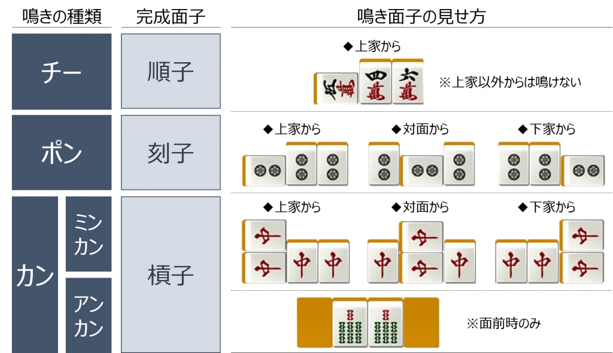
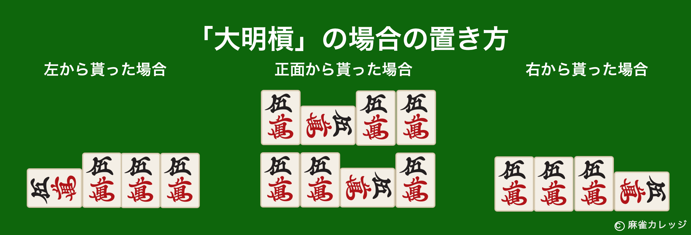
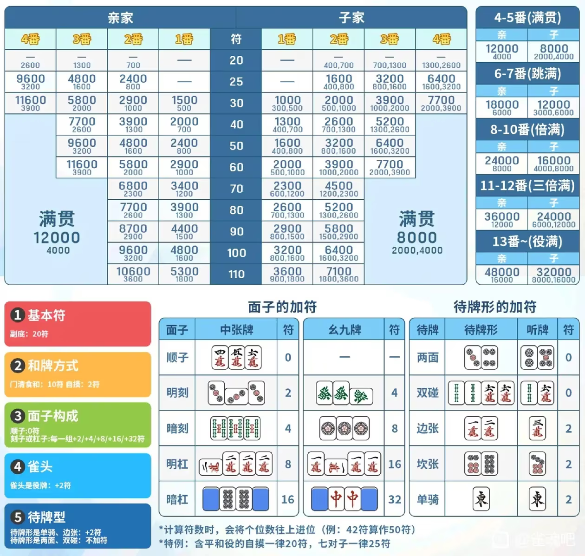

# 雀魂

## 规则

### 麻将入门

#### 麻将牌介绍

麻将共有1-9万（日语为マンズ/简写为m），1-9饼（日语为ピンズ/简写为p），1-9索（日语为ソウズ/简写为s），东南西北白发中（简写为1-7z），每一种各4张，共136张牌。为方便表示，下文统一使用上述简写。例如，2万、5万、6万、两张8饼、东、南、中，记作256m88p127z。

#### 摸打顺序

麻将由4名玩家分别坐在桌子的四个方向上进行。桌上会有东、南、西、北四个方位的标记，来标记你的自风。坐在“东”位的玩家是庄家。庄家起手14张并先打出一张牌，其余玩家起手各13张。之后逆时针轮流摸一张、打一张。

#### 基本牌形与和牌条件

3张同花色且数字连续的牌叫顺子，例如123m、456p；字牌（1-7z）不能组成顺子，数牌也不能跨越9和1，例如891、912都不算顺子。3张完全相同的牌叫刻子，2张完全相同的牌叫对子。顺子和刻子统称面子，通常的和牌形由4个面子和1个雀头（即对子）组成。

如果你的手牌组成了完整的和牌形，并且至少有一个役，你就可以和牌，这局结束。当你的和牌满足某些特定条件时，就会获得对应的“役”。不同的役有不同的番数，一手牌也可以同时满足多个役，番数会累加；大概来说番数越高，得分越高。如果你的牌虽然组成了完整的和牌型，但一个役都没有，就叫“无役”，这种情况下不能和牌。

只差最后一张牌就能和牌的状态称为“听牌”。和牌之前一定会听牌。例如你有11145m456s234p22z，此时摸到3m可以组成345m，摸到6m可以组成456m，因此称为听36m。

#### 荣和、自摸与振听

如果别人打出了你和牌所需要的最后一张牌，你可以“荣和”。打出这张牌的人称为“放铳者”，也可以说是他给你“放铳”了，通常由放铳者独自支付你这次和牌的点数。如果有人进行加杠，而加上的那张牌正好能让你和牌，你可以用这张牌荣和，称为“抢杠”。通常只能抢加杠；部分规则允许国士无双（役满之一）抢暗杠。雀魂平台允许国士无双抢暗杠。

如果一张牌同时让多人和牌，通常都算和。部分规则采用头跳，即当多人同时荣和时，只计算从放铳者起按逆时针方向最先遇到的那一家的和牌，其他人的和牌不成立；也有规则规定一炮三响直接流局，即不结算，直接结束本局。天凤平台有一炮三响流局。雀魂没有有一炮三响流局。

如果你自己摸到了和牌所需要的最后一张牌，则称为“自摸”，由另外三家共同承担。日本麻将的自摸不像四川麻将那样，不是三家各收一份荣和点数，不等价于三家同时向你放铳。因此，自摸的总收益并不是荣和的三倍；被自摸时通常也比自己放铳损失更少。

如果你处于“振听”状态中，你不能荣和别人打出的任何牌，只能自摸和牌。

#### 吃、碰、杠

如果对局中上家打出的牌能和你的手牌组成顺子，例如你有12m，上家打3m；或者你有24m，上家打3m，你可以“吃”，拿走这张牌组成顺子，然后打出一张牌。其他玩家打出的牌不能吃。

如果你手里已经有两张相同的牌，而任意一家打出了第三张相同的牌，你可以“碰”，拿走这张牌组成刻子，然后打出一张牌。碰的优先级高于吃，因此同一张牌如果有人要碰，其他人不能吃。

4张完全相同的牌可以形成“杠子”，在和牌结构中算作一个面子。如果你手里有3张相同的牌，别人打出第4张，你可以“大明杠”；如果4张牌全部来自自己手中，可以“暗杠”；如果之前已经碰了一组刻子，后来又自己摸到第4张，可以“加杠”。杠之后要补摸一张牌，然后再打出一张牌。

大明杠和加杠统称明杠，吃、碰、明杠统称鸣牌，又称副露。不可以鸣海底牌，即最后一张能摸到的牌。

吃、碰、杠后，需要把形成的面子公开摆在手牌旁边，并通过横放牌的位置表示拿的是谁打出的牌。

  
  

吃牌时还要注意“食替”规则。例如你有123m，上家打1m。虽然你可以用23m吃进1m，但吃完后不能立刻打出自己原来那张1m，这叫“现物食替”。“现物”就是别人打过的牌。又例如你有234m，上家打1m，你用23m吃成123m后，很多规则也不允许你立刻打出4m，这类情况称为“筋食替”。“筋”就是数字相差3的同花色牌。这真是一个烦人的规则！

#### 庄家轮换

进入下一局时，如果没有连庄，下一位玩家会成为庄家。大家通常不会交换座位，而是改变东南西北的身份标记。对固定坐在一个位置的玩家来说，自风（即你所在的位置的标记）会按照东→北→西→南→东的顺序变化，也可以理解为桌上的“东家标记”逆时针移动一位。

#### 入门建议

“振听”和“役”是日本麻将相比其他麻将规则最显著、也最容易让初学者头疼的规则，之后会专门进行讲解。不过，如果你以前完全不会打麻将，最先需要熟悉的并不是这两个规则，而是麻将最基本的结构：四面子一雀头，以及吃、碰、杠这些操作。

个人认为，如果只是想先熟悉麻将的基本逻辑，四川麻将会比日本麻将更容易入门，因为它的和牌限制更少。在附录中会介绍[四川麻将的规则](#四川麻将的规则)，先帮助大家建立对麻将的直觉，再回过头学习日本麻将会轻松很多。

### 役

在立直麻将中，仅仅凑齐“四面子一雀头”的基本和牌形是不够的，你还必须至少满足一个“役”的条件才能和牌。也就是说，立直麻将不允许单纯“推倒就和”；如果牌型中没有任何役，就会被判定为“无役”，无法和牌。附录中的[役种表](#役种表)列出了各类役及其详细说明。不过役种数量不少，刚开始接触时很难一下子全部记住。下面先介绍一些常见，也比较好记的役种。

#### 常见役种

- 立直：这是立直麻将最具代表性的役，也是[出现频率最高的役](https://amae-koromo.sapk.ch/statistics/fan-stats)，成立后计1番。立直要求玩家保持门前清，也就是此前没有鸣牌过。
  - 在门前清状态下达到听牌后，可以在打出一张牌时将其横置，作为立直宣言牌。如果立直宣言牌被其他玩家吃、碰或杠走（统称“鸣走”），立直仍然成立。此时，应将自己下一次打出的牌横置；如果这张牌也被鸣走，则继续横置下一张舍牌（“舍牌”即自己打出的牌），直到有一张横置牌留在自己的牌河（“牌河”即面前摆放舍牌的区域）中。如果没有其他玩家荣和这张牌，则立直成立，需要支付1000点立直棒放在桌面中央。
  - 不足1000点无法立直。这1000点会由之后和牌的玩家获得；如果本局流局，则立直棒会保留到之后的牌局作为场供，直到有人和牌为止；若多家和牌，场供及场上的立直棒由头跳家获得。
  - 立直成立后，原则上只能摸切，也就是摸到什么牌就打出什么牌，也不能再鸣牌，直到荣和或自摸。
  - 立直后仍然可以进行暗杠，但必须要求暗杠后不改变原有的待牌（待牌即能让你和牌的牌）。
  - 前面提到的门前清是立直麻将中非常重要的概念。许多役只有在门前清状态下才能成立；另一些役即使鸣牌后仍然成立，但会少一番，这种役叫做食下役。剩余牌大于等于4张时才能立直。
- 役牌：这是立直麻将中非常常见的役，不要求门前清。只要你拥有一组由役牌组成的刻子或杠子，成立后计1番。
  - 役牌包括三元牌白、发、中，以及符合条件的风牌。役牌包括场风牌，即当前场次对应的风牌。例如现在是南2局，那么拥有一组南刻子即可成立役牌。还包括自风牌，即自己座位对应的风牌。例如你当前坐北家，那么北就是你的自风，拥有一组北刻子即可成立役牌。
  - 不是役牌的风牌叫客风牌。
  - 如果同一张风牌同时是场风和自风，则两个役会同时计算，共计2番。例如在东场中，东家的东刻子既是场风刻子，也是自风刻子，因此算2番。
  - 部分规则采用“无后付”：如果在听牌时手牌本身还没有确定的役，例如手中有一个役牌对子和另一个普通对子，形成双碰听牌，那么即使最后和到役牌、使役牌刻子成立，也仍然不能和牌，因为这个役是在和牌时才产生的。雀魂有后付，这种情况下如果和到役牌，就会成立“役牌”这一役，可以正常和牌。
- 断幺九：这是比较容易达成的役，通常不要求门前清，成立后计1番。牌型中不能包含任何1万、9万、1筒、9筒、1条、9条，这些牌统称为老头牌；同时也不能包含东、南、西、北、白、发、中这些字牌。老头牌和字牌合称为幺九牌。少数规则要求断幺九必须保持门前清，这种规则称为无食断。
- 门前清自摸和：成立后计1番。保持门前清并自摸即可成立。这个役的价值之一，是让你在没有其他役、又不想立直时，仍有自摸和牌的可能。没错，后面会讲到，有些时候即使没有其他役，你也未必想立直。
- 七对子：成立后计2番，并且必然是门前清。需要由七组不同的对子组成；在立直麻将中，四张相同的牌不能当作两组对子，因此不承认“龙七对”。如果手牌很差，几乎很难凑成正常的“四面子一雀头”，但对子比较多，就可以考虑转做七对子。
- 对对和：面子全部由刻子或杠子组成，不需要门前清，成立后计2番。碰碰碰，爽！不过这个役通常不太推荐去做，之后会讲原因。
- 混一色：只使用一种数牌花色和字牌。门前清时3番，副露后2番。
- 清一色：只使用一种数牌花色，不含字牌。门前清时6番，副露后5番。这两个役都是食下役。
- 国士无双：13种幺九牌各一张，再加上其中任意一种凑成一对。属于役满，分数非常高，但牌型十分特殊。

简单来说，新手不要看到吃、碰、杠按钮亮了就直接点，先想一想，这样副露之后，我还有役吗？不然很容易把自己做成无役，最后不能和牌只能干瞪眼。

一些不被主流规则普遍承认的役，被称为古役，可以理解成“村规役”。

#### 役满包牌规则

PS：大三元（白、发、中各有一组刻子或杠子，是役满）和大四喜（东、南、西、北各有一组刻子或杠子，是两倍役满）通常存在包牌规则。如果对方已经副露了两组三元牌，你又打出第三种三元牌让他碰或大明杠；或者对方已经有三组风牌，你又打出第四种风牌让他碰或大明杠，那么你就会成为包牌者。自摸役满时，包牌者需要承担这个役满的全部责任；如果是其他玩家放铳，则包牌者承担这个役满的一半。例如有人和出大四喜+字一色，是三倍役满。若由其他玩家放铳，包牌者需要支付其中大四喜部分的一半：和牌家是亲家为96000÷2＝48000点，和牌家是子家为64000÷2＝32000点。如果是自摸，包牌者则要承担大四喜的全部分数，再加上自己本来需要支付的字一色自摸份额。因此，亲家自摸时需要支付96000+16000＝112000点；子家自摸时，如果自己是子家则支付64000+8000＝72000点，如果自己是亲家则支付64000+16000＝80000点。

所以，看到别人已经副露了两组三元牌或三组风牌时，最后那一种牌千万不要乱打！除非你有比较充分的理由判断他碰不了，例如这张牌已经有两张出现在牌局中（简称为现2），那么他手里就不可能还有两张来碰。巡目特别早，比如前三巡时，风险也相对较低，因为他不太可能起手就同时拿着所有对应的对子。如果打出去正好被他碰了，那就当是成全他了。遇到这种场面，立直也要非常谨慎，因为立直以后摸到什么就得打什么，万一摸到那张致命的三元牌或风牌，会被迫成为包牌者。就算没有包出役满，这种牌也已经非常危险。例如对方已经有两组三元牌时，第三种三元牌就可能直接放铳小三元。小三元本身2番，再加上两个役牌，共4番；如果再叠加很容易与小三元复合的混一色、对对和之类的役，轻松就能达到6番跳满，已经非常严重了！

### 振听

立直麻将最有特点的规则之一就是振听，它是很多新人的噩梦。你可以把振听理解成一种“诅咒”：一旦振听，你就不能荣和，只能自摸。虽然很烦，但振听也能防止你给别人点炮。

#### 振听的类型与解除条件

以下几种情况会触发振听：

- 舍张振听：你的听牌里包含自己曾经打过的牌。比如你听3、6万，如果之前打过3万，那么不仅3万不能荣和，6万也不能荣和。没立直的话，可以通过改变听牌解除振听；立直后听牌不能改变，只能认栽，等待自摸和牌。
- 立直振听：立直后，如果放过别人打出的和牌，或者摸到能和的牌却没有自摸，就会进入振听，而且无法解除。
- 同巡振听：也叫临时振听。没立直时，如果别人打出了你听的牌，但你没有荣和，就会暂时振听。直到自己下一次出牌解除。如果别人打出的牌满足自己的和牌型，但是因为无役不能荣和，仍然会进入振听状态。

#### 避免振听的技巧

新手出牌时，可以稍微想一下，这张牌以后会不会变成自己的和牌。例如，135打掉5后，剩下的13又摸到4，不要急着打1留下34，否则以后听25时，会因为打过5而振听。同样，之前打过9，后来又摸到8，也要谨慎保留；如果最终留下78，听69，就会因为打过9而振听。

不过，振听并不一定代表你技术不好。振听很难完全避免，魂天一样会振听。

### 王牌和宝牌

#### 牌山、王牌与岭上牌

牌山就是麻将开局洗牌后，把牌两张上下叠成一层，再一层层排成墙状的那一整排牌。游戏过程中，大家就是从牌山里依次摸牌。在日麻中，通常有14张牌不会被正常摸取。在实体麻将中，这14张牌位于牌山末端的7幢，每幢由上下两张牌组成，统称为“王牌”。

王牌的前两幢是4张岭上牌。开杠后，补摸不是从平时摸牌的位置摸排，而是从王牌中的岭上牌里摸1张。但摸走1张岭上牌后，王牌就会少1张。为了让王牌始终保持14张，正常牌山中的最后一张牌，海底牌，就会被划进王牌里，不能再正常摸到。无论开几次杠，最后始终都会留下14张王牌不能摸到。

#### 宝牌、里宝牌与赤宝牌

王牌中，第3到第7幢的上层牌是宝牌指示牌，用来决定这局的宝牌（日语是Dora）。和牌时每有1张宝牌，就额外加1番，所以大家会更倾向于把宝牌留在手里。正因为如此，宝牌更不容易被打出，而宝牌以及它周围的牌也更容易放铳，打宝牌放铳时也尤其心痛。不过要注意，宝牌不是役。如果手牌没有任何役，还是不能和牌。

开局会先翻开第3幢的宝牌指示牌。例如指示牌是2p，那么3p就是宝牌。数字牌按1-2-…-9-1循环；三元牌按白-发-中-白；风牌按东-南-西-北-东。每开一次杠，就会在补摸岭上牌，并打出一张手牌后再翻开1张宝牌指示牌，因此宝牌也会增加。若同一张牌同时被多个宝牌指示牌指中，番数会重复计算。如果立直后和牌，还可以查看宝牌指示牌下方对应的“里宝牌指示牌”。判定方式相同，这是立直的一大福利。另外，5m、5p、5s中各有1张红色的牌，叫“赤宝牌”，记作0m、0p、0s，每张同样加1番。

宝牌指示牌最多只能有5张，所以一局游戏最多只能开杠4次。如果同一名玩家开了4次杠，其他玩家便不能开杠；如果4次杠由多名玩家共同完成，会触发“四杠散了”流局。

### 点数计算

- 和牌时，每满足一个番种条件，就会获得相应的番数。
- 普通役种仅累计至役满为止，记作累计役满，日语为数え役満；若和牌中包含役满役种，则普通役种不再计入，多个役满役种之间可叠加计算。例如，大四喜+四暗刻是三倍役满，获得役满点数的三倍。
- 牌型、听牌方式等因素还会决定符数。
- 亲家（庄家）的得点为子家的1.5倍。

最终得点由番数、符数以及庄闲身份共同决定：
- 基本点 = 符\*2^(番+2)
- 闲家荣和：基本点\*4
- 庄家荣和：基本点\*6
- 闲家自摸：庄家付\*2，闲家各付\*1
- 庄家自摸：三家各付\*2

每笔支付向上取整到100点。

基本点上限：
- 满贯：5番（或4番40符及以上），2000点
- 跳满：6-7番，3000点
- 倍满：8-10番，4000点
- 三倍满：11-12番，6000点
- 役满：13番及以上（累计役满），8000点

可根据下表查出对应的和牌得点。

表格中的小字表示自摸时各家需要支付的点数。子家自摸时，小字会以逗号分隔。较大的数字表示亲家需要支付的点数，较小的数字表示其他子家各自需要支付的点数。亲家自摸时，三名子家支付的点数相同。在番数和符数相同的情况下，子家自摸时另外两名子家各支付总得点的1/4，亲家支付1/2。亲家自摸时三名子家各支付相当于子家自摸时总得点的1/2，总和为子家得点的1.5 倍。

这个表确实非常复杂，甚至职业玩家在算符时都有可能出错。幸运的是，有了电脑之后，算分已经不再困难。一个比较简便的估算方法是：

| 番数     | 等级  | 点数      |
| ------ | --- | ------- |
| 1番     | —   | 1,000点  |
| 2番     | —   | 2,000点  |
| 3番     | —   | 4,000点  |
| 4–5番   | 满贯  | 8,000点  |
| 6–7番   | 跳满  | 12,000点 |
| 8–10番  | 倍满  | 16,000点 |
| 11–12番 | 三倍满 | 24,000点 |
| 13番及以上 | 役满  | 32,000点 |

亲家的得分是以上的 1.5 倍。

### 流局

流局指的是没有任何人和牌，但这一局仍然结束的情况。

#### 荒牌流局与不听罚符

如果牌山已经摸完，仍然没有人和牌，就称为荒牌流局，这也是最常见的流局。荒牌流局时，未听牌的玩家需要向听牌的玩家支付点数。好消息是，判定听牌时可以处于振听状态，也不需要有役；即使是空听，也仍然算听牌。所谓空听，就是所有和牌张都已经出现，不可能被摸到了。不过，不能通过虚听来获得听牌判定。虚听就是，你手里已经有某种牌的四张，而和牌却要求不存在的第五张相同的牌，这种情况不算听牌。

荒牌流局时，听牌与未听牌玩家之间转移的点数总额固定为3000点：
- 1人听牌、3人未听牌：3名未听牌玩家各支付1000点给听牌玩家。
- 2人听牌、2人未听牌：2名未听牌玩家各支付1500点。
- 3人听牌、1人未听牌：未听牌玩家需向其余听牌玩家每人支付1000点，共支付3000点。
- 4人全部听牌，或全部未听牌：不发生点数支付。
未听牌的玩家只需要支付“不听罚符”。和四川麻将的“查大叫”相比，这里的损失就温和多了。

另外还有一个彩蛋役：如果荒牌流局时，一名玩家从头到尾打出的牌全部都是幺九牌，而且这些牌一次都没有被别人鸣过，就可以达成流局满贯，等价于自摸8000点。

#### 途中流局

除了荒牌流局之外，还有一些特殊情况会让牌局立即结束，这类情况称为途中流局:

- 九种九牌：在自己的第一次摸牌后，如果手牌中含有至少9种不同的幺九牌（注意不只是9张），并且此前没有任何玩家鸣牌，可以选择宣布流局，也可以不流局。
- 四风连打：在没有任何人吃、碰、杠的情况下，第一巡中四名玩家打出的第一张牌全部是同一种风牌时，立即流局。
- 四杠散了：同一局中，如果由两名或以上玩家累计进行了四次杠，则会触发流局。不过，如果第四次杠发生时有人抢杠和牌，则按照和牌处理。
- 四家立直：四名玩家全部宣布立直，并且最后一名玩家的立直宣言牌没有造成放铳时，牌局流局。

### 局间规则和PT计算

#### 巡目

一局麻将可以按照巡目，也就是你已经打出了几张牌，大致分成三个阶段：1-6巡称为序盘，7-12巡称为中盘，13巡以后称为末盘。雀魂的牌河正好也是6张一行，因此看牌河时非常方便。第一行是序盘，第二行是中盘，第三行以后是末盘。

#### 连庄、本场与场次

一整场麻将的第一局叫做东一局，场风为东。如果庄家和牌，或者荒牌流局时庄家处于听牌状态，又或者发生九种九牌等途中流局，庄家都会继续连庄。此时局数不变，本场数加一，例如依次进入东一局一本场、东一局二本场，其他局也是同理。

每增加1本场，荣和时由放铳者多付300点；自摸时其他三家各多付100点。若多人同时荣和，仅头跳家获得本场加点。本场加点与亲家、子家无关。

反之，如果只有子家和牌且庄家未和牌，或者荒牌流局时庄家未听牌，庄家就会下庄，庄位会按照东、南、西、北的顺序轮到下一家，牌局会依次进入东二局、东三局、东四局。子家和牌时，本场数清零；荒牌流局时，无论庄家是否连庄，本场数都会加一。东一局至东四局合称为东场。

东场结束后进入南场，此时需要把场风标示调整为“南”。之后的牌局依次称为南一局、南二局、南三局、南四局。

#### 对局形式与结束条件

常见的对局形式主要有：
- 东风战：只打东场，也就是东一局到东四局。雀魂线上对局采用5+20秒的思考时间：每次操作有5秒，另有20秒共用的备用时间；备用时间耗尽后，每次就只剩5秒；一场对局约20分钟。
- 半庄战：打东场和南场。一场对局约40分钟。

每位玩家开局时都有25000点，也就是所谓的“原点”。

在雀魂中，如果东风战的东四局，或者半庄战的南四局结束后，没有任何一名玩家达到30000点，对局不会立刻结束，而是继续进入下一场。东风战会进入南场，半庄战则会进入西场，这种情况分别称为南入和西入。南入或西入之后，只要某一局结束时有玩家达到或超30000点，对局就会结束；但此时若存在庄家连庄且当前庄家不是一位的情况时，连庄优先；庄家为一位，超过30000点且满足要求可以连庄时，不再连庄，结束游戏；如果始终无人达到30000点，则最多进行到南四局或西四局。此时由第一位获得全部场供。

有击飞规则。有玩家点数为负数时立即结束游戏，有玩家为0点时继续游戏。

#### 顺位、马点与PT结算

游戏结束后，会根据玩家的最终位次和得分计算PT，用于段位升降、比赛评分等。

四麻中，各位次的马点分别为1位+15、2位+5、三位-5、4位-15。游戏结束时，若玩家点数相同，则按东一局的座位顺序决定名次，东家优先，其次为南家、西家、北家。

然后计算精算点数=最终得分-25000÷1000+马点。

在雀魂中，最终获得的PT计算公式为roundup（精算点数）+段位分。roundup表示向上取整。段位分由对局房间等级、最终顺位和玩家段位决定，属于雀魂内的特有规则，此处不作介绍。

## 上卷

### 序言

了解完规则之后，我们便要正式开始学习麻将的技术了。短期来看，运气确实是决定胜负的主要因素；但把时间拉长，技术水平一定会反映在数据上。

有人看到一手牌会说：“这一手再摸几张万子，就能做成混一色了。”这和“这一手之后只要再摸3张发、3张中、3张白，就是大三元了”本质上又有多大区别？初学者尤其要避免只盯着最理想的情况做牌。麻将并不会按照你脑海里预设的剧本发牌。日本麻将里有一种说法叫“絵合わせ麻雀”（拼图麻将）就是只按照心中的最好剧本来打麻将。初学阶段，最需要避免的正是这种打法。

下文将介绍以下几项麻将知识：
- 牌效率基础。所谓牌效率，就是让自己和牌更快、打点更高的技巧。
- 弃和基础。日麻中，被自摸或流局未听的损失一般小于放铳，因此避免放铳很有价值。振听规则限制了荣和，我们可以利用这一规则，放弃和牌，选择不容易放铳的牌来减少损失。
- 立直策略基础。

本部分的框架参考了《魔女博客——初心の入门书》，也结合了其他博主的讲解，具体参考资料见附录。

#### 阅读前的准备与建议

建议至少先熟悉麻将最基本的和牌结构，以及吃、碰、杠等基本操作。完全没有麻将基础的读者，可以先打几局四川血战到底麻将来建立直觉。虽然四川麻将与日本麻将在战术上有很大差异，但基本的牌型结构和吃碰杠规则是相通的。具体规则可参见[四川麻将的规则](#四川麻将的规则)。

也建议先随便打几局日本麻将，争取做到以下几点：
- 理解什么是振听、什么是役，不会在对局中经常无役振听。
- 熟悉[上文所述](#役)的常见役种。

虽然不要求读者完全记住前面介绍的所有规则和役种，但上卷将不再重复解释这些内容。如果阅读时遇到不熟悉的规则或役种，请自行查阅[规则](#规则)或附录[役种表](#役种表)。

阅读时建议做笔记。遇到不理解的地方，不要死记硬背，先自己推演一下为什么作者会这样说。如果因为作者编排不够妥当，不小心提前提到了尚未讲解的概念，可以先记下来，暂时放下，阅读完再回头看。如果发现了作者忘记解释的术语，可以去上网搜索或着询问AI。

认真阅读优秀的教材，胜过自己瞎打一辈子。如果能够熟练掌握这一章的战术，实际上已经算是中级玩家了。这些技术并不是认真看完就能立刻掌握的，需要通过大量实战不断积累熟练度。

### 牌效率 - 孤张

#### 孤张与牌效率

打麻将时，每打掉一张牌，其实都意味着放弃了这张牌未来可能的发展。最直白的例子是，你打掉一张牌以后，就很难把它摸成对子或者刻子了。所谓“牌效率”，就是比较不同牌的未来价值。我们要尽量保留潜力大的牌，舍弃潜力小的牌，从而让自己的手牌更快地向听牌推进。

一开始，比如我们摸到了1255m257p378s1366z。这时候手牌还比较凌乱，我们应该先打什么呢？可以先把手牌拆开来看。12m摸到3m就能组成面子，55m是对子；2p是一张孤张，57p摸到6p就能组成面子；3s是一张孤张，78s摸到6s、9s都能组成面子；1z、3z都是孤张，66z则是对子，之后还能碰成役牌刻子。你会发现，2p、3s、1z、3z现在都比较孤立，还需要摸到更多合适的牌才能派上用场，所以它们的价值比其他牌低，应该优先打出。

#### 孤张的舍牌顺序

对于孤张，推荐按照这个顺序打出：
1. 客风牌：只能形成对子和刻子，发展潜力最低，最优先打出。
2. 1、9数牌：除了形成对子和刻子，还可能未来变成12、13。12只有摸到3才能形成面子，13只有摸到2才能形成面子。9的情况和1一样，只是方向相反。之后遇到这种对称的情况，我们都只讲其中一边。
3. 役牌：和客风一样，只能形成对子和刻子。但是役牌一旦碰成刻子，就会有役，之后可以更自由地吃碰，而不用担心无役。所以虽然它的发展潜力不如1、9数牌，但还是更值得保留。
4. 28数牌：以2为例，可以变成12、23、24。12只有摸到3才能形成面子，24只有摸到3才能形成面子，而23摸到1或者4都能形成面子，所以2比1有更多的发展方向。8同理。
5. 3-7数牌：以3为例，可以变成13、23、34、35。13只有摸到2才能形成面子，35只有摸到4才能形成面子，而23摸到1或者4，34摸到2或者5都能形成面子，因此3-7的发展潜力最大。

对于客风来说，出牌顺序影响不是很大。不过真要细究，可以考虑两种策略：
- 首先是比较常见的推荐顺序。自己想尽快做牌时，先打下家的自风，再打对家的自风，最后打上家的自风。原因在于，三家如果要碰自己的自风，你最希望的是上家来碰。因为你打出一张牌后，上家一碰完，你就会多一次摸牌的机会，对自己推进手牌最有利。所以，如果上家的自风最后打出，在你打出它之前，上家已经比另外两家多经历了一些摸牌机会，比其他家更有可能把自己的自风摸成对子，从而碰牌。
- 如果有特别想压制的玩家，可以考虑优先打他的自风。比如你现在排名第三，但和第四名的点差很小，你希望他不要通过和牌反超你，你最需要防范的自然就是第四名。你优先打出他的自风，对方在此之前经历的摸牌次数就会比别家少，也就更不容易已经把自风摸成对子，他就更难碰自风，更难做牌。

#### 孤张价值的修正因素

以下因素会影响孤张牌的出牌顺序：
- 14中的1，价值低于单独的1。如果手里有14，如果先打掉1，之后即使摸到2或者3，仍然可以和4组合成24或34，所以除了损失1本身形成对子、刻子的可能性以外，没有其他损失。但如果是一个完全孤立的1，就会直接失去变成12或13的可能性。而且这种牌相比客风还更容易放铳，所以价值甚至低于客风，可以最优先打掉。
- 15中的1，价值高于单独的1。因为15可以形成135的结构。当然，15价值低于2。
- 场上已经出现过一张的役牌，价值会降低很多。役牌一旦已经在场上出现过，无论是在牌河中被打出，还是作为宝牌指示牌出现，剩余枚数都会减少，之后再做成刻子的难度也会明显提高，因此保留价值会随之下降。相应地，因为出现过两张的役牌不可能碰到，所以几乎没有价值了。
- 三元牌之间，优先打发。因为发相比白和中，多了一个绿一色役满的可能性，所以发对别人的潜在价值略高。为了减少被利用的可能，优先打发。
- 役牌之间，先打场风牌再打三元牌后打自风。三元牌对所有人都有役，因此更容易被碰，早点打可以减少之后被碰的概率。如果自风和场风不一致，场风牌不仅对所有人都有役，对于场风和自风同样的玩家来说是连风牌，碰了就有2番，应该比三元牌更优先打出。自风只对自己有役，对其他玩家没有役牌价值，因此可以晚一点打。
- 客风是宝牌时，价值远远高于役牌。因为只要有一张宝牌就能获得一番，而役牌需要三张才能有一番。注意宝牌不是役。

#### 孤张价值的模拟比较

把宝牌、已现枚数等修正因素考虑进去后，这个排序到底会发生多大变化呢？

虽然这么详细的排名，对麻将胜负本身并没有多大影响，但作者自己也很好奇，所以就拿 [Mahjong Nanikiru Simulator](https://pystyle.info/apps/mahjong-nanikiru-simulator/) 跑了不少局面，比较打出不同孤张时的打点预期。需要注意的是，这是一个单人麻将模拟器，并不会考虑鸣牌。因此，役牌可以通过碰牌直接形成役种这一优势无法被正确反映，模拟结果会系统性低估役牌孤张的实际价值。

笔者最终还是放弃了继续做两两对比。首先，不能用Codex跑。一个原因是它非常非常非常消耗usage，消耗量是用Codex Workspace正常编程的很多倍。笔者前后Reset了三次才勉强跑完，而且用的还是Plus套餐，每月20美元的！另一个更重要的问题是，Codex很难做到严格控制变量。首先，模拟时要保证“搭子（如13这样的两张牌，摸到2就能形成面子） + 面子 + 对子”的数量少于4。因为和牌只需要4组面子，如果已经有4组以上，我们基本上就不太需要这些孤张再去形成新的面子了，直接使用手里已有的搭子即可，这样就很难比较出不同孤张本身的成搭能力。同时，手牌里也不能有太多对子，或者过多幺九牌。否则七对子和国士无双这两个比较特殊、并不遵循普通牌效率逻辑的役种就会混进来，干扰最终结果。但另一方面，牌又不能做得太差。具体来说，4向听（之后马上会介绍什么是向听，这里就简单理解成很不好的牌即可）以上的手牌，模拟器无法计算期待得点。如果全部靠自己手动跑，两两比较的工作量实在太大。

另一个麻烦是，模拟结果偶尔还会出现一些很难解释的反常现象。比如某些局面里，手牌同时有14，宝牌分别设为1和北时，宝牌北的保留价值居然会低于4；但如果单独比较，宝牌客风的价值又明显高于5。这样的结果很难判断究竟是我输入时出了问题，还是手牌里存在某些没有注意到的结构差异，抑或模拟器本身的计算方式导致了这种现象。每遇到一次都要重新检查条件、排查变量，实在太麻烦了。

所以最后没有继续追求一个严格的完整排名，只是试着跑了一些有代表性的局面，大致得到了下面这些结论。

- Dora有压倒性的优势。[客风dora的价值甚至明显高于5](https://pystyle.info/apps/mahjong-nanikiru-simulator/?v=1&mode=yonma&hand=2567789m13445p5s4z&dora=3z&counts=4244232333432244444444244444433444111&turn=3&round=27&seat=27)。甚至客风dora已现1 枚时，[价值仍然和3-7的中张孤张差不多](https://pystyle.info/apps/mahjong-nanikiru-simulator/?v=1&mode=yonma&hand=2567789m13445p5s4z&dora=3z&counts=4244232333432244444444244444432444111&turn=3&round=27&seat=27)，[并且明显高于28](https://pystyle.info/apps/mahjong-nanikiru-simulator/?v=1&mode=yonma&hand=2567789m13445p2s4z&dora=3z&counts=4244232333432244444344344444432444111&turn=3&round=27&seat=27)。
- Dora已现2枚后，优势会明显下降。客风dora已现2枚时，[它的价值已经和生张（场上没有出现的）19差不多](https://pystyle.info/apps/mahjong-nanikiru-simulator/?v=1&mode=yonma&hand=2567789m13445p1s4z&dora=3z&counts=4244232333432244443444344444431444111&turn=3&round=27&seat=27)。
- [连风牌已现1枚，价值和役牌几乎一致。](https://pystyle.info/apps/mahjong-nanikiru-simulator/?v=1&mode=yonma&hand=3345678m179p3s145z&dora=1z&counts=4423233343444343434434344442443344111&turn=3&round=27&seat=27)
- 已现1枚的役牌与生张19，价值难以通过模拟比较。根据雀魂内置的AI复盘工具MAKA的建议，一般应先打生张19。

### 牌效率 - 搭子

#### 搭子的类型与保留优先级

处理完价值较低的孤张以后，我们就可以开始观察手牌中还没有组成面子的两张牌组合。其中，两张相同的牌叫对子；而像12、35、78这样，距离组成顺子只差一张的两张数牌，就叫做搭子。搭子有三种：

1. 边张：12和89。12只有摸到3才能形成顺子，89只有摸到7才能形成顺子。
2. 坎张：例如35，需要摸到中间的4才能形成顺子。
3. 两面：例如78，摸到6或者9都能形成顺子。

边张和坎张都只有一种牌能够直接形成顺子，因此称为愚形搭子；两面摸到两种牌都能形成面子，因此称为好形搭子。

边张的价值最低，其次是坎张，两面的价值最高。不同坎张之间也有区别，因为它们未来变成两面的能力不同。可以按照下面的顺序理解：

1. 边张12/89。以12为例，只能通过摸到3形成顺子，而且本身没有改良成两面的空间。
2. 坎张13/79。以13为例，本身需要摸到2才能形成顺子；但如果摸到4，就可以改良成34两面。
3. 坎张24/68。以24为例，摸到5后可以改良成45两面。
4. 其他中张坎张35/46/57。可以从两个方向改良成两面，因此比靠近边缘的坎张更有价值。
5. 两面。两面摸到两种牌都能形成面子，不要优先拆掉。

所以可以不同搭子的保留优先级是边张 < 13/79坎张 ≈ 24/68坎张 < 其他中张坎张 << 两面。

#### 拆搭子的顺序与振听

如果已经决定拆掉一个搭子，先打外侧还是先打内侧，有时也会产生区别。

对于两面搭子来说，差别不大。例如想要拆34m。
- 先打3m，留下4m。之后如果摸到2m，就会形成24m坎张；但因为3m已经被自己打过，之后如果再听3m，就会产生振听。
- 先打4m，留下3m。之后如果摸到5m，就会形成35m坎张；同样，因为4m已经被自己打过，之后如果再听4m，也会产生振听。

对于坎张，更倾向于从外侧拆，保留更靠中间的牌，可以留下更多改良空间。例如13m决定拆掉时，先打1m留下3m：
- 如果之后摸到2m，会形成23m，也就是14m两面。不过因为自己已经打过1m，这会成为振听两面。
- 如果之后摸到4m，会形成34m，也就是正常的25m两面，不会振听。

对于边张，先打内侧还是外侧，要根据自己的手牌情况判断。例如决定拆12m时，如果先打1m、留下2m，之后却摸到3m，就会形成23m，也就是摸到14m能形成面子的的两面。不过，因为自己已经打过1m，这时会处于振听状态。如果自己的牌比较差，没有什么其他好形搭子，那么这个振听两面比较可能比其他愚形搭子更快形成顺子。这种情况下，可以先打1m，保留摸到3m后重新形成两面的可能。反过来，如果自己的牌其他搭子质量也不错，那么这个振听两面就没有那么值得保留。尤其是如果它一直留到最后，反而可能让最终听牌陷入振听。这种情况下，可以先打2m，更彻底地放弃12m这个搭子。

总的来说优先打外侧牌是一个很好用的经验法则。

这种拆掉搭子以后，却又摸到本来想要的牌，结果形成振听搭子的情况，日语里称为裏目（うらめ），意思是“适得其反”，中文里也俗称“烫到了”。

上面的搭子优先级默认相关牌都还没有出现时的理论效率。实际对局中，还要看这些牌究竟剩多少张。例如：12223455m1229p12s，乍看之下，9p似乎是最明显的孤张，好像应该优先打掉；但这里其实可以把万子部分理解成1 + 222 + 345 + 5。由于2m自己手里已经有三张，剩余的2m只有一张，因此1m以后和2m组成12搭子的机会已经很少，价值低于9p。

### 牌效率 - 向听数、有效牌、进张重复、听牌型

为了方便之后的讲解，这里会介绍一系列术语。

#### 向听数与进张

向听数可以理解为：对于14张手牌，至少还需要摸多少次牌，才能进入听牌状态。向听数越小，就说明手牌距离听牌越近。例如1向听表示再前进一步就能听牌。[Mahjong Efficiency Trainer](https://euophrys.itch.io/mahjong-efficiency-trainer) 提供了专门的向听数计算训练，可以用来熟悉不同手牌的向听判断。手牌向听数很高，比如说5向听时不必追求精确计算；但对于3向听、2向听和1向听，最好能够比较快地判断出来。大致掌握自己当前的向听数，对于估计自己的局势非常重要。手牌的最差情况是七对子6向听。

#### 进张

另一个术语是进张，日语是“受け入れ”。所谓进张，就是能够让手牌向听数下降的牌。例如一手牌当前是2向听，那么摸到某些牌以后能够变成1向听，这些牌就属于这手牌的进张。比如手里有23m，在完成这个顺子能够使整手牌向听数下降的情况下，1m和4m就是进张。[Tenhou](https://tenhou.net/2/) 支持使用麻将牌简写输入牌型：万子用m、筒子用p、索子用s、字牌用z，赤宝牌用0表示。输入手牌后，可以计算当前手牌向听数，以及切出每一张牌时对应的进张。当然，进张最多选项的并不一定是牌效率最大的选项！你会发现，牌越烂，向听数越大，进张就越多。

有一个很重要的概念叫做进张重复，日语里叫二度受け。当两个搭子的进张有重复时，这两个搭子的价值都会下降。比如你有3467m23s，现在需要拆掉一个搭子。应该拆34m或67m，而不是拆23s。假设拆掉34m，剩下的进张有58m、14s；如果拆掉 23s，则只剩下258m。因为5m同时是34m和67m的进张，所以拆掉它们其中一个的进张损失只有一种牌，不像拆掉单独的两面搭子一样损失两种牌。

再看几个例子：
- 6889p12s，应该打9p，而不是1s。因为89p的进张和68p重复。
- 2368m24888p，应该打8m，而不是2p。这里的68m的价值略低于24p。因为68m的后续改良存在潜在的进张重复。如果摸到5m，68m改良成56m，此时4m就会同时成为56m和23m的进张。

#### 改良与有效牌

有时候，摸到一张牌后向听数不会下降，但进张会增加，这种变化叫作“改良”。例如，手里有13时摸到4，牌形变成34，虽然向听数不变，但进张变多了。进张和改良合称有效牌。

#### 基本听牌型

听牌的基本类型主要分为以下几种：

1. 两面：3面子+雀头+两面搭子，听两种8张。是好形。
2. 双碰：3面子+2对子，由于两种牌手里都已经各有两张，听两种4张。是愚形。
3. 坎张：3面子+雀头+坎张搭子，听一种4张。是愚形。
4. 边张：3面子+雀头+边张搭子，听一种4张，而且没有坎张的改良。是愚形。
5. 单骑：4面子+1单张，听一种3张。是愚形。

单骑虽然听牌张数少，但很容易换听。你可以很轻松地改听更容易和到的牌，例如场上已经出现一张的字牌。也可以借助已有面子形成更好的复合听牌。比如手里有234面子，单牌可以组成1234，听14，共6张。组成2234，听25，共6张。如果有333面子，组成3334，听245，共11张！所以单骑听牌时，不要急着立直，它的改良很多。

实际牌形会出现比这些复杂得多的复合听牌，但说到底，都可以通过拆解，理解成两面、坎张、边张、双碰和单骑这几种基本结构的组合。

### 牌效率 - 对子、七对子、对对和

#### 对子的价值

和牌需要面子和雀头，不过对子的价值比面子低很多。首先，对子虽然能发展成刻子，但自己已经拿着其中两张，剩下的进张只有2张，甚至少于边张的4张。如果不能碰，很难组成面子。其次，和牌只需要一个雀头，而手里有14张牌，摸到与其中某张相同的牌，就有机会形成对子，因此对子并不难获得。

所以，除非已经接近听牌，否则不要为了保留雀头而拆掉面子。例如1223，即使22是手里唯一的对子，也应该打2，保留123，而不是打1来保住对子。不过，临近听牌时，为了获得好形听牌，可以考虑拆暗刻。例如234m45789p345888s，此时打8s把88s作为雀头，听36p两面，比打4p或5p单骑听牌更好。也不要过早确定雀头。例如12446，不要急着把44当作雀头而打掉6，应把这个形状看作1+24+46，打掉1，这样不损失任何进张。

#### 对子的数量与进张

只有一个对子时，摸到它的第三张只是改良，不是进张。因为对子变成刻子后，手牌就失去了雀头，还得另找一个。例如23567m236p24699s，99s是唯一的雀头，摸到9s并不能减少向听数，因此不算进张。不过，这张牌是很好的改良。摸到9s、打掉6p后，手牌变成23567m23p246999s，进张就会增加很多。此时999s已经成为面子，接下来需要的是雀头；而对子很容易形成，摸到与手中任何一张未组成面子的牌相同的牌，都可以产生雀头。

有两个对子时，它们合计提供4枚进张。例如23789m1166p5678s，摸到1p或6p都能让其中一个对子变成刻子，同时留下另一个作为雀头。因此，有两个对子时，拆掉其中一个，会失去4枚双碰进张。

第三个对子只额外增加2枚进张。例如33789m1166p567s1z，对子提供的进张是3m，1p6p，共6枚。一般两个对子就够了，更多对子会挤占你的手牌空间。如果有三个对子，可以考虑牺牲2枚进张，拆掉其中一对，保留更有价值的其他牌。总的来说，一个对子不提供进张，两个对子合计提供4枚进张；有三个对子时，可以考虑拆掉一对，损失2枚进张来保留其他更有价值的牌。

#### 复合形中的对子

拆对子时，经常会遇到两面对子，如566；坎张对子，如688；以及边张对子，如112或122。这时应该拆哪一个对子呢？ 例如你有两个面子和566m33p466s，如果要在6m和6s之间选择，应该打6m，拆掉两面对子中的对子，保留56m两面搭子。原因在于，566m和466s都既能作为搭子，也能提供雀头。它们作为对子的价值相同，作为搭子的价值却不同。拆掉其中的对子，不会影响顺子进张，但会影响摸成刻子后留下的形状。打6m后，如果摸到6s或3p，就会形成56m33p4666s或56m333p466s。此时打掉4s，都能留下56m两面听牌。反过来，打6s后，如果摸到6m或3p，就会形成5666m33p46s或566m333p46s。此时打掉5m，留下的却是46s坎张听牌。拆掉复合形中的对子，就是放弃它变成刻子的机会，保留它作为搭子的功能。因此，应该拆好形中的对子，把好形留下来做搭子，让愚形承担雀头的角色。毕竟，好形对子和坏形对子摸成刻子的概率相同，我们更希望在其中一个对子变成刻子时，留下的是好形搭子。

如果好形对子余1枚、坏形对子余2枚，拆好形对子自然更有利。但如果坏形对子余1枚、好形对子余2枚，就存在一些取舍，但实验证明拆好形对子更有利。例如123566m33789p466s，即使6s只剩1枚，[Mahjong Nanikiru Simulator](https://pystyle.info/apps/mahjong-nanikiru-simulator/)的结果仍然显示：先打6m、保留56m两面搭子的期待得点明显更高。这个例子说明，保留好形的价值，足以弥补少一枚刻子进张的损失。

还有一个关于牌理的小知识：遇到224466这种连续坎张对子形，该怎么拆？例如224466m789p23789s该切4m。根据牌理计算，拆中间的对子，进张数最多。为什么不切2m呢？因为即使切2m后摸进5m，看起来搭子得到了改善，实际上却没有进向听。这样一来，手牌就没有雀头了。不过，如果手牌本身已经有四个对子，情况就不同了。例如224466m789p33789s，这时，无论拆掉哪个对子，进张数都是一样的，但切3s后续还有做成一杯口的可能性。

#### 七对子

有四个对子时，手牌会变得棘手，因为一般形的进张可能很少。这时可以考虑以下两种补救办法：

- 通过断幺九或染手（做混一色或清一色）等役，放弃门前清，利用鸣牌推进手牌。例如4m23488s33567799p，很多人会先打4m，但这里应该打9p，考虑走断幺九路线，为之后碰牌创造条件。这手牌对子多，进张很少；打掉一张9p，除了损失再摸到9p形成刻子的机会，并不会损失其他进张。之后摸到合适的牌，再打掉剩下的9p，就能往断幺九推进，通过吃碰缓解进张少的问题。
- 保留七对子的可能。例如4499m12789s33p33z，手里只有789s一组顺子，其他部分进张很少，对子之间也缺乏联系，可以考虑转做七对子。不过，即使有了做七对子的想法，也不要随便挑一张单张打掉，而应尽量保留一般形的可能，选择进张损失最小的牌。例如67889m566p3599s33z，打9m就是最经济的选择。因为七对子的进张非常少。当手牌有五个对子时，是七对子一向听，只有3种、共9枚进张，听牌非常不容易；四个对子更是才到七对子二向听。因此，不妨给自己多留一些机会，万一之后一般形变好了，还能及时转回去。当然，如果四个对子的手牌形状实在太差，那就不用再兼顾一般形了。七对子和一般形（即普通的4面子1雀头和牌）向听数相同时，只要一般形能够形成好形，应该优先做一般形。

手里有五个对子时是七对子一向听。不过，如果一般形的牌形也很好，例如好形两向听，就不要完全放弃一般形。因为如上所述，七对子一向听到听牌非常难。

#### 对对和

新手，尤其是打过四川麻将的人，容易看到对子多就一路碰下去，做成对对和。在四川麻将中，碰牌后还有加杠得分的机会；但在日麻中，不能照搬这种思路。对局水平越高，对对和占整体和牌的比例通常越低。不要因为对对和不要求门前清，就觉得“碰碰碰就完事了”。

有四个对子时，要慎做对对和。如果手里只是四个普通的中张对子，不要轻易副露，去做对对和nomi。のみ（nomi）在日语中表示“仅有”。在日麻中，用来表示手牌只有所提到的役，没有其他役或宝牌加番。常见用法有“立直nomi”，“对对和nomi”，“混一色nomi”等。例如，你有3355m46699p3578s，宝牌是5p。此时对家打出6p，不建议碰，原因有三点：
- 剩下的对子不好碰。例如55m，别人不会轻易打出中张5宝牌，更不用说红5。
- 碰牌容易导致对对和nomi，只有2番。这手牌没有其他确定的役，碰了6p以后，普通的顺子手很可能无役，只能继续追求对对和。碰牌在这里会导致失去一些有价值的进张。如果保持门前清，之后摸到0p，便能与46p组成406p顺子，其中红5同时计算赤宝牌和普通宝牌；碰掉66p后，这条路线就消失了。
- 副露会降低手牌的防守能力。副露越多，手中可以自由打出的牌越少。别人立直时，你能选择的安全牌也会越少。

有三个对子时，一般应该拆掉一个对子，向一般形推进，不要急着做对对和。只有当牌形很差、一般形难以和牌时，才应该考虑保留三个对子，而且要转做七对子而不是对对和。例如79m2379p22468899s，不要拆第三个对子了，出9m/9p。这么差的手牌，往往是别人先立直。做七对子可以保持门前清，比碰牌做对对和保留更多手牌，在他人立直时有更多安全牌可选。

五个对子时，一般应优先考虑七对子，而不是对对和。
- 如果手中没有刻子，五个对子做对对和还是3向听，而做七对子已经是1向听。
- 七对子听牌后容易换听。摸到更适合等待的单张，就可以换掉原来的待牌。例如，客风字牌比较容易被别人打出，可以考虑听它。
- 七对子和对对和本身都是2番，但七对子保持门前清，可以叠加立直、门前清自摸、一发和里宝牌。例如，立直、七对子、自摸，再中两张里宝牌，就是6番跳满。

那么，什么时候推荐做对对和？
- 已有暗刻，不需要把所有面子都靠碰牌完成。
- 能够复合其他役。例如役牌、断幺九、混一色、三暗刻，既能提高打点，也能保留转做一般形的可能，避免只能靠连续碰牌完成对对和。
- 对子容易碰到。例如幺九牌，28数牌等别人较容易打出的牌，比普通中张对子更容易碰到。因为这些牌成为待牌的概率更低，别人会觉得这些牌更安全，打起来更放心，这就正合你的计划。具体数据可以参考[这篇关于不同牌成为待牌的频率的博客](https://blog.kobalab.net/entry/20180120/1516417938)。如果你手里的5个对子都特别好碰，你甚至可以不做七对子而去做对对和。
  - 44m5577p1366s377z不应该碰中，继续做七对子。
  - 11m2288p13s22377z应该碰中。
  - 11m2288p1399s223z不该碰中，尽管对子好碰，但因为是对对nomi，一旦遇到对手立直，这手牌的打点不足以让我们有信心继续与对手对攻。

### 牌效率 - 复合形

除了对子和搭子之外，数牌之间还可以形成更复杂的组合结构。下面介绍一些容易理解的复合形。参考了up主[星野Poteto](https://space.bilibili.com/303003611)的系列视频。

#### 经典好形

- 五连形：如23456，经典的三面听，听147。
- 四连形：如4567。
  - 既可以看作面子加单张，也可以看作两个两面的组合。3568都是进张，并且能留下两面搭子，还可能发展成34567、45678这样的进张258或369的三面听形状，价值很高。
  - 如果听牌时没有对子，四连形可以转化出雀头。例如有三个面子和4567时，听47形成雀头。比如说你有23m1111234p278s77z，宝牌为7z。这手牌不要暗杠1p，因为几乎没人能忍住不碰宝牌7z；一旦碰出，手牌就会失去雀头，最后可能四个面子齐了，就需要一个雀头和牌，也就是单骑听牌，只听3张。保留111+1234的结构，则能更方便地产生雀头，避免单骑。此外，这手牌还有发展成混全带幺九的可能。
  - 1234只有创造雀头的价值，因此如果手牌不缺雀头，价值和123面子+4孤张差不多。
  - 对于1234这个形状来说，打1和打4的牌效率损失其实差不多，尽管1比4更不容易放铳。因为打掉1以后，4也就被锁定在234这个面子里了。
- 中膨形：如4556。不要把它看成456+5的孤张；这是45+56，3467都是进张，都能留下两面搭子，还有发展成一杯口的可能，价值很高。不过，1223这样的边张中膨形价值要低得多，基本可以视为123+2。

#### 坎张复合形

- 两坎：如468。虽然大家不太喜欢坎张，但是其进张数和一个两面相同，而且只占三张手牌，价值不算太差。
- DNA形：如134556。
  - 既可以拆成1+345+56来看，也可以拆成135+456来看。这个牌形的有效进张包括247，因此1并不是多余牌。DNA形也常称为两面坎张型。
  - 类似的隐藏两坎还有AABCCE形，如445668，可以拆成456+468。8并不多余。
- 长两坎：如134568，1和8都不多余，摸到2或7都能组成两个面子，可以理解为“一个面子+两坎”。更气人的是，如果先打1，之后摸到2，就会留下23456，听147三面。如果因为打过1而振听，那可真是气死人了！打8后摸到7也一样。可以记成3456四连形，两端各隔一张添一张牌。
- 长坎张对子：如134566，作用类似133这样的坎张对子。133进13，134566进26。可以记成3456四连形，一端隔一张加1，另一端再加一张6。
- 连坎：
  - 四连坎如2468，就是著名的“非洲大连坎”。摸到5后，组成456，会留下28两张浮牌，形状不太好。奇数的四连坎如1357，至少还能摸8打1，改良成3578。偶数四连坎2468则没有改良。
  - 五连坎，如13579，拆掉一张就会变成较差的四连坎。与四连坎不同，它进张后仍能留下不错的形状。摸到2后，变成123+579，留下两坎；摸到4打掉1后，变345+79，留下坎张。

#### 顺子强化复合形

顺子强化的孤张和坎张。顺子越靠近边缘，强化作用越小。如果顺子已经撞墙，也就是最大数牌为9或者最小数牌为1，则无法提供这类强化。
- 跳一形，如1345：
  - 1345中的345能够强化旁边的1。1345摸1形成对子，摸2形成两面，摸3或6形成坎张。相比之下，孤张2摸1形成边张，摸2形成对子，摸3形成两面，摸4形成坎张。因此，1345中的1已经有接近孤张2的价值。而且，摸6形成的13456是强化坎张，比普通13更好，下文会进一步解释。综合来看，这里的1比孤张2略强。此外，1345还可以吃2，形成123+45，留下两面搭子。
  - 2456，其中的2强于孤张2。2456摸1形成边张，摸2形成对子，摸3形成23456三面听，摸4形成坎张，摸7形成强化坎张。不过，它仍不如孤张3。孤张3摸15形成坎张，摸24形成两面，摸3形成对子。虽然2456摸3能形成三面听，但它只有这一种摸牌能直接变成好形；孤张3却有两个方向的好形变化。
  - 3567的情况类似2456，其中的3强于孤张3。
  - 4678则不如3567。因为摸9后形成的46789中，789已经撞墙，不能像其他顺子那样强化坎张。
  - 5789和1235中的5，没有被强化，价值与孤张5几乎一致。
- 强化坎张：
  - 13456：456强化了13。摸1234时，13和13456的结果相同。但普通13摸5只会形成135两坎，而13456摸5会形成DNA形134556。摸8形成134568长两坎，进27。摸6形成134566长坎张对子，进26。摸7后打掉1，则留下34567，听258三面。
  - 13345：345强化了13。摸1245时，13和13345的结果相同。但摸3形成133345后，形成暗刻复合形，多了摸6组成333+456的机会。摸6形成133+456。相比之下，57789中的789已经撞墙，对57没有强化。
  - 13567：567强化了13。摸1235时，13和13567的结果相同。但摸4后打掉1，可以留下34567三面听，摸8则形成135+678两坎。相比之下，35789中的789已经撞墙，对35没有强化。
  - 相比普通13，这三种形状的强化如下。A->B表示原有变化A升级为B，“无->”表示新增的有效变化：
    - 13456：两坎->DNA形；无->长两坎；无->长坎张对子；无->三面听。
    - 13345：坎张对子->暗刻复合形；无->坎张对子。
    - 13567：两面->三面听；无->两坎。
    从这些改良来看，13456的强化明显优于另外两种；13345和13567价值大致相近。

#### 创造雀头的复合形

手中对子较少，没有对子或者只有一个对子时，这些形状比较有价值；有两个或更多的对子时，这些形状价值会大大减少。注意，役牌对子在不缺对子的时候基本会碰成刻子，所以不需要把它固定当作雀头。
- 亚两面：如4456。
  - 已有三个面子时，留下4456就能听47，两面听牌形成雀头。
  - 摸4则变成44456。可以看成44+456，也可以看成444+56。BCDDD的形状被称为“烟囱形”。手里有烟囱形和一个对子，如33345m88s，听36m8s。顺子撞墙形成的12333没有两面变化。
  - 如果不缺对子，这些变化的价值就会降低，其他变化与孤张4相近。
  - 还可以用46吃5，留下45两面来改良。
  - 1233、7789这样的撞墙亚两面，没有同样的优势。
  - 缺雀头时，1123通常比1234更好，因为前者有两面听作出平和的可能；摸1时，也可以按单骑解释，符数更高。
- 螺丝形：暗刻+单张，如4445、4446、1112。
  - 已有三个面子时，4445听356；4446听56；1112听23。因此，缺雀头时，这些形状很有价值。
  - 如果不缺对子，不需要形成雀头的变化，螺丝形就没有什么额外的价值，除了变成大肚刻34445。而且，4445中5的孤张价值低于普通孤张5，因为自己已经拿了三张4。例如3334m446p2367999s，切4m或6p都有16枚进张，但3334m要摸到最后一张3m，才有机会发展出额外面子；而446p发展出新面子的潜力更大；因此，更倾向于切4m。即使446p之后摸5打4，失去唯一的对子，也可以摸到与搭子中某张相同的牌，补上雀头，或在听牌时拆暗刻作雀头。
- 大肚刻：如34445。
  - 可以看成345+44，由于手中已有三张4，很难再摸到最后一张4。
  - 也可以看成3445中膨形+4，是好形。例如摸2形成234+445后，摸36/14都能组成第二个面子。

#### 进张重复的复合形

进张重复的复合形，价值较低。如果非常缺搭子，可以暂时保留；否则应尽早解决进张重复。
- 1334：保留1，摸2后可以拆成123+34，留下两面搭子。
- 13468/13568：13468打1，会失去摸2或5后留下两坎的变化；13568打8，会失去摸4或7后留下两坎的变化。

其他形状不再逐一介绍，因为作者只想保留那些不经提醒就很难自己发现的形状。内容太多，反而容易模糊重点，讲了一堆，最后什么也没记住。当然，这一章已经讲了不少。遇到未介绍的形状，可以举一反三；如果一时想不明白，就先记下来，之后再慢慢分析。认真阅读这些内容后，应该可以做到在纸面上分析进张；但要在雀魂的5秒决策时间内判断清楚，还需要慢慢积累熟练度。

### 牌效率 - 五组理论、一向听集中理论

#### 五组理论与搭子取舍

普通和牌需要四个面子和一个雀头，因此可以把手牌大致分成五组，方便观察哪些部分已经够用，哪些还需要发展。例如34889m577p23678s3z，可以分成34m/889m/577p/23s/678s五组，3z则是多余的孤张。

- 搭子不足时，保留形成新搭子的机会。
  - 例如1278m3458p367s356z，只有12m/78m/345p/67s四组，属于搭子不足。这时应该保留8p、3s等有发展潜力的孤张，希望它们形成新的搭子。
  - 不过，有些手牌看起来只有四组，实际并不缺搭子。例如133m378p1225667s4z，可以分成133m/78p/122s/5667s四组，但5667s是中膨形，也可以看成56s/67s两组，能够承担两个面子的任务。
- 搭子足够，但有愚形时，要保留改良。
  - 例如126m33567p34799s3z，虽然搭子够用，但其中有12m这样的坏形。6m不应急着打掉，因为它容易形成好形搭子，之后可以替换12m。
  - 再如123m3489p5678s233z，搭子已经齐了，但89p是边张。因此，5678s四连形仍值得保留，希望通过它的变化替换坏形。
- 搭子足够，而且都是好形时，不必继续追求新的搭子。
  - 例如123m349p56678s33z，摸到7m。虽然孤张7m的牌效率高于9p，但手牌已经有足够的好形搭子，两张孤张都不需要。7m未来比9p更容易放铳，因此可以先打7m，留下相对安全的9p。
  - 但这不代表所有改良都没用了。如果摸到4p，能让34p变成344p，增加进张，就仍有保留价值。例如45789m237p77788s1z，1z是连风牌。手牌已有五组，不需要7p或1z再形成普通搭子；但如果1z发展成刻子，就能增加2番。因此，可以打7p，保留1z。
  - 幺九牌的双碰容易和牌，可以视为好形。比如55578m11367p4s377z，不需要4s改良。
  - 23688m45789p488s3z则比较微妙，两组对子都是28数牌。这种手牌处在保留改良与留安全牌的分界附近。序盘可以切西，保留4s的变化；中盘以后则可以切4s，留下西作为安全牌。
- 搭子过多，拆掉最弱的一组。例如1256m56789p446s44z，可以拆掉12m这个边张。

#### 一向听集中理论

- 如果几组搭子的强弱接近，就要考虑“一向听集中理论”，日语为一シャンテンピーク理論。有时，当前进张最多的打法，并不是牌效率最高的打法。暂时牺牲一些进张，换取一向听时更多的进张，反而能更快听牌。因为向听数越少，整体进张通常越少，同样多出的几枚进张，在一向听时占比更大，作用也比在两向听时更明显。
  - 例如45999m677p3478s44z，有六组。
    - 打7p，当前进张最多，有32枚进张，留下45999m67p3478s44z。
    - 但也可以拆78s，保留677p这个复合形，有28枚进张，留下45999m677p348s44z。
  - 假设之后摸到3m，完成345m，进入一向听：
    - 第一条路线是345999m67p3478s44z，仍有六组，必须再拆一组两面。例如打8s后，留下345999m67p347s44z，一向听有16枚进张。
    - 第二条路线是345999m677p348s44z，只需打掉剩余的8s，留下345999m677p34s44z，一向听有20枚进张。除了两面的进张，还保留了7p4z合计4枚双碰进张。

手牌有六组，其中有一个对子和一个两面对子复合形，其余未完成的搭子都是两面时，可以提前拆掉一组普通两面，保留两面对子，把额外的4枚进张留到更难推进的一向听阶段。向听数越少，整体进张通常越少，这4枚的作用也就越明显。例如44678m23378p2367s，可以拆23s。

不过，如果整体形状不好，例如46999m677p2479s44z，就更适合打7p，暂时保留各组搭子，等待后续改良。

#### 进张与改良的取舍

向听数越大，进张也就越多，向听数也越容易推进。因此，在向听数很大时，可以考虑暂时退向，拆掉愚形搭子，保留改良，比如说红5等宝牌。临近听牌时，进张越来越少，就不要轻易为了改良退向听。向听越少，进张越重要。向听越多，改良越重要。

听牌后的待牌即使比一向听的进张少，也不能直接据此认为听牌更慢。门前一向听要靠自己摸牌推进，而听牌后可以自摸，也可以荣和。立直还能够给对手施加压力，让自己有更多机会摸牌。

#### 注重好形听牌

一向听集中理论还有其他应用。比如说要小心进向听时好形先完成，剩下的进张全落在愚形上。例如手里有两个面子、34466、88和一张不太会放铳的安全牌4z，不要说因为4是第三个对子，而且之后放铳概率比较大，就把4打了留下4z。这样除了会失去摸4形成刻子的两枚进张，还会降低摸5后的听牌质量。保留34466时，摸5打6，可以拆成456+34+88，听25两面。提前打4后，摸5、打安全牌，则只能留下345+66+88，双碰听68。因此，34466中的第二张4并不多余。

### 牌效率 - 鸣牌

#### 鸣牌的收益与代价

新手在鸣牌时最大的问题，是看到按钮亮了就点。鸣牌的主要好处是加快和牌，但也有不少代价：
- 损失打点。许多门前清限定的役不再成立，部分役会减番，还要小心变成无役。
- 削弱防守能力。副露越多，手中能自由打出的牌越少。别人立直时，可选择的安全牌也会减少。
- 暴露手牌意图。例如断幺九、对对和、混一色、清一色、混全带幺九，都相对容易从副露中看出线索，让对手更警惕你需要的牌，从而减少你荣和的机会。

#### 不宜鸣牌的情况

以下情况不建议鸣牌：
- 没有意义的鸣牌。例如手里已有123，上家打1，你又用23吃成123，牌形没有改善，还浪费了一次摸牌机会。
- 鸣牌后打点大幅下降。例如3367m556677s334p，上家打5p，不要急着吃，会失去平和和一杯口。不过，如果已经到了南四局，只需和出2000点就能逆转，那么速度比打点更重要，可以鸣牌。
- 鸣牌后留下大量坏形。鸣牌虽然减少了向听数，但因为手中有大量坏形，和牌依然很困难。
  - 手牌本来就很差。例如2489246p479s266z，不建议碰发。碰了以后手牌仍然很慢，却失去了两张可以用于防守的发。再如24m99p1359s123556z，不建议吃3m或碰白。这手牌有8种幺九牌，一般形很难和牌，应该考虑国士和七对子的特殊和牌形，拆掉24m，先打危险牌，保留更多安全牌。
  - 鸣掉好形，留下坏形。一个经典笑话就是序盘吃掉两面，最后听边张。好形本来就更容易形成面子，鸣牌应该优先解决坏形。例如78m12p23377s2377z，只应吃3p或碰中。
  - 鸣牌破坏了原有好形。例如同花色的2334668899，不要碰3，否则会破坏2334中膨形。由于3万只剩一枚，剩下的2万几乎成了字牌，4万也近似边张。再如1234556779，不要碰7。两张7原本可以分别参与567顺子和79坎张，碰掉后会同时损失这两条路线。由于7只剩一张，4556好形的进张也会减少，9的价值也大幅下降，接近字牌。

#### 开杠的取舍

开杠可以多摸一张牌、增加符数，并翻开新的宝牌指示牌，但以下情况不建议开杠：
- 门前清时大明杠。会破坏门前清，失去相关役种。
- 自己手牌较差。新增宝牌更可能帮助其他玩家。不过如果自己大幅落后，不怕放铳降低顺位，也可以杠。
- 已经有人立直。开杠会额外增加对方中里宝牌的机会。
- 自己大幅领先，或手牌已经满贯确定。额外宝牌和符数的收益有限，不值得为此增加对手的打点。

#### 鸣牌改良与巡目

鸣牌除了完成面子，也可以改良牌形。
- 例如亚两面4456，可以用46吃5，留下45两面；
- 5566可以通过吃牌减少进张重复。
- 56678p，dora8p，应该用68p吃7p留下567p，而不是56p吃7p。之后摸到红5，可以替换普通5；摸到8p，则可以打5p，保留带宝牌的678p。

巡目越晚，越倾向于鸣牌。序盘还有时间靠摸牌改良，末盘则应更积极地鸣牌，争取尽快听牌。对手可能听牌时，也可以鸣牌抢和。临近流局，甚至可以副露成无役听牌，争取罚符。

### 牌效率 - 染手

做混一色（门前3番，副露2番）或清一色（门前6番，副露5番）称为染手（日语为染め手）。新手常见的错误，是过度贪染手，损失了门前和其他花色的好搭子。而且，序盘只打另外两种花色，只吃碰目标花色，很容易暴露染手意图，让对手提前防守。

#### 不宜染手的情况

- 花色没有明显偏向。例如13566m1456p5s234z，万子和筒子的数量接近，不应为了染手先打5s。
- 保持门清也有足够的打点。副露混一色只有2番，不是很大的牌。
  - 34m1355667788p56s，可以先打1p，不要只盯着清一色。即使不染手，也有机会做成立直断幺九平和一杯口，简称“立断平一杯口”，合计4番，打点已经不错。如果强行做清一色，拆掉万子和索子的两面后，第四个面子又要从哪里来？
  - 334678m4p67s12666z，已经有了役牌暗刻和其他颜色的两面，立直+发的打点和混一色一样，立直能威慑对手，还有一发自摸里宝等可能的额外加番。
  - 1256677999p3s477z，宝牌是3s，也不要随手打掉3s。可以先打北，保留宝牌的发展。摸3s就有两张宝牌，摸2s或4s则能形成两面，继续走门前路线。考虑立直等加番后，打点未必比副露混一色低。
  - 3m230578p46s34557z，宝牌是5p。手里已有两张5p，其中一张还是红5，合计3番宝牌，不需要再强行染手来增加打点。
- 染手会大幅降低和率。
  - 22445m45p78s13577z，染手会损失2个两面搭子。碰中做1000点速攻牌和率会提升很多。
  - 23347999m345s377z，其他花色已经有了完整的面子。

#### 适合考虑染手的情况

- 难以门前听牌，可以用副露混一色加快速度。同时混一色可以多留字，提前处理掉容易放铳的其他花色的中张，让自己更加安全。
  - 例如49m24s125788s1447z，牌形很差，可以考虑混一色。不过，如果迟迟没有改善，也不要勉强副露。多保留一些安全牌，因为别人很可能先立直，到时可以用来防止放铳。
  - 例如112468899m12p48s7z，索子都是孤张，万子又有较多对子，门前推进比较困难，可以考虑混一色或清一色，争取通过副露获得和牌机会。
  - 例如3m235578p46s24557z，门前推进不容易。白对子如果迟迟不碰，还可能被别人打完，因此可以考虑混一色。有役牌对子时，值得多考虑染手路线。
  - 例如4m124677p269s5577z，有两个役牌对子，一般不会门前推进，可以考虑混一色。
  - 相比之下，235578p67s145557z的形状已经不错，即使有白刻子，也不必因此染手。
- 即使立直，也很可能只是愚形立直nomi。
  - 例如2m125567s124p1567z，直接切字牌、走门前路线，很可能只得到愚形立直nomi。可以考虑混一色；即使做不成，留下的字牌也能方便之后防止放铳。
  - 例如12m23467999p4s157z，门前路线可能最终听3m，只有立直一役，可以考虑混一色。
- 有机会大幅提升打点，从1000-2000点小牌做成8000点满贯。
  - 45889m45p78s15577z，两个役牌对子+两面搭子可以轻松做出1000-2000点的小牌。尽管之前说过会损失2个两面搭子，但是做出混一色就是4番8000点，打点能翻4倍！
  - 1120799m45p78s177z，类似的道理，如果巡目尚早，有机会从中+红宝牌2番，变成中+红宝牌+混一色4番满贯，可以做。如果最后需要妥协，比如说巡目晚了，或者做出了其他花色的面子，那么就老老实实做2000点的小牌吧，不要勉强。

不过，已经一向听时，不要轻易拆掉现成搭子，强行做染手。

### 弃和 - 弃和的意义、现物、留安

#### 弃和的意义与时机

在日本麻将中，为了避免给已经听牌的对手放铳，放弃自己的和牌机会很有意义，你甚至值得拆掉已经成形的面子来防守。为什么值得这样做？因为对手自摸时，点数由其他玩家分担，每个人的损失相对有限；放铳时，却要由放铳者一人承担全部点数，损失更大。这与四川麻将自摸时每家各付一份点数的规则不同。

什么时候该从做牌转为弃和，属于攻守判断。这项技巧非常重要。新手先掌握几条简化原则，完整的判断方法将在下一阶段介绍。
- 有人立直时，如果你已经听牌，或是一向听且手牌很好，可以考虑继续进攻。听牌或一向听时究竟该进攻还是弃和，是下一阶段学习的重点。
- 有人立直时，如果手牌还在两向听或更远，一般应全力弃和。例外是自己大幅落后，冒着放铳的风险也要追分。

仅凭牌河，很难准确判断对手的待牌。因此，防守的核心是找出安全牌。

#### 现物与留安

先介绍几种最简单的防守技巧。
- 现物：
  - 现物包括听牌家打过的牌。由于舍牌振听，对手无法荣和自己打出过的牌。找现物时除了看牌河，也要看其他玩家的副露。通过横置牌的位置，可以判断这张牌是否由立直家打出；如果是，它同样是立直家的现物。这类现物只保证对相应玩家安全。
  - 现物也包括对手立直后，其他玩家打出且他没有荣和的牌，因为有立直振听。如果一张牌在多家立直后通过，它就同时是所有立直家的现物。
- 跟打：在某位对手最近一次摸牌或鸣牌之后，其他玩家打出且他没有荣和的牌，在他下一次摸牌或鸣牌前，对他是安全的，因为同巡振听限制了他的荣和。
- 第四张字牌：第四张字牌不可能放铳给普通手牌，只能放铳国士无双。国士一般会有早巡打中张、快听牌时开始打幺九牌这样的线索，很容易看出。如果另有一种幺九牌已经四张全部公开，则可以排除国士，第四张字牌也就绝对安全。
- 第三张字牌：第三张字牌除国士外，只可能放铳给单骑。此时，对手手中有一张，场上已经出现两张，能和的牌只剩最后一张，称为“地狱单骑”。如果最后一张在王牌中，就无法和牌；而单骑又容易换听，因此大部分玩家不会选择地狱单骑。
- 留安：巡目还不晚时，如果两张牌对你都完全没有用，先打更危险的牌，留下相对安全的牌比如字牌，等到对手听牌时，就有安全牌可用。例如234m3356p111478s2z，在4s和2z之间，可以先打4s，因为它将来更容易成为危险牌。不过，不要随便为了留安全牌大幅损失牌效率。留安是在几张都不需要的牌之间，选择留下更安全的一张。搭子不足时，一般应优先补齐五组，而不是留字。手牌较好时，应更重视进张，不应该留字；手牌很差时，则更应重视储备安全牌。

### 弃和 - 筋、壁

#### 筋

大体的数据显示，所有的立直中三分之二的立直都是两面听牌。因为对手经常会等待坎张和双碰听牌变化成两面的好形听牌，所以听牌了也有可能不会立直。为了不铳两面听牌的理论就叫做“筋”。

对于数牌，和一张牌同花色，数字相差3的牌，称为那张牌的“筋”，比如说4的筋是1和7。常见口诀是147、258、369。没有现物时，可以考虑打筋牌，防止放铳两面听。为什么呢？比如说立直的人打过4s，那么他就不可能拿着23s听14s，或者拿着56s听47s，否则就会振听，不能荣和。因此，1s、7s不会放铳这两种两面听，也就相对更安全。

平和要求两面听，所以即使筋牌放铳，对方也不会有平和这一役。

但是，筋无法防御双碰、单骑、坎张和边张，可别把筋牌当成绝对安全的牌！很多人甚至会故意利用你对筋的信任，诱导你打出他们的和牌张，这称为“骗筋”，日语是“引っ掛け”。
- 比如做七对子或者单骑听牌这种很好换听的牌时，可以故意听筋牌。
- 还有经典的两坎骗筋。例如11468m234p123789s，打8m听5m，或者打4m听7m，都是立直nomi。听5m虽然有机会拿到红5，但别人不会轻易打出这种危险牌；打4m立直听7m，7m却会被当作筋牌，更容易有人打出来。这手牌选择骗筋听7m，收支更高。不过，如果之后自摸了红5，你就红温吧。
- 两坎骗筋已经臭名昭著，很多人会特别提防立直宣言牌的筋。比如234678m135888p99s，打5p立直听2p，对手可能会想：“你偏偏打5p立直，是不是想骗我出2p？”那么，要不要先打5p等一巡，下一巡再立直，让这个筋看起来更可信？一般还是要直接立直的。

判断筋时，不只看立直家自己打过的牌。立直后，其他人打出而立直家没有荣和的牌，也可以作为参考。因为立直后放过和牌就会进入无法解除的立直振听，所以这些牌同样是立直家的现物。例如立直后有人打出4s，没有被荣和，那么1s、7s也就成了对这家的筋牌。

哪些筋牌更加安全，哪些筋牌更加危险？
- 筋19：只可能因为单骑或双碰放铳，最为安全。
- 筋28：除了单骑和双碰，还可能因为坎张放铳。
- 筋37：除了单骑、双碰和坎张，还可能因为边张放铳。
- 456比较特殊，要看两边的筋是否都已经打出。
  - 比如对方打过1，虽然可以排除23听14，但仍然可能拿着56听47，所以4还不能排除两面听。这种只排除一侧两面听的牌，称为“半筋”，安全性最低。
  - 如果对方同时打过1和7，那么4的两种两面听就都被排除了，只可能因为单骑、双碰或坎张放铳，安全性和筋28接近。这种情况称为“两筋”。5需要对方打过2和8，6则需要打过3和9。
所以，可以记成：筋19 > 筋28 ≈ 两筋456 > 筋37 > 半筋456。

#### 壁

如果某种牌已经现4，也就是四张都在你的视野里（包括手牌和宝牌指示牌），别人手里不可能再有，这种牌就称为“壁”。壁为什么能帮助防守呢？可以先想想幺九牌为什么比较安全。1只能组成123，9只能组成789，都只能从一个方向形成顺子。另一个方向呢？零万？十万？没有这种牌吧。壁的作用也类似，别人手里没有这张牌，就无法组成经过它的顺子。

如果一张牌的两个方向都被堵住了，无论是两边都有壁，还是一边已经到了19的边界，另一边又有壁，那么别人就不能用它组成顺子。这种牌称为No Chance牌，简称NC牌。例如，你能看到四张3，那么别人就不可能有13或34来听2，因为他们手里已经没有3了。2的另一侧又是数牌的边界，因此不能通过顺子放铳，只可能放铳单骑或双碰，安全性就和字牌类似。这里，3是壁，2就是No Chance牌，简称NC。如果此时场上还已经出现了三张2，那么剩下的最后一张2也不可能放铳单骑或双碰，就完全安全了。

筋只针对打出对应牌的那一家，壁则可以用来判断所有人的手牌。因为四张牌都已经看到了，谁手里都不可能再有这张牌。

不过，壁只能排除顺子，不能排除对子和刻子。比如8m是壁，9m就是No Chance牌，别人不可能用78m听9m。但如果已经到了第9巡，9m却一张都没出现，就要小心是不是有人拿着9m对子，等你打出去双碰和牌。不能看到NC就觉得绝对安全！

如果某种牌已经看到了三张，只剩最后一张不知道在哪里，就叫做薄壁。比如3已经出现了三张，3就是薄壁，2就是One Chance牌，简称OC。别人如果想用34听2，就必须拿着最后那张3，可能性相对较低。不过，薄壁并不像壁那样可靠。随着牌局进行，牌山越来越少，最后那张牌可能已经在别人手里，所以OC越晚越不安全。OC在序盘的时候是可信的，但是在终盘就不靠谱了。

如果同一侧有两个薄壁，安全性还会提高。比如7和8都已经出现了三张，别人要用78听9，就必须同时拿着最后一张7和最后一张8。这叫Double One Chance，简称2OC，比OC安全很多。

#### 补充说明

如果对手经常碰，而且打出了很多中张，就要考虑对对和的可能。对对和不靠顺子和牌，筋和壁排除顺子的作用也就帮不上忙了。此时，场上没出现过的生张，尤其是役牌，都不安全。

筋和壁还可以一起用。比如对手打过9，那么6只是半筋：可以排除78听6，但还不能排除45听6。如果此时4又是壁牌，45这条路线也被排除了，6就不会放铳给两面听牌，只需要小心单骑、双碰和坎张，安全性就接近筋28。

还有一个有趣的线索：如果一个人同时有红5和普通5，基本上都会先打普通5。因此，如果他手切（从手牌中切出，而不是摸切刚摸到的牌）了红5，可以推测他手里应该没有其他5。面对24、68这样的坎张，正常做牌时摸到5会改良成45、56两面，不过会有极少数老阴比会故意打红5，引诱你打出3或7，这太坏了！

### 弃和 - 安全性排名

#### 安全性排名

总结一下不同牌的安全性。首先是完全弃和时应该优先打的牌。简单来说，现物和跟打绝对安全；现3、现2的筋老头牌 (19数牌)、字牌和NC牌不会放铳顺子，安全性非常高。现1或生张的筋老头牌、NC牌也比较安全，但是现1字牌没那么安全，生张字牌甚至不怎么安全，不在这个范围内。为什么现1字牌没那么安全？因为如果大家都不需要它，应该会打出来很多。为什么只打出了一张？可能别人手里有对子可以碰，也可能是已经有暗刻。

- 现物=跟打>现3的字牌/筋19/NC>现2的字牌/筋19/NC>现1筋19/NC>生张筋19/NC>现1字牌

然后是自己一向听、为了兜牌，也就是在保持向和牌前进的情况下防守，可以容忍的牌。可以打，但是放铳了也别意外：

- 2OC>筋28=两筋456>筋37>生张字牌

中晚巡生张字牌不太安全。为什么早巡一直没有人打出？可能别人手里有对子可以碰，也可能已经有暗刻。

最后是自己未听牌时尽量别打的牌：

- 无筋19>半筋456=无筋2837>无筋456

One Chance牌的安全性介于有筋和无筋之间，而且巡目越晚，OC牌越不安全。无筋456的放铳率大约是10–15%！

你也可以看看[不同牌成为待牌的频率](https://blog.kobalab.net/entry/20180120/1516417938)。
| 数牌 | 1 | 2 | 3 | 4 | 5 | 6 | 7 | 8 | 9 |
|---|---|---|---|---|---|---|---|---|---|
| 立直 | 4.3% | 5.6% | 6.7% | 8.3% | 8.5% | 8.4% | 6.7% | 5.7% | 4.4% |
| 未立直 | 3.4% | 5.7% | 6.9% | 8.2% | 9.1% | 8.3% | 6.8% | 5.8% | 3.4% |

#### 宝牌的影响

以下因素会影响危险度。

首先是宝牌。宝牌能增加打点，所以大家会更倾向于听宝牌。宝牌的放铳率约为平时的1.5–1.6倍；如果宝牌是幺九牌，倍数更是达到1.8–1.9倍。宝牌附近的牌称为ドラそば，放铳率也比平时高约10%。宝牌放铳也会多损失一番的打点。因此，弃和时尽量不要打宝牌！除非是在有筋、现1的19宝牌和无筋456之间选择这样的情况。而宝牌相邻的数牌，安全性也需要下调一级。

#### 弃和出牌顺序

确定对手听牌后，先从最安全的牌开始出。筋牌没有那么安全，如果现在不急着出筋，之后可能会有更多安全的现物。当你有很多现物时，优先出数牌。因为如果第二家也立直了，这些数牌可能就不安全了。

#### 弃和练习

可以用[这个网站](https://euophrys.itch.io/mahjong-efficiency-trainer)做弃和练习。手牌有14枚时很容易找到现物，建议把设置改成只有11枚手牌，加大难度，让自己多练习找筋。找筋时，先看现物中的456，再找对应两边的筋，这样比较好找。反过来，两筋456需要同时有两张对应的现物，不太好找。

同理，自己立直时，如果其他条件相同，也应尽量少打456，以免给对手提供更多筋牌。例如4599m1234456p234s，应打1p立直，而不是4p。两种打法都听36m，但打4p会让17p成为筋牌。对手有了更多相对安全的选择，就更少需要冒险打出你的和牌张，荣和的机会也会随之减少。

### 弃和 - 没有现物、筋、壁时怎么办

#### 序盘外侧理论

首先可以考虑序盘外侧理论。比如说，如果一个人早巡打过8m，9m对他来说大概相对安全。为什么呢？因为他手里大概没有78m两面，也不太可能有9m对子，可能8m周围啥也没有。这个假设的前提是，他打出这张牌时，手牌还比较凌乱。什么时候算早巡？要看他打出这张牌以后，距离听牌还差多少巡。如果再过2-3巡就听牌了，这个假设就不成立。此外，对方也可能在做七对子，或者之后恰好进张了，这时候外侧牌就没那么安全了。

#### 缺少安全牌时的选择

如果实在没有安全牌，可以先出牌效率相对不好的牌。

也可以先拆暗刻或者对子，这样至少能撑过几巡，之后可能就有新的安全牌了。

#### 兜牌

兜牌很重要，也就是在保持听牌，或者至少一向听的情况下，选择更安全的牌打出。比如从两面听退成单骑，虽然听牌变差了，但还有截和立直家的可能。又比如，你已经听牌，别人立直后却摸到一张生张红5，你恐怕不敢打吧！这时可以拆掉一个搭子，退回一向听。万一之后摸到2346，就重新听牌了。到了尾巡，也可以通过副露做成无役听牌，至少还能吃到罚符。

#### 弃和的代价

弃和也很容易被看出来，拆刻子、跟打都很明显。而且弃和局的收益仍然小于0，大约是−1500到−2000点。因为即使不放铳，也可能被自摸，或者流局时支付罚符，所以也别太怂。

### 弃和 - 应对不立直听牌的防守基础

如果对手副露，就不会立直了。更有腹黑的人，门前清听牌也不立直，这就叫默听。这两种情况令人防不胜防。那么，对手不立直时，如何判断他是不是听牌了？下一阶段会详细介绍判断方法，其中一个重要的线索是区分手切（打出原本的手牌）和摸切（打出刚摸到的牌）。雀魂会显示这些信息，但只有出牌时能看到，之后不会保留。新手暂时不用掌握这些，我们先看不需要记忆的线索。

#### 通过副露次数判断听牌

首先可以看副露次数。副露次数与向听数之间的关系，可以参考[这篇统计](https://blog.kobalab.net/entry/20180203/1517667551)。如果以平均向听数低于0.75为标准，1副露在第9巡、2副露在第5巡、3副露在第2巡，就已经达到这个水平。因此，3副露、中巡2副露、晚巡1副露，基本就可以当作听牌了。

#### 接近听牌的行为提示

然后是其他行为提示。出现以下情况时，对手大概已经一向听或者听牌了：
- 其他人确定听牌或立直后，仍然继续副露，或者打出无筋456这样的危险牌。大概率自己也听牌了，当然，也可能手里没有安全牌，或者就是在低段位不会防守的野猪。
- 有明显的染手倾向，前期不出自己需要的花色，只吃碰这个花色，之后开始打出所染花色的牌。
- 打出中张宝牌。
- 碰出两种三元牌后，打出第三种生张三元牌。一般会留着它做大三元。

#### 宝牌、染手与打点提示

还有一些补充提示：
- 自己看到的宝牌越多，对手持有宝牌的几率就越低。
- 对手染手时，所染花色和字牌更不安全。
- 立直的平均打点约为7500点，但高打点副露比立直还大。

### 立直策略基础

门前清听牌后，可以选择立直，也可以不立直。不立直且门清有役听牌被称为默听。下文将默听简称为dama，来自日语「黙聴」（ダマテン）。

立直的收益：
- 增加打点。立直本身是1番，还带来一发和里宝牌的机会，合计约增加1.5番。
- 增加自摸率。对手可能因此减少进攻，截和率下降，你就有了更多摸牌的机会。
- 引诱对手打出安全牌。对手会倾向于打筋、客风、NC牌或其他立直家的现物等相对安全的牌。如果你恰好听这些牌，就有更多机会荣和。

立直的代价：
- 无法改良。立直后只能摸切或暗杠，不能再调整听牌。
- 荣和机会减少。对手会更少打出危险牌。好形立直的和牌率和愚形默听接近。
- 支付1000点供托。这1000点可能会被别人获得。
- 无法防守，可能被迫打出危险牌放铳。

先制两面听牌时，也就是尚无对手明显听牌或立直时，一般应立即立直。立直带来的打点提升，可以弥补和牌率下降的损失。也不必过于担心放铳，你放铳需要对手在你立直的威慑下听牌，之后你还得摸到他的铳牌。巡目越早，立直的优势通常越大。

#### 适合默听的情况

- 对手有危险的副露，如碰两组役牌、碰连风牌、染手或碰宝牌时，放铳损失可能很大，除非自己手牌很好，否则不值得对攻。
- 和率非常低，如愚形待牌3-7，只剩1枚时，一般不宜立直。不过，如果大幅落后，不怕放铳，哪怕是听坎宝牌而且没有改良这样和率很低的听牌，也可以立直。既然别人本来就不太会打出宝牌，不妨靠更高的立直自摸打点追分。
- 巡目不晚、改良较多时。
  - 3-7单骑时，可以等待改良，借助已有面子形成亚两面、四连形或螺丝形等复合听牌；也能换听现1字牌、其他立直家的现物等更容易和到的牌。
  - 坎张听牌时，46m摸3或7能改良两面，改良枚数是和牌张5m的两倍；13m只有摸4能改良，改良枚数与和牌张相同，等待改良的价值较低。
- 不急于追求打点。自己明显领先，或因雀魂段位分对四位的惩罚较重而需要避四时，可以更重视防守。
- 手牌是4/6/8番或役满时，立直增加一番带来的点数收益有限。
  - 满贯或跳满的好形听牌，如果巡目较早，或是三面听，和牌机会较多，也可以立直，争取一发和里宝牌，将打点提升到跳满或倍满。
  - 对于必须自摸才能成立的役满，如双碰型四暗刻或振听的国士无双十三面，应该立直。立直能增加自摸的机会。

### 结语

#### 牌效率练习

上卷的大头是讲牌效率。牌效率是麻将取胜最基础，也是最重要的知识，需要通过一些练习才能掌握。比在段位场一局一局地打更高效的练习方法是刷题。[这个网页](https://euophrys.itch.io/mahjong-efficiency-trainer)就是一个非常好的习题生成器。不过，它不会考虑七对子和一般形之间的抉择，完全禁止退向听，也不考虑听牌后是否容易和牌，只是机械地考察你能不能看出当前进张最多的舍牌。但作为初学者，做一做还是很有帮助的。可以做一些错题本，再找一段时间集中重做错题。

估算局势时，需要计算自己手牌的向听数。个人的计算方法是：如果你有14张牌，看看至少需要换几次牌才能和牌，再把这个数字减1即可。在换牌的过程中，你会逐渐意识到哪些牌更应该打出。而且，你还可以想一想，换成什么牌能够减少向听数，这也有助于判断哪种打法的进张更多。

在牌局中，每次遇到难以拆分的组合形，都可以先记下来，之后再慢慢想一想，比较不同拆法的进张，再把结论记下来。这样，你拆分复合形的能力就会慢慢提升。

#### 打牌习惯

不要等摸牌了才开始思考，别人在打牌的时候就可以先想，这样可以节省时间。不过，每次摸牌之后，还是一定要好好看一眼再出牌，别太着急。比如说你本来有23478m，然后摸到0m，你可千万别一看：“0m和78m进张重复，扔了！”你应该看到它还能形成2340m！

如果累了就别硬打麻将，因为你一累就会停止思考，这样打下去不会对你的水平有任何提升。不动脑子打麻将，和玩消消乐这样的无脑小游戏没有区别。

#### 复盘

每次牌局结束后，你都可以用[这个网站](https://mjai.ekyu.moe/zh-cn.html)把自己的牌局输入Mortal（麻将AI），或者用雀魂内置的AI MAKA，看看自己的决策和技术更好的AI有哪些差别。不要在游戏途中使用AI插件，比如雀魂大助手。哪怕不是自动操作，只是让AI提建议，也属于开挂，小心封号。

也可以去看王座之间的牌谱，看看自己的思路和魂天们有什么差距。牌谱可以上[雀魂牌谱屋](https://amae-koromo.sapk.ch/)查询。自己打一个半庄就要40分钟，看牌谱时却可以直接快进到困难的决策，看看他们是怎么处理的。这可比自己不停打要省时间多了。

#### 统计数据

个人认为，放铳率无论如何都要控制在15%以下。而且在对四位惩罚很大的雀魂/天凤高段位，放铳率达到13%以上，就可以认为有些偏高了。如果采用更严格的标准，那么12.5%以上就值得注意。因为雀圣1玩家的平均放铳率，恰好是12.5%。

提高牌效率，可以在增加和牌率的同时降低放铳率。如果你做牌的速度慢，你听牌的巡目晚，别人的手牌会推进得更多，即使选择立直，其他玩家也未必会轻易弃和，自己的放铳风险就会提高。

为了提升做牌速度，除了需要良好的牌效率，还需要注意副露率不能太低。副露率低于28%，就稍微有些偏低了。因为如果很少鸣牌，就难以快速听牌。

攻守判断更激进或更保守，则会让和率和铳率同时上升或下降。但是过度进攻，尤其是在自己和牌期望就不怎么大的时候，和率提升不会明显，铳率可是会高不少。

作为初学者，我们可以先盯住这个目标：一般来说，和牌率与放铳率之差要大于10个百分点，才算比较健康的数据，否则恐怕很难上分。和牌率和放铳率同时略高没问题，这属于个人选择。而且这个标准也有例外：第三代天凤位[独歩](https://x.com/doppo3010)在凤凰桌铳率13.01%，和率22.23%，但是平均顺位2.413，成绩相当好。他的进攻非常强势。

#### 其他

也可以打打三麻，节奏更快，牌更大，紧张刺激，也很好玩！规则见附录[三人麻将](#三人麻将)部分。

也可以加一些麻将QQ群，就去b站的麻将博主粉丝群就很好，有问题直接发到群里，会有人一起探讨的。

## ---

## 附录

### 引用

数据来源：
- [副露次数与向听数之间的关系](https://blog.kobalab.net/entry/20180203/1517667551)。
- [巡目和向听数之间的关系](https://blog.kobalab.net/entry/20180118/1516202840)。
- [不同牌成为待牌的频率](https://blog.kobalab.net/entry/20180120/1516417938)。
- [雀魂赤羽之战规则](https://zh.moegirl.org.cn/雀魂麻将/特色规则)。
- [雀魂规则参考](https://zh.moegirl.org.cn/雀魂麻将)。

自媒体：
- [星野Poteto](https://space.bilibili.com/303003611)，麻将教学UP主。讲解详细。
- [Yoteru](https://www.youtube.com/@yoteru)，麻将教学UP主。思路独到。
- [Yoteru的博客之一](https://mj-news.com/tag/column-yoteru_ch/)。
- [光之行方](https://space.bilibili.com/595376)，麻将教学UP主。覆盖了一些比较细节的讨论。

网页工具：
- [天凤牌理分析](https://tenhou.net/2/)，用于计算向听数和不同舍牌的进张。
- [Mahjong Efficiency Trainer](https://euophrys.itch.io/mahjong-efficiency-trainer)，提供牌效率、弃和、点数计算和向听数训练。
- [Mahjong Nanikiru Simulator](https://pystyle.info/apps/mahjong-nanikiru-simulator/)，通过一人麻将模拟比较不同舍牌的期待得点、听牌率和和牌率。
- [雀魂牌谱屋](https://amae-koromo.sapk.ch/)，提供对局数据统计、金之间及以上房间的牌谱查询、雀士三及以上玩家的数据查询和排行榜等功能，是很实用的工具。

书籍：
- [《魔女博客---初心の入门书》](https://github.com/Jackey-Marine/Mahjong-B2D/blob/main/魔女blog（相对完整版）.pdf)。个人感觉内容不够全面，不过前面讲牌效率的部分比79博客更详细，更好读，对纯新手来说更容易上手。
- Yoteru[《只有上级者才知道的麻雀战术论》](https://www.bilibili.com/read/readlist/rl765906)，日文标题《上級者だけが知っている麻雀戦術論》

### 役种表

1番：
- 立直：门清限定。宣言时支付1000点。立直后只能进行摸切，或在不改变听牌形的情况下进行暗杠。
- 断幺九：不含幺九牌，即手牌中没有1、9万／筒／索及字牌。
- 门前清自摸和。
- 役牌：[自风牌]：拥有对应的刻子或杠子。
- 役牌：[场风牌]：拥有对应的刻子或杠子。
- 役牌：[三元牌]：拥有对应的刻子或杠子。
- 平和：门清限定。和牌时由4组顺子组成，雀头不得为役牌，且必须以两面听牌和牌。
- 一杯口：门清限定。手牌中包含两组完全相同的顺子。
- 抢杠：他人加杠时，以该牌荣和。国士无双可以抢暗杠。
- 岭上开花：通过岭上牌自摸和牌。
- 海底摸月：以牌山最后一张牌自摸和牌。
- 河底捞鱼：以牌山最后一张打出的牌荣和。
- 一发：立直后，在无人鸣牌的情况下，于下一巡结束前自摸或荣和。
- 宝牌：不是役，但可以增加番数。

2番：
- 两立直：第一巡、且在自己摸牌前无人鸣牌时立直。
- 三色同刻：万、筒、索三种花色中各有一组相同数字的刻子，如333m、333p、333s。属于相当罕见的役种，其出现频率与役满四暗刻相近。
- 三杠子：和牌时拥有3组杠子。
- 对对和：和牌型由4组刻子或杠子组成。
- 三暗刻：和牌时拥有3组暗刻或暗杠。荣和完成的刻子不算暗刻，大明杠不算暗刻，暗杠算暗刻。
- 小三元：三元牌中有两组刻子或杠子，剩余一种作为雀头。由于另外计2番役牌，实际至少为4番。
- 混老头：手牌仅由老头牌（1、9万／筒／索）和字牌组成。由于必定同时满足对对和或七对子，实际至少为4番。
- 七对子：由7组不同的对子组成。龙七对不算，且不与一杯口复合计算。简称七对。
- 混全带幺九：副露时减1番。每组顺子、刻子或杠子以及雀头都含有老头牌或字牌。简称混全。
- 一气通贯：副露时减1番。同一花色中同时拥有123、456、789三组顺子。简称一气。
- 三色同顺：副露时减1番。万、筒、索三种花色中各有一组相同数字组成的顺子，如234m、234p、234s。简称三色。

3番：
- 二杯口：门清限定。手牌中包含两组一杯口，如223344s、667788p。不与七对子复合计算。
- 纯全带幺九：副露时减1番。所有顺子、刻子或杠子以及雀头都含有老头牌，且不含字牌。简称纯全。
- 混一色：副露时减1番。手牌仅由一种花色的数牌和字牌组成。

6番：
- 清一色：副露时减1番。手牌仅由同一种花色的数牌组成，没有字牌。

满贯：
- 流局满贯：荒牌流局时，自己的所有舍牌均为幺九牌，且其中没有任何一张被其他玩家吃、碰或杠。

役满：
- 天和：庄家起手后，在第一次摸牌前直接和牌。
- 地和：闲家在第一巡、且此前无人鸣牌的情况下，第一次摸牌直接自摸和牌。
- 国士无双：集齐13种幺九牌，并使其中任意一种再出现1张组成对子。简称国士，又名十三幺。
- 大三元：中、发、白三种三元牌全部组成刻子或杠子。
- 四暗刻：门清限定。拥有4组暗刻或暗杠。双碰听牌时荣和完成的刻子不算暗刻，因此必须自摸；大明杠不算暗刻，暗杠算暗刻。
- 字一色：手牌全部由字牌组成。
- 九莲宝灯：门清限定。仅使用一种花色，组成1112345678999，再加同花色任意1张数牌。
- 绿一色：手牌仅由2、3、4、6、8索及发组成。
- 清老头：手牌全部由老头牌组成。
- 小四喜：四种风牌中有3种组成刻子或杠子，剩余1种作为雀头。
- 四杠子：和牌时拥有4组杠子。出现频率比天和还低。

双倍役满：
- 四暗刻单骑：四暗刻以单骑听牌和牌。
- 国士无双十三面：先集齐13种不同的幺九牌，听全部13种幺九牌。
- 纯正九莲宝灯：先组成1112345678999的牌型，并听同花色1至9中的任意一张。
- 大四喜：四种风牌全部组成刻子或杠子。

### 四川麻将的规则

四川麻将的规则与立直麻将有较大差异，但两者都遵循“四面子一雀头”的基本和牌结构。本文所介绍的规则以《雀魂》平台“赤羽之战”玩法为基准，并参考了[萌娘百科“雀魂麻将/特色规则”](https://zh.moegirl.org.cn/雀魂麻将/特色规则)页面的相关内容。

基本规则：
- 四川麻将不使用字牌，只使用108张数牌。
- 没有吃，只能碰或者杠。
- 没有王牌。开杠时，按照平常摸牌的顺序摸一张牌。
- 换三张：配牌时，玩家选择3张同一花色的牌，并按照本局规定的方向与其他玩家交换。交换方向可以是与对家交换、顺时针交换或逆时针交换。若某一花色的牌不足3张，则不能选择该花色进行交换。
- 定缺：换牌后，玩家需从万、饼、索中选择一种不要的花色。手中如果有该花色则无法和牌。请最先出定缺的花色。
- 没有类似立直的报听宣言。
- 没有振听。

分数计算：
- 役种和立直麻将完全不同，且没有门清限定和食下役。
- 按照1000\*2^(番数-1)的公式计算分数。不计算符数。
- 自摸和牌时，所有其他玩家分别付给和牌的玩家对应的点数再额外加1000点。
- 和牌时，若有人被击飞，则当场结束。

局间规则：
- 和牌时当场计分。和牌的玩家将自己的手牌扣下，不能再摸牌或打牌。
- 有人胡牌后退出对局，且不会被自摸，胡牌者的下家继续打，这就是所谓的“血战到底”规则。当牌山剩余0张牌时，若和牌人数小于3，则本局流局。一局进行到流局或最多3人和牌时结束。
- 一局中最开始和牌的玩家会成为下一局的庄家。
- 没有特殊流局。

杠相关的规则：
- 下雨：暗杠时，所有玩家当场向开杠的玩家各支付2000点。
- 刮风：大明杠时，被鸣的玩家当场向开杠的玩家支付2000点；用刚刚摸到的牌加杠时，所有玩家当场向开杠的玩家各支付1000点；使用手牌中已有的牌加杠时，无需支付点数（该规则为《雀魂》特有机制，并非萌娘百科记载有误，实际规则确实如此）。
- 若加杠时发生抢杠，则优先处理抢杠，而不会产生由加杠造成的点数变动。而如果那位被抢杠的玩家之后和牌时，则那个杠子会被视为刻子。
- 退杠转移：流局时，如果有开杠的玩家未能听牌，则需将开杠时获得的点数归还给原主。

流局相关的规则：
- 查大叫：听牌的玩家需算出自己若和牌会赢得多少点数。如果听多种牌，则需算出和哪种牌赢得的点数最多（即“高目”）。没听牌的玩家需支付高目所带来的分数给听牌的玩家。听牌者之间不互相赔付。若有多家听牌，要分别赔付。
- 查花猪：无论是否听牌，只要玩家手中仍持有最初宣布不要的花色，即判定为“花猪”。花猪玩家需分别向其余所有玩家支付至少8000点；若对方按查大叫可获得的高目点数高于8000点，则按该较高点数赔付。例如，流局时，玩家A听16000点，玩家B听4000点，玩家C未听牌，玩家D虽已听牌，但仍未绝一门，因此判定为花猪。结算时，C需向A支付16000点、向B支付4000点；D则需向A支付16000点，并分别向B、C支付8000点。

#### 四川麻将战术

四川麻将的战术思路与日本麻将有很大不同，很多在四川麻将中战术不适合日本麻将：

- 四川麻将通常更愿意保留对子。对子不仅可以碰，之后还有机会补杠，直接获得点数，还能增加一个根。在四川麻将对子的价值很高，在日本麻将里对子的价值没有那么高。日本麻将碰牌会破坏门前清，使玩家失去许多只能在门清状态下成立的役。

- 四川麻将中如果在早巡就已经形成好型听牌，常会选择过水，见和不和，继续等待自摸，因为自摸收益是点炮和的三倍还多1000all。日本麻将的自摸收益不会翻三倍，因此见逃并不常见。通常只有在存在明显的低目与高目差距时，例如追求自摸四暗刻，或者必须由特定玩家放铳才能扭转顺位时，才会主动放弃眼前的和牌机会。见逃还会触发振听的惩罚。

- 四川麻将中碰牌、杠牌也明显更加积极。除了能加快做牌之外，杠本身往往就能直接产生收益。相比之下，日本麻将的副露代价更高。吃、碰和大明杠都会失去门前清，而大量役种是门清限定或者食下役，副露还会降低自己的防御力，因此玩家通常会更加谨慎地决定是否副露。

- 定缺本身也会带来一些四川麻将特有的心理战。例如实际打算做万子清一色，但手中本来就没有筒子时，可以故意宣布不要条子，从而降低其他玩家对自己正在做万子清一色的警惕。

- 四川麻将鼓励竭尽全力尽快和牌，因为拖得越久，承担的风险越大。除了点炮之外，还存在刮风下雨、自摸、查大叫等难以通过防守规避的失分来源。被自摸的损失比自己点炮还多1000点。此外，流局时未听牌所受到的惩罚也比日本麻将更重。于是大家都会倾向于尽快和牌，以减少之后被自摸、被刮风下雨以及查大叫的风险。

- 日本麻将则会考虑进攻和防守的平衡，因为日本麻将自摸时通常由其他三家共同分担点数，因此单个玩家因他人自摸而承受的损失小于自己直接点炮；荒牌流局时，未听牌罚符的损失也远不如一次高打点放铳严重。因此，日本麻将没有那么强烈的“必须尽快结束这一局”的压力，玩家有办法通过防守来降低损失。同时，日本麻将禁止无役和牌，而许多高价值役又要求门前清，这也进一步抑制了随意吃碰，使整体做牌速度比四川麻将更慢。相应地，日本麻将出现荒牌流局的频率也更高。

因此，打了一段时间四川麻将之后再回到日本麻将时，尤其要注意这些战术差异。不要把“对子一定要留”，“能碰就碰”，“早巡好形听牌要拼自摸”，“能听牌就听牌”，之类的四川麻将思路直接照搬到日本麻将中。

#### [四川麻将役种表](https://zh.moegirl.org.cn/四川麻将#番种一览)：

1番（以下条件均可彼此复合计算）：
- 底和：未满足任何2番及以上番种条件的普通和牌，可与其他1番条件复合计算。
- 根：手牌中每有四张完全相同的牌，计1根；这四张牌不一定需要组成杠。
- 杠上开花：用开杠后摸到的牌自摸。
- 杠上炮：他人开杠后打出的第一张牌被玩家荣和。和牌时，开杠者此前因该次杠牌所得的点数同时转移给和牌者。
- 抢杠：他人补杠时，以其用于补杠的牌荣和；被抢的补杠同时视为无效。
- 海底捞月：以牌山中的最后一张牌和牌。

2番：
- 对对和：由四组刻子或杠子与一对将牌组成的和牌。

3番：
- 带幺九：每组搭子及将牌中均含有幺九牌。
- 清一色：全部手牌只由一种花色组成。
- 金钩钓：累计碰牌或杠牌四次后，以最后一张手牌单钓和牌。不另计对对和。
- 七对：不采用“四组搭子加一对将牌”的通常和牌形式，而是由七个对子组成。若其中存在两对完全相同的对子，则称为“龙七对”，按“七对+1根”计算。

4番：
- 将对：仅使用2、5、8组成的对对和。
- 清对：同时满足清一色与对对和。

5番：
- 清幺九：同时满足清一色与带幺九。
- 清金钩钓：同时满足清一色与金钩钓。
- 清七对：同时满足清一色与七对。

6番：
- 天和：换牌结束后，庄家的初始配牌直接满足和牌条件。
- 地和：换牌结束后，闲家以自己摸到的第一张牌自摸和牌。

### 三人麻将

三个人也可以打麻将，而且非常好玩。三麻的基本规则和四麻大体一致，但有不少重要区别。

三麻没有北家，牌局只有东一到东三、南一到南三。由于不存在北家，也就没有“四风连打”和“四家立直”这两种流局。雀魂三麻默认以35000点为原点，一位结束必要点数为40000点。本场棒每根200点，流局时不听罚符总计2000点。马点为：一位+15、二位+0、三位-15。精算点数的计算方式为：（原始得分-35000）÷1000+马点。

三麻不能吃牌，只能碰和杠，因此副露役牌要更加谨慎。四麻中有时可以先碰役牌，再通过吃牌快速推进手牌；但三麻没有“吃”，碰役牌的收益没有那么大。

三麻不使用2m-8m，只保留1m和9m。因此三麻不存在“三色同顺”这一役种。宝牌指示牌的规则也略有不同：当指示牌为1m时，宝牌为9m；当指示牌为9m时，宝牌则回到1m。

雀魂三麻还采用“拔北”规则。手牌中出现北时，可以把北单独放到一旁，然后从岭上牌补摸一张，但拔北本身不会增加新的宝牌指示牌。每拔一张北增加1番，结算是计拔北宝牌。但拔北本身不是役，所以如果手牌没有其他役，不能仅凭拔北和牌。拔北后从岭上摸到的牌如果自摸，可以计“岭上开花”。如果北本身是宝牌，那么已经拔出的北每张计2番；未拔出的北如果仍留在手牌中，则只按普通宝牌计1番。拔出的北视为手牌的一部分，而不是舍牌，因此不会像普通舍牌那样造成振听。其他玩家也可以对别人的拔北进行荣和。不过抢北并不计“抢杠”这一役，所以想靠抢北和牌，手牌本身必须有其他役。如果北不拔出，而是留在手牌中组成面子，那么它只是普通的客风牌。

拔北在规则判定上近似于鸣牌，因此会破坏一发、地和、九种九牌、两立直的条件。另外，碰牌后不能立刻拔北。

由于有拔北规则，雀魂三麻的岭上牌共有8张。宝牌指示牌前方因此会有4幢而不是四麻的2幢。不过这些拔北用岭上牌并不是永远锁死在王牌区中，正常摸牌可以摸到。因此，雀魂三麻开局依然显示“余54张”。计算方式是：108张总牌-庄家14张-两名子家各13张-14张王牌＝54张。线下打牌时，也可以简单理解为牌山剩14张时荒牌流局。

雀魂三麻默认采用“自摸损”规则。三人麻将少了北家，因此自摸时，原本应该由北家支付的那部分点数会直接消失。结果就是庄家自摸时，实际获得的点数会比荣和少1/3；子家自摸时，则会少1/4。友人场也可以采用“丸取”规则，也叫“北家折半”或“无自摸损”。这种规则会把原本应由北家支付的点数平分给另外两家承担，从而使自摸和荣和的总得点保持一致。

三人麻将之所以好玩，很大程度上就在于它比四麻更加快速、刺激。

因为牌的总数减少了，对局节奏会明显加快。

因为少了2-8m，染手（即做混一色或清一色）更容易进行。玩家数量和牌种减少后，相同牌更容易集中，因此七对子、对对和等牌型的出现率也会上升。像大三元、国士无双、混老头这类高打点牌型，也比四麻更容易见到。还有拔北宝牌。综上所述，三麻的平均打点会比四麻更高，平均约9000。三麻也因此dama率高于四麻。

## ---

## 草稿

要求：认真通读过上卷、规则，知道麻将所有的役和对应番数。

内容会更简短杂碎，更加细腻的判断，因为基础知识已经都说过了。

我们现在要开始取舍了。

押引（攻守 全攻 弃和 兜牌）判断
副露/默听防守
场况判断
点数判断
役牢记取舍

修改格式 手牌/副露

除非另有说明，以下战术分析默认东一局0本场、自己为子家、四家均持有25000点。

副露率在28%-45%之间都很正常。作为参考，根据[雀魂牌谱屋](https://amae-koromo.sapk.ch/statistics/data-by-rank)，魂一作为雀魂的高段位，平均副露率为32.87%。太低了速度慢，太高了打点低。

在我们提升牌效率，能够较快听牌之后，我们现在开始要在保持听牌速度的同时，注意提升打点，要学会做番形。在和铳差大于10之后，要注意打点。打点5000多是不够的。魂1平均打点6449，铳点5422。因为4番以下基本上多一番多一倍，之后多一番不明显，我们的目标就是争取满贯，拿到满贯之后就不用那么着急做大牌了。

### 染手

有些手牌其实可以很自然地同时保留染手和门清这两种可能性。而面对这种牌形，就可以使用一种我称之为：「两头平衡・顺便观察混一色机会打法」（両天秤・ワンチャンホンイツ打法）这个名字是我自己起的，所以如果你觉得太土了，也完全可以换成自己喜欢的叫法（笑）。这种打法的核心思路是：基本上按照牌效率推进，尽量不做太多损失；但如果余牌刚好和同一花色连接起来，就顺势转入混一色路线。光这样用文字讲，可能还是不太好理解。所以，接下来我们还是直接来看实际的牌形例子吧。

### 点数计算的好处

掌握点数计算之后，在打麻将时究竟能够获得哪些实际的好处。我写这篇文章的初衷，是希望那些还不会计算点数的朋友，在读完之后能够切实感受到：“原来学会点数计算，就能做到这么多事情啊！真厉害！”

学会点数计算的第一个好处，就是能够更好地兼顾速度与打点，构筑出更加均衡的手牌。想要在麻将中获胜，基本上需要做到两件事。第一是尽可能多地和牌，第二是尽可能和出高打点的牌。不过，想要同时做到这两点，其实并不容易。因为麻将的点数规则决定了，越难做成的牌型，通常得点就越高。也就是说，打麻将最重要的事情之一，就是在速度与打点之间取得平衡。但是，如果不会计算点数，就无法准确判断自己目前这手牌究竟值多少点，自然也就很难把握两者之间的平衡。

56s55p333m/666m，暗杠白。目前是白nomi。这时，有人打出了一张五筒。如果碰掉这张五筒，再从手中切出五索或六索，就可以增加一个对对和的役种。不过，这样一来，听牌形状就会从两面听变成单骑听牌，和牌的难度也会随之增加。这种时候，如果掌握了点数计算，就能够更好地权衡速度与打点之间的关系。

首先来看目前的手牌。由于已经有一个杠子，符数计算起来稍微复杂一些。不过，这手牌只有役牌白一番，得点是2000点（60符1番）。那么，如果碰五筒，会变成多少点呢？答案是：因为增加了对对和，得点将变成8000点（70符3番）。也就是说，仅仅通过碰一张五筒，得点就从2000点提升到了8000点，足足增加了6000点！6000点的提升可是相当可观的。毕竟，平时想要做出一手6000点左右的牌并不容易，而现在只需要碰一下五筒，就能让这手牌的打点大幅提高。因此，虽然碰牌之后会从两面听变成单骑听，和牌难度有所增加，但考虑到打点提升如此之大，这里选择碰五筒、转成对对和，才是速度与打点之间更合理的平衡。

不过，麻将有趣的地方就在于：只要条件稍微发生变化，正确答案就可能完全不同。接下来，我们稍微修改一下这手牌，把五索和五筒都换成赤宝牌（红五），再来看看情况会发生什么变化。

在这种情况下，和刚才一样，又有一张五筒被打了出来。那么，这次我们应该碰牌吗？首先来看目前这手牌的点数。这次是白，加上两张赤宝牌，总共60符3番，得点为7700点。那么，假设这次也选择碰五筒，会怎么样呢？这样一来，再加上对对和2番，总共就变成了5番。从3番增加到5番，整整多了2番，听起来点数应该会提高很多，对吧？然而，令人意外的是，这手牌虽然是70符5番，最终得点却只有满贯的8000点！也就是说，即使增加了对对和，点数也仅仅提高了300点！那么，答案应该已经很明显了吧？为了区区300点的提升，特意把原本容易和牌的两面听改成更难和牌的单骑听，显然没有这个必要。所以，这里不要碰五筒，保持原本的四索、七索两面听牌，尽可能提高和牌的成功率就好了。掌握点数计算，可以帮助我们在和牌速度与打点之间做出更加合理的取舍。

学会点数计算的第二个好处，就是能够提高自己的平均顺位。掌握点数计算之后，我们就能够根据当前的点数形势，选择更合适的打法。举个简单的例子：在南四局（最后一局），你可以准确判断自己需要和出多少点才能逆转拿到第一名，或者需要多少点才能上升到第二名。比如，自己目前有30000点，而第一名有34600点，两人的点差是4600点。那么，要想逆转第一名，究竟需要和出多少点呢？麻将中有一种很常见的得点：5200点（40符3番）。因此，只要做出5200点或以上的手牌，就能够完成逆转。除此之外，麻将还有自摸和直击这两种情况。所谓直击，就是通过荣和，直接从你想追赶的对手手中赢得点数。因为自摸和直击都会让对手失去点数，所以即使自己的和牌点数稍低一些，也有可能实现逆转。以刚才的点数形势为例：如果是自摸，只需要和出1000-2000（30符3番）的牌，就能够逆转。如果是直击第一名，只需要和出2600点（40符2番）的牌，就能够逆转。

接下来，我们进一步深入讨论，如何根据当前的点数形势来调整打法。刚才讲的是，在最后一局自己还没有拿到第一名时，可以通过点数计算，知道需要和出多少点才能逆转。其实，这个思路也可以反过来考虑。和牌的反面是什么呢？就是放铳。在最后一局，我们同样可以计算出：“最多放铳多少点，自己的顺位仍然不会受到影响？”掌握点数计算之后，我们就能准确判断这些界限。

假设现在是南四局（最后一局），自己是南家，持有35000点，暂时排名第一。其他三人的点数分别是30000点、26800点，以及8200点。其中，只有8200点的末位玩家正在担任最后的庄家。

目前，坐在自己对面的第三名玩家已经进行了三次鸣牌。鸣340m，067p，中。乍一看，可能会觉得：“这家打点不低啊，千万不能放铳！”但实际上，我们几乎可以确定，对面的打点只有3900点。

此时看一看，自己有dora暗刻，0s。也就是说，对面已经不可能再持有其他宝牌了。当然，如果对面除了宝牌以外，还有其他役种，那么就有可能达到4番，得点上升到8000点。不过，对面尚未公开的手牌只剩下4张，想利用这4张牌再组成其他役种，其实相当困难。唯一可能是双碰役牌和别的。极小可能是役牌暗刻+单骑。我们可以判断：只要不放铳给对面的役牌，对方的和牌点数就几乎只有3900点。那么，即使自己向对面放铳3900点，结果会怎样呢？自己的点数会从35000点下降到31100点，而对面则会从26800点上升到30700点。但是，根据实际情况，我们还可以采用另一种战术：故意向对面打出可以荣和的牌，让对方以3900点和牌，同时确保自己仍然拿到第一名。这种打法在麻将中叫作「差し込み」（电报）。如果能熟练运用这种战术，是不是很帅？不过，如果不会点数计算，就无法准确判断对方的打点，自然也很难使用这种战术。因此，如果你也想学会这种帅气的打法，那就一定要试着掌握点数计算！（点数占至少倍满优势情况下，通过判断对手手牌大小后读牌，点小炮行为。比如说对家可能和47m，但是下家打7m没吃，那么就不太可能和47m。电报，但是有风险，比如说多副露没宝牌，但是实际上有宝牌结果点了满贯，悲。）

补充：流局时的未听罚符
接下来再补充一个小知识，叫作「ノーテン罰符」（未听罚符）。当一局麻将荒牌流局时，未听牌的玩家需要向已经听牌的玩家支付一定点数。具体支付方式取决于有多少人听牌，如下表所示：
听牌人数	支付方式	听牌者与未听者拉开的点差
1人听牌	3名未听者各支付1000点	4000点
2人听牌	2名未听者各支付1500点	3000点
3人听牌	1名未听者向每人支付1000点	4000点

这里最希望大家记住的是：流局时，听牌者与未听牌者之间最多会产生4000点的点差变化。比如说，假设自己没有听牌，而其他三人都已经听牌。那么，自己就需要向他们每人支付1000点，总共损失3000点。与此同时，其他三人每人都增加了1000点。因此，自己与其他三人的点差都会扩大4000点。4000点这个数字非常重要，建议大家一定记住。那么，这个知识在什么情况下最有用呢？答案还是南四局（最后一局）。

例如，自己是最后一局的庄家，目前排名第一，领先第二名4200点。这种情况下，即使流局时自己未听牌、第二名听牌，也不会因为未听罚符而被逆转。所以，我们就可以选择主动弃和防守，让牌局流局，从而确保第一名。但如果领先第二名的点差只有3200点，情况就不同了。此时，如果流局时第二名听牌，而自己未听牌，就有可能被对方逆转。因此，不能轻易选择弃和防守。领先4000点以上还是不足4000点，会让我们的打法产生完全不同的变化。不过，假设这时第二名突然宣布：“立直！”这样一来，对方需要支付1000点立直棒，双方点差就从3200点扩大到了4200点。既然点差已经超过4000点，那么我们又可以采取新的策略：祈祷对手不要和牌，自己选择弃和防守，争取通过流局保住第一名。能够根据这种细节调整战术，就会让人觉得你是一个非常熟悉麻将的玩家，真的很帅。

其实说实话，就算不会点数计算，也完全可以打麻将。如果是在网络麻将平台上玩，游戏系统会自动帮你计算点数。即使是在现实中打麻将，只要是在允许新手、不要求玩家自己计算点数的场所，通常也会有人帮忙计算。

但是，在所有麻将玩家当中，我觉得有一类人特别值得主动学习点数计算。那就是经常玩 天凤（天鳳） 和 雀魂（雀姬麻将、Mahjong Soul） 的玩家。为什么呢？因为这两款游戏的规则决定了：掌握点数计算，可以显著提升自己的竞技成绩。在这类游戏中，比起单纯赚取更多点数，拿到更好的最终顺位往往更加重要。

「雀魂」玉之间：雀豪1的段位点数变化
最终名次	段位点数变化
第一名	+125＋点数分
第二名	+60＋点数分
第三名	−5＋点数分
第四名	−180＋点数分

假设自己处于雀魂玉之间，段位为雀豪1，那么段位点数就会按照上表发生变化。例如，如果自己最终以40000点获得第一名，那么相比起始的25000点，就多出了15000点。这15000点可以换算成15段位点数。因此，最终获得的段位点数就是：125＋15＝140点。可以看到，第一名本身就能获得125点，而额外持有的15000点只带来了15点。所以，在这套规则下，最终持有多少点更像是附加奖励，真正重要的是获得什么名次。相比之下，如果是M联赛的规则，即使没能获得很好的名次，只要最终持点足够高，有时仍然可以取得不错的成绩。但是，天凤和雀魂的段位规则对最终顺位的要求更加严格。如果不能争取更好的名次，段位提升就会变得相当困难。因此，为了更好地争取顺位，掌握点数计算就非常重要。尤其是对于那些希望在雀魂中达到雀圣甚至魂天段位的玩家来说，我认为点数计算几乎是一项必备技能。

### 低打点愚形立直吗

一个比较尴尬的情况是，改良少的中低打点愚形，例如13坎张，到底该不该立直？

立直nomi，立直需要支付1000点，无额外加番时，子家40符荣和只有1300点，期待收益可能接近0。
- 如果是早巡先制，一般仍应立直。默听时没有其他役，只能靠自摸和牌；不立直，也无法压制对手进攻。一旦别人立直，这手牌又不足以对攻，最后只能弃和。弃和仍可能被自摸，或支付未听罚符，期待收益为负。[自己未和牌的牌局平均损失1500至2000点](https://mj-news.com/column/column-yoteru_ch/yoteru-19/)。
- 终盘则更倾向于默听。此时对手的手牌已经成形，立直的威慑作用下降，即使你率先立直，也可能被对攻。同时，剩余摸牌次数不多，更有机会不摸到危险牌，保持听牌直到流局，争取罚符。
- 更好的方法是提前避免走到容易留下愚形立直nomi的一向听。例如334m5678p1256799s，12s很可能留到最后。可以提前拆掉12s，暂时退向，保留5678p四连形的发展，让之后的一向听和听牌形状更好。但如果是334m2678p1256799s，筒子没有四连形，退向后的改良空间也有限，不必勉强拆边张，就认命吧。

愚形有役1番，或者愚形无役dora1：
- 一般直接立直就好了。这些牌立直的局收支也是正的。
- 但是，如果有危险迹象，例如有人碰了dora役牌，或者亲家拆了役牌对子，就应该默听。亲家连役牌这样的好对子都开始拆了，很可能是要听牌了，而且他的打点还要乘1.5！
- 如果自己是亲家，和牌收益更高；或者待牌场况很好，例如听已经出现过的19；又或者有骗筋、骗早巡外侧牌等积极因素，那么立直也可以。

dora2枚及以上的无役愚形，应该立直。立直后至少有5200点，就算被追立（即有人立直后顶着立直立直），期待值也是正的。除了听已经被打出三枚的坎张这样极端差的情况，基本上都应该立直。

愚形有役2番，平场时一般立直，领先时可以默听。

愚形有役3番，比较两难。前6巡听牌，可以立直；待牌场况好，例如大家都不要万子，而你恰好听万子，也可以立直。

### 低打点鸣牌做大牌

低打点的鸣牌手遇到了对家的立直的话容易发生的是，因为没有安牌所以只能硬着头皮进攻，而且还打点低，苦啊。不要这样。

所以需要保留一些提升打点的牌。在点数低，巡不晚时可以损失一些进张。

多留dora，除非1向听。如166m34089p445s，副露白，dora1m。这是两⾯边张的1向听，现状是2000点，浮牌1m是dora。虽然切了1m就变成了6m和4s碰听的情况，但这⾥还是推荐打4s。如刚才所说向着2000点的边张听牌做牌会变成不利的决胜负。先留下1m，如果靠上23m就变成了3900点，如果1m摸对就变成了8000点。像这样的⼿牌就更能战⽃了。但是这样的⼿牌也会有先摸到了36s或者上家打出了36s，导致⾃⼰⽆法利⽤到1m听牌的情况。这样的场合下就做觉悟鸣牌打1m吧，听牌和1向听之间的差距还是⾮常⼤的。

染手。1234599m223s5z 副露发，切了⽩就是两个两⾯加上9m、2s碰听的情况，但这样就是1000点确定了。这⾥切2s就是意识到打点的打法。如果⽩摸对切23s，就变成了打点更⾼的混⼀⾊。如果⽩变成刻⼦的话就变成了役牌·役牌·混⼀⾊的满贯，打点变成了原先的8倍。

1377m12399p16s，副露发，dora2p。虽然切1s和6s都是1向听，但这里推荐打6s。虽然单纯从进张角度来说留下能做两面的6s更好，但现状是2000点。全力向着2000点做牌并不好，如果能够摸到23s拆7m对子的话，打点就上升为了发·全带·三色·dora1的8000点。

如果把上面这两个手牌变成发是暗刻的门前手手牌，那么不需要强行找手役也可以通过立直自摸追逐打点，追求良形就好了。

### 1000点副露

低打点的副露和牌回报小，还有着高打点放铳的风险。保持听牌，一旦有危险就得弃和。期待值是负的！一般用于：截和大牌/过庄（让庄家下庄，失去1.5得分优势）/局消化（自己领先，让游戏快速结束让自己的优势保持）。 

以下情况才推荐：
有安牌，或最终是好形。
- 128m2377p45s3355z。碰了白可以预想这样的一向听：2377p233z，副露345s，白。接下来碰西听牌的话虽然没有了安牌，但取而代之最终形变成了良形。吃14p听牌的话虽然最终形变成了愚形，但因为留下了安牌西所以想弃和也不是没有办法。
- 128m2377p89s3355z，如果要直线做牌的话就有可能变成4愚形听到边张上还没有安牌的地狱手牌。碰了白，要注意要回避愚形无安的听牌。不能鸣西。碰西的话，不但维持了愚形的状态还消除了安全牌。这绝对不能鸣。也别破坏23p好形鸣14p，鸣好形听边张，经典笑话。只能鸣3m、7p、7s。
- 128m2377p3389s55z，因为没有安牌形状一般所以不碰白可能最好。不过如果自己落后或者坐庄，自己和牌的价值很高的情况下鸣牌也是可以的。这样的情况下，“留下和向听数相等的安牌”。碰白之后，如12m2377p3389s2z，副露白，2向听，摸到安牌不摸切，而是拆边张。之后摸到第二个安牌也留下。之后手牌每前进一次就打掉一枚安牌。至少可以避免在没听牌而他家立直的时候自己手里一张安牌都没有的情况。

### 读牌

如果幺九牌一直没人出，大概是在手里面。

不要幻想精准猜出听什么，不过读牌可以增加安全牌。除了读⼿牌以外还有读⼭。

前3巡切出的数牌，当时周边更可能不被⼈持有，例如前三巡出1m2p，根据法则，这⾥对⼿就更可能没持有23m或者134p。哪怕有进张重复，如245vs单独2，切单独的2，因为2345比2强多了。假设是对手手牌还比较乱。如果马上听牌了不算。34789m22567p1279s，一般应该拆12s。不过此时上家1巡打了1s，下家1巡打了2s，现在第3巡，意味着他们手里大概没有3s，3s在山里更多，留下边3s搭⼦拆79s对于这回的情况来说是更容易和牌的选择。像这样认为⼭⾥存量很多的牌被称为「场况好」。但是如果换成34789m22567p12s66z，就不能为此从拆边张变成拆役牌双碰，役牌双碰比边张好多了。

### 手摸切

手摸切不会保存，一直看会很累，所以我们只看关键手摸切。看是⼿切还是摸切，如果是重要的情报就记住，不是就忘记。

重要的情况有什么？介绍这些。

拆对⼦、搭⼦的第⼆枚：
如南东9m8s1p3p，3p手切，说明他想拆13p，有比13p更好的搭子。

鸣牌家的最终⼿切：
鸣牌不能完全确定听牌，比如说碰了dora发，吃456，很危险，听牌一点也不奇怪。不过他最后手切是3p，那么之后能通过的牌就是安全的。比如说别人打过79p，那么79p对他就是安全的，不过之后他又手切了，79p就又不安全了。

### 双碰坎张二择

113m77p双碰vs坎张，都是愚形，恐怕要二择，二择失败就不好和牌了。Yoteru说一般双碰好，差不多65:35。犹豫不决时，优先选择双碰听牌。（副露过你可以碰三家），还有就是选听牌好的。19听3分，28听2分，3-7听1分。比如说不门清22p779s，坎2点，双碰1.5（2 times 0.5 + 1 times 0.5 = 1.5），选择坎。但同分，如33p668s，双碰好。主要是双碰两面改良更多，坎张相对少）。若枚变少，234m11406p668s，副露中；1p只余一枚。坎张得分1，双碰1/2+3/4=1.25，还是更好。听幺九牌的牌型还是很强啊！

在立直的情况下，即使不同听牌方式的剩余和牌张数存在一定差距，双碰听牌往往仍然更有利。因为剩余多少反正大家都不太想打。双碰听牌更容易创造筋，NC。在立直的情况下，即使两种听牌方式之间存在约0.5番的打点差距，双碰听牌仍然会更强。

如果有2番役，优先2番役。
123456799m23499s，打8m获得一气通贯。
123m113678p12388s，打1p三色同顺。
44777m668p123666s，打8p自摸可以三暗刻。

如果有1番役，如一杯口
112234m45688p567s，从听牌形状来看，听1万和8筒的双碰听牌明显更好。如果选择边张听3万，虽然能够形成一杯口，但3万有一张已经被自己使用了，而且3万本身在前面介绍的评价体系中也只有1点，所以这是一个相当差的听牌。最好根据手中宝牌的数量来改变判断。

有1张宝牌时，这是最适合选择边张听牌的情况。
因为如果选择边张听3万，立直和牌时只要自摸，就能达到满贯，即使牺牲一定的和牌率，也是值得的。

没有宝牌时
这种情况就比较微妙了，不推荐一杯口，隐私哦即使选择一杯口的听牌方式，也必须同时满足自摸和里宝牌命中这两个条件，才能达到满贯。这个门槛还是相当高的。而且，由于听牌形状较差，一旦遭到其他玩家的反击，局面就会变得非常艰难。

如果还处于较早的巡目，那么边张听3万立直也是可以考虑的。
但是，如果其他玩家的舍牌已经显露出危险的迹象，那么可以考虑：
- 边张听3万默听，同时保留根据局势弃和防守的可能性。
- 或者干脆选择和牌率更高的双碰听牌立直。
yoteru认为这两种选择都是可行的。

有2张或更多宝牌时
这种情况下，推荐选择双碰听牌立直。
因为即使选择能够形成一杯口的边张听牌，打点也不会得到太大的提升。
当然，也可以考虑边张听3万默听。
但是，3万这种牌即便在对手没有察觉你听牌的情况下，也并不容易被打出来。
既然如此，我认为不如直接选择双碰立直，通过立直给对手施加压力、限制他们的进攻，同时期待对手弃和过程中打出和牌张，或者自己自摸和牌。
这样做会更加有利。

### 吃听

断幺九平和一向听，什么时候舍弃立直平和直接吃牌听牌断幺九nomi？进入中盘之后，就应该开始考虑吃听。（8-12巡）

所听的牌剩余张数越多，就越不倾向于鸣牌；反过来，所听的牌已经被打出去得越多，就越倾向于鸣牌。

还有就是对手的速度。
比如说对手都在切南东1p9p发2m9s中，一直在打幺九，最近才开始打28，说明手牌比较慢，没必要急着吃听。反之，对手打的是9s发2m4m7s8p7m4s; 南东1s8p6p白，白1s8s9m6p3m4p白，打了很多3-7（中张牌），还有人鸣牌了两次。鸣牌家听牌都不稀奇，自己一向听还差得远，要赶紧鸣牌听牌。

宝牌数量	鸣牌时的打点	立直时的打点
宝牌0	1000	3900
宝牌1	2000	8000
宝牌2	3900	8000
宝牌3	8000	12000
麻将中有一种说法：「麻将是以做出满贯为最高效目标的游戏。」
这是因为，满贯以上的牌型，即使费力增加番数，最终打点的提升幅度也往往比较有限。
因此，如果从「尽可能做出满贯」的角度出发，把宝牌0～3张这四种情况按照容易鸣牌的程度排序，就会得到：
宝牌3 ＞ 宝牌2 ＞ 宝牌0 ＞ 宝牌1

首先是宝牌3张。
这种情况下，即使鸣牌也已经确定有满贯，因此是最容易选择鸣牌的。
虽然这期视频以「进入中盘之后才开始考虑吃听」为基本前提，但宝牌3张的情况是个例外。
我认为，即使还处于序盘，也完全可以选择吃听。
在麻将中，确保自己能够做出一手满贯，就是如此重要。
接下来是宝牌2张。
这种情况下，鸣牌虽然无法达到满贯，但依然有3900点，已经接近满贯的一半。
因此，作为放弃门清高打点之后的折中选择，我认为这个结果还是相当不错的。
然后是宝牌0张。
由于即使立直也无法直接达到满贯，因此，有时反而会选择主动鸣牌，争取尽快和牌，以阻止其他玩家做出满贯。
不过，毕竟立直之后还有一发和里宝牌的机会，依然有可能达到满贯。
因此，在鸣牌倾向上，我会把宝牌0张排在第三位。
最后是宝牌1张。
这种情况下，如果能够保持门清并立直，就可以达到满贯；但一旦鸣牌，打点就会降到2000点。
也就是说，这是鸣牌与立直之间打点差距最大的一种情况。
如果只是为了抢先和牌、打断对手进攻，就把这样一手有满贯潜力的牌变成低打点的速攻手，实在有些可惜。
因此，可以说，宝牌1张的手牌是这四种情况中最不应该轻易鸣牌的。

要素四：庄家还是闲家
自己是庄家还是闲家，也会对鸣牌判断产生影响。
在麻将中，庄家的得点是闲家的1.5倍。而且，手牌的打点越高，这种优势就越明显。
例如，鸣牌之后只有断幺九这一番时，闲家和牌是1000点，庄家则是1500点。这样一来，即使是庄家，也只多了500点，差距并不大。
但是，如果牌型变成门清断幺平和，情况就不同了。
闲家立直后是3900点，庄家则是5800点，两者相差1900点。
如果再加上一发或里宝牌，使得手牌达到满贯，那么庄家与闲家的得点差距就会扩大到4000点。
既然如此，当自己是庄家时，就应该尽可能争取做出高打点的手牌。
把这个道理应用到鸣牌判断上，就可以得出一个结论：
由于庄家保持门清的价值更高，因此庄家相对更不倾向于鸣牌。
不过，这里还有一点需要注意，那就是「庄家可以通过连庄继续坐庄」这一优势。

因此，如果遇到的并非吃听的情况，而是像下图那样，2467m245p346889s，距离听牌还有一段距离的手牌，有时反而需要为了争取连庄而积极鸣牌。就是牌太差就鸣。

### 亲子场况

亲家和牌收益1.5倍，还可以连庄，但是被自摸要支付2倍。
    庄家进攻会更加积极（因为想要连庄。还有，被自摸的损失更大）；
    会更愿意立直（因为大家更害怕你更会弃和，你就连庄了）；
作为子家，防止庄家连庄是要点。首先要小心给庄家放铳。还有就是尽快和，防止连庄。还有尤其是北家打过的牌庄家可以吃，也要少碰，减少庄家摸牌机会。

庄家进攻动力大，因为被自摸损失大，和牌收益大

这里引用的是“M联赛成绩速报（非官方）”在 note 上发表的数据。根据对 M 联赛216场比赛、共2660局的数据进行统计，结果显示，每次担任庄家的期望收益约为＋617点。

当然，由于规则不同、玩家打法不同等因素，这个数值可能会存在一定差异。但即便如此，基本上也可以认为，一次庄家机会的价值只有不到1000点。

因此，最终得出的结论是：基本上没有必要为了争取连庄而专门采取什么特殊的打法。

最常见的一种情况，就是为了形式听牌而进行攻守判断。我认为，没有必要因为“只要拿到形式听牌就能连庄，所以要继续进攻！”这样的理由而选择押牌。无需因为自己是庄家还是闲家而改变判断标准，只要根据这一局本身的得失期望来决定就可以了。当然，如果考虑到当前的点数形势，一旦失去这次庄家机会，这个半庄就肯定要垫底了，那就是例外。毕竟这种情况下，也只能硬着头皮继续进攻了。

恰恰相反，我认为庄家和闲家的打法需要有相当大的区别。首先，庄家和牌的得点是闲家的1.5倍。由此可以推导出一种战术：庄家应该比闲家更加积极地追求高打点。例如，一手1000点的牌，即使作为庄家，得点提高到1.5倍，也只有1500点，仅仅多了500点，感觉差别不大，对吧？但如果是一手满贯，闲家和牌是8000点，庄家和牌就能得到12000点。一下子多了4000点，这个差距就相当可观了。尽量在庄家局和出高打点的牌！庄家的高打点和牌，就是如此容易成为决定整场比赛胜负的关键一击。

接下来举一个实战例子。比如说像这样一种听牌：断幺九的嵌张听牌，这时候就会面临“到底是立直还是默听”的选择。一般来说，这种牌无论是庄家还是闲家，基本都推荐立直。不过，有时候也会出现“有点不想立直”的情况，对吧？例如，这张牌的场况实在太差，或者有对手碰了宝牌，自己不想被对方反击之类的。

遇到这种情况时，如果自己是闲家，那么选择默听其实也完全可以，是一种相当合理的选项。但如果自己是庄家，那么即使这些不利条件都叠加在一起，也依然可以放心立直。当然，也不是说完全没有例外。比如说，场上已经出现了明显的役满级别的副露迹象，这种极端情况另当别论，那确实还是默听更合适。但如果只是有人碰了个宝牌，这种程度的话，庄家这边完全可以照样立直。

因为这样一来，只要立直后摸到一张里宝，就能变成7700点；如果是自摸再加一张里宝的话，就是4000 ALL。所以说，庄家通过立直来提高打点的价值，确实要比闲家时更高。

接下来，再来看这种一向听的情况。如23467m3306p567s3z，这是一手门清断幺九、平和、宝牌1的一向听牌型，但也可以通过吃牌，直接听牌，做成断幺九、宝牌1的两番牌。庄家开始选择吃牌听牌的时机，可以比闲家推迟2～3巡左右毕竟庄家局是一个有机会靠一手大牌瞬间拉开巨大点差的场合。因此，与其早早把手牌变成一手用来快速结束本局的小牌，我更希望尽可能坚持门清，直到最后关头。

当其他玩家自摸时，庄家需要支付闲家两倍的点数。由这个特点，也能推导出另一种战术。那就是：庄家局什么都不做，本身就是一种损失！这是什么意思呢？比如，自己是庄家，面对闲家的立直，如果放铳5200点，感觉会相当痛，对吧？但如果立直的对手自摸，和出一手满贯，那么身为庄家的自己就需要支付4000点。这么一比较，是不是会觉得放铳和被自摸造成的损失，其实差不了太多？当然，放铳意味着只有自己一个人支付点数，因此可能提高自己最终垫底的概率。而且，有些手牌无论荣和还是自摸都是满贯，所以如果能够避免放铳，自然还是尽量避免比较好。不过至少与闲家相比，庄家放铳和被别人自摸之间的损失差距更小。**

正因为如此，如果在庄家局仅仅因为手牌不好，就什么也不做、消极地弃和防守，其实往往会吃很大的亏。所以，首先，庄家局尽量不要去做国士无双。闲家有时拿到很差的起手牌（如8种九牌的烂牌），会选择尝试国士无双，同时做好随时弃和的打算。但是庄家不应该这样打。无论起手牌有多差，都应该先想着如何推进手牌，积极争取和牌，这种意识非常重要。只有当起手牌真的有10种以上的幺九牌，才应该考虑去做国士。

接下来，我认为庄家还可以适当增加一些较早阶段、距离听牌还比较远的鸣牌（吃碰）。前面说过，庄家追求高打点的价值更大，但我们不可能每一局都拿到有机会做成高打点的好牌，对吧？有时起手牌非常零散，甚至会拿到那种如果不通过吃碰，就几乎没有机会和牌的手牌。如23m468p2258s3577z，搭子不弃，没有dora，因此，对于闲家来说，这种又便宜又远的鸣牌，说实话有点微妙。当然，选择碰牌也没什么问题，但碰完之后，如果需要弃和防守，往往会比较困难。所以完全可以选择不碰，甚至我认为，不碰反而是更加稳妥的打法。但是，如果自己是庄家，我认为几乎在所有情况下都应该碰白板。毕竟，对于庄家来说，无论手牌是什么形状，都应该尽量主动推进。否则就只能被动等待别人和牌，承受失点的风险。当然，这样碰牌之后，也可能因为继续进攻而放铳，遭受比较惨重的损失。但即便如此，我还是认为，比起不碰牌，选择碰牌至少能够增加自己和牌的可能性，因此总体上是更好的选择。

接下来，我还想谈谈进攻与防守的判断（押引）。假设现在有对手已经立直，而自己手上正好是这样一副听牌。立直nomi坎7m，而且还有一个不利条件：自己需要打出去的三筒是对手立直的无筋牌。如果自己是闲家，那么这种情况下选择追立直（追击立直）就相当勉强了。冒着打出无筋危险牌的风险，只为了一手立直一番，通常还是不要这样做比较好。但是，如果自己是庄家，答案就是追立直。当然，具体还要看巡目和当前的点数状况，但如果是东一局第8巡左右，基本上大多数时候都应该选择追立直。原因就在于，即使对手自摸和牌，身为庄家的自己也要承担相当可观的失点。既然如此，保留自己和牌的可能性，从期望值的角度来看反而更有利。即便是这样一手看起来没什么吸引力的牌，只要运气稍微好一点，也有机会和出立直、自摸、里宝牌1，2000点ALL的牌。因此，在庄家局应该更积极地选择追立直。

同样的道理也适用于一向听的情况。有些手牌，如果自己是闲家，面对对手立直时可能已经应该弃和；但如果自己是庄家，就需要调整判断，选择继续进攻。由于一向听的手牌形状和具体情况实在太多，这里就不一一展开了。大家只需要记住一个大致的判断标准：庄家局的攻守选择，可以适当向进攻方向倾斜。

不过，如果距离听牌还有两向听，那么无论是庄家还是闲家，基本上都推荐弃和防守。即使是庄家，也不能进攻过头。

### 点数场况

关于点数：
领先的时候，你不希望被反超，所以你应该更注重防守：
    与其做大牌，不如快点和牌；
    更加谨慎地对攻。
    不要开杠，这会增加dora，让别人逆转局势。
落后的时候，你会更加积极的进攻，你会使劲开杠，做大牌。
点差很重要。比如说你离上一位差10000点，离下一位只差1000点，你就要更加小心被赶超，而不是想着超越上一位。
剩下的局数越少，相同的点数差，优劣势就会越明显。在前半场（比如说东1东2），哪怕领先也不要太保守；哪怕落后也不用急着在一局之内追平差距。后半场点差会对局势有明显的影响。

### 巡目场况

到了第6巡仍是三向听，或第12巡仍是两向听，和牌机会渺茫，应放弃全力做牌。在有人立直前，尽量跟打同巡其他玩家刚打过的牌，同时扣住安全度较高的牌，比如说字牌，为之后可能出现的立直准备安全牌，减少放铳风险。中巡以后，不要只想着“先打危险牌，留下安全牌”，因为对手可能已经听牌，只是没有立直。例如，看起来只碰了一组役牌的对手，也可能早已听牌。

向听/巡的判断 https://blog.kobalab.net/entry/20180118/1516202840 巡和向听统计

关于巡目：
序盘（1-6）：一般来说，在序盘都可以假设有没有人听。尽量让自己的手牌留有更多的可能性。
中盘（7-12）：对手的意图，在此刻已经明了。可能有人听牌了
末盘（13+）：由于每一家听牌率都很高，安全性成为最大的考虑因素。在流局之前，可能的话也可以考虑型听，争取罚符（因为听牌连庄，这对庄家十分重要。）

### 途中流局

有一些途中流局可以自己选择。

九种九牌
https://www.bilibili.com/video/BV1994y1D7ba 9种如果牌不好建议流，期待点数小于0。10种看情况，国率12.7，期待点数大于0，可以做，反正安全牌很多，做不成就弃和。但是南场top不建议。11种国率50，建议做。先尝试做国士无双，如果做不成，就利用手里攒下来的字牌弃和防守。真正的问题是：你真的能够顺利做到这一点吗？假设牌桌上有人正在做国士无双，其他玩家会采取什么行动呢？如果是我，我会在原有的打法中加入以下两个判断。第一，如果上家正在做国士无双，我会增加鸣牌做断幺九的频率。毕竟，上家既然在做国士无双，那么无论是宝牌还是赤宝牌，只要是中张牌，他都有可能打出来。既然如此，我当然会积极鸣牌，充分利用这些机会。第二，如果手牌处于立直和默听都可以的微妙状态，而听牌时的和牌张又是断幺九牌，我就会倾向于选择默听，争取荣和正在做国士无双的玩家。因此，做国士无双其实并不适合防守，反而是一种具有相当高放铳风险的打法。九种只要牌不好就要要流局，国率非常低。

四风连打
关于“四风连打”的思考
当自己处于北家时，就有机会决定是否触发四风连打。具体来说，如果东家、南家、西家在第一巡都打出了相同的风牌，而自己手里正好持有第四张，那么只要打出这张牌，就会触发四风连打，导致途中流局；如果选择打出其他牌，则牌局继续。那么，自己的起手配牌究竟要好到什么程度，才值得选择继续打下去呢？

先说结论，虽然只是一个比较粗略的标准，但我认为：只要手里有至少1张非字牌的宝牌，并且手牌的向听数优于4向听，就可以考虑不流局、继续打下去。也就是说，我认为其实有相当多的情况都可以选择继续。首先，麻将的起手配牌存在一个叫作「平均向听数」的概念。这个数值大约是3.57。根据https://blog.kobalab.net/entry/20180118/1516202840

因此，3向听的配牌比平均水平好，而4向听的配牌则比平均水平差。那么问题来了：既然4向听已经比平均水平差了，继续打下去是不是有些勉强呢？实际上，在可以选择触发四风连打的情况下，即使自己的配牌比平均水平稍差，也依然有一战之力。原因就在于：我们基本可以确定，西家的起手配牌很差。只要站在西家的角度想一想，就很容易理解这一点。假设西家的起手配牌很好，那么他应该不会选择跟着前两家打出相同的风牌。因为一旦北家也打出了第四张相同的风牌，就会触发四风连打，导致途中流局。这样一来，自己好不容易拿到的一手好牌，就白白浪费掉了。当然，也不能完全排除一种极其罕见的情况：西家的起手配牌好得离谱，属于那种「超级好配牌」，以至于除了这张风牌之外，根本没有其他合适的牌可以打。不过，相比这种极端情况，我认为西家更有可能是因为起手配牌很差，所以即使流局也完全无所谓，才会选择跟着打出相同的风牌。因此，既然西家的手牌大概率很差，那么即使我们自己的起手配牌稍微差一点，也还是有机会与其他玩家竞争的。不过，即便如此，如果拿到的是下面这种配牌，我仍然建议直接选择流局。

24689m346p3378s37z没有任何宝牌的3向听，或者愚形较多的2向听如果是上图这种一张宝牌都没有的手牌，那么最终即使听牌，也很可能只能做成只有立直役的牌型，打点上完全没有吸引力。因此，我认为这种情况直接选择流局就好。
1279m208p2268s237z虽然有1张宝牌，但愚形过多的4向听。下图的手牌虽然有1张赤宝牌，但由于几乎全是坎张、边张这样的愚形搭子，感觉很难顺利听牌。虽然从向听数来看，这手牌确实也算4向听，但实际牌效率实在太差，所以同样建议选择流局。

可以接着打的4向听是：2357m2599p40s345z，有两面有宝牌。然后你再知道西家牌不好，那么这种程度的配牌，选择继续打下去应该也是不错的。

四家立直
如果自己的手牌多少还有一些和牌的希望，那么就没有必要强行让这一局以平局结束。你没那么容易输，三家摸切呢。毕竟，即使选择弃和防守，也有相当大的概率能够以平局收场。别人点别人叫横向移动。既然自己的手牌还有和牌的可能性，那么为了确保平局而主动放弃获胜的机会，其实并没有太大的好处。

所以，一个典型的例子就是下面这种只有平和役的听牌。如果立直宣言牌是安全牌，但是，如果选择继续打下去，一旦成功和牌，就能获得1000点的和牌点数，再加上场上3根立直棒的3000点，总共可以收入4000点。而且，在下一次轮到自己摸牌之前，就有三次机会可以荣和其他玩家打出的牌。因此，实际上还挺有可能轻轻松松就和到牌的。所以，我认为在这种情况下直接选择流局，实在是太可惜了。不过，如果选择默听继续打下去，就会遇到另一个问题：如果之后摸进了危险牌，该怎么办呢？其实这个问题也很简单。如果摸进来的牌看起来比较容易通过，那就直接打出去；如果是非常危险的牌，那就选择弃和防守。

虽然一旦弃和，就失去了自己和牌的机会，但正如前面所说，即使选择弃和，这一局也有相当大的概率以其他玩家之间的横向移动结束。因此，没有必要过度担心弃和带来的损失。如果已经有役，而且听的是良形，就选择默听继续打！如果之后摸进了非常危险的牌，再选择弃和防守。

另外，如果是立直nomi听牌，或者虽然有役、但听牌形状非常差（如坎6，一杯口nomi）的情况，那么自己成功和牌的希望就实在太小了。这种时候，直接选择立直触发四家立直流局，我认为完全没有问题。

最后，我们来聊聊四杠散了。
如果自己的手牌打点高，而且看起来有希望和牌，那就继续打；如果手牌打点低，或者感觉很难和牌，那就直接选择流局。

### 特殊的安全牌

- 役牌的“筋”？那是什么东东？

比如说庄家立直，牌河为发西北8p2s4m，全部是手切。这种情况役牌比较安全。在第1巡打出发之后，庄家又陆续从手牌中打出了对自己而言属于客风牌的西风和北风。这意味着什么呢？这个人宁愿把客风牌留在手里，也想尽早把发打出去。换句话说，他认为，与其期待自己摸到第二张发、把发凑成对子所带来的好处，还不如优先避免其他玩家摸到第二张发、将其凑成对子所带来的坏处。假如你手里有一对役牌，你应该很少会选择先拆掉这对役牌，而把客风牌留在手里吧？

比如说你有3445m68p224s34677z，有中对子和发，你不会先打发财，因为想碰中和发。那那个人是什么情况？通常会是那种不太需要役牌，更倾向于追求门清立直的手牌。如467m788p24567s346z。牌不错，有发对子会损失平和，收益并没有多大提升，所以，为了避免其他玩家先把役牌凑成对子，选择优先打出役牌也是很自然的。所以面对主动优先打出役牌的玩家，其他役牌的通过率也往往比较高！

- 面对先打1、隔了几巡后再手切2的舍牌河，4相对安全。

比如对家立直，牌河南西9p1s发2s中8p3m。其实存在一张乍看之下非常危险，但实际上却有很大概率能够安全通过的无筋牌。那就是4索。因为我们可以推测，这个人的手里很可能已经有一张4索了。而能够得出这一判断的重要线索，就隐藏在他先打1索，再打发财，最后从手牌中打出2索的这一连串舍牌顺序中。首先，这个人打出了1索，说明他当时认为1索已经没有保留的必要。但是，他并没有紧接着打出2索，而是暂时将2索留在了手里，直到打出发财之后，才把2索从手牌中切出去。这说明，2索曾经与他的手牌结构存在某种关联，因此才被暂时保留下来。而在2索附近存在其他数牌、同时又不包含1索的牌型中，几乎所有的组合都会包含4索。

和2相关的形状有
1. 224
2. 246
3. 234
4. 244
5. 24567
6. 24456
7. 122
而既然他最后把2索打了出来，我们就可以推测：他原本持有上述某种牌型，后来摸进了某张牌，于是选择切出2索。
比如，如果原本是①的牌型，那么可能就是摸进了3索，所以才把2索切掉。
当然，也存在像⑦那样，手里仍然保留着1索的情况。但即使把这些可能性考虑进去，我们仍然可以判断：从常见的手牌变化来看，对方有相当高的概率持有4索。
而如果对方手里确实有4索，那就意味着：
4索不会成为他最终听牌时的和牌张。
不过，这里有一个需要特别注意的例外。
那就是对方的立直宣言牌恰好是2索的情况。
此时，如果是从④、⑤、⑥这三种牌型中切出2索，也经常会形成听4索的情况，因此需要小心。
但如果对方是在一向听或两向听阶段就已经切出了2索，那么我们就可以推测：4索成为最终听牌张的可能性较低。
为什么呢？
因为在下面这些牌型中，2索属于愚形搭子的补强牌，通常会一直保留到听牌阶段才切掉。
那么，接下来就假设我们真的遇到了刚才展示的那个舍牌河，并且对方已经立直。
（其中2索是从手牌中打出的。）

可能是一会摸1 然后过一会摸2，都不要。所以要加限制：手切2

但是1s发2s也符合孤张顺序。比如说手里有发，56。进1s打1s符合牌理。然后摸到2，先打发，再手切2，也完全正常，2的价值比役牌大。但是手里有56，4就不安全。不过反驳是，打过1之后优先打2，因为小心23m振听！

135打1来2一般不会留2。振听不好。

当然在无筋时再这么考虑。只能说4比一般半筋安全吧。这技巧是下下策

### 役牌安全度

第三巡西家立直，只能打生张东或西。哪个更安全？东更安全。因为相比西，东更有可能被东家或南家持有，尤其是被他们各持有一张的可能性存在相当大的差异。东是场风牌，因此对所有玩家来说都是役牌。尤其对于庄家而言，东还是双东，也就是同时具有场风和自风的役牌。因此，即使手里只有一张东，庄家也完全有理由将它保留下来，等待摸成对子。相反，西对于西家以外的玩家来说只是客风牌，所以在配牌中拿到西的话，往往会比较积极地将它打出去。面对立直者时，生张的自风牌是最危险的役牌。

### 里宝牌效率

第一种是：让自己和牌时，更容易翻到里宝牌。
第二种是：让自己放铳给对手时，对手更不容易翻到里宝牌。

这还能控制的吗？

1. 4099m1234456p234s
2. 4099m34556p234789s
先来看图①。
这副手牌听36m，是平和、宝牌1的立直。
那么，打出哪张牌立直，才能让自己更容易获得里宝牌呢？
图①应该切4p立直。因为你只需要1dora就能满贯了，多一个dora没有那么大用。尽管切4损失了4作为里2的机会，但是增加了1p作为里1的机会，我们没有那么需要里2。

接下来是图②。
这副手牌只要切掉3p或6p中的任意一张，就能形成听牌。
从里宝牌的角度来看，切6p会让里宝牌命中的概率稍微高一些。
为什么呢？
因为如果3p成为了里宝牌，那么对应的里宝牌指示牌2p，自己手中一张都没有使用。
而如果6p成为了里宝牌，那么对应的里宝牌指示牌5p，自己手中已经使用了一张。
因此，前一种情况下，里宝牌指示牌能够出现的剩余数量更多，翻中的概率也会稍高一些。

像这样，增加手牌中不同牌的种类，并尽可能多地使用那些容易成为里宝牌的牌，就能提高里宝牌的命中概率。

那么，接下来看看另一种思路：
「让自己放铳给对手时，对手更不容易翻到里宝牌」。
这种情况下，只需要把刚才的思路反过来考虑就可以了。

接下来举一个这样的例子。
假设自己已经碰了中，目前是一向听，需要在白和发之间选择一张切出。
这里假设白和发都已经各自被打出过一张。
虽然从安全度来看，两张牌没有明显区别，但如果考虑里宝牌效率，应该切出发，将白留在手里。
为什么呢？
因为，即使我们将白打给已经立直的对手，由于场上已经能看见3张中，所以白很难成为对手的里宝牌。
但如果打出发，由于场上只看见了2张白，因此发成为里宝牌的概率会稍微高一些。
考虑到自己已经副露，无法立直，那么自然应该尽量降低对手获得里宝牌的概率。

到这里，我们已经介绍了里宝牌效率的基本原理，不过在实际使用时，有一件事需要特别注意。
那就是：
「只有在完全不存在其他判断因素、仅剩里宝牌效率需要考虑的时候，才应该使用这个技巧！」
似乎有不少玩家相当在意里宝牌效率。
比如，我在一些麻将对局视频的评论区里，也经常看到类似这样的留言：
“这里明明切另一张牌，里宝牌效率会更高，为什么不那么打呢？”
但实际上，几乎不存在应该把里宝牌效率放在第一位来决定舍牌的情况。
就拿刚才介绍的图①和图②来说。

如果只考虑里宝牌效率，那么：
- 图①应该切4p。
- 图②应该切6p。
但如果问实际对局中应该切哪张牌，那么：
- 图①应该切1p。
- 图②应该切3p。
为什么呢？
因为如果打出图①的 4p，或者图②的 6p，就会让相应筋上的牌变得更容易被对手判断为安全牌。
具体来说：
- 图①切4p，会让1p、4p、7p这一筋上的牌更容易被对手打出。
- 图②切6p，会让3p、6p、9p这一筋上的牌更容易被对手打出。

和里宝牌命中率稍微提高那么一点点的好处相比，让对手更容易打出安全牌、从而减少自己荣和机会的负面影响，显然要大得多。
里宝牌效率这个知识确实很容易记住，而且学会之后，会让人产生一种“自己正在认真研究麻将”的感觉，所以难免会忍不住想在实战中使用。
但在真正应用之前，请务必仔细考虑：
「这里真的已经没有任何其他需要考虑的因素了吗？」
只有确认这一点之后，再去使用里宝牌效率的思路。

真正根据里宝牌效率来决定舍牌的情况，大概也只有一年一次。

### 押引

2向听该弃和。⾼打点2向听如dora暗刻，如果被⼈⽴直了的话基本上也请完全弃和。2向听的话连听牌都很⾟苦。如果是第8巡⽴直的话，基本上14巡才能摸听追⽴。在这么深的巡⽬下摸听并且和牌的可能性很低，⽽且打危险牌决胜负的⻛险也很⾼。如果是最序盘的⽴直的话还可以稍微攻⼀攻，但是如果是到了中盘⼿牌还没有进展的话就必须全弃。

### 一向听牌形

参考了https://mj-news.net/mj-course/mj-tips/20210826164486 https://mj-news.net/mj-course/mj-tips/20210902164777

靠张一向听くっつきイーシャンテン：三面子，雀头，2浮牌。进张很多。如2347m567p3789s33z，56789m12345s3z摸到都能听牌，很容易抢先立直。但是，不容易做出两面。59m15s是坎张听牌，7m3s是双碰，3z是单骑。11种牌有7种不是好形。

无头一向听ヘッドレスイーシャンテン：3面子2搭子。很好的形状。234678m56p23789s，摸到56m23s，两面听牌，摸到47p14s，单骑听牌。单骑改良很多（亚两面/四连）。加上组合形，234m34567p45678s，共有2345678p3456789s，14种有效牌！

两面子一向听2メンツのイーシャンテン：2面子2搭子雀头+浮牌（可以是安牌）。如23467m56p12388s3z，有效牌只有58p47s。另外，如果有两个两面搭子，那还算不错；但如果其中存在嵌张或边张，有效进张就会进一步减少。不好听牌。实战中最常形成的，恰恰就是这种普通的一向听。

如果把浮牌和搭子结合，变成两面对子，如234677m56p12388s，进张会更多，叫完全一向听，增加了7m8s双碰进张。而且，无论摸到其中哪一张有效牌，都能够以两面听的形式进入听牌。鸣牌很方便啊。不过和普通的两面子一向听相比，就没有安全牌的空间了。

究竟应该保留安全牌，还是选择做成完全一向听？”由于具体情况不同，并不存在一个简单明确的标准答案。实际判断时，需要综合考虑许多因素，例如当时四名玩家的点数、对局进行到第几巡、自己手牌的打点、是否处于非和不可的局面、其他玩家的做牌速度，以及其他玩家可能拥有的打点等。

### 明杠

加杠。离和牌差太远就不要加杠。好形如果是1番或者4番听牌，情况就完全不同了，这时就很难轻易决定开杠。原因在于，开杠带来的打点提升并不明显。4番原因很明显，1番呢？例如，如果是只有中这一种役的1番听牌，那么即使开杠后增加了一张杠宝牌，打点也只是从1000点变成2600点，仅仅增加了1600点。如果能够保证一定会增加宝牌，那开杠倒也没什么问题。但实际上，开杠后只有大约30%的概率能够增加宝牌，因此说实话，是否值得开杠就比较微妙了。不过如果其他三家都已经弃和防守，那么开杠的风险就为零。 这种情况下，我认为应该开杠，以增加自己摸牌的次数，从而提高自摸和牌的机会。愚形听牌时是否应该开杠，首先，从番数来看，和刚才一样，1番和4番时不建议开杠。毕竟，连两面听牌都不值得开杠的情况，换成愚形听牌就更没有理由开杠了。

接下来是3番的情况。如果是3番，我建议开杠。毕竟，能够把3900点的手牌提升到满贯，收益实在是太大了。一旦增加杠宝牌，打点提升就非常可观。因此，虽然需要承担一定的风险，但我认为还是开杠比较好。

最让人纠结的是2番的情况。因为开杠带来的打点提升不上不下，同时还会增加风险，所以确实很难判断。不过，我个人认为，2番听牌时最好根据巡目来决定是否开杠。如果还处于序盘，那么对手暂时不太可能立直，因此可以选择开杠。但如果已经进入中盘，尤其是到了第7、8巡之后，开杠后很可能马上就会遇到其他玩家立直。这种情况下，最好还是不要开杠。我认为，像这样根据巡目的早晚来决定是否开杠，是比较合理的做法。

在一向听状态下，加杠除了能够提高打点之外，还有一个好处：可以通过补摸岭上牌，获得一次直接进入听牌状态的机会。正因为加杠能够带来这一额外的听牌机会，所以即使还处于一向听，很多情况下也值得考虑开杠。

我认为，可以结合前面讨论过的番数和听牌形状，以以下两种情况作为判断标准：
- 2番，且处于两面＋两面以上的一向听。
- 3番，且处于两面＋坎张以上的一向听。
如果是两面＋两面的一向听，那么无论哪个搭子先完成，最终都会形成两面听牌，因此可以期待较高的和牌概率。所以，从2番开始就可以考虑开杠。

如果是两面＋坎张的一向听，情况就不同了。因为一旦两面搭子先完成，剩下的就是坎张听牌，和牌会比较困难。因此，只有在3番、开杠能够带来较大打点提升的情况下，才建议开杠。另外，这次还有一种即使手牌已经有4番，也可以考虑开杠的情况，那就是“靠张一向听（くっつきの1シャンテン）”。满贯的手牌，肯定特别想和出来，对吧？所以，我们自然希望能够尽快听牌，哪怕只快一秒也好。因此，虽然这手牌通过开杠几乎无法进一步提高打点，但我认为，为了争取通过补摸岭上牌直接进入听牌状态，还是应该选择开杠。靠张一向听进张多，通过岭上牌摸到这些有效牌，就能哪怕只提前一秒进入听牌状态，让自己尽早处于可以直接喊出“荣和”的状态。这正是提高和牌率的诀窍。看到这里，你可能会想：“既然如此，那像刚才那种两面＋两面的一向听，不也应该开杠吗？”但说实话，这种情况就有点微妙了。首先，两面＋两面的一向听，能够使手牌进入听牌状态的牌只有4种。因此，即使开杠，想要仅凭补摸的那一张岭上牌就直接听牌，其实并不容易。其次，还有一个重要的区别：两面＋两面的一向听可以通过吃牌来推进手牌。刚才介绍的靠张一向听，除了可以碰雀头之外，基本上只能依靠自己摸牌来进入听牌状态。因此，额外增加一次摸牌机会的价值很高。但如果手牌也能够通过吃牌进入听牌，那么就不必那么依赖自摸，也有机会顺利听牌。这样一来，额外一次摸牌机会的价值就会降低。因此，我认为，如果是4番的两面＋两面一向听，就没有必要特意开杠了。

大明杠的注意事项
与加杠相比，大明杠的使用门槛会一下子提高很多。也就是说，大明杠需要更加谨慎，不能轻易使用。主要有两个原因。首先，大明杠会消耗安全牌。由于开杠后，组成杠子的牌就不能再打出了。例如，手中原本有三张中（中中中）的暗刻，如果别人打出一张中，你选择大明杠，就相当于一下子消耗掉了三张原本可以用于防守的安全牌。另一个原因是，大明杠会向对手暴露信息。如果大明杠的是2～8的数牌，那么其他玩家就会知道这种牌已经全部用完，因此可能形成“壁”，也可能让对手获得组织手牌时可以参考的信息。也就是说，除了增加宝牌以外，大明杠还可能给对手带来其他方面的优势。如果杠的是幺九牌（即1、9数牌及字牌），尤其是字牌，就不会产生上述数牌特有的信息问题。不过，这种情况下仍然存在一个缺点：可能会让对手推测出自己正在做什么役种。

例如，上图中的手牌，碰8p，表面上看起来是在通过副露做断幺九，但实际上，手里暗藏着一组中暗刻，真正的目的是利用役牌这一役，和出不符合断幺九条件的边缘数牌。然而，如果把这组役牌拿去大明杠，自己的真实意图就会暴露。对手便会发现你并不是在做断幺九，从而开始警惕那些原本以为你不需要的边缘数牌。正因为如此，与加杠相比，大明杠需要满足的条件要严格得多，也更不适合轻易使用。

关于大明杠（两面听牌篇）
那么，究竟在什么情况下适合大明杠呢？首先来看两面听牌的情况。这一点与加杠相同，如果是2～3番的两面听牌，原则上可以直接选择大明杠。

大明杠似乎一直给人一种不太好的印象，因此除了新手对局之外，其他对局中很少有人会使用。不过，如果已经处于两面听牌状态，那么大明杠完全没有问题，可以放心使用。倒不如说，在自己和牌概率已经非常高的情况下，为什么还有那么多人犹豫着不敢开杠呢？我甚至有点不太理解。不过，如果是愚形听牌，那么大明杠的门槛就会提高很多。

关于大明杠（愚形听牌篇）
我个人认为，恐怕只有在3番听牌的情况下，才适合进行大明杠。因为只有3番的时候，增加杠宝牌所带来的打点提升实在太大，所以建议开杠。反过来说，其他番数的手牌，我都不推荐大明杠。这是因为，如果是愚形听牌，那么之后面对其他玩家的进攻时，自己有相当大的可能需要弃和防守。例如，自己正在坎张听6m，这时对手突然立直，而自己又摸到了一张非常危险的牌。即使冒险打出了这张牌，而且没有放铳，接下来也很可能会想：“这种愚形听牌实在太难和了，我还是想弃和啊！”这样的情况不是经常发生吗？这时候，如果手中留有一组字牌暗刻，就可以利用这些牌顺利弃和防守。但如果之前已经把这组字牌大明杠了，手里只剩下数牌，就可能陷入没有安全牌可打、只能硬着头皮继续进攻的局面。更糟糕的是，开杠已经增加了杠宝牌，相当于给全场玩家都施加了强化效果。在这种情况下，自己却不得不拿着愚形听牌继续进攻，实在是非常不利。因此，我认为，如果是愚形听牌，只有打点提升特别可观的3番手牌，才值得考虑大明杠。其他情况下，还是不开杠比较稳妥。既然愚形听牌时，大明杠的条件就已经如此苛刻，那么如果自己的手牌还处于一向听，几乎就不存在适合大明杠的情况了。毕竟，一向听时如果遇到对手立直，很多时候都需要选择弃和防守。因此，为了大明杠而失去手中的安全牌，终究是不可取的。说完全不存在适合大明杠的情况，可能有点言过其实了。

比如，像这样的手牌：114067m0p777z，副露789s。有两张赤宝牌，已经确定有3番，而且是有效进张非常广的靠张一向听，几乎可以说和两面听牌没什么区别了。（这手牌只要摸到任意一种万子，或者3～7筒中的任意一种牌，就能进入听牌状态，总共有14种有效进张。）如果是这种情况，或许也可以考虑大明杠。不过，我认为，在一向听阶段适合大明杠的情况，大概也就只有这种程度的牌型了。大明杠的使用门槛就是这么高。40m88p234678s4p，碰4p vs 40m44488p234s副露678s，这种手牌，即使对图中的4筒进行加杠或大明杠，符数仍然是30符，并不会发生「テンパネ」（符数提升）。这是因为，中张牌的明杠只能获得8符。待遇真是不怎么样啊。对于这种开杠后符数也不会提高的手牌，大明杠一律不推荐。虽然像前面提到的3番手牌，如果开杠后增加了一张杠宝牌，就能够升级为满贯，确实很有吸引力，但大明杠仍然存在两个缺点首先，大明杠会向所有玩家暴露4筒已经全部用完的信息。其次，对于可能打出4筒的那名玩家来说，我们4筒是安全牌，因此进行大明杠也可能意味着消耗了原本能够用于防守的安全牌。考虑到这两个缺点，我认为这种情况下还是不太适合大明杠。况且，开杠后也不是那么容易增加杠宝牌。如果没能增加宝牌，连5200点都达不到，这样的收益实在有点不够看。

另一方面，加杠的情况就不同了。对于加杠，仍然可以沿用前面介绍的判断标准。因为加杠不存在刚才提到的大明杠的那些缺点。而且，如果选择不加杠，就需要把4筒打出去，这样很有可能让下家通过吃牌获得关键的进张。一旦4筒被下家吃走，自己的和牌率就会大幅下降。因此，我认为这种情况下选择加杠完全没有问题。总之，虽然明杠通常给人的印象不太好，但在适合开杠的情况下，还是应该积极利用它。

### 一番vs两面
取舍078m。如果向听多，留着0
如果078m22456p224789s，dora9s，那么切0m。一向听未来的变化不如手中的现在要紧。如果dora不是9s，立直nomi，你就可以切24s/8m。0m变成有别的役，如一杯口的5m同理。有别的役如断幺九078m22456p224678s，切8m，因为不需要没有价值的9m进张。听牌了一般是打0立直。如078m22456p222678s，立直断幺两面。但如果有三色，如078m22567p222567s，切8m，立直断幺三色满贯甚至是跳满！
245m11234p234567s，切5m立直。立直平和不如立直三色愚，加1番，虽然张少了。当然2家立直之后该切2m，和了率更重要，为了安全。

### 5200理论（ゴーニー理论）

接下来，我还想在这期视频中介绍一个与对对和有关、非常实用的理论，那就是**「5200理论」**。如果我没记错的话，这个理论最早应该是麻将专栏作家福地诚先生提出的。因为它非常实用，所以我想在这里介绍给大家。请看下面这手牌。222m05p056s，副露8s、中。我们已经碰了中，形成了中＋对对和＋赤赤的听牌。这时摸进了一张6索。当然，如果直接把6索摸切，就可以维持原来的对对和听牌。不过，我们也可以选择打出5索，把听牌形状改成听4索、7索的两面听牌。但这样一来，打点就会从满贯的8000点下降到5200点……那么，究竟应该选择哪一种听牌形状呢？

直接公布答案：正确的选择是打出5索，改成两面听牌。这就是所谓的「5200理论」。简单来说，「ゴーニー」就是5200的意思，这个理论的核心就是：“只要有5200点，就应该选择两面听牌。”既然称为理论，自然也有相应的道理。这手牌如果选择双碰听牌，打点是8000点；如果选择两面听牌，打点则是5200点。两者相差2800点。大家觉得怎么样？如果为了提高打点，特意把原本的两面听牌改成更难和出的双碰听牌，结果却只能多获得2800点，是不是感觉有点不太划算呢？造成这种现象的原因，其实在于麻将的点数计算机制。假设选择双碰听牌后，能够形成一手40符5番、8000点的牌，而且不存在满贯的点数上限，那么双碰听牌所带来的打点优势自然就会更加明显。但实际的麻将计分规则并不是这样。在麻将的点数计算中，只要达到5番，就不再计算符数，无论是什么牌型，子家的得点都是8000点。对于1～3番的手牌，每增加1番，点数基本上就会翻倍。但从4番开始，随着符数和番数增加，手牌就可能达到满贯的上限，点数不再继续翻倍。既然如此，与其为了多获得2800点，特意选择更难和出的双碰听牌，不如保留两面听牌，争取更稳定地和出5200点。这就是**「5200理论」**背后的逻辑。不过，这个理论有一个非常重要的前提。虽然听起来有点理所当然，但还是要强调一下：

这个理论只适用于打点为5200点的情况。例如，如果把刚才那手牌中的赤2索换成普通的5索，222m05p556s，副露8s、中。那么选择双碰听牌时，打点仍然是8000点；但如果选择两面听牌，打点就只有2600点了。这样一来，两种听牌形状的打点差距就达到了5400点，得点几乎相差3倍。由于打点差距实在太大，因此这种情况下，正确的选择就是保留双碰听牌。

3. 222m05p556888s，副露中
4. 222m55p556888s，副露中，dora5p，
除此之外，还有像摸和三暗刻（图③），以及宝牌成对、甚至有机会达到跳满的手牌（图④）。
不过，要达到跳满，图③必须满足自摸的条件，而图④则必须和出宝牌才行。

也就是说，能够达到跳满的情况都受到特定条件的限制，实际上并没有那么容易实现。因此，即使是这样的手牌，我认为选择5200点的两面听牌可能仍然更好。毕竟，这样应该能让我们以更加稳定的方式推进对局。那么，这次就先简单总结到这里。我们一起讨论了对对和这个役的特点与强弱。以后有机会的话，我也想用类似的方式来分析其他役种！

### 配牌役役对子时的打法

起手有两组役牌对子，就应该以满贯为目标！

如果起手有两组不同的役牌对子，那么大多数情况下，我们应该都会把这两组役牌碰出来。但如果只是这样直接和牌，没有再复合其他役，那么最终就只有2番、2000点。好不容易拿到一手有两组役牌对子的优质配牌，结果却只和了2000点，难道不觉得有点可惜吗？举个例子，假设我们通过调整做牌方向，把原本2000点的手牌变成了8000点。这时候，打点提高到了原来的多少倍呢？没错，是4倍。仔细想想，打点提高到4倍，是不是一件非常夸张的事情。如果能够让打点提高到原来的4倍，那么即使为此大幅降低和牌率，也完全有可能是划算的。具体来说，即使和牌率降低到原来的三分之一，只要打点能提高到4倍，这笔交换仍然是值得的。

那么，剩下的2番应该从哪里来呢？当然，如果手里已经有两张宝牌，那就非常简单了。但如果没有宝牌，最典型的选择就是混一色或对对和。也就是说，基本思路是：役牌＋役牌＋一个2番役＝满贯。

2579m68p34s125577z，坚定的做万混一色。
223m119p28s125577z，做对对。切孤张也有顺序，切3m。乍看之下，3万属于手中唯一的两面搭子，所以可能会让人非常舍不得打掉。但既然这手牌已经决定做对对和，那么两面搭子根本就不重要。在这种情况下，我们更希望靠近两端的数牌能够形成对子，因为这些牌将来更容易从其他玩家那里碰到。因此，如果以对对和为目标，就应该尽可能保留靠近两端的数牌。

假如说到了这个形状：河3m8s4s9p东南，22m111p22s，碰白中，再看看自己的舍牌河，会发现第一巡就打出了3万。大家觉得怎么样？这样一来，2万是不是就显得特别容易和出了？

dora1，找一番役/普通做牌就行。
137m3799p124s5577z，混全带幺九（混全）。这手牌实际上已经凑齐了5个符合混全条件的牌块。千万不要一不小心就把1索之类的牌打出去，导致原本可以成立的混全被破坏。
67m1335p46s125577z，但如果手中已经有一张宝牌，那么就应该老老实实地从打字牌开始，顺着牌型自然推进，而不是去做混一色。这手牌即使不刻意追求其他役，只是正常推进，也很有希望做出役牌＋役牌＋宝牌1的3900点手牌，对吧？那么，3900点和满贯的8000点相比，打点大约相差2倍。这就意味着，如果选择刻意追求满贯的打法，那么它的和牌率必须保持在自然推进打法的一半以上，才有可能值得这样做。由于打点相差4倍，所以即使为了追求满贯，把和牌率降低到原来的三分之一，也仍然可以接受。但是，当比较对象变成3900点和8000点时，情况就完全不同了。此时，连把和牌率降低到原来的一半都已经不划算了。所以，再回到刚才那手有两组役牌对子、外加一张赤宝牌的手牌。如果我们从这里开始拆掉万子或索子，一门心思地去做筒子混一色……那么，和牌率恐怕会毫无疑问地下降到原来的一半以下吧？因此，对于原本就有望和出3900点的手牌，很多时候顺着牌型自然推进，反而才是更好的选择。

如果没有配成2役牌对子，有dora1，那么找2番役。
13m67s5577z，吃067m 碰9m，这手牌应该拆掉6索、7索组成的两面搭子，转而追求混一色，以役牌＋混一色＋宝牌1的满贯为目标。

405s25577z/111p888m，如果只是顺着牌型自然推进，那么打出南确实没有问题。但是，这样一来，如果之后摸到3索或6索，就会直接进入听牌状态。当然，根据具体的对局情况，这样选择也未必不好。不过，这手牌最值得追求的目标，仍然是役牌＋对对和＋宝牌1的满贯。既然如此，那不如干脆现在就把4索打掉，不是吗？这样一来，就可以把南作为安全牌留在手中，同时提前处理掉比较危险的4索。既切断了低打点的和牌路线，又确保了防守所需的安全牌。我个人其实挺喜欢这种打法，而且我认为，这样做也不会让和牌率下降太多。

虽然起手有两组役牌对子，而且没有宝牌，但仍然应该顺着牌型自然推进吗？
适合自然推进的情况，主要只有一种。
那就是：如果不顺着牌型自然推进，而是刻意追求其他役，就会导致和牌率大幅下降。

如2467m223p56s25577z。例如，像这样的起手配牌就是典型情况。如果想把这手牌做成满贯，那么最接近的路线就是万子混一色。但这样一来，第一打应该选择什么呢？我们就不得不拆掉筒子或索子的两面搭子。然而，如果这手牌只是顺着牌型自然推进，那么不难想象，很快就能形成下图所示的听牌形状。678m22p56s/555777z。凭我个人的感觉，拿到这样的起手配牌时，如果顺着牌型自然推进，和牌率应该能达到50%左右。但如果强行去做万子混一色，又会怎么样呢？我认为，能够有10%的和牌率就已经算不错了。也就是说，和牌率会下降到原来的五分之一左右。当然，这些数字只是我个人的直觉，未必完全准确。不过，我认为有一点是可以肯定的：强行追求混一色，确实会导致和牌率大幅下降。只有在这种情况下，虽然有些遗憾，但我们也可以选择顺着牌型自然推进，老老实实地和出1000点或2000点。希望大家也能记住这种打法。

22467m35p68s35577z，那么，反过来，如果是这样的起手配牌，又该如何选择呢？我稍微调整了一下刚才的牌型。这手牌即使顺着牌型自然推进，最终也很可能留下坎张搭子，因此本身的和牌率就比较低。所以，即使转而追求混一色，也不会让和牌率下降太多。而且，与刚才的牌型相比，这手牌还多了一张万子。既然如此，就没有什么好犹豫的了。果断打掉筒子或索子，积极追求满贯吧！

### 多面听计算

多面听很难当场计算，看到了就记下来即可。
清一色门清真的很困难。
有暗刻，复合，没雀头，就会听很多
你就是想：谁当雀头
23444m11z，听14m1z。
2344567，听147。
3334556，听475。
1112346789，听695。
7888899，听697。
44556677m11z，听47m1z。
2234456777，听253。
333444555566，听367。
1234555，听14，36
2223456，听36，147，
2223456789，听369，147
3456678，听369
6667789听578
1122333听123
找类似结构如1123455567789，实际上是11 234 55567 789，有用的只有1155567。
2345678，听258
33345p88s，36m8s

首先要介绍的是一种叫作「无论和哪边都有一杯口」的特殊牌形。12223334，无论和到一筒还是四筒，都能够成立一杯口。当自己以这种形状听牌时，因为手里已经分别持有三张二筒和三张三筒，所以其他玩家就很难利用一筒和四筒来组成顺子。因此，一筒、四筒这个听牌形状的和牌性能其实非常优秀。

和了之后，这种112223334/122233344，2枚3枚3枚1枚，就是三个面子。尤其是在做清一色等牌型、遇到比较复杂的多面听牌时，经常会出现包含这种结构的情况。这时候，如果你知道这种形状本身就能拆分成三个面子，就可以先把这部分单独划分出来，再去分析剩余的牌，从而更容易找出正确的听牌张。

隐藏的平和：44455566p33678s，乍一看，似乎是六筒和三索的双碰听牌，而且如果自摸，就能形成三暗刻。但实际上，除了这两张牌之外，三筒也可以和牌。如果只按照双碰听牌来理解，那么这手牌就只有立直、断幺九两番，得点是2600点。但是，正如刚才所说，这手牌其实也可以拆分出一杯口的形状。所以，正确的役种应该是：立直＋断幺九＋平和＋一杯口＝4番。最终得点为为7700点。

而且，这种牌形还有进一步的变化形式。44455566p33345s，听36p36s。但这手牌还有一个更加有意思的地方：根据最终和到的牌不同，成立的役种竟然会发生很大的变化！例如，假设我们荣和了三筒或六筒。那么，和刚才介绍的一样，成立的役种就是：立直＋断幺九＋平和＋一杯口。那么，如果荣和的是三索或六索，又会怎么样呢？这时成立的役种就变成了：立直＋断幺九＋三暗刻。平和与三暗刻，按理说是两种性质截然相反的役种，但它们竟然能够同时隐藏在同一副听牌牌形之中，我觉得这一点非常有趣。顺便再说一下，如果自摸的是六筒，会怎么样呢？
这种情况下，可以把手牌按照以下两种方式来计算：第一种：立直＋自摸＋断幺九＋平和＋一杯口，总共5番。第二种：立直＋自摸＋断幺九＋三暗刻，同样是5番。因为两种拆分方式的番数相同，所以无论采用哪一种都可以。不过，我倒是很好奇：如果是在网络麻将平台上，系统究竟会把这手牌判定成哪一种役种组合呢？

利用此知识的何切：1222333m114567p2s。目前这靠张的一向听，那么，应该切哪张牌比较好呢？乍一看，似乎一万是最不需要的牌。但如果理解了前面介绍的知识，应该就能发现，正确答案其实是切二索。首先，如果留下二索，能够让我们感到高兴的进张，其实只有摸到三索的时候。而且，即使摸到了三索，也不过是形成一手只有立直一番的两面听牌。要说这种进张有多值得期待，其实也比较微妙。相反，如果切掉二索，保留一万，那么摸进一万时，就可以形成听一万、四万、一筒的三面听牌。这是一种非常理想的听牌形：根据和牌张的不同，可以形成平和、一杯口，或者在自摸时形成三暗刻。而如果摸进四万，就能够形成刚才介绍的「无论和哪边都有一杯口」的两面听牌。这样比较下来就很明显了：保留一万，能够形成优质听牌形的进张种类更多。所以，这道题就是想提醒大家：遇到这种手牌时，千万不要凭第一感觉，随手把一万切掉。

四连星
123m4445556p777z，123m4445566p777z。这两种牌形虽然不同，但听牌张完全一样，都是四筒、五筒、六筒、七筒。

五连星
4445666p234s777z，这种牌形似乎也经常被称为「暗刻三明治」（アンコサンドイッチ）。听牌张是：三筒、四筒、五筒、六筒、七筒，总共五种！而且，这种牌形还有一个非常强大的地方：自己手中已经分别持有三张四筒和三张六筒，所以其他玩家很难利用这些牌来组成顺子。也就是说，自己所听的牌恰好是对手不太容易使用、相对容易打出来的牌。因此，这是一种非常优秀的听牌形状。

顺便一提，暗刻三明治还有另一种变化形式。3335777p234s777z，这手牌听的是四筒、五筒、六筒，属于三面听。或许可以叫作「三连星」吧。而且，由于这种牌形会让其他玩家比较难以利用四筒、五筒和六筒，因此这些牌相对容易被对手打出来。所以，这种牌形同样是一种相当优秀的听牌形状。

双重双碰听牌（ダブルシャンポン）2233445566p234s。这手牌竟然是二筒、三筒、五筒、六筒的四面听！但实际上，这四种听牌张，自己手里都已经分别持有两张。所以每一种牌在外面最多只剩下两张，总共的有效和牌张数为：8张。这与普通两面听牌的最大有效张数完全一样。

8連星最后要介绍的，是多面听中最强的一种牌形。它就是所谓的“八连星”。能够形成“连续8个数字都能和牌”的牌形.

其中一种就是这里展示的牌形。2223456777p777z。除了九筒以外，其余都能和。
3334567888p777z除了一筒以外，其余都能和。

首先，像三筒、六筒的延伸嵌张（ノベタン）听牌，很多人应该一眼就能看出来。接着，再把这手牌换一种思路去看：如果把二筒当作雀头，把七筒看作暗刻，那么就能看出它还包含了一筒、四筒、七筒这些和牌张。反过来，如果把二筒看作暗刻，把七筒当作雀头，那么又会得到二筒、五筒、八筒这些和牌张。要是真能听成这种形状，那感觉就算直接开立直把听牌内容告诉别人，恐怕也还是能和牌吧。

不过，我后来去请教了一位对多面听非常了解的熟人——一位小麻将馆的老板——结果他又给我介绍了这样一种牌形。

1112345666678，2344445678999，除了自己已经持有四张的那一种牌以外，其余所有同花色的牌都是和牌张。可以说，它就是纯正九莲宝灯的反向版本。

多面听除了国士无双十三面，最强的就是九连宝灯了。之所以是双倍役满就是其灵活性，摸到1-9都能形成一般形和牌。

### DNA形
dna vs 双碰 356778m788p23499s，切3m8p进张一样，切8p。因为听牌平和确定。如果不是平和确定如356778m788p22299s，那么二者都可以。如果一个对子是役牌，如356778m788p222s77z，切3m。3567788m78p23499s，摸8m9s会损失平和，切8m损失一杯口机会。dora3枚以上切8m，平和确定好dama满贯。dora0-2枚切3m，立直平和一杯口打点高。

### 配弃

③保留安牌以防备他家攻击
1688m249p127s2346z，太惨了，怎么也听不了牌，字牌可以作为重要的安牌候选项保留，这⾥先从1饼或9筒这些数牌开始打。如果愚形进张同时摸到2张宝牌，看起来能够和牌的话再向着和牌的⽅向前进吧。

烂得不可思议的起手，比如说147m258p369s12345z，W弃和。完全弃和就是开始扔危险牌，中盘跟打，然后看到有人要听牌了弃和。但是除了all last，不放铳就是一位确（如和第二位差20000）等情况不建议使用。遇到很不好的牌的另一种办法是做带很多幺九的2番以上役，如混一色、全带、对对、七对子、国士无双，不要的都扔了。这些牌幺九多，防守力也很好。七对子任何牌都可以考虑。13688m29p68s12447z，可以考虑混一色。1489m3699p1289s12z，可以全带。2448m49p1337s1477z，可以对对，但是可别乱碰啊。很多一番役不要幺九，是攻击役。

### 绞杀

绞杀：一位扣牌，防止和/过庄。扣dora/染手扣字/花色，多副露读牌

### 兜牌

334789m12388p777s，下家立直，3危险4安，切3立直，因为和了率高了你铳率自然低。

## 素材

https://mj-news.com/column/column-yoteru_ch/di-15hui-honitunoshi-ifang-woche-di-jie-shuo/
https://mj-news.com/column/column-yoteru_ch/yoteru-16/
https://mj-news.com/column/column-yoteru_ch/yoteru-17/
https://mj-news.com/column/column-yoteru_ch/yoteru-18/
https://mj-news.com/column/column-yoteru_ch/yoteru-19/
https://mj-news.com/column/column-yoteru_ch/yoteru-20/
https://mj-news.com/column/column-yoteru_ch/yoteru-21/
https://mj-news.com/column/column-yoteru_ch/yoteru-22/
https://mj-news.com/column/column-yoteru_ch/yoteru-23/
https://mj-news.com/column/column-yoteru_ch/yoteru-24/
https://mj-news.com/column/column-yoteru_ch/yoteru-25/
https://mj-news.com/column/column-yoteru_ch/yoteru-26/
https://mj-news.com/column/column-yoteru_ch/yoteru-27/
https://mj-news.com/column/column-yoteru_ch/yoteru-28/
https://mj-news.com/column/column-yoteru_ch/yoteru-29/

YOTERU的书

79博客，内容深而多，但是讲的不太清楚，不适合新手，适合有基础的人进阶。上卷的主要结构是魔女博客，79仅用于补充。
（11）麻将的听牌型（一） ................................................................................ 22
（12）麻将的听牌型（二） ................................................................................ 24
章：牌效率 ......................................................................... 26
（1）根据牌理打牌 ................................................................................. 27
（2）有效牌和张数 ................................................................................. 28
（3）浮牌理论.......................................................................................... 29
（4）搭子理论（一） ............................................................................. 30
（5）搭子理论（二） ............................................................................. 32
（6）搭子理论（三） ............................................................................. 34
（7）切牌选择的思考方法 ..................................................................... 35
（8）初期牌理（一） ............................................................................. 36
（9）初期牌理（二） ............................................................................. 37
（10）两向听的牌理（一） .................................................................. 39
（11）两向听的牌理（二） .................................................................. 40
（12）两向听的牌理（三） .................................................................. 41
（13）一向听的牌理（一） .................................................................. 43
（14）一向听的牌理（二） .................................................................. 44
（15）一向听的牌理（三） .................................................................. 45
（16）一向听的牌理（四） .................................................................. 47
（17）一向听的牌理（五） .................................................................. 49
（18）一向听的牌理（六） .................................................................. 50
（19）听牌时的牌理 ............................................................................... 52
（20）向听倒退 ....................................................................................... 53

第三章：手役 ................................................................. 55
（1）手役的考虑方法（一） ............................................... 56
（2）手役的考虑方法（二） ............................................... 56
（3）役牌 ................................................................................ 58
（4）平和 ................................................................................ 59
（5）断幺 ................................................................................ 60
（6）染手（一）.................................................................... 62
（7）染手（二）.................................................................... 63
（8）三色 ................................................................................ 65
（9）对子手（一） ............................................................... 66
（10）对子手（二） ..........................................................

和赤牌 ...................................................... 69
（1）宝牌的对策 ....................................................................... 70
（2）宝牌的对策（二） .......................................................... 70
（3）宝牌 2 以上的情况 .......................................................... 71
（4）切宝牌的时机 .................................................................. 72
（5）宝牌和手役选择 .............................................................. 74
（6）有赤麻将基本 .................................................................. 75
（7）赤宝与祝仪 ....................................................................... 76
第五章：鸣牌 ........................................................................ 79
（1）鸣牌的优点与缺点 ................................................................ 80
（2）副露判断的基本 .................................................................... 81
（3）碰与吃（一） ........................................................................ 82
（4）碰与吃（二） ........................................................................ 83
（5）杠（一） ................................................................................. 84
（6）杠（二） ................................................................................. 85
（7）鸣牌与向听数 ........................................................................ 87
（8）食断 ......................................................................................... 88
（9）对对 ......................................................................................... 89
（10）混一色 .................................................................................. 91
（11）后付（一） .......................................................................... 92
（12）后付（二） .......................................................................... 93
（13）鸣牌的技巧（一）.............................................................. 94
（14）鸣牌的技巧（二）.............................................................. 95
（15）鸣牌的技巧（三）.............................................................. 96
第六章：立直 ................... 98
（1）立直的优点与缺点 ........................................... 99
（2）立直？还是默听？（一） ............................. 100
（3）立直？还是默听？（二） ............................ 101
（4）立直？还是默听？（三） ............................. 102
（5）立直理论（一） .............................................. 103
（6）立直理论（二） ............................................. 104
（7）立直的听牌取向（一） .................................. 106
（8）立直的听牌取向（二） .................................. 107
第七章：防守 ............................................................... 109
（6）弃和的切牌顺序（一） ............................................ 116
（7）弃和的切牌顺序（二） ............................................ 117
（8）弃和的切牌顺序（三） ............................................ 118
（9）兜牌 ............................................................................. 120
（10）副露的防守 .............................................................. 122
（11）扣牌（一） .............................................................. 124
（12）扣牌（二） .............................................................. 125
（13）不放铳的打法 .......................................................... 126
（14）立直的读牌（一）.................................................. 128
（15）立直的读牌（二）.................................................. 130
第八章：场况判断 ........................... 133
（1）场况判断的基本 .............................................. 134
（2）要有顺位意识 ................................................. 135
（3）场况与做牌（一） ......................................... 136
（4）场况与做牌（二） ........................................... 137
（5）场况与做牌（三） ......................................... 139
（6）场况和立直判断 ............................................... 141
（7）ALL LAST 的战术（一） .............................. 143
（8）ALL LAST 的战术（二） ............................... 145
（9）ALL LAST 的战术（三） ............................... 147
第九章：攻守判断 ........................... 150
（1）攻守判断的原则 ............................................... 151
（2）判断材料 ........................................................... 152
（3）攻守判断的标准 .............................................. 154
（4）实际场况的攻守判断 ....................................... 156
