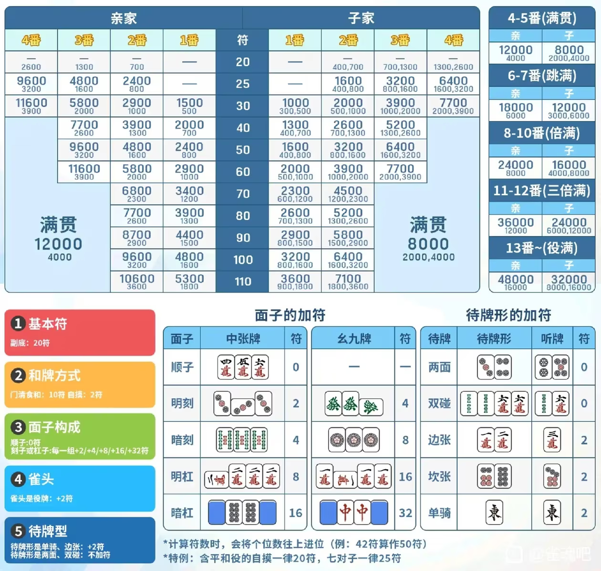

## 下卷

### 序言

下卷会介绍更进阶的麻将知识。除非另有说明，默认四人南东一局0本场，自己和对手都是子家，四家均持有25000点。

开始阅读下卷之前，建议做好以下准备：
- 认真读完上卷的所有内容。
- 熟悉麻将的所有规则。精确算点暂时除外，这个之后会教。
- 记住各个役的成立条件和番数。这个确实有点难，但我们之后会经常需要判断自己的手牌有多少番，所以这是免不了的。如果觉得一下子记住所有役太难，可以先从这些比较常见，但上卷没有要求掌握的役开始：平和、一杯口、一气通贯、三色同顺、三暗刻、混全带幺九。
- 能够观察简单的手役（和宝牌）。例如：
  - 34m2233367p23678s，有六组，应该拆23s，因为这样就能确定断幺九。
  - 1357m23478p56s333z，dora3m，应该切7m，这样就能保证用上宝牌3m。

上卷已经讲了麻将的很多方面，比如牌效率、安全度等等。但是，还有一个重要的概念我们没有认真讨论，那就是对打点的重视。银之间野猪太多了，你既没时间做大牌，也可能还没有这个意识。但是看看[雀魂牌谱屋的段位统计](https://amae-koromo.sapk.ch/statistics/data-by-rank)，雀圣3的平均打点有6482，平均铳点只有5452。如果你的平均打点只有5000多点，可不太够哦！

我们很重视能不能做到满贯。
- 在满贯以下，多一番往往意味着点数翻倍。如果增加1番能让点数翻倍，那么只要和牌率还能保留原来的一半以上，就是划算的。
- 达到满贯以后，多一番未必能增加点数，即使增加了，提升幅度也没有翻倍那么大。这时候，就更应该重视和牌率，不要过度贪番数。

那么，打点和和牌率到底怎么平衡？那就是比较不同选择的期待点数。我们可以用一个很粗略的方法比较：点数\*剩余待牌枚数。

例如11m344p555z/888m777z，dora1m，应该切3p还是4p？
- 切4p：留下34p两面，听25p。白、中、dora2，合计4番，满贯8000点。
- 切3p：留下1m4p双碰，增加对对和，合计6番，跳满12000点。

看起来跳满很诱人，但是双碰只有4枚待牌，两面却有8枚。待牌张数少了一半，点数却只增加到1.5倍。而且，1m是宝牌，4p是中张，都不太容易被别人打出来。这里应该切4p，选择两面满贯。

### 牌效率 - 一向听的类型

一向听有以下类型：
- 靠张（日语为くっつき）一向听：三个面子、一个雀头和两张浮牌。只要其中一张浮牌靠成搭子，就能听牌，但是容易形成愚形。
  - 例如2347m567p3789s33z，摸到56789m12345s或3z都能听牌，共有11种进张，听牌非常快：
    - 摸59m15s会留下坎张听牌。
    - 摸7m3s会留下双碰听牌。
    - 摸3z会留下单骑听牌。
    - 只有摸到68m24s才能留下两面听牌。
- 无头（日语为ヘッドレス）一向听：三个面子和两个搭子，没有雀头。这其实是很好的形状。
  - 例如234678m56p23789s：
    - 摸56p23s，可以形成雀头，留下两面听牌。
    - 摸47p14s，可以完成第四个面子，留下单骑听牌。因为单骑的改良很多，所以并不是特别差的听牌。
  - 如果面子里有暗刻，那就更棒了。如果最后形成三个顺子、一个暗刻和一个两面搭子，你就可以从暗刻中打掉一张，把剩下的对子作为雀头，直接两面听牌。既容易听牌，听牌形状又好，这真是太棒了。
  - 如果再加上组合形，进张就更多了。例如234m34567p45678s，摸到2345678p3456789s都能听牌。
- 两面子一向听：两个面子、两个搭子、一个雀头，再加一张浮牌。如果不需要改良，浮牌可以换成安全牌。
  - 例如23467m56p12388s3z，摸到58m47p才能听牌，有效牌比前面两类少了很多。
  - 如果两个搭子都是两面，那还算不错，至少听牌后能留下两面。但如果其中有坎张或边张，进张不仅会进一步减少，也可能会好形先完成最后留下愚形听牌。
- 完全一向听：在两个搭子都是两面的两面子一向听中，如果多余的那张浮牌恰好能与其中一个两面搭子组成两面对子，就形成了完全一向听。例如234677m56p12388s，在两面进张之外增加了7m8s双碰进张。无论摸到哪一种进张，都能留下两面听牌。

### 牌效率 - 双碰与坎张的二择

有时候，你会遇到类似113m77p这样的抉择：是打1m留下坎2m，还是打3m留下1m7p双碰？两边都是4枚进张，好纠结啊！要是打了3m，下一张就摸到2m，恐怕会当场红温吧！到底该怎么选？

- 不打算保持门前清时，优先选择双碰。双碰可以碰三家，坎张只能吃上家。算上自己摸牌的机会，双碰推进的机会大约是坎张的两倍。
- 保持门前清时，如果剩余枚数相同，待牌也差不多容易被打出来，比如37双碰和28坎张，那么双碰也略优于坎张。
  - 中张对子有不错的两面改良。例如55m摸到4m或6m，就能拆掉一张5m，留下45m或56m两面。
  - 双碰还可能恰好变成NC牌，更容易和到。

考虑到役种的抉择时：
- 如果其中一种选择能增加2番役，优先选择有役的那一边。
 - 123456799m23499s，打9m，听8m，可以获得一气通贯。
  - 123m113678p12388s，打1p，听2p，可以获得三色同顺。
  - 44777m668p123666s，打8p，听4m6p双碰，自摸可以获得三暗刻。
- 如果只增加1番役，就要根据自己原本的番数，也就是役和宝牌的合计，判断是否值得为了点数牺牲和牌率。
  - 例如112234m45688p567s，没有其他役：
    - 打2m，留下1m8p双碰，需要立直才能荣和。
    - 打4m，留下边张3m，有一杯口，可以立直，也可以默听。
    - 1m8p双碰比边张3m更容易和到。而且，你自己已经用掉了一张3m，边张只剩3枚了。为了多这一番一杯口，值得牺牲这么多和牌机会吗？这就要看宝牌有几张了。
  - 3张宝牌：
    - 双碰立直：推荐。
    - 边张立直：不推荐。双碰立直和边张立直打点都是8000点，选择边张立直纯吃亏。
    - 边张默听：也可以。一杯口加3张宝牌，默听荣和也是8000点。不过，3m这种中张牌，即使别人不知道你听牌，也不太容易被打出来，默听的和牌率未必有多高。再说了，手里有3张宝牌，你不会舍得弃和的。既然如此，不如干脆选择双碰立直，还能通过立直的威慑，压制其他对手做牌。
  - 2张宝牌：
    - 双碰立直：推荐。
    - 边张立直：不推荐。双碰立直是5200点，边张立直能把打点提升到8000点，但提升幅度已经小于翻倍。但是这里选择边张立直的和率损失挺大的，不推荐。
    - 边张默听：也可以。如果对手做牌很快，可能会未来顶着你的立直对攻，这是一个不错的选择。如果对手做牌速度没有那么快，还是更推荐立直来压制对手做牌。
  - 没有宝牌：
    - 双碰立直：推荐。
    - 边张立直：不推荐。双碰立直1300点，增加一杯口后，荣和是2600点。打点确实翻倍了，但仍然很低。一旦别人追立（他们的期待点数是明显大于2600的），拿着这种难和的小牌，又不能弃和，这可真是叫天天不应，叫地地不灵！不过，巡目特别早时，也不是完全不能选择边张立直来压制对手。
    - 边张默听：也可以。对手进攻时可以及时弃和。
  - 1张宝牌：
    - 这是唯一推荐边张立直的情况。一杯口、立直、宝牌合计3番，荣和是5200点。相比有更多宝牌时，增加一番的收益没有被满贯上限压缩。相比没有宝牌时，打点也已经有信心和未来可能的对手对攻。如果运气好有偶然役，加上自摸就有7900点，如果有一发或者中一张里宝就能满贯，那可真是太棒了。

#### 打点与和牌率取舍的基本思路

这个分析也太麻烦了吧！实战就那么几秒，我怎么可能现场想明白？所以，读这一段的重点不是记住每一种情况该怎么选，而是理解背后的思路：
- 打点还没有接近满贯时，增加1番一般能让点数翻倍。只要打点提升足以弥补和牌率的下降，就可以考虑牺牲一些听牌速度来争取加番。
- 达到满贯后，增加1番对点数的提高有限。这时应该更重视和牌率，不要无脑贪加番。
- 小牌要小心之后被别人追立。待牌好，可以争取靠速度抢先和牌。待牌不好，则要多考虑保留防守的余地。不要为了做一手小牌，随便大量吃碰，或者用很难和的待牌立直，最后自己牌又小，和牌又难，还没有办法弃和，那可就难受了。早巡可以适当放宽标准，因为早巡立直能有效压制对手做牌。
- 3番40符的5200点，是一个值得注意的分界线。从这里开始，由于满贯上限，再增加1番，点数就不再翻倍，因此，为了加番而牺牲和牌率，就未必那么划算了。这就是为什么点数计算很重要！我们之后会学的哦。

这些思路，之后还会反复用到。下一部分会讲两个副露一番役：役牌和断幺九。至于值不值得为了平和、一杯口这样的一番门清役牺牲一些和牌率，甚至广义上的078搭子何切（到底是打掉红5留下两面，还是打掉8留下坎张、多拿一番），我就不再单开章节了。他们的取舍原则还是上面四条。

实战中，可以按以下法则粗略估算不同选择对和牌率的影响：
- 吃牌速度×2，碰牌速度×4；
- 和牌率与剩余待牌枚数成正比；
- 19牌、28数牌、37数牌，456数牌的和牌率之比约为1.7∶1.3∶1.2∶1。该标准参考了[《一姫でもわかる現代麻雀技術論》](https://jantama.sinoa.ws/blog/?p=5519)。仅考虑中盘立直、待牌未被打出且为无筋的单骑听牌。

再用和牌率\*点数，比较一下哪个选择更划算就行了。

### 牌效率 - 断幺九和役牌

断幺九和役牌都是可以副露的一番役，因此放在一起讲。这里仅讨论副露后只靠食断或役牌成役的情况；其他情况，按照上文的[四条原则](#打点与和牌率取舍的基本思路)取舍即可。

#### 鸣牌判断

役牌和断幺九，什么时候才该放弃门清选择鸣牌，不是很容易判断。牌太好了，舍不得放弃门清；牌太差了，鸣了也未必和得了，还不如多留些安全牌，为别人立直做好防守准备。那么，什么程度的牌才值得鸣呢？我个人估算的参考是：6巡时处于两向听，9巡时处于一向听。到了第6巡仍是三向听，或第12巡仍是两向听，做牌进度已经明显落后，大概率会被别人抢先听牌。这时不宜鸣牌，应开始储备安全牌，为之后可能的弃和做准备。

牌形好，可以晚一点鸣，贪一下门清的打点；牌形不好，且鸣牌可以消除愚形，可以早一点鸣。

如果担心这只是我的一家之言，也可以参考ネマタ的《现代麻将技术论》，其中给出的判断标准与我的估算大致相近。
> [第97回](https://mj-news.net/column/method/2016010931450)讨论了搭子足够、副露后有役确定的两向听，其中以门前有断平潜力的牌为例，可以作为食断判断的参考：
>
> - 如果鸣牌能解决愚形，基本不受巡目限制。
> - 如果要鸣的是好形，可以参考下面的鸣牌分界点：
>
> | 完成一个两面后的一向听形状 | 一向听时的鸣牌分界点 | 两向听时的鸣牌分界点 |
> |---|---:|---:|
> | 完全一向听 | 第11巡左右 | 第8巡左右 |
> | 两面×2的一向听 | 第9巡左右 | 第6巡左右 |
>
> [第107回](https://mj-news.net/column/method/2016011932020)讨论了可能留下片和的情况。以没有宝牌、搭子足够的两向听为例：
>
> - 役牌后付，除役牌对子外都是好形：第6巡左右开始鸣。
> - 食断还保留23这样的搭子，可能留下只有4有役、1无役的片和：第8巡左右开始鸣。

除了向听数，鸣牌判断还有其他影响因素。

- 打点：比如你有门清断幺九平和的机会，副露会损失立直和平和，共2番。宝牌数量不同，这个损失的意义也不同：

| 宝牌数量 | 鸣牌时的打点 | 立直时的打点 | 评价 |
|---|---:|---:|---|
| 0张 | 1000 | 3900 | 如果手牌不够好，但又很想屁和截和，也可以放弃普通立直的打点，换取一手又小又快的牌。尽管吃上家和牌速度差不多\*2，点数只剩原来的1/4，期待收益会下降，但为了抢先和牌，也可以接受。|
| 1张 | 2000 | 8000 | 不推荐吃。你损失了满贯的机会。鸣牌优先级排第四。|
| 2张 | 3900 | 8000 | 如果牌不够好，比如前面说的6巡两向听、9巡一向听，就可以考虑鸣牌。毕竟3900点的打点也还行。鸣牌优先级排第二。 |
| 3张 | 8000 | 12000 | 吃上家和牌速度差不多\*2，点数只是变成了原来的2/3，值得积极鸣牌，哪怕是序盘也可以。鸣牌优先级排第一。 |

- 对手的速度：
  - 比如在第8巡，对手的牌河是2z1z1p9p6z2m9s7z，一直在打幺九牌，最近才开始打28，说明手牌可能比较慢，自己没必要急着副露。
  - 反过来，在第8巡，如果三家的牌河分别是9s6z2m4m7s8p7m4s、2z1z1s8p6p5z、5z1s8s9m6p3m4p5z，打了很多中张，还有人副露了两次。副露家听牌了都不奇怪。如果自己还在一向听，要赶紧鸣牌听牌。

- 场况：如果All Last只要和出1000点，就能保住第一或逆转到第一，那就不必再追求打点，怎么快怎么来。

#### 食断

食断就是副露断幺九，它的优点是和牌快。

它的缺点是：
- 防守能力较弱，手里没有幺九牌。
- 对手也知道你不会听幺九牌，更容易缩小待牌范围。

达到上述推荐的鸣牌时机后，若满足以下条件之一，就可以考虑只靠食断成役：

- 一次副露就能听牌。这样还有足够的防御力。
- 算上断幺九，至少有3番打点。例如手里有dora2，有一些底气对攻立直。
- 好形听牌确定。即使对手知道你在做断幺九，好形仍有不错的自摸机会。就算之后有人立直，也有信心自己比对手先和牌。
- 自己是亲家。毕竟亲家不和牌，可能被自摸炸庄，未听流局还会丢掉庄位，亲家就是要积极地行动。

如果像铜之间新手一样，“吃喵！吃喵！吃喵！”，最后做成三副露愚形断幺九nomi听牌，突然有人立直，那就完蛋了。

#### 碰役牌

相比食断，仅靠碰役牌成役的好处是：
- 对手更难排除你的待牌。
- 手牌可以保留幺九牌，方便储备安全牌。

达到上述推荐的鸣牌时机后，若满足以下条件之一，就可以考虑只靠碰役牌成役：
- 好形听牌确定。
- 是亲家。以上两点和断幺九相同。
- 有dora。有宝牌。役牌手有dora1就可以更积极地碰，不必像前面的食断建议那样需要dora2为参考。因为役牌对子如果留作雀头，既没有断幺九，也没有平和，保持门清后的打点没有那么高。相比断幺九，碰役牌时放弃门清的代价更小。
- 有安全牌。例如手里有客风对子，方便之后弃和。所以，如果以上三条条件不满足，碰了役牌之后，不要随便碰掉最后一对客风。
  - 例如128m2377p3389s55z，形状一般，又没有安全牌，可能不碰白更好。不过，如果自己落后，或者自己是庄家，也可以鸣牌。
  - 这种情况下，可以采用“留下与向听数相同枚数的安全牌”的办法。例如碰白后，手牌变成12m2377p3389s2z/555z，目前是两向听。这个时候不要切2z，而是拆掉边张，把安全牌留下；摸到第二张安全牌，也同样留下。此后，手牌每前进一步，就打掉一张安全牌。这样至少可以避免自己还没听牌，别人却先立直，手里连一张安全牌都没有的情况。

1000点的副露手要谨慎。因为即使已经听牌，一旦需要打危险牌，就只能弃和。这种小牌的点数期待值是负的！因此，只在有明确目的时推荐使用：
- 截和大牌。
- 过庄，即让点数落后的庄家下庄，让他失去赚点数的优势。
- 局消化，即自己领先时尽快推进牌局，减少对手逆转的机会。
- All Last只需要和1000点牌。

#### 役牌后付

后付役牌是这样的：手里有役牌对子，但先吃碰其他部分，等之后碰出役牌，或者最后和到役牌，才有役和牌。这看上去很像铜之间纯新手不知道什么是役，瞎副露一通，最后发现只有役牌能和的菜比玩法。

不过有时候我们可以战术性后付。达到上述推荐的鸣牌时机后，若满足以下条件之一，就可以考虑役牌后付：
- 有dora2以上，特别想和；
- 自己是亲家。
- 有二手准备，役牌碰不出来也能转其他役。
  - 如577m357p34778s77z，能考虑断幺九；
  - 224m23p244555s55z，dora5s，能考虑234三色；
  - 11267778p222s66z，有转向对对和的可能。
- 急需的牌被打出来，错过就很难再摸到。如123446m4p5689s55z，dora8s，上家打出7s，就值得用89s吃。因为宝牌指示牌已经用掉了一张7s，眼前这张再放过去，剩下就只有两张了。虽然这么吃会暴露后付，但你的副露威胁度不算大，别人不至于把白扣死。

后付的防御力，其实也还行。如果役牌还没碰出，别人就先立直了，你可以拆掉役牌对子防守。立直家恰好拿着另外两张，双碰等你这张役牌的概率不大。

后付很容易被看出来。尤其自己是亲家，本来就很有威慑度，别人更可能扣住役牌不打。因此，能让副露看起来像断幺九，就尽量别主动暴露后付。例如亲家拿着2235m67p889s1166z，不要随便吃1m或7s。123m、789s一亮出来，迫于你庄家的威严，别人就不太会打役牌了。

面对别人的后付，晚巡要小心生张役牌。还要想一想：他为什么要后付？如果他的点数场况不至于急着和牌，那就要提防他是不是因为宝牌很多，所以特别想和牌。尤其在自己看不到多少宝牌时，宝牌在对手的手里的概率也就很大。

### 牌效率 - 三色同顺和一气通贯

三色同顺和一气通贯都是门前2番、副露后减为1番的顺子役。这里以三色同顺为例，讨论是否值得为了这2番牺牲牌效率；一气通贯的取舍思路基本相同，不再单独展开。混全带幺九虽然也是2番食下役，但和牌难度更高，因此另开一节讨论。

#### 门清时

先制听牌时，如123m123567p13499s，准备立直。应该切1s，留下25s两面，获得平和；还是切4s，留下坎2s，获得三色？

| 宝牌数 | 立直＋平和 | 立直＋三色 | 取舍 |
|---|---:|---:|---|
| 0张 | 2000点 | 5200点 | 选三色。打点提高到原来的2.6倍，待牌枚数只减少了一半。会算点数，就能发现如果这里多1番，点数竟然比翻倍多！|
| 1张 | 3900点 | 8000点 | 两种选择的期待得点差不多。早巡选择三色；晚巡选择两面。这正是在应用上卷讲过的原则：早巡重视好形和打点改良，晚巡则更重视速度。 |
| 2张 | 7700点 | 8000点 | 选平和。打点只差300点，没有必要把两面变成坎张。 |

一向听时，如3789m3789p229s333z，是靠张一向听，也有789三色的机会。如果不考虑役种，应该切9s，保留3m、3p两张中张浮牌。这样更容易听牌，也更容易留下好形。但如果切3m或3p，保留9s，之后摸到7s或8s，就能形成带三色的愚形听牌。取舍思路与前面的听牌例子相通：
- 没有宝牌时，主动做三色。
- 有1张宝牌时，两种选择的期待得点差不多，需要结合场况判断。
- 有2张及以上宝牌时，不用贪三色。

两向听时，如3789m3379p3559s33z，他的形状不好，同时隐约有789三色的机会。我们可以开始考虑鸣牌三色。假设最终都留下愚形，宝牌数量会影响我们更愿意走哪条路线：
| 宝牌数 | 不做三色，门清立直 | 门清立直三色 | 副露三色 | 取舍思路 |
|---|---|---|---|---|
| 0张 | 1300点 | 5200点 | 1000点 | 愚形立直nomi和愚形三色nomi都应尽量避免。他们和牌率低，打点也低。面对他人立直，这种副露小牌基本上不值得冒险切危险牌对攻，除非晚巡需要争取听牌料。如果自己已经立直，期待打点不如对手，待牌又差，连弃和都做不到，你不慌吗？选择门清三色，虽然很难听牌，但万一听牌，就有了对攻的底气；如果迟迟听不了，也可以弃和。反正这手牌大概率要走向弃和，为什么不给自己留一线做成大牌的生机？ |
| 1张 | 2600点 | 太慢了，大概率听不了牌，其他选项也没立直nomi那么糟糕，不考虑 | 2000点 | 更倾向于门清做牌，而不是副露三色。愚形2000点听牌的点数没有高到有底气一直对攻立直。门清立直还有一发、里宝牌和自摸的加番机会，其中凑到两番就能满贯，因此，对攻也有一定底气。这里的副露三色也达不到两倍速，因为最后可能留下片和。例如做234三色时，最后留下23搭子，就只能和4，不能和1。 |
| 2张 | 5200点 | 太慢了，不考虑 | 3900点 | 门清和副露都可以。如果这手牌是副露手，例如有容易碰出的宝牌对子，就选择副露三色；否则继续门清。 |
| 3张 | 8000点 | 太慢了，不考虑 | 7700点 | 已有3张宝牌，再有一个役就能接近满贯。我们这里只需要追求速度，不必再贪打点。这手牌门清推进困难，为了尽可能加快和牌，应该积极副露三色。|

#### 副露时

如果副露后已经有其他役，那么是否追求三色或一气，主要就是打点与速度的取舍，和前面讲过的[四条原则](#打点与和牌率取舍的基本思路)类似，不再展开。

如果副露后只能依靠三色或一气成役，最后可能是愚形听牌，或者可能留下片和（例如做345三色时，最后留下45两面，就只能和3，不能和6）。这就与役牌后付有相通之处了。因此，这里的鸣牌标准和前面讲过的[役牌后付](#役牌后付)的判断标准一致。

### 牌效率 - 混全带幺九

混全带幺九简称全带。这是个挺讨厌的役。它的和牌率比三色同顺和一气通贯低多了。首先，全带都是靠边的牌，和牌速度堪忧。其次，全带一定是愚形或者片和。全带还不能利用红5。所以，它字面上是2番役，实际上是个副露1番役，因为很难靠门清做到听牌。就算每天打，可能半年也遇不到一次门清全带的和牌。

如果是门清全带，相关决策可以参见门清三色同顺和一气通贯的思路。但是门清全带很罕见，我们这里只考虑副露。什么时候适合做副露全带？
- 有dora2以上，特别想和牌，但门清推进不顺，可以按照[上文鸣牌判断部分的标准](#鸣牌判断)考虑鸣牌。
- 自己是亲家，但门清推进不顺，可以按照[上文鸣牌判断部分的标准](#鸣牌判断)考虑鸣牌。
- 只要和牌就行。比如All Last，和了就是第一，那做副露全带nomi也行。一般情况下可别这么干啊！打点又低，又是愚形，面对立直我们是不敢打危险牌对攻的。
- 凑成满贯所缺的最后1番。大家应该经常通过鸣牌和出3900点吧？要是多一个役，打点就能接近翻倍，岂不美哉？主要有下面两种组合：
  - 役牌+宝牌2+混全带幺九。例如899m778p12499s/777z，dora9s。单纯按牌效率，最应该切1s，但这里应该切4s。这样只要摸进9p，基本上就能确定做成混全带幺九，把打点从3900点提高到接近满贯。如果没有宝牌，就切1s。毕竟，加上混全也只是把1000点提高到2000点，打点提升有限，不如保留摸5s形成两面的可能，让手牌更容易和。
  - 役牌+混一色+混全带幺九。例如357789p22z/333666z，切3p或7p都能听牌，该切哪张？答案是切3p。单看357p，左右对称，切3p和7p本来没有区别。但在这手牌里，保留7p，之后就有机会通过吃8p或9p，把手牌转换成混全带幺九。这样就能再加1番，把打点提高到接近满贯。

与役牌后付相比，下面两个条件就不能单独成为做全带的理由：
- 有二手准备。适合做混全带幺九的牌，没什么好的备用路线。真有更好的选择，你也不会想做全带了。
- 急需的牌被打出来。全带不仅是某一个搭子难完成，而是到处都难完成。每一张能进向听的牌都很急需（悲）。吃掉眼前这一张，剩下的手牌还是又乱又小。

### 牌效率 - 染手（续）

染手的基本原则，上卷已经讲过了。这里再介绍一些进阶技巧。

有些手牌可以正常做牌，同时保留染手的机会。核心思路是：大体按照正常牌效率推进，尽量不要损失太多进张，但可以留一些目标花色或者字牌的浮牌。如果它们恰好形成搭子或对子，就顺势转做混一色。
- 例如1167789m23s5z/777z，目前是一向听。如果听牌前先摸到白，形成白对子，就可以考虑拆掉23s，转做混一色，争取满贯。假设先摸到的是3s。按照普通牌效率，应该切白，留下233s，形成完全一向听，增加双碰进张。不过，这里该摸切3s，保留白。虽然暂时少了一些进张，但增加了摸到白后转做混一色的机会。

保留浮牌，等它形成搭子后再转向其他役种，这个思路不只适用于混一色，做其他役时也经常能用上。
- 例如3456788m3499p56s，如果听牌前先摸到258m，就可以拆掉99p，转做门清断幺九平和。
- 例如123m278p1235699s，如果先摸到1p或3p，就可以拆掉56s，转向纯全带幺九+三色同顺。

染手时，鸣牌可以比平时更积极。
- 为了拿进目标花色的牌。例如112567m29s55z/777z，乍看之下，值得鸣的只有13m和5z，但实际上，45678m也都可以吃。吃进万子，再打掉索子，就能让手牌进一步向混一色靠拢。
- 通过吃牌，创造新的两面搭子。这种技巧叫作“食延”（食い伸ばし）。例如4556用45吃7，留下56；2234用24吃3，留下23；6789用89吃7，留下67。

不过，以下情况不适合鸣牌：
- 鸣牌会让形状大幅变差。例如4556碰5，或者6789吃5。除非已经到了晚巡，只想争取形式听牌。
- 混一色nomi不要轻易碰掉手里的最后一对客风。例如3579m335z/123m444z，碰西虽然能大幅增加进张，但如果只有混一色2番，碰完就没有安全牌了。拿着一手2000点的牌，没法弃和，如果有人立直，你就没辙了。有1张宝牌时，就可以更积极地碰。副露混一色加宝牌共3番，再加上字牌明刻的符，荣和至少有3900点，已经值得争取和牌了。

### 牌效率 - 杠

这一部分先讨论加杠和大明杠的判断标准。暗杠放到最后单独讲，因为Yoteru[《只有上级者才知道的麻雀战术论》](https://www.bilibili.com/read/readlist/rl765906)没有分析暗杠（流汗），这部分只能自己琢磨，所以也不敢把标准说得太笃定。

明杠可以增加符数、翻开新的宝牌指示牌，还能多摸一张岭上牌。但是所有人都能享受到新的宝牌。尤其已经有人立直时，对方不仅能用杠宝牌，还能多看一张里宝牌指示牌。你凭什么觉得，这个杠对自己的帮助会比对方更大？

大明杠的标准比加杠更严格。因为大明杠相比加杠有两个额外的缺点：
- 消耗安全牌。手里有暗刻，遇到对手立直时，本来可以考虑拆掉防守。
- 暴露手牌意图。例如杠出役牌，别人就知道你不可能是断幺九。

加杠之前，碰牌早就已经做了这两件事，所以没有同样程度的额外损失。

暗杠不破坏门清，增加的符数也更多，因此收益比加杠更大，标准更松。

#### 听牌时

下面用一组简化的点数变化说明。假设原本是30符，开杠后提高到40符，而且恰好多了1番杠宝牌。

| 原有番数 | 不杠 | 杠后增加符数及1番宝牌 | 评价 |
|---|---:|---:|---|
| 1番 | 1000点 | 2600点 | 除非其他家基本都弃和了，否则不推荐。就算多中1番，也才2600点，杠宝牌对立直家的帮助更大。 |
| 2番 | 2000点 | 5200点 | 序盘可以考虑，中盘以后谨慎开杠。|
| 3番 | 3900点 | 8000点 | 杠喵！|
| 4番 | 7700点 | 8000点 | 谁杠谁傻。 |

大明杠的标准更严格，具体体现在：2番愚形听牌时，连序盘都不太推荐大明杠。因为2番愚形听牌，如果没有中到新增的杠宝牌，面对立直时，仍要弃和，你开杠就损失了安全牌。

#### 一向听时

一向听时，除了增加打点，补摸岭上牌还有机会让自己立刻听牌。

对于加杠：
- 1番：不推荐。自己还没听牌，杠宝牌对立直家的帮助更大。
- 2番：两面+两面，或者进张更多的一向听时，可以考虑。有效牌较多，补摸一张对速度的提升比较有用。
- 3番：两面+坎张，或者进张更多的一向听时，可以考虑。虽然听牌速度没有前一种那么好，但从3900点提升到满贯的收益很大，可以适当放宽要求。
- 4番：靠张一向听时，可以考虑。这时主要是为了多摸一次牌，尽快听牌。靠张一向听进张很多，补摸一张，有不小的机会直接听牌。进张更少的话，就没那么值得了。自己本来就接近满贯，何必帮大家翻宝牌呢？

一向听不推荐大明杠。唯一例外是3番靠张一向听，而且开杠能增加符数。大明杠就这么严格。

#### 两向听或更远时

除了序盘，两向听或更远时，不建议加杠或大明杠。自己做牌的进度落后于对手，不建议帮对手增加宝牌。

#### 暗杠

两向听或更远时，不推荐暗杠，免得帮别人翻宝牌。序盘的幺九牌暗杠才可以考虑。四张一样的中张牌，还可以看成一个面子+一张浮牌。直接杠掉，会损失和牌速度。

已经听牌，或者是两面+坎张及以上进张的一向听，可以考虑暗杠。当然，如果是4番，除非是进张很多的靠张一向听，想靠多摸一张尽快听牌，否则就别杠了。

### 牌效率 - 起手有两组役牌对子时的打法

起手有两组役牌对子，就应该以满贯为目标！

如果起手有两组不同的役牌对子，我们基本上都会把它们碰出来。如果只是顺着牌型直接和牌，没有宝牌，也没有复合其他役，最后大概就只有2番，2000点。你都有2番了，还能自由吃碰，推进速度也有了，那不得好好利用一下这个机会？再找2番，就能把打点从2000点提高到8000点，这可是4倍！单看和牌收益，只要和牌率还能保留原来的1/4以上，这笔交换就是赚的。

没有宝牌时，找一个2番役做。最常见的目标就是混一色或对对和。
- 2579m68p34s125577z，坚定地做万子混一色。
- 223m119p28s125577z，坚定地做对对和。切孤张也有顺序，这里先切3m。乍看之下，23m是手里唯一的两面搭子，拆掉可能有点舍不得。但既然已经决定做对对和，两面就没有那么重要了。我们更希望留下靠近两端的数牌，等它们形成对子，因为这些牌之后更容易碰到。而且，如果第一巡就打掉3m，2m就成了早巡外侧牌，别人会觉得它比较安全，更愿意打出来，这不正合我意吗？

有1张宝牌时，找一个1番役，或者正常做牌。
- 137m3799p124s5577z，可以做混全带幺九。这手牌已经有5组符合混全条件的block，别一不小心按普通牌效率把1s打了。
- 67m1335p46s125577z，如果有1张宝牌，就老老实实从打字牌开始，顺着牌型推进。正常做牌，就很有希望和出双役牌加宝牌1的3900点。混一色虽然能做到8000点，但要拆掉万子和索子的两个两面，和牌率恐怕连原来的一半都保不住，那就不划算了。

dora1，但是没能碰出2组役牌，还是要找2番役。
- 13m67s5577z/067m999m，应该拆掉67s两面，转做万子混一色，以役牌+混一色+赤宝牌1的满贯为目标。
- 405s25577z/111p888m，顺着牌型做，切南当然没有问题。之后摸到3s或6s，再切一张普通5s，就能听白、发双碰，荣和是2番40符、2600点。不过，这手牌值得争取的是双役牌+对对和+赤宝牌1的满贯。既然如此，不如现在就切4s，把索子固定成对子。南先留着，之后可以用于防守，同时提前处理掉比较危险的4s。既放弃了低打点的顺子路线，又给自己留了一张相对安全的牌。

当然，如果为了做役，和牌率损失大得不值当就不好了。
- 2467m223p56s25577z，如果没有宝牌，想做满贯，比较容易想到的是万子混一色。但筒子和索子都有两面，强行染手就得把它们拆掉，剩下的万子也没有好到值得这样牺牲。这个时候就别贪了，顺着牌型正常推进即可。

### 牌效率 - 点数计算的好处

学会点数计算的第一个好处，就是能够更好地兼顾速度与打点。同样是3番，3900点和5200点，可能会让你做出不同的决策。3900点增加1番，变成7700点，基本上翻倍；5200点增加1番，却会撞上满贯上限，只能提高到8000点。既然加番的收益不同，值得为此牺牲多少和牌率，自然也不同。例如：
- 222m078p234789s33z，dora3z。切0p立直，留下78p两面，3番40符，荣和5200点；切8p立直，留下07p坎张听6p，多保留1张赤宝牌，4番40符，满贯8000点。待牌枚数少了一半，点数却没有翻倍，不值得。
- 123m123567p13499s，dora7p。切1s立直，留下34s两面，听25s，立直、平和、宝牌1，3番30符，荣和3900点；切4s立直，留下13s坎张，听2s，立直、三色同顺、宝牌1，4番40符，满贯8000点。待牌枚数少了一半，点数翻了一倍。两种选择的期待得点差不多。早巡可以争取高打点，晚巡则应更重视和牌率。

学会点数计算的第二个好处，就是能够更好地判断点数场况。我到底要和多大的牌，才能逆转？反过来说，万一放铳，最多能放多大的牌，才不会掉顺位？先看看几个粗略的关系。以下自摸点数都指自己收到的总点数，暂时不考虑本场和立直棒：
- 直击要追赶的对手，点差缩小和牌点数的2倍。
- 荣和其他玩家，点差缩小和牌点数的1倍。
- 亲家自摸，与任意一家缩小的点差，大约是总得点的1.33倍。
- 子家自摸，与另一名子家缩小的点差，大约是总得点的1.25倍；与亲家则是1.5倍。
- 荒牌流局时，自己听牌、对手未听，最多可以缩小4000点差。
不过，麻将点数没有这么规整。到了All Last，差几百点就能决定名次时，你还是需要记住精确的点数。

### 牌效率 - 点数计算的方法

呃啊啊啊啊啊，该来的终于还是来了！

这一节默认你已经熟悉各个役种，能够自己算番。

#### 判断手牌符数

先看两个特例：
- 平和自摸：20符，结束。
- 七对子：25符，结束。

其他情况，从基础的20符开始，依次往上加。

1. 和牌方式：
- 门清荣和：+10符。
- 自摸：+2符。

2. 待牌：
- 单骑、坎张、边张：+2符。

3. 刻子和杠子：
- 每组分别计算。以中张数牌暗刻的4符为基础：幺九牌\*2，明刻或明杠/2，杠子\*4。荣和形成的刻子不是暗刻。

4. 雀头：
- 役牌雀头：+2符。
- 连风雀头：+4符。

最后向上取整到十位，例如42符算50符。

还有一个例外：副露后，如果按上面的方法算出来只有20符，按30符计算。20符只有平和自摸。

我vibe code了一个`Scripts/符数计算练习.py`脚本，希望对大家记住怎么算符有帮助。

#### 根据番符计算点数

这个表格也太大了吧！我怎么记得住？

其实可以少记很多。
- 达到满贯（子家8000点、亲家12000点）以后，就不用算符了。
- 70符及以上的情况很罕见，不用背。
- 符数翻倍，相当于增加1番。例如，2番50符和3番25符的点数相同。所以，50符、60符可以分别借用25符、30符高1番的点数；20符可以借用40符低1番的点数。

这样，就只剩下亲家、子家在25符、30符、40符时的荣和与自摸点数需要记忆了。至于剩下这些怎么记...我也没有什么好办法了，多练吧！

这是我背点数时发现的一些规律，大家看个乐子就好：
- 25符的点数很规整。记住子家2番25符荣和1600点，就能完全按照理论上的规律推进，没有奇怪的进位：
  - 加1番点数翻倍；
  - 亲家1.5倍；
  - 子家自摸时，其他子家付荣和点数的1/4，亲家付1/2；
  - 亲家自摸时，每家付荣和点数的1/3。
- 子家自摸加一番，原来的“亲支付”就变成新的“子支付”。例如40符：400／700 -> 700／1300 -> 1300／2600，可以少背几个数字。
- 同番同符，子家自摸时亲家付多少，亲家自摸就是多少all。例如子家自摸700／1300，对应亲家自摸1300all。
- 亲家40符荣和，等于子家30符多一番荣和。例如亲家3番40符和子家4番30符，都是7700点。

我vibe code了一个`Scripts/点数记忆练习.py`脚本，希望对大家记忆点数表有帮助。我个人的记忆顺序是，先记子家荣和，再记子家自摸，最后记亲家荣和。亲家自摸可以直接借用子家自摸时亲家的支付点数，不需要额外记忆。你可以打开脚本，自行设定练习范围。

符数计算和点数计算，各练上半小时到一小时，大概就能学会了，但是恐怕会算得很慢。没办法，熟练度就是要花时间练的。人生中有那么多事情，我们不可能每一件都练得很熟。麻将只是个爱好，不想把重复练习的时间花在麻将上，一点问题也没有。

### 牌效率 - 复杂的多面听

最难计算听牌形的，大概就是门清清一色了。一整排同花色的牌，根本搞不懂自己在听什么。到了没有听牌便捷提示的王座间和天凤，或者线下麻将，我们该怎么办啊！

把牌形拆成几个复合形，就更容易看懂了。下面列出一些例子，不要求全部背下来，记住其中标有名称的7张形就够了。更复杂的形状，先认真读一遍，理解拆解思路，实战中遇到一个记住一个就好。拆解时，最根本的思路是，暗刻既可以看作一个面子，也可以拆成一个对子和一张单牌。

顺子多面听：
- 四连+顺子，如1234567听147：1234/567；123/4567。
- 四连+刻子，如2223456听36147：22/23456；222/3456。
- 亚两面+顺子，如4566789听369：4566/789；456/6789。
- 亚两面+刻子，如1112234听253：111/2234；11/123/24。
- 中膨形+刻子，如3334556听475：333/456/5；33/345/56。
- 八连形，如12345678听369：123/45678。
- 23445566听147：23/445566；234/456/56。
- 1112346789听695：111/234/6789；11/123/46/789。
- 2234456777听253：2234/456/777；24/234/567/77。
- 12223334听14：123/23/234。
- 1112345678听258369：111/2345678；11/12345678。
- 1112345666678p听12345789p：除了6p，其他筒子全都能和。

双碰多面听：
- 二三二形，如2233344听243：223344/3；333/2244。
- 二二三形，如2233444听1423：23/234/44；2233/444；234234/4。
- 烟囱形，如23444m11z听14m1z：234m/44m11z；23m/444m/11z。
- 2233445566听2356：2233/445566；223344/5566。
- 44556677m11z听47m1z：445566m/77m11z；556677m/44m11z。
- 44455566p11z听6p1z3p：444555p/66p11z；456456p/11z/45p。

螺丝形多面听：
- 螺丝形组合1，如3334555听25364：333/4555；3334/555。
- 螺丝形组合2，如3335777听456：3335/777；333/5777。
- 螺丝形组合3，如6777888听5867：6777/888；777/6888。
- 螺丝形+四连形，如2333456听1247：2333/456；23456/33。
- 有根复合形（四川麻将把四张相同的牌称为“根”，所以我借用了这个说法，给这个形状起了这个名字），如2233334听1245：2333/234；22/333/34。
- 1113456888听3627：111/3456/888；111/345/6888；1113/456/888。
- 2223456777p777z听12345678p：有点像九莲宝灯，除了9p，其他筒子全都能和。

我vibe code了一个练习脚本`Scripts/多面听练习.py`，我觉得很适合帮助你记住这些复杂的多面听。

清一色给你13张牌，问听什么，就已经够头昏脑涨了；要是给14张，问切哪张待牌最多，那就更要命了。打2听什么？打4呢？打5呢？打6呢？每种打法都重新算一遍，你会累死的！雀魂切一次牌最多用25秒，哪有时间挨个试？如果一时算不清切哪张最好，思考时间又快用完了，我该怎么办？

所以，如果手牌很不好分解，我会先看看手里有没有值得保留的役。比如我看到了一气通贯，那么组成一气通贯的那8-9张牌就先不考虑打了，只看剩下的牌。这样选项一下子就少了很多。以下我的一些思考案例：
- 23444566777888p：因为有三暗刻，我不会打478p。再看566p，因为周围的4p和7p自己都用了三张，这个形状的发展不太好，所以决定打5p，留下14p两面。决定打5p之后，手牌剩下2344466777888p，再仔细看看，我们也可以把手牌分解成234/44/678678/78，原来原来还听69p！最后是1469p四面听。
- 12345567788899m：我看到了一杯口和一气通贯，组成它们的1234679m就暂时不动，剩下5m和8m可以考虑。8m自己已经拿了三张，单骑只剩一枚，太少了；那就打8m，单骑5m吧。但是单骑5m有点难和。而且为了保住一气通贯，你不能做出类似2234的亚两面单骑改良，你只能期待换听，这个概率有点低。既然保住所有役不好和，就看看能不能放弃一点打点。舍弃一杯口吧，打7m还是9m呢？打9m更好。打掉9m，手牌分解成123/45/567/789/88，不仅有平和，摸到6m还能保留一气通贯。
- 11355666788999s：这手牌还没有听牌。一气通贯还缺2s和4s，太远了，不要幻想了。7s可以参与很多顺子，还有做一杯口的机会，不打。158s有机会形成三暗刻，也不打。所以我的决定是打3s。[Mahjong Nanikiru Simulator](https://pystyle.info/apps/mahjong-nanikiru-simulator/)的模拟结果是打6s最好，打3s第二好。虽然没选到最优解，但这样想很省事。打3s的听牌率、和牌率不高，但是期待得点挺高的。
- 11223334566899m：先保留一杯口，112233m暂时不动，只看剩下的34566899m。打8m，听69m双碰。打9m，听边7m。打6m，听坎7m。打3m，也是听坎7m。因为双碰优于坎张，就打8m吧。[Mahjong Nanikiru Simulator](https://pystyle.info/apps/mahjong-nanikiru-simulator/)的模拟结果确实是打8m最好。

所以，遇到很不好分解的牌，我的办法是：
- 先看役，排除一些不考虑打的牌，再算剩下几个选择。如果听牌形不错，就可以结束了，不必非要把所有打法都算完。
- 如果不满意，就试着放弃一个小役，重新看看。也别忘了找找平和。我觉得清一色里最难看出来的就是平和！
- 选好以后，再检查有没有振听，自己打过的同花色牌，有没有哪张能和？
- 最后把所有待牌找全。

我的方法绝对不是理论上最好的办法。门清清一色已经有6番了，我知道最好的选择是找到待牌最多的选择，而不是继续贪加番。但问题是，实战就那么几秒，我真的算不明白啊！职业玩家可能会狂刷门清清一色何切，把各种多面听练到一眼就能认出来。但我们还有自己的生活，打麻将只是个爱好，何苦呢！能在时间限制内找到一个打点和听牌都不错的选择，我已经很满意了。

如果一个人一直在打其他花色，临到立直前突然开始大长考，你大概能猜到，这家伙不会是在算清一色吧！为了及时算完，也避免把染手的意图暴露得这么明显，最好一边做牌，一边想可能留下什么形状。别在染手时只顾着扔掉不要的牌，别的啥也不想，等到终于听牌了，才从头开始算。

### 牌效率 - 振听两面

到了听牌阶段，应该选择振听两面，还是坎张听牌？例如406888m235p12388s，之前打过1p。究竟要振听的14p两面，还是可以荣和的坎4p？难道真的要选振听吗？

振听是大家很害怕的东西。不过到了高段位，大家防守能力都很好，立直后想荣和也没那么容易了。所以，振听竟然也没有那么可怕。看看这份[凤凰桌的统计](https://note.com/nifty_yak8361/n/n7183db1d924f)，虽然你能荣和三家，但荣和率远远不到自摸率的三倍：
| 指标 | 子家 | 亲家 |
|---|---:|---:|
| 立直后和牌率 | 50.10% | 48.52% |
| 立直后荣和率 | 26.12% | 22.91% |
| 立直后自摸率 | 23.97% | 25.60% |

一般认为，坎张的和牌率略高于振听两面。但如果保持门清，振听两面立直一旦和牌，就一定有门前清自摸和，多一番。因此，一般选振听两面。想不到吧！

那么，什么时候选择坎4p？
- 两种听牌的剩余张数相差不大时。比如场上已经有人碰出了1p，请选择坎4p。
- 只需要和牌率时。比如All Last大Top，只想赶紧结束比赛。
- 荣和率较高时。比如自己的牌河是3z4z1p8s9m7p，4p是两筋；如果场上其他已经确认安全的牌又比较少，别人就很可能打出4p，坎张的和牌率会明显提高。
- 不是门清时。没有门前清自摸和的加成，振听两面就没什么优势了。坎张也也方便之后改良。35p摸到6p，就能改听47p。
  - 例外是荣和率特别低时。例如356p77z/789p111666z，谁都看得出这是混一色满贯，筒子大概都会扣着不打，你几乎只能靠自摸。这时振听的损失不大，两面却有更多张数，就可以选振听两面。当然，如果已经有人立直，扣不了牌，还是选择坎4p更好。

那么，在听牌之前，应该如何处理振听两面搭子？
- 两向听或更远时，优先保留振听两面，而不是愚形搭子。因为后续还有很多摸牌机会，可以解决振听问题。例如45888m2378p23468s，之前打过1p，应该拆68s。之后摸到1234p，都有机会解决振听。哪怕不幸留到了最后，振听两面立直也没有大家想象中那么差。
- 一向听时：
  - 门清手保留振听两面。例如12305m12379p3478s，dora3z，之前打过2s，应该打9p。这手牌副露后没有役，必须保持门清。既然准备立直，就更希望留下振听两面，而不是坎张。而且，如果听牌前先摸到2s或5s，就能直接完成这个搭子，连振听的问题也一起解决了。
  - 副露手保留能够荣和的坎张。例如12305m79p3478s777z，dora5m，之前打过2s，应该拆34s。这手牌有中暗刻，本身就有役；手里还有3张宝牌，即使副露也能达到满贯，应该积极鸣牌。这时振听两面就没有优势了。

### 牌效率 - 荣和赌里，还是见逃等自摸

All Last，距离逆转条件还差1番，别人打出了铳牌，我该直接荣和赌里宝，还是见逃等自摸？例如，All Last，Top坐庄，自己落后7500点，和第三名点差很大，不用担心掉到三位。那么，这一局就集中精力争取逆一吧。自己的逆转条件是：荣和其他子家7900、自摸1300/2600，或者直击Top3900点。现在手里是立直、平和、dora1，荣和3900点。如果自摸或者直击Top，那当然直接和，没什么好纠结的。问题是，如果另外两家打出了铳牌，我该不该和？直接荣和，只要中1枚里宝牌，就能逆一。见逃后陷入振听，则可以保证如果和牌，一定能自摸逆转。

赌里宝不是什么丢人的事情。有些人会说：“不要依赖里宝这种偶然因素，要见逃，瞄准能够确定逆转的自摸。”但难道自摸就不是运气了？我们应该比较的是：现在荣和中里的概率，和见逃后最终自摸的概率，哪个更高？

一般来说，应该直接荣和赌中里。只有特别有利的情况，例如4巡以内的超早巡，或者三面听以上的超好形，才更值得考虑见逃等自摸。原因分析如下。

先看一个简化模型：假设两面待牌还剩8张，未知牌有136张，自己能够一路摸到流局，中间没有其他人和牌。那么，不同剩余摸牌次数对应的自摸概率如下：

| 剩余自摸次数 | 16 | 15 | 14 | 13 | 12 | 11 | 10 | 9 | 8 | 7 | 6 | 5 | 4 | 3 | 2 | 1 |
|---|---|---|---|---|---|---|---|---|---|---|---|---|---|---|---|---|
| 自摸概率 | 62.09% | 59.72% | 57.20% | 54.53% | 51.69% | 48.67% | 45.46% | 42.05% | 38.43% | 34.58% | 30.49% | 26.15% | 21.53% | 16.63% | 11.42% | 5.88% |

再看中里的概率。只考虑一张里宝牌指示牌时，手里不同种类的牌越多，越容易中里；重复的牌越多，中里的机会就越少。可以用一个非常粗略的公式估计：$P(\text{中里})\approx\frac{4n}{136}$。其中，$n$是和牌时手里不同牌的种类数。例如：
- 基本没有重复的牌，如123m45699p123567s，有13种牌，约38%。
- 有一些重复的牌，如344556m456p78999s，有10种牌，约29%。
- 七对子，如224477m5588p33s22z，有7种牌，约21%。

那么，假设自己的中里率约为38%，还剩10次摸牌，表里的自摸率却有45%。这是不是说明应该见逃？还是应该赌中里。因为表里的45%，建立在你能够一直摸到最后的前提上。实战中，其他三家也在做牌，大概率轮不到你摸完这10次。荣和至少能保住素点，见逃之后还有可能放铳呢。

### 牌效率 - 里宝牌效率

里宝牌效率理论可以：
- 让自己和牌时，更容易中里宝牌。
- 万一自己放铳，让对手更不容易中里宝牌。

这还能控制的吗？还真能稍微控制一点。

#### 让自己更容易中里

例如4099m1234456p234s，准备立直，听36m。这手牌有立直、平和、赤宝牌1，荣和3900点。那么，切哪张牌立直，更容易中里呢？如果只考虑里宝牌效率，应该切4p。因为只要中1张里，打点就能提高到7700点，已经接近满贯；中2张里则是8000点，只多了300点。我们很想中里，但没有那么需要一次中两张。切4p以后，虽然少了4p中里时一次加2番的机会，却多了1p中里的机会。既然中1张就已经很够用了，不如增加命中的范围。

再如4099m34556p234789s，切3p或6p，都能听36m。如果只考虑里宝牌效率，应该切6p，留下345p。为什么呢？如果3p是里宝牌，指示牌就是2p，而自己手里没有2p。如果6p是里宝牌，指示牌就是5p，自己却已经拿着两张5p了。这些5p在你手里，就更不可能躺在里宝牌指示牌的位置。因此，保留3p，比保留6p稍微更容易中里。

#### 让对手更不容易中里

如果自己已经副露，不能立直，就可以反过来想：万一之后放铳，我希望对手别中里。

例如自己已经碰了中，目前是一向听，需要在白和发之间切一张。假设白和发都已经被打出过一张，其他条件也没有明显区别，那么可以先切发，把白留下。因为白的指示牌是中，而你已经碰出了三张中，能成为里宝牌指示牌的中只剩最后一张。相比之下，发的指示牌是白，目前能看见的白只有两张：自己手里一张，牌河里一张。

所以，白比发更不容易成为里宝牌。先把发处理掉，之后万一需要打出留下的白，而且不幸放铳，至少这张白给对手加里宝牌的机会小一些。

#### 警告

里宝牌效率只能用来处理其他条件几乎完全相同的选择。任何其他因素都比里宝牌效率重要。

所以，回到前面两手牌，实战中反而推荐：
- 4099m1234456p234s，切1p立直。
- 4099m34556p234789s，切3p立直。

第一手如果切4p，会让17p成为筋牌；第二手如果切6p，会让39p成为筋牌。你给对手提供了更多相对安全的选择，他们就更少需要冒险打出你的和牌张。

所以这个技巧知道就好。真正轮到里宝牌效率决定舍牌的情况恐怕一年也用不上几次。

### 防守 - 自己听牌时的攻守判断

对手立直时，如果自己还在两向听或更远，基本毫无疑问，该弃和了。那么，如果自己已经听牌，或者处于一向听，到底该怎么选？我们开始吧。我们这部分先讨论：面对一家立直，自己已经听牌，应该继续对攻，还是弃和？

已经听牌时，进攻比你想象中更值得。继续进攻确实会增加放铳风险，但自己也有了和牌的机会。和牌不仅能得点，还能截和对手，阻止之后可能发生的失分。反过来，弃和也是有确定的损失的：
- 可能会被自摸。
- 流局时会支付罚符。
- 如果有人追立，可能找不到共同安牌。

如果是好形听牌，自己的和牌机会并不比对手差多少，即使采取全力进攻的策略，也大概是划算的。不要因为自己点数小，就不敢对攻。

这里只考虑局收支。如果场况影响特别明显，如All Last，不放铳就能保住第一，那当然没必要用好形小牌截和。

已经听牌时，面对一家立直，可以参考下面的粗略标准：

| 自己与对手的关系 | 手牌情况 | 判断 |
|---|---|---|
| 自己是子家，对手是子家 | 愚形、1番 | 弃和 |
| 同上 | 愚形、2番 | 进攻或弃和均可。考虑到雀魂四位惩罚较重，如果没有追分需求，可以偏向弃和。 |
| 同上 | 其他听牌情况 | 一般进攻 |
| 自己是庄家 | 已经听牌 | 一般进攻 |
| 自己是子家，对手是庄家 | 愚形、2番及以下 | 弃和 |
| 同上 | 其他听牌情况 | 一般进攻 |

保持好形听牌很重要。例如34m678s55z/222p111z，只有东这一个役，但因为是两面听牌，仍值得继续进攻。假设3m是现物，之后摸到了无筋6m，也不要因为害怕就打3m，退成坎张。仍应切6m，保留34m两面。

根据《「統計学」のマージャン戦術》英译本 [Statistical Mahjong Strategy](https://files.catbox.moe/ofyysq.pdf) 第45—46页的统计，不同条件下的平均打点如下：

| 类别 | 子家荣和均点 | 子家自摸均点 | 子家自摸占比 | 庄家荣和均点 | 庄家自摸均点 | 庄家自摸占比 |
|---|---:|---:|---:|---:|---:|---:|
| 全部和牌 | 4300 | 5800 | 39% | 6400 | 8600 | 43% |
| 立直一发 | 7600 | 9400 | 49% | 10900 | 13700 | 53% |
| 立直非一发 | 5300 | 7000 | 49% | 7500 | 10000 | 54% |
| 副露混一色 | 6600 | 7200 | 37% | 9600 | 10400 | 41% |
| 副露对对和 | 7300 | 8900 | 35% | 10500 | 12900 | 38% |
| 副露断幺九 | 3200 | 3700 | 34% | 4700 | 5300 | 36% |
| 副露役牌（排除混一色） | 2800 | 3400 | 32% | 4500 | 5300 | 36% |

对照这张表，就更能体会前面的攻守标准有多积极。例如副露愚形3番，点数低于子家非一发立直的平均荣和打点，但仍然值得对攻。

### 防守 - 自己一向听时的攻守判断

面对一家立直，自己还在一向听时，攻守判断要比听牌时保守很多。因为你还得先听牌，再和牌；在这期间，可能需要多打出几张危险牌。相比已经听牌，和牌机会更少，放铳风险更高。

可以采用这套简化标准：
- 2番及以下：弃和。
- 第10巡或更晚：弃和。一向听还要经过“听牌->和牌”两步，剩余摸牌机会不多的话，就很难赶上了。
- 如果以上条件满足：
  - 无头或靠张一向听：进张多，听牌快，可以进攻。
  - 两面子一向听：剩下的两个搭子必须都是好形。这样虽然进张不算特别多，但无论哪组先完成，都能留下好形听牌。例外是你有很多压倒性的其他因素，比如说序盘、一好一愚两面子一向听、dora3这样极端的情况，才可以进攻。

### 防守 - 面对鸣牌的攻守判断

上卷[讲过](#通过副露次数判断听牌)，可以按副露次数和巡目，把听牌概率分成三档：
- 高：3副露，或者末盘2副露。
- 中：末盘1副露，或者中盘2副露，听牌率约50%。
- 低：中盘1副露，或者序盘2副露。
- 序盘1副露可以无视。

然后估计打点。除了看役、宝牌，以及自己准备打出的牌放铳后会不会增加对方的打点，还要看已经能看到多少宝牌。如果宝牌已经看到了很多，对方大概就没有额外的宝牌了。如果还有很多宝牌和赤宝牌没出现，而且副露家容易用上，就先按他可能持有其中1张左右估计。

根据这些信息，把打点分成三档：
- 高：确定或很可能达到4番以上，例如dora3、目标花色包含宝牌的混一色等。
- 中：3番。
- 低：2番及以下。

接下来按以下标准判断：
- 高打点+高听牌概率：
  - 自己听牌时，按面对立直的标准判断；未听牌则弃和。
- 高打点+中听牌概率，或中打点+高听牌概率：
  - 双方都是子家：听牌一般进攻；一向听时按面对立直的标准判断。
  - 自己是亲家：两向听或更远时弃和；一向听愚形且低打点，也弃和。
  - 对方是亲家：按面对子家立直的标准判断。
- 高打点+低听牌概率，或中打点+中听牌概率：
  - 双方都是子家：两向听或更远时弃和；一向听愚形且低打点，也弃和。
  - 自己是亲家：两向听或更远时弃和。
  - 对方是亲家：听牌一般进攻；一向听时按面对立直的标准判断
- 低打点+高听牌概率：
  - 两向听或更远时弃和。
- 其他情况：
  - 在末盘，且自己还在两向听或更远时弃和。

文中攻守判断的这三部分参考了ネマタ的以下文章：
- [链接一](https://note.com/nemata3939/n/nfa2641c68c94)
- [链接二](https://note.com/nemata3939/n/n75597ef53793)
- [链接三](https://note.com/nemata3939/n/n6c1bc51a9dfd)

### 防守 - 兜牌

兜牌是完全弃和和完全进攻之间的一个战略，也就是在保持听牌，或者至少一向听的情况下，选择更安全的牌打出。

- 比如说你有577m233456p678s66z，假如我们不想拆面子，我们可以打发，去做门清断幺。
- 比如，你已经听牌，亲家立直后，在一发巡内（放铳会加1番），你却摸到一张生张无筋红5，你恐怕不敢打吧！这时可以退回一向听，然后祈祷自己之后能摸到2346，这样就能重新听牌了。到了尾巡，也可以通过副露做成无役听牌，至少还能吃到罚符。

兜牌可以参考以下标准：
- 已经听牌时，不建议为了兜牌，把好形退成愚形。应继续进攻。因为和率高了，铳率自然就低了。
- 两向听或更远时，弃和。
- 一向听只有2番及以下时，弃和。
- 如果兜牌留下的浮牌的靠张机会很少，也不适合兜牌。例如45m9m2678p23488s33z，兜了以后也没多少变化。兜牌的关键，是让暂时打不出去的浮牌靠成搭子，重新推进手牌。但如果留下的是1289这样的浮牌，靠张能力不好，兜下去也很难提高和牌率。这时要么选择全攻要么全弃，但不适合兜。

### 结语

掌握上下卷的内容后，可以把MAKA评分稳定在S−或S作为目标。不过，偶尔分低得离谱，比如只有B+，也不一定是你傻透了。有时只是某个路线选择和MAKA不同，结果扣了很多巡的分。例如，你想保持门清，MAKA却建议转做食断；你迟迟不切幺九牌，后面几巡就会一直被扣分。这有点像考试第一问算错了一个数，后面沿用这个结果，最后被扣得很惨。

随着学习深入，需要考虑的因素会越来越多，麻将会越来越烧脑。因此，要把思考分散到每一巡，分散到其他玩家思考的时间。我们拿到牌之后就可以马上开始思考可能的役种、番符和最终听牌。这样，临近听牌时就不用在25秒内从头分析了。

实战时，不必一次性兼顾全书的所有内容。先做好已经掌握的部分，再集中练习一个重点即可。例如，想练习攻守判断，就暂时不必纠结其他方面的失误；遇到相关抉择，如果自己不太确定，就截图保存。对局结束后用AI复盘，先检查那些明明知道该怎么打，却一时犯蠢打错的地方，然后再跳转到这些关键位置，比较自己的判断与AI的建议。下卷的知识很难看一次就记住，需要反复练习。练习时，我推荐整理错题本。实战中也请把那5秒用足。给你的时间，不用白不用，和考试一样（摊手）。

学到这里，麻将教材你基本上应该都能看懂了，但阅读不是多多益善的。读完上下卷，主要的理论框架你已经都了解了。遇到具体问题，善用AI辅助搜索即可。更何况，很多资料的教学质量并不好：
- 很多资料只会罗列各个选项的收益和损失，最后来一句“根据情况而定”。这谁不会啊？
- 大部分何切题也有类似的问题。他们的讲解只是给出作者自己的取舍，不解释背后的判断标准，也不提供足够的证据，凭什么让人相信这个答案就是对的？
- 更糟糕的是，有人喜欢训学生。比如说：“来，你告诉我立直的收益和损失是什么？那你为什么这种牌还立直？”学生能背出收益和损失，和能在实战中熟练应用，差得还很远。不能因为学生犯了错误，就用反问羞辱他。这种人打牌水平可能不错，但这样的教学，越看越生气。

之后如果还想看书，可以看看[这位B站博主翻译的麻将书籍](https://space.bilibili.com/4067381/upload/opus)。

下卷涉及较多主观判断，因此我会持续将书中的分析与AI的建议对照，不断修正和完善。
